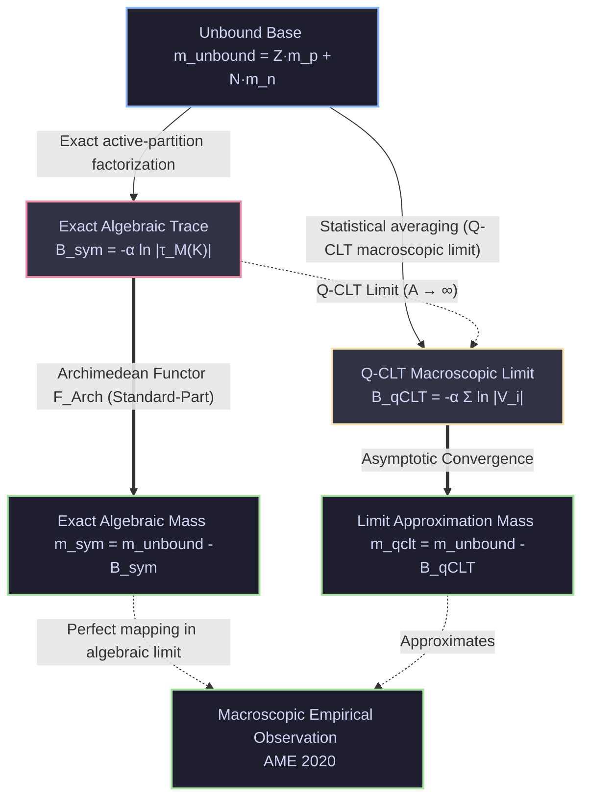

<!-- FILE_START: algebraic-core-survives.md -->
We present this survey to justify our central move: we may take the substrate parameter $q \in \mathbf{No}$ in the infinitesimal neighbourhood of $1$, without disturbing any algebraic machinery of this paper. The bulk of the formal structure is **purely algebraic**. It depends only on the ground ring being a field (typically of characteristic zero), independent of any analytic or topological property of $\mathbb{R}$ or $\mathbb{C}$.

## Blocks that lift verbatim

The following constructions are formulated over
$\mathbb{Z}[q, q^{-1}]$, $\mathbb{Q}(q)$, or an arbitrary
characteristic-zero field, and therefore lift unchanged to any
real-closed extension $K \supseteq \mathbb{R}$, in particular to
$\mathbf{No}$:

1. **Hecke algebra $H_n(q)$.** The presentation
   $(\sigma_i - q)(\sigma_i + q^{-1}) = 0$ plus the braid relations
   $\sigma_i \sigma_{i+1} \sigma_i = \sigma_{i+1} \sigma_i \sigma_{i+1}$ makes sense over any
   commutative ring in which $q$ is invertible. The Wedderburn
   decomposition $H_n(q) \cong \bigoplus_{\lambda \vdash n}
   M_{d_\lambda}(K)$ holds at generic $q$ over any algebraically
   closed field of characteristic zero.

2. **Hoefsmit seminormal form**
   ([Hoefsmit seminormal form](#prop:hoefsmit-seminormal-form)).
   The matrix entries of $\rho_\lambda(\sigma_i)$ are rational
   functions in $q$ with coefficients in $\mathbb{Z}$. The
   eigenvalues $q$ (symmetric channel) and $-q^{-1}$
   (antisymmetric channel) are field-polymorphic.

3. **Markov trace and Jones polynomial.** The unique trace
   $\mathrm{tr}_M : H_\infty(q) \to K[q, q^{-1}]$ satisfying the
   Markov property yields the Jones polynomial $J_K(q)$ as an
   element of $\mathbb{Z}[q, q^{-1}]$; nothing needs $\mathbb{R}$.

4. **$q$-Schur--Weyl duality.** The decomposition of $V^{\otimes n}$
   into irreducible $H_n(q)$-modules indexed by partitions
   $\lambda \vdash n$ with at most two parts is purely
   representation-theoretic.

5. **$q$-deformed identities.**
   $c_q = 1/(q - 1)$, $\hbar_q = (q-1)/q$, $[n]_q =
   (q^n - q^{-n})/(q - q^{-1})$, $[n]_q! = \prod_{k=1}^n [k]_q$,
   and the quantum dimension $\dim_q(\lambda)$ are all rational
   in $q$ and lift unchanged to any field.

6. **Rigid :refterm[monoidal category]{#monoidal-category} axioms**
   ([rigid :refterm[monoidal category]{#monoidal-category}](#def:rigid-monoidal-category)).
   The axioms of a strict rigid :refterm[monoidal category]{#monoidal-category} (associator,
   unitors, left/right duals, evaluation/coevaluation) are
   categorical identities, not analytic conditions.

7. **Hopf algebra structure on $\mathcal{H}_q$**. Comultiplication,
   antipode, coassociativity, and the grouplike elements
   $\exp_q, \log_q, \mathrm{Li}_2^q$ are all formal-power-series
   manipulations over any field.

8. **Frobenius algebra structure** on $A$ as a bare algebraic
   structure (the non-degeneracy of $\int_A$ as a pairing $A
   \otimes A \to K$). This is a bilinear form condition and
   requires only a field.

9. **Braid group action**: $B_n$ acts on $V^{\otimes n}$ via the
   Hecke $R$-matrix; the action is functorial in the ground ring.

10. **Character formulas**: the Hoefsmit-Murphy formula for
    $\chi_\lambda(\sigma_w)$ in terms of contents of the Young
    diagram is a rational-function identity.

11. **Elliptic curve $\mathcal{E}_q$ as an algebraic variety.**
    The Descartes Weierstrass equation defines a smooth
    projective curve over $K[q, q^{-1}]$ (away from the
    discriminant locus). Its group law is algebraic.

12. **Tannaka--Krein reconstruction** of $\mathrm{SU}_q(2)$ from
    $(\mathbf{C}, A, \tau)$: the reconstruction procedure
    produces a Hopf algebra from a fibre functor to $K$-modules;
    the ground field plays no essential role beyond being a
    field.

13. **Rigid dualizing complex** $\omega_A^\bullet$: the Van den
    Bergh duality isomorphism
    $\omega_A^\bullet \simeq R\mathrm{Hom}_{A^e}(A, A^e)$ is a
    statement in derived algebra, unchanged over surreals.

14. **Fibre functor rigidity** (deformation-theoretic): vanishing
    of $\mathrm{Hom}(\mathbf{1}, \mathrm{Ad}(A))$ is a
    cohomological condition independent of topology.

## Note: Frobenius is a structural sieve, not a measure

Item 8 above can be mis-read. The Frobenius pairing
$\int_A : A \otimes A \to K$ on the QOU observable algebra is an
*algebraic* bilinear form: a non-degenerate $K$-linear map
witnessing the self-duality $A \cong A^\vee$ as objects of the
rigid braided monoidal category. It is **not** a Lebesgue-style
measure-theoretic integral, and it is **not** a surrogate for
one. The Costin–Ehrlich–Friedman theorem
[@costin-ehrlich-friedman2015] rules out any translation-
invariant measure on the full ring $C(\mathbf{No})$, so no
axiomatic stipulation could install one without contradicting a
proved theorem.

What the Frobenius axiom does instead is *select* a sub-algebra
of admissible observables. An object $A$ in the monoidal
category may only carry a Frobenius structure if it is rigid and
self-dual; this is a strong constraint that excludes most of
the wild functions in $C(\mathbf{No})$ (e.g.\ continuous
surreal-valued functions with non-well-ordered support, or
indicator functions of order-disconnected pieces of $\mathbf{No}$).
The QOU observable algebra is built bottom-up from
representation-theoretic data ($H_n(q)$ modules, Wedderburn
blocks, braid-word characters) — none of which can produce such
pathological elements. This dissolves the apparent paradox "QOU
has a Frobenius pairing on its observable algebra $A$, therefore
QOU has a Lebesgue integral on $C(\mathbf{No})$": the algebra $A$
is *not* $C(\mathbf{No})$, but the representation-theoretic
sub-algebra generated by Hecke matrices and Markov-trace
functionals, all of which live on the CEF-positive side of the
integration partition (analytic / transseriable functions of
$q$, evaluated at $q = q_0 \in \mathbf{No}$). The Frobenius
pairing exists on it not because we postulated one on
$C(\mathbf{No})$, but because the sub-algebra is small enough and
algebraic enough to admit one.

## Consequence for the appendix

The core mass formula — Hoefsmit seminormal form $\to$ Markov
trace $\to$ Jones polynomial at the substrate value — runs
identically over $\mathbf{No}$. The categorical mass
$\mathfrak{m}(K)$, transfer matrix $T(c,d)$, and $q$-value
predictions are all *field-polymorphic* and have well-defined
interpretations wherever we choose $q \in \mathbf{No}$.

The break from $\mathbb{R}$ to $\mathbf{No}$ only becomes
non-trivial at the last step: when a categorical quantity is
compared to a *measured* real number, a standard-part must be
taken ([classical limit as standard-part](#conj:classical-limit-stpart)).

This observation is the foundation for the appendix's central
move: the substrate parameter $q$ can be taken in $\mathbf{No}$
(indeed in the infinitesimal neighbourhood of $1$) without
disturbing any of the algebraic machinery of the main paper.
<!-- FILE_END: algebraic-core-survives.md -->

<!-- FILE_START: analytic-obstructions.md -->
A first pass at a surreal lift of QOU would catalogue the
general-purpose obstructions — Lebesgue measure, Hilbert-space
completion, hyperbolic geometry — that surreal numbers famously
lack [@alling1987]. An honest audit of the **actual** QOU
content, however, finds that most of these obstructions are
*not triggered* by the main paper. This remark records which
obstructions genuinely bite and which are only apparent.

## 0. An audit, not an axiomatisation

The shortcut of axiomatising a single integration operator on $\mathbf{No}$ is mathematically closed. Costin, Ehrlich, and Friedman [@costin-ehrlich-friedman2015] prove a two-sided result on integration over the surreals:

- **Positive direction.** A robust algebraic integral exists for
  the class of semi-algebraic, analytic, and Écalle–Borel
  transserial functions, obtained by routing through Hardy-
  field germs and the surreal–transseries correspondence
  [@berarducci-mantova2018]. On this class the integral satisfies
  the standard properties (linearity, FTC, translation
  invariance).
- **Negative direction.** Set-theoretic obstructions rule out
  extending the integral to a translation-invariant operator on
  the full ring $C(\mathbf{No})$ of continuous surreal-valued
  functions. The order topology on $\mathbf{No}$ is totally
  disconnected, $C(\mathbf{No})$ contains functions whose
  "support" violates well-ordering, and no measure on
  $C(\mathbf{No})$ can simultaneously be translation-invariant,
  $\sigma$-additive, and non-degenerate.

We do **not** postulate a measure on all of $C(\mathbf{No})$. That object does not exist. Manufacturing one via a categorical proxy (e.g.\ asserting the Frobenius pairing $\int_A : A \otimes A \to \mathbf{1}$ at $A = C(\mathbf{No})$) smuggles the obstruction into the axiom. Instead, we audit each genuine use of an analytic structure in this paper to determine whether the use lifts to $\mathbf{No}$ on the CEF-positive side (algebraic / transserial) or requires a custom workaround. We perform this audit below.

## 1. Lebesgue measure: one genuine use, no others

We evaluate Lebesgue, Haar, and Hausdorff measures across the content objects. Almost all instances are *categorical* or *algebraic* upon inspection:

See [Table 1](#tbl:analytic-obstructions-table1-data).

**Net effect.** The Möbius energy proof is the only block whose
argument genuinely depends on Lebesgue measure, and it is used
as a motivational cross-check rather than as a load-bearing step
in the mass formula. The mass formula itself — Hoefsmit $\to$
Markov trace $\to$ Jones $\to$ substrate value $\to$ categorical mass —
never integrates.

## 2. Hilbert-space completion: stylistic, not load-bearing

Only one block in the content objects writes down a Hilbert-
space completion: `knot-eigenbasis-complete-proof.md` (part 3 of
the proof). The passage reads:

> The direct limit $\varinjlim V^{\otimes n}$ is a pre-Hilbert
> space whose completion $\mathcal{H}_{\mathrm{phys}}$ is
> separable (each $V^{\otimes n}$ is finite-dimensional). The
> union of the finite-dimensional subspaces $V^{\otimes n}$ is
> dense by construction, and each is completely decomposed by
> (1). Hence the irreducible summands, indexed by knot types via
> the closure map, span a dense subspace.

Close reading shows that the only step that invokes Hilbert
structure is the word *dense* in the final sentence. Everything
else — the direct limit, the finite-dimensional decomposition,
the knot-closure indexing — is pure algebra. The conclusion can
be restated in its algebraic form without loss:

> The irreducible summands span the algebraic direct limit
> $\varinjlim V^{\otimes n}$.

This is the statement actually used downstream. The Hilbert
framing is a stylistic choice (anticipating a physical
interpretation) rather than a load-bearing argument. **No
spectral theorem, functional calculus, or unitary
representation is used anywhere in the paper**; Hoefsmit's
diagonalisation is an *algebraic* diagonalisation of a matrix
over $\mathbb{C}(q)$.

Consequence: the Hilbert obstruction is only an obstruction to
**future** work (e.g. a rigorous scattering-pipeline formulation
with physical Hilbert spaces). The current paper survives without
it.

## 3. Genuine obstructions that remain

Three narrow obstructions do bite:

1. **Möbius energy integral** (`mobius-energy-proof.md`).
   Requires Lebesgue on $S^1 \times S^1$ plus diagonal
   regularisation. A surreal Loeb-measure replacement is
   possible in principle (see
   [calculus up to $\varepsilon$](#rem:calculus-up-to-epsilon),
   §5), but is not automatic.

2. **Hyperbolic volume $\mathrm{Vol}(S^3 \setminus K)$**. Used
   for cross-checking the Kashaev volume conjecture
   ([Kashaev volume--density](#rem:kashaev-volume-density)).
   Hyperbolic geometry requires conformal structure on
   $\mathbb{CP}^1$ and metric completion of a universal cover
   — neither is native to $\mathbf{No}$. A surreal
   reformulation is proposed in
   [Kashaev surreal reformulation](#conj:kashaev-surreal),
   but it **trades** the hyperbolic-volume problem for an
   asymptotic-surreal problem rather than solving it.

3. **Classical limit $q \to 1$**, interpreted as a topological
   limit ([classical limit functor](#def:classical-limit-functor)).
   This is not so much broken as *replaced*: the classical
   limit becomes the standard-part of evaluation at
   $q = 1 + \varepsilon$ (see
   [classical limit as standard-part](#conj:classical-limit-stpart)),
   which is an *exact substitute*, not a weakening.

## 4. Things that look like obstructions but are not

For bookkeeping, the following were considered and ruled out as
obstructions after audit:

- **Haar on $\mathrm{SU}_q(2)$** — not used computationally;
  the paper uses the Hopf-algebra counit and Hoefsmit
  seminormal form, both algebraic.
- **Julia set measure $\mu_J$** — used only for interpretive
  language; the Hausdorff dimension is rational in $q$.
- **Convergence of $q$-dilogarithm products** — only used as
  formal power series.
- **Smooth-manifold structure on $M$** — the main paper treats
  $M$ via the brane tower (algebraic) and the
  frame bundle $\mathcal{S}$ (algebraically described).
  Smoothness is a convenience, not load-bearing.
- **Spectral decomposition of Hecke generators** — Hoefsmit
  gives it algebraically over $\mathbb{Q}(q^{1/2})$.
- **$\mathrm{PSL}(2, \mathbb{C})$ action on $\mathbb{CP}^1$** —
  used only in knot-complement discussion and Möbius energy
  setup; not load-bearing for the mass formula.

## 5. Revised summary

See [Table 2](#tbl:analytic-obstructions-table2-data).

**Conclusion.** The surreal lift preserves nearly all structure. With two narrow exceptions — the Möbius energy integral and the hyperbolic-volume side of the Kashaev comparison — every load-bearing step of the mass formula and categorical axioms transfers to $\mathbf{No}$ without modification. The remaining work constructs new structures (birthday grading, $\varepsilon$-relaxed axioms, standard-part functor) in the surreal ambient.
<!-- FILE_END: analytic-obstructions.md -->

<!-- FILE_START: standard-part-functor.md -->
The standard-part map bridges the surreal substrate to its
archimedean limit: it realizes the quotient $\mathbf{No}_{\mathrm{fin}}
/ \mathbf{No}_{\mathrm{inf}} \cong \mathbb{R}$ and underlies the
classical limit at $q = 1 + \varepsilon$. Its construction begins with
the finite and infinitesimal surreals.

An element $x \in \mathbf{No}$ is **finite** if there exists
$n \in \mathbb{N}$ with $|x| \leq n$. Write $\mathbf{No}_{\mathrm{fin}}
\subset \mathbf{No}$ for the subring of finite surreals, and
$\mathbf{No}_{\mathrm{inf}} \subset \mathbf{No}_{\mathrm{fin}}$ for the
ideal of infinitesimals (those $x$ with $|x| < 1/n$ for every $n \in
\mathbb{N}$).

## Definition

The **standard-part map**

$$
  \mathrm{st} : \mathbf{No}_{\mathrm{fin}} \to \mathbb{R}
$$

sends each finite surreal $x$ to the unique real $r \in \mathbb{R}$
with $x - r \in \mathbf{No}_{\mathrm{inf}}$. Classically
[@robinson1966; @alling1987]:

$$
  \mathrm{st}(x) =
  \sup\{q \in \mathbb{Q} : q \leq x\}
  = \inf\{q \in \mathbb{Q} : q \geq x\}.
$$

The map $\mathrm{st}$ is a surjective ring homomorphism with kernel
$\mathbf{No}_{\mathrm{inf}}$, inducing a ring isomorphism

$$
  \mathbf{No}_{\mathrm{fin}} / \mathbf{No}_{\mathrm{inf}}
  \xrightarrow{\sim} \mathbb{R}.
$$

## Functorial extension

For a $K$-linear category $\mathbf{C}$ equipped with a
[birthday grading](#def:birthday-grading), define the **standard-
part functor**

$$
  \mathrm{St} : \mathbf{C}_{\leq \omega + 1}^{\mathrm{fin}}
   \longrightarrow \mathbf{C}_{\mathbb{R}}
$$

from the finite-coefficient sub-category at birthday $\leq \omega + 1$
to the archimedean sub-category. On objects it is the identity; on
morphisms it applies $\mathrm{st}$ entrywise to the matrix
representation of $f$ in any Hoefsmit-type basis.

Concretely, if $f \in \mathrm{Hom}_{\mathbf{C}}(X, Y)$ has matrix
entries $f_{ij} = r_{ij} + \varepsilon \cdot s_{ij} + O(\varepsilon^2)$
with $r_{ij}, s_{ij} \in \mathbb{R}$, then $\mathrm{St}(f)_{ij} =
r_{ij}$.

### Key properties

1. **$K$-linear**: $\mathrm{St}(af + bg) = \mathrm{st}(a)\mathrm{St}(f)
   + \mathrm{st}(b)\mathrm{St}(g)$ for $a, b \in K_{\mathrm{fin}}$.
2. **Monoidal**: $\mathrm{St}(f \otimes g) = \mathrm{St}(f) \otimes
   \mathrm{St}(g)$ on finite-coefficient morphisms.
3. **Right inverse to inclusion**: $\mathrm{St} \circ \iota_{\mathbb{R}
   \hookrightarrow K} = \mathrm{id}_{\mathbf{C}_{\mathbb{R}}}$.
4. **Classical limit = $\mathrm{St} \circ$ evaluation at
   $q = 1 + \varepsilon$** (see
   [classical limit as standard-part](#conj:classical-limit-stpart)).
<!-- FILE_END: standard-part-functor.md -->

<!-- FILE_START: standard-part-classical-limit.md -->
## Example: Jackson derivative

The Jackson derivative

$$
  d_q f(x) = \frac{f(qx) - f(x)}{(q - 1) x}
$$

at $q = 1 + \varepsilon$ has birthday $\leq \omega + 1$ (the
coefficients are rational in $\varepsilon$). Applying $\mathrm{st}$
recovers the classical derivative exactly:

$$
  \mathrm{st}\!\bigl(d_{1 + \varepsilon} f(x_0)\bigr) = \frac{df}{dx}(x_0)
  \qquad (x_0 \in \mathbb{R}).
$$

This is the exact substitute for the (broken) classical-limit functor
([classical limit functor](#def:classical-limit-functor)): instead of
taking $q \to 1$ as a topological limit in $\mathbb{R}$, we evaluate at
a specific infinitesimal-shifted surreal and take the standard-part.
Unlike the topological limit, this construction makes sense in pure
algebra.

## Significance for QOU

The main paper's mass formula outputs live in $\mathbb{Q}(q)$ with
$q = q_0 \in \mathbb{R}$ as the substrate value. Under a surreal lift,
$q$ becomes $1 + \varepsilon$ and the outputs live in
$\mathbf{No}_{\mathrm{fin}}$ (they are rational in $\varepsilon$).
Applying $\mathrm{st}$ recovers exactly the paper's reals; the
discarded infinitesimal part is an explicit record of the
first-order quantum correction.

The functorial standard-part is the bridge between the surreal-
ambient reformulation and the archimedean paper.
<!-- FILE_END: standard-part-classical-limit.md -->

<!-- FILE_START: archimedean-functor-trace-commutativity.md -->
## Archimedean Functor & Trace Commutativity

Two independently defined binding traces — the exact active-partition factorization $B_{\mathrm{sym}}$ and the Q-CLT statistical limit $B_{\mathrm{qCLT}}$ — must land on the *same* macroscopic observable, and the standard-part functor is what guarantees it. Acting as the **Archimedean Functor** $\mathcal{F}_{Arch}$, it transforms algebraic traces into physical macroscopic observables, so that the evaluation of nuclear binding traces rigorously commutes as the scale $A \to \infty$. The payoff is already concrete in the tritium / helium-3 splitting: both routes agree that the $n$–$n$ bond of tritium binds more tightly than the $p$–$p$ bond of helium-3.

### Numerical realization

The scale $\alpha$ in the diagram is the canonical energy scale $\alpha = E_0 =
\mathfrak{m}_e/\bigl(q_0(q_0-1)\bigr)$, the electron mass lifted by the substrate
factor — a derived quantity, not a free parameter (in particular it is neither
the neutron $\beta$-decay value $\mathfrak{Q}_\beta$ nor a deuteron-pinned fit). Writing the
bond suppression $s(K) = 1 - \mathrm{tr}_M(W_{\mathrm{atom}})/\mathrm{tr}_M(W_{\mathrm{free}})$
and the log-ratio $L(K) = \ln\bigl(\mathrm{tr}_M(W_{\mathrm{free}})/\mathrm{tr}_M(W_{\mathrm{atom}})\bigr)
= -\ln(1-s)$, the exact algebraic trace is $B_{\mathrm{sym}} = \alpha\,L$; its
linearization $B_{\mathrm{lin}} = \alpha\,s$ is the leading term of $L = s + s^2/2 +
\cdots$ and saturates at $\alpha$ (since $s < 1$); and the Q-CLT limit
$B_{\mathrm{qCLT}} = \alpha \sum_i \ln|V_i|$ replaces the exact correlated trace by a
sum of independent per-bond contributions, each $V_i$ the Markov-trace ratio of a
two-nucleon sub-braid. Taking every $V_i$ equal to the deuteron bond gives the
uniform limit; resolving the three bond types ($p$–$p$, $p$–$n$, $n$–$n$) by their
own sub-braid ratios — with $\ln|V_{n\text{-}n}| > \ln|V_{p\text{-}p}|$ — gives the
factorized limit.

Evaluated on the light nuclei whose binding trace is canonical, the exact
log-trace $B_{\mathrm{sym}}(E_0)$ reproduces the measured binding within
$\approx 1.2\times$ for the non-anomalous $A = 3$ isotopes with no fit. The
tritium / helium-3 splitting is resolved both by the exact trace and by the
factorized Q-CLT: tritium carries an $n$–$n$ bond where helium-3 carries a
$p$–$p$ bond, and the larger $n$–$n$ sub-braid suppression makes tritium the more
bound — a distinction the uniform-per-bond limit, blind to bond type, averages
away. The doubly-magic $^4\mathrm{He}$, which carries no single hyperbolic knot,
is instead reproduced by the shell-closure specialization $B = 2\,\mathfrak{m}_e\,
A\,\mathrm{Vol}(L6a4)$ with $\mathrm{Vol}(L6a4) = 8G$ the Borromean residue; the
per-knot trace forms undershoot the heavier $^6\mathrm{Li}$ and $^7\mathrm{Li}$ by
$\approx 1.6\times$, marking where the single-trace estimate gives way to shell
structure. The side-by-side evaluation through this one canonical trace — now
spanning $^2\mathrm{H}$ through $^7\mathrm{Li}$ — is recorded in
`binding-single-pipeline-comparison.witness.json`.
<!-- FILE_END: archimedean-functor-trace-commutativity.md -->

