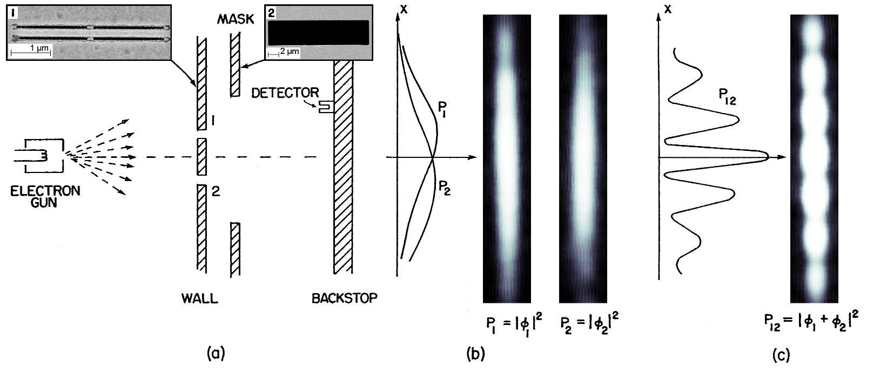

**Figure 1.** Simplified setup.  **(a)** An electron beam passes through a
wall with two slits.  A movable mask is positioned to block the
electrons, only allowing those traversing through slit 1 ($P_1$),
slit 2 ($P_2$), or both ($P_{12}$) to reach the backstop and detector.
**(b, c)** Probability distributions are shown (experimental in
false-colour intensity) for electrons that pass through a single slit
(b), or the double-slit (c).  **Inset 1, 2:** Electron micrographs of
the double-slit and mask.  The individual slits are 50 nm wide $\times$
4 $\mu$m tall with a 150 nm support structure midway along their height,
and separated by 280 nm.  The mask is 5 $\mu$m wide $\times$
20 $\mu$m tall.
