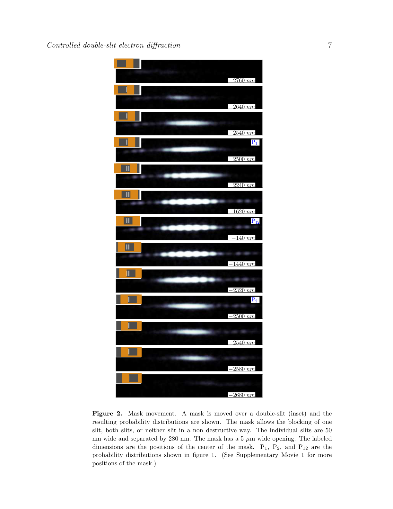

**Figure 2.** Mask movement.  A mask is moved over a double-slit (inset)
and the resulting probability distributions are shown.  The mask allows
the blocking of one slit, both slits, or neither slit in a
non-destructive way.  The individual slits are 50 nm wide and separated
by 280 nm.  The mask has a 5 $\mu$m wide opening.  The labeled
dimensions are the positions of the center of the mask.  $P_1$, $P_2$,
and $P_{12}$ are the probability distributions shown in Figure 1.

The continuous transition from single-slit ($P_1$) through double-slit
($P_{12}$) back to single-slit ($P_2$) is visible as the mask sweeps
across the slit pair.
