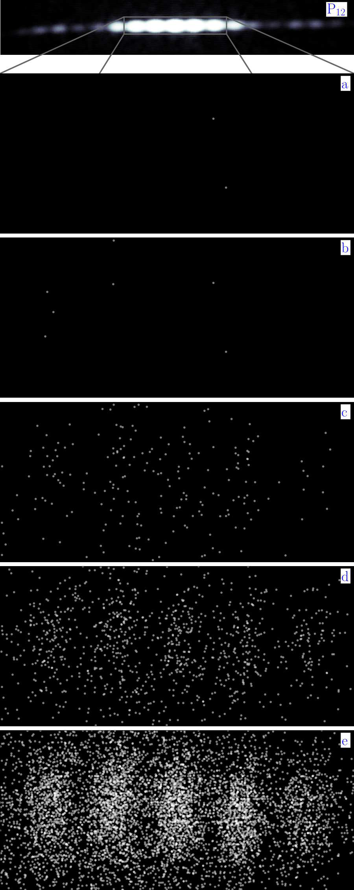

**Figure 3.** Buildup of electron diffraction.  "Blobs" indicate the
locations of detected electrons.  Shown are intermediate buildup
patterns from the central five orders of the diffraction pattern
($P_{12}$) magnified from Figure 2, with:

- **(a)** 2 electrons
- **(b)** 7 electrons
- **(c)** 209 electrons
- **(d)** 1004 electrons
- **(e)** 6235 electrons

The top panel (e) includes the Fraunhofer envelope overlay.  In (a--c)
the electron hits appear completely random; only after many electrons
accumulate can the interference pattern be discerned.  The final buildup
took approximately 2 hours.

Panel (e) is the source for the
[digitized intensity profile](#ex:bach-intensity-profile) used in the
QOU double-slit simulator.
