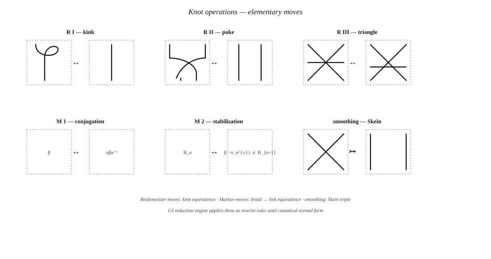

The Hecke algebra $H_3(q)$ has three fundamental relations
governing all knot operations.  Every composite operation
reduces to the six-element normal form basis via these rules.

**Relation 1 (Hecke).**
$\sigma_i^2 = (q - q^{-1})\sigma_i + \mathbf{1}$
for each generator $\sigma_i$.  Squaring a crossing yields
the identity (photon) plus a HA-weighted crossing.

**Relation 2 (Yang--Baxter).**
$\sigma_0\sigma_1\sigma_0 = \sigma_1\sigma_0\sigma_1$.
Adjacent braids satisfy the braid relation; this equates
the trefoil representations on both generator orderings.

**Relation 3 (Hecke inverse).**
$\sigma_i^{-1} = \sigma_i - (q - q^{-1})\mathbf{1}$.
Inverting a crossing subtracts HA from the identity channel.

**Table K.2: Composite operations and their normal forms.**

| Operation | Normal form | net$(q_0)$ | Physical interpretation |
|-----------|------------|:----------:|------------------------|
| $\sigma_0^2$ | $\mathbf{1} + \mathrm{HA}\cdot\sigma_0$ | $+1.209$ | Hopf self-link (Hecke relation) |
| $\sigma_1^2$ | $\mathbf{1} + \mathrm{HA}\cdot\sigma_1$ | $+1.209$ | Hopf self-link (Hecke relation) |
| $\sigma_0\sigma_1^2$ | $\sigma_0 + \mathrm{HA}\cdot L_+$ | $+1.209$ | Crossing then self-link |
| $\sigma_1\sigma_0^2$ | $\sigma_1 + \mathrm{HA}\cdot L_-$ | $+1.209$ | Crossing then self-link |
| $\sigma_0^2\sigma_1$ | $\sigma_1 + \mathrm{HA}\cdot L_+$ | $+1.209$ | Self-link then crossing |
| $\sigma_0\sigma_1\sigma_0\sigma_1$ | $L_- + \mathrm{HA}\cdot e^-$ | $+1.209$ | Hopf chain (4 crossings) |
| $\sigma_1\sigma_0\sigma_1\sigma_0$ | $L_+ + \mathrm{HA}\cdot e^-$ | $+1.209$ | Hopf chain (4 crossings) |
| $\sigma_0^{-1}$ | $-\mathrm{HA}\cdot\gamma + \sigma_0$ | $+0.791$ | Negative crossing (down quark) |
| $\sigma_1^{-1}$ | $-\mathrm{HA}\cdot\gamma + \sigma_1$ | $+0.791$ | Negative crossing |
| $\sigma_0^{-1}\sigma_1^{-1}$ | $+0.044\gamma - 0.209\sigma_0 - 0.209\sigma_1 + L_+$ | $+0.626$ | Inverse Hopf link |
| $\sigma_1^{-1}\sigma_0^{-1}$ | $+0.044\gamma - 0.209\sigma_0 - 0.209\sigma_1 + L_-$ | $+0.626$ | Inverse Hopf link |
| $\sigma_0^{-1}\sigma_1^{-1}\sigma_0^{-1}$ | (see $e^+$ in Table K.1) | $+0.451$ | Positron (mirror trefoil) |

**Borromean operations** (confinement/gluon field):

| Operation | Description | net$(q_0)$ |
|-----------|------------|:----------:|
| $\sigma_0\sigma_1^{-1}$ (gluon unit) | $-\mathrm{HA}\cdot\sigma_0 + L_+$ | $+0.791$ |
| $(\sigma_0\sigma_1^{-1})^2$ | Intermediate Borromean (5 terms) | $+0.800$ |
| $(\sigma_0\sigma_1^{-1})^3 = B_3$ | Full Borromean confinement (5 terms) | $+1.000$ |

The Borromean braid $B_3$ has NF:

$$
  B_3 = +0.998\gamma - 0.010\sigma_0 + 0.009\sigma_1
        + 0.046L_+ - 0.044L_-
$$

The $L_+$ and $L_-$ terms are the **gluon content** of $B_3$.
Their near-cancellation ($+0.046 - 0.044 = +0.002$) reflects
the color neutrality of the baryon: the net gluon content is
close to zero, consistent with a color singlet.

The $\gamma$ term $\approx +0.998$ shows that $B_3$ is
perturbatively close to the identity — the Borromean
confinement is a small correction to free quarks, with
net$(B_3) \approx 1$.

