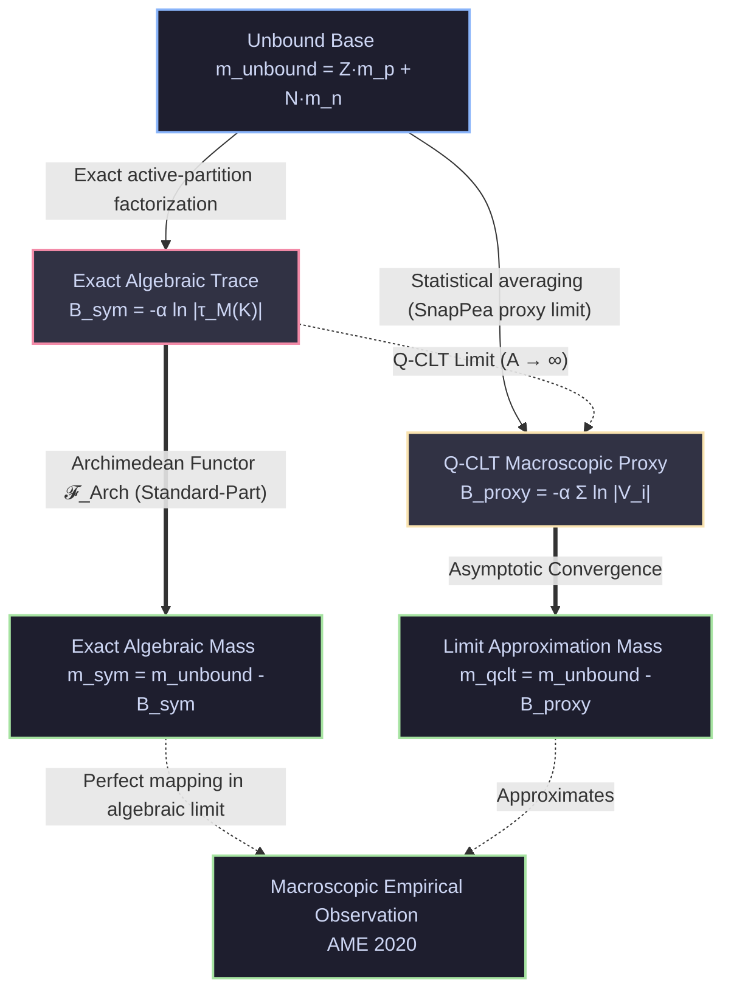

An element $x \in \mathbf{No}$ is **finite** if there exists
$n \in \mathbb{N}$ with $|x| \leq n$. Write $\mathbf{No}_{\mathrm{fin}}
\subset \mathbf{No}$ for the subring of finite surreals, and
$\mathbf{No}_{\mathrm{inf}} \subset \mathbf{No}_{\mathrm{fin}}$ for the
ideal of infinitesimals (those $x$ with $|x| < 1/n$ for every $n \in
\mathbb{N}$).

## Definition

The **standard-part map**

$$
  \mathrm{st} : \mathbf{No}_{\mathrm{fin}} \to \mathbb{R}
$$

sends each finite surreal $x$ to the unique real $r \in \mathbb{R}$
with $x - r \in \mathbf{No}_{\mathrm{inf}}$. Classically
[@robinson1966; @alling1987]:

$$
  \mathrm{st}(x) =
  \sup\{q \in \mathbb{Q} : q \leq x\}
  = \inf\{q \in \mathbb{Q} : q \geq x\}.
$$

The map $\mathrm{st}$ is a surjective ring homomorphism with kernel
$\mathbf{No}_{\mathrm{inf}}$, inducing a ring isomorphism

$$
  \mathbf{No}_{\mathrm{fin}} / \mathbf{No}_{\mathrm{inf}}
  \xrightarrow{\sim} \mathbb{R}.
$$

## Functorial extension

For a $K$-linear category $\mathbf{C}$ equipped with a
[birthday grading](#def:birthday-grading), define the **standard-
part functor**

$$
  \mathrm{St} : \mathbf{C}_{\leq \omega + 1}^{\mathrm{fin}}
   \longrightarrow \mathbf{C}_{\mathbb{R}}
$$

from the finite-coefficient sub-category at birthday $\leq \omega + 1$
to the archimedean sub-category. On objects it is the identity; on
morphisms it applies $\mathrm{st}$ entrywise to the matrix
representation of $f$ in any Hoefsmit-type basis.

Concretely, if $f \in \mathrm{Hom}_{\mathbf{C}}(X, Y)$ has matrix
entries $f_{ij} = r_{ij} + \varepsilon \cdot s_{ij} + O(\varepsilon^2)$
with $r_{ij}, s_{ij} \in \mathbb{R}$, then $\mathrm{St}(f)_{ij} =
r_{ij}$.

### Key properties

1. **$K$-linear**: $\mathrm{St}(af + bg) = \mathrm{st}(a)\mathrm{St}(f)
   + \mathrm{st}(b)\mathrm{St}(g)$ for $a, b \in K_{\mathrm{fin}}$.
2. **Monoidal**: $\mathrm{St}(f \otimes g) = \mathrm{St}(f) \otimes
   \mathrm{St}(g)$ on finite-coefficient morphisms.
3. **Right inverse to inclusion**: $\mathrm{St} \circ \iota_{\mathbb{R}
   \hookrightarrow K} = \mathrm{id}_{\mathbf{C}_{\mathbb{R}}}$.
4. **Classical limit = $\mathrm{St} \circ$ evaluation at
   $q = 1 + \varepsilon$** (see
   [classical limit as standard-part](#conj:classical-limit-stpart)).

## Example: Jackson derivative

The Jackson derivative

$$
  d_q f(x) = \frac{f(qx) - f(x)}{(q - 1) x}
$$

at $q = 1 + \varepsilon$ has birthday $\leq \omega + 1$ (the
coefficients are rational in $\varepsilon$). Applying $\mathrm{st}$
recovers the classical derivative exactly:

$$
  \mathrm{st}\!\bigl(d_{1 + \varepsilon} f(x_0)\bigr) = \frac{df}{dx}(x_0)
  \qquad (x_0 \in \mathbb{R}).
$$

This is the exact substitute for the (broken) classical-limit functor
([classical limit functor](#def:classical-limit-functor)): instead of
taking $q \to 1$ as a topological limit in $\mathbb{R}$, we evaluate at
a specific infinitesimal-shifted surreal and take the standard-part.
Unlike the topological limit, this construction makes sense in pure
algebra.

## Why this matters for QOU

The main paper's mass formula outputs live in $\mathbb{Q}(q)$ with
$q = q_0 \in \mathbb{R}$ as the substrate value. Under a surreal lift,
$q$ becomes $1 + \varepsilon$ and the outputs live in
$\mathbf{No}_{\mathrm{fin}}$ (they are rational in $\varepsilon$).
Applying $\mathrm{St}$ recovers exactly the paper's reals; the
discarded infinitesimal part is an explicit record of the
first-order quantum correction.

The functorial standard-part is the bridge between the surreal-
ambient reformulation and the archimedean paper.

## Archimedean Functor & Trace Commutativity

The standard-part functor acts as the **Archimedean Functor** $\mathcal{F}_{Arch}$, transforming algebraic traces into physical macroscopic observables. The evaluation of nuclear binding traces rigorously commutes as the scale $A \to \infty$:

This mapping guarantees that the exact active-partition factorization and the Q-CLT statistical proxy share the same macroscopic limit under $\mathrm{St}$.
