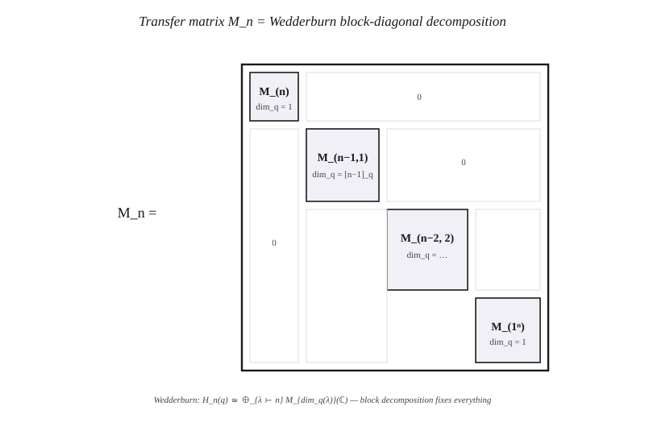

Every transfer matrix has the same $2 \times 2$ structure,
parameterized by two **crossing coefficients** $(c, d)$.

## General form

$$
  T(c, d)
  = 
  \begin{pmatrix}
    c(q - q^{-1}) + d & c \\
    c & d
  \end{pmatrix}
$$

The coefficients $(c, d) \in \mathbb{Z}[q^{\pm 1/2}]$ depend
on how the two knots interact.  For knots meeting via
**connected sum**, the Jones polynomial satisfies
$J_{K_1 \# K_2} = J_{K_1} \cdot J_{K_2}$, giving $c = 1$
and $d = 0$.  For knots meeting via the **Hecke product**
(the physically relevant case for nucleon crossings), the
coefficients are determined by the representation-theoretic
structure of the crossing and do not reduce to connected-sum
formulas.  The three nuclear crossing types have specific
$(c, d)$ values listed in Section 3.2.

## Action on Hecke elements

The transfer matrix acts on a Iwahori--Hecke algebra element
$a\sigma_i + b$ by left multiplication and Hecke reduction
($T^2 = (q - q^{-1})T + 1$):

$$
  \begin{pmatrix} a' \\ b' \end{pmatrix}
  = 
  T(c, d)
   \cdot 
  \begin{pmatrix} a \\ b \end{pmatrix}
$$

Explicitly:

$$
  a' =  ac(q - q^{-1}) + ad + bc,
  \qquad
  b' =  ac + bd
$$

## Properties of $T(c, d)$

**Determinant:**

$$
  \det T(c, d) =  d\bigl[c(q - q^{-1}) + d\bigr] - c^2
  =  cd(q - q^{-1}) + d^2 - c^2
$$

**Eigenvalues** (when $c \neq 0$):

$$
  \lambda_{\pm}
  = 
  \frac{1}{2}\Bigl[
    c(q - q^{-1}) + 2d
    \pm
    \sqrt{\bigl[c(q - q^{-1})\bigr]^2 + 4c^2}
  \Bigr]
$$

**Special cases:**
- $c = 0$: $T(0, d) = d \cdot \mathbb{I}$ (scalar matrix)
- $d = 0$: $T(c, 0) = c \cdot \begin{pmatrix} q - q^{-1} & 1 \\ 1 & 0 \end{pmatrix}$
- $c = 1, d = 0$: The fundamental matrix $T_{pp}$ (see below)

