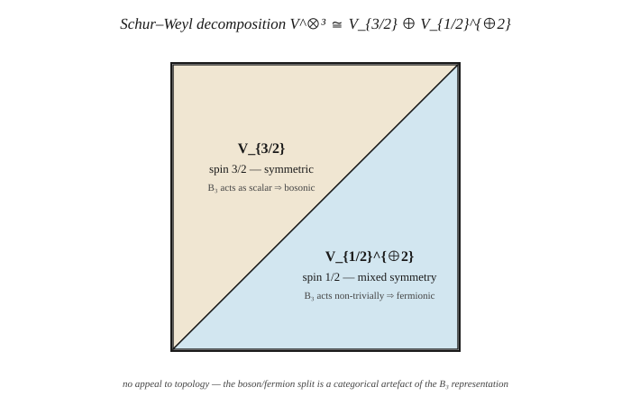

The Schur--Weyl decomposition
$V^{\otimes 3} \cong V_{\frac{3}{2}} \oplus V_{\frac{1}{2}}^{\oplus 2}$
separates the symmetric (spin-$\frac{3}{2}$) and mixed-symmetry
(spin-$\frac{1}{2}$) sectors.  The $B_3$-action preserves this
decomposition: on the symmetric sector the generators act as scalars
(bosonic exchange), while on the mixed-symmetry sector they act
non-trivially (fermionic exchange).  This categorical distinction between
bosons and fermions requires no appeal to topology.

