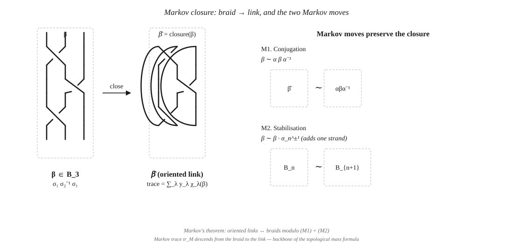

The stability condition excludes arbitrary knot composites: only
those whose $R$-matrix braiding produces net binding (more
negative crossings than positive) qualify as hadrons.  The
Coulomb charge $Q(\mathfrak{H})$ ([Coulomb charge](#def:coulomb-charge))
measures the electromagnetic character of the composite.

The integer $n$ is the *valence* of the hadron.  A hadron of
valence $3$ is a **baryon**; valence $2$ is a **meson**.

This definition is abstract --- the hadron lives in the knot
eigenbasis without reference to a specific Euler characteristic
or base point.  Localization to a point is a separate operation
([localized hadron](#def:localized-hadron)).  The specific knot
content (which torus knots serve as generators) is determined by
$\chi(A)$ in the Descartes universe.

