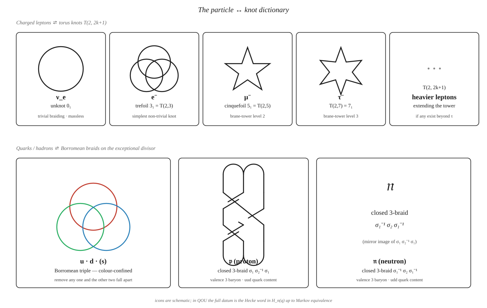

In the QOU framework, traditional path integrals are replaced by finite sums
over the discrete fibre structure.  Since the base space $B$ and each fibre are
finite, the continuum measure $\mathcal{D}\phi$ collapses to a combinatorial
sum, eliminating the need for renormalisation of divergent integrals.

The braid group acts naturally on the fibre degrees of freedom.  What we
observe as particle interactions corresponds to the action of braid operators
exchanging strands in the fibre bundle.  The algebraic content of these
interactions is therefore encoded in braid-group representations rather than in
Feynman vertices.

The exchange operations carry a $q$-deformation parameter inherited from the
quantum group structure of the fibres.  Concretely, the $R$-matrix of
$\mathcal{U}_q(\mathfrak{su}(2))$ furnishes a $q$-deformed braid operator
whose eigenvalues govern the phase acquired under particle exchange.

Under this correspondence, specific knot types map to particle identities.  The
unknot, carrying trivial braiding, is identified with the neutrino; the trefoil
knot $3_1$ is identified with the electron; and heavier charged leptons
($\mu$, $\tau$) appear as higher torus knots $T_{2,2k+1}$ through the brane
tower.  Quarks sit inside a Borromean braid configuration of three linked
unknots on the exceptional divisor.
The geometry that carries these knots — Bring's surface — is developed in
[Chapter 9](#chap:descartes-universe); the physical predictions it generates
are collected in [Chapter 11](#chap:observations).

