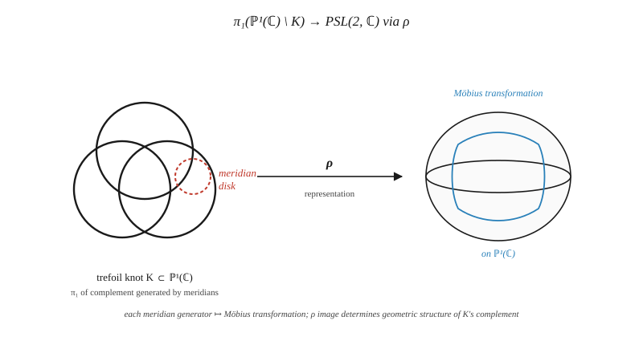

For a knot $K\subset S^3$ (or, more generally,
$K\subset\mathbb{P}^1(\mathbb{C})$), the fundamental group
$\pi_1(\mathbb{P}^1(\mathbb{C})\setminus K)$ encodes the topology of the
complement.  A representation

$$
  \rho\colon\pi_1(\mathbb{P}^1(\mathbb{C})\setminus K)
   \longrightarrow \mathrm{PSL}(2,\mathbb{C})
$$

maps each meridian generator to a Mobius transformation of the
Riemann sphere.  The image of $\rho$ characterises the geometric
structure on the knot complement.

