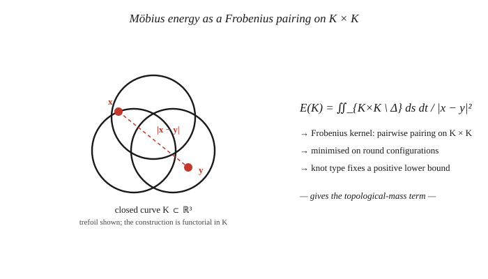

**Proof.**
At $q = 1$ the $q$-Hodge star reduces to the classical Hodge star,
and the comultiplication $\Delta$ becomes cocommutative.  The
[Frobenius pairing](#def:frobenius-pairing) $\int_A \circ \mu$ on $A \otimes A$ reduces to
the standard $\mathrm{SU}(2)$ Killing form, so the integrand
simplifies to

$$
  \mathrm{tr}\bigl(
    \Delta(\gamma(s)) \otimes \Delta(\gamma(t))
  \bigr)
  \xrightarrow{q \to 1}
  \frac{1}{\lvert \gamma(s) - \gamma(t) \rvert^2}.
$$

The repulsive kernel $1/r^2$ is thus the classical shadow of the
resistance of the Frobenius--Hopf object $A$ to local deformations
of the connection $\nabla$: the Frobenius form $\int_A$ assigns a
diverging cost when two strands of $\gamma$ approach.  $\square$

