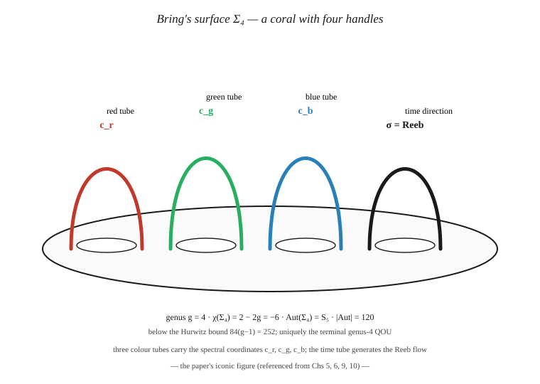

Let $R$ be a commutative ring with $30 \in R^{\times}$ (i.e.
$\mathrm{char}(R) \nmid 30$).  Let $x_j$, $j\in\{0,\dots,4\}$, be
homogeneous coordinates on $\mathbb{P}^4_R$.  *Bring's surface* is the
algebraic variety

$$
  \Sigma_4 =  \mathrm{Proj}\!\left(
    R[x_0,\dots,x_4]\Big/\bigl(\textstyle\sum x_j,
    \textstyle\sum x_j^2, \textstyle\sum x_j^3\bigr)
  \right),
$$

defined by the vanishing of the first three power sums.  Over any
algebraically closed field $K \supseteq R$, $\Sigma_4$ is a smooth
projective curve of genus $4$ with automorphism group
$\mathrm{Aut}(\Sigma_4) \cong S_5$ ($\lvert\mathrm{Aut}\rvert = 120$,
the largest automorphism group for any genus-$4$ curve, though below the
Hurwitz bound $84(g-1) = 252$) and Euler characteristic
$\chi(\Sigma_4) = 2 - 2g = -6$.

