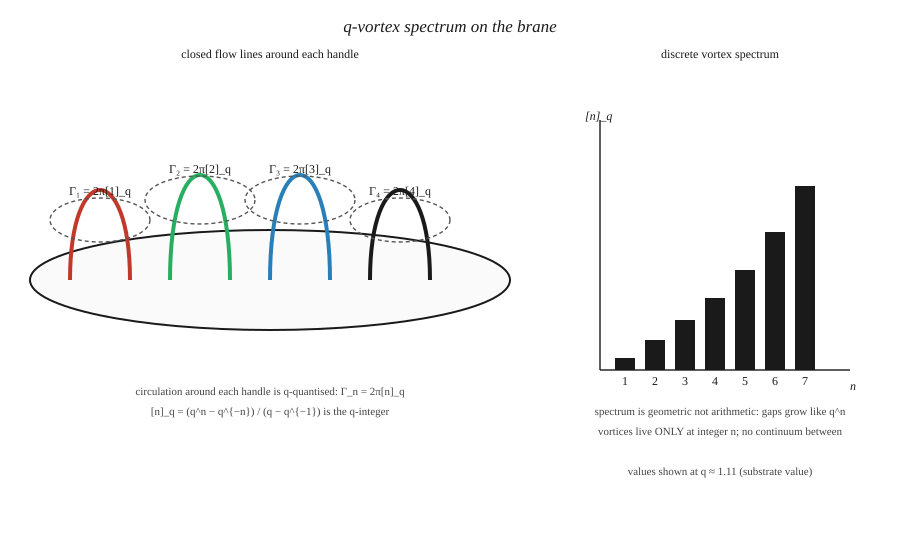

Geodesics of the [acoustic metric](#rem:madelung-fluid) coincide
with critical points of a $q$-deformed energy functional on closed
curves in the [state bundle](#ex:c-quantum-observable-universe) $\mathcal{S}$.

**The $q$-energy functional.**
For $\varrho \colon S^1 \to \mathcal{S}$:

$$
  \mathcal{E}_q[\varrho]
  = 
  \oint_\varrho
  \bigl(
    \tfrac{1}{2}\lVert\dot\varrho^H\rVert^2
    + Q_q(\varrho)
    + \lVert F_A(\dot\varrho)\rVert^2
  \bigr)ds,
$$

where $\dot\varrho^H$ is the horizontal velocity, $Q_q$ the
[quantum pressure](#rem:madelung-fluid), and $F_A(\dot\varrho)$
the curvature along the filament.

**Critical points are geodesics.**
$\delta\mathcal{E}_q / \delta\varrho = 0$ gives

$$
  \nabla_{\dot\varrho}\dot\varrho
  = -\nabla^\perp Q_q - \iota_{\dot\varrho}{*F_A}.
$$

At $q \to 1$: $Q_q \to 0$, the gauge term reduces to Biot--Savart
self-induction (Hasimoto soliton).

**Stability.**
The second variation $\delta^2\mathcal{E}_q$ decomposes via the
[weight-space decomposition](#def:weight-decomposition):

- **Longitudinal** (Cartan): stable, eigenvalues
  $[k]_q^2 \hbar_q / L_q^2$ ([discrete
  spectrum](#prop:discrete-vortex-spectrum)).
- **Ladder** ($E_\pm$): barrier
  $\Delta E = \hbar_q([j\!+\!1]_q[j\!+\!2]_q - [j]_q[j\!+\!1]_q)/(2I_q)
  > 0$ for $q > 1$.
- **Gauge**: quotiented out by symmetry.

**Index theorem.**
The Morse index of the fundamental vortex ($j = 1/2$) is zero:
no lower state exists.  The lightest fermion is an absolute
minimum of $\mathcal{E}_q$ in its topological class.

**Connection to mass.**
$\mathcal{E}_q[\gamma_0] = \oint_{\gamma_0}
\lVert\nabla_A q\rVert \cdot \lVert L \wedge F^+\rVert
\propto m$, reproducing the [mass identity](#def:mass-identity).
The [geometric drag](#rem:geometric-drag) is the static limit
of $\mathcal{E}_q$.

