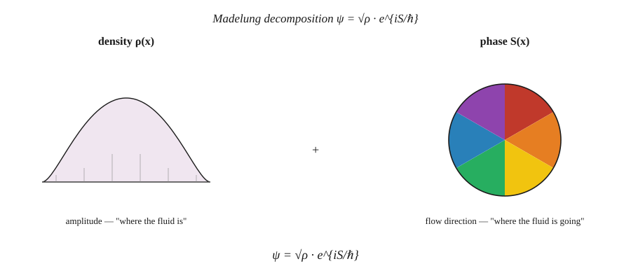

**The Madelung split.**
Write $\psi = \sqrt{\rho}\exp(JS/\hbar_q)$ to decompose the
[q-deformed Schrödinger equation](#rem:schrodinger-jet-coaction) into two
real equations.  Setting $v = \nabla_A S$ and fluid density
$\rho = |\psi|^2$:

- **Continuity:** $\partial_t \rho + \nabla_A\cdot(\rho v) = 0$.
- **Quantum Euler equation:**

$$
  \partial_t v + (v\cdot\nabla_A)v
  =  -\nabla_A\!\left(\frac{\delta\mathcal{H}}{\delta\rho}\right)
  -  \nabla_A Q_q,
  \qquad
  Q_q =  -\frac{\hbar_q^2}{2}\frac{\Delta_q\sqrt{\rho}}{\sqrt{\rho}},
$$

where $Q_q$ is the $q$-deformed quantum pressure.

**$|\psi|^2$ as fluid density; $q$ as brane thickness.**
The [substrate parameter](#def:substrate-parameter) $q$ modulates the
effective thickness of the quantum fluid: near $q \approx 1$ one recovers
ordinary inviscid flow (quantum pressure $Q_q \approx 0$); at $q \gg 1$,
$Q_q$ dominates and the fluid strongly resists compression — this
resistance is the inertial mass of the brane.

**Zero-information state $|\psi|^2 = 0$.**
The vacuum $\psi = 0$ carries no medium, no vortex, and no fermion.  It
lies outside the support of all harmonic modes filtered by the
[algebraic filter](#rem:algebraic-filter).  As $q \to 1$, $\hbar_q \to 0$:
the vacuum is the state of maximal classical certainty.

**Acoustic metric and analogue gravity.**
Perturbations $\delta\psi$ around a background flow satisfy
$\Box_{g_{\mathrm{ac}}}\delta\psi = 0$ with the acoustic metric

$$
  g_{\mathrm{ac}}
  = 
  \frac{\rho}{c_s}
  \begin{pmatrix}
    -(c_s^2 - v^2) & -v^T \\
    -v & \mathbf{1}
  \end{pmatrix},
  \qquad
  c_s^2 = \frac{\partial P}{\partial\rho}\bigg|_{Q_q}.
$$

An acoustic horizon forms wherever $|v| = c_s$, coinciding with a
gravitational horizon in the substrate geometry.  General relativity
emerges as the geometry of non-uniform brane flow: the
[GR substrate geometry](#rem:gr-substrate-geometry) is the acoustic
manifold.  Bosonic modes (with $[F_A, \alpha] = 0$) travel on null
acoustic geodesics; fermionic modes (with $[F_A, \alpha] \neq 0$)
spiral into vortex filaments of $\psi$.

**Geodesics as stable vortex filaments.**
Bosonic modes follow straight null geodesics of $g_{\mathrm{ac}}$.
Fermionic modes spiral around the zeros of $\psi$, forming stable vortex
filaments $\varrho$ whose mass is controlled by

$$
  m  \propto  \oint_\varrho \|\nabla_A q\|\cdot\|L \wedge F^+\|,
$$

reproducing the [mass identity](#def:mass-identity) as a line integral of
the substrate curvature around the vortex core.

**Linking and splitting in the divisor.**
The zero-locus $\{\psi = 0\}$ is a Weil divisor.  Each blowup at a
ramification point replaces a zero $z_i$ with an exceptional divisor
$E_i \cong \mathbb{CP}^1$:

- **Splitting:** a single zero resolves into multiple components
  $E_{i_1}, \ldots, E_{i_k}$; the vortex filament bifurcates and
  the mass decomposes as
  $\sum_j \lambda_j|\Phi_q(z_{i_j})|$,
  recovering the [topological decomposition](#conj:topological-decomposition-mass).

- **Linking:** $E_i \cdot E_j \neq 0$ in homology if and only if the
  corresponding vortex filaments are Hopf-linked; the intersection
  pairing measures the strong-force binding energy from mutual velocity
  induction between the linked filaments.

The divisor structure of $\{\psi = 0\}$ — not $|\psi|^2$ itself — is
therefore the correct object for tracking vortex topology and the
associated particle content.

