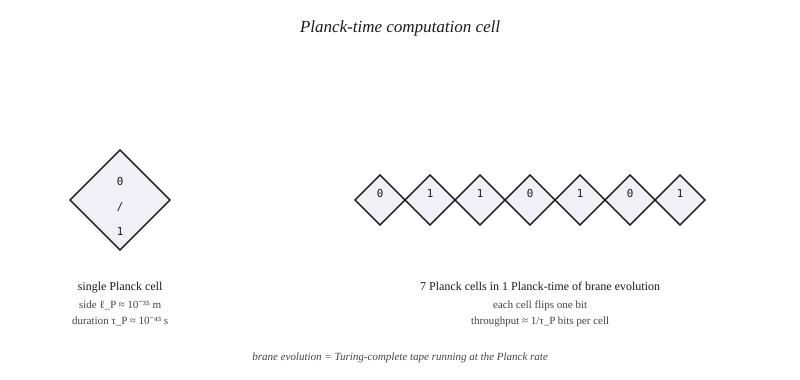

**Definition.**
Let $q \in k^\times \setminus \{1\}$ be the substrate parameter
([substrate parameter](#def:substrate-parameter)) and
$\hbar_q = 1 - q^{-1}$ the quantum Planck constant
([quantum Planck constant](#def:quantum-planck-constant)).
The **Planck time** is

$$
  t_P(q)  :=  \frac{1}{\hbar_q}
  =  \frac{q}{q - 1}.
$$

This is a rational function of $q$ defined over any field $k$ in
which $q \neq 1$.

**Interpretation.**  One Planck time is the period of a single
full circuit of the $q$-Reeb flow
([$q$-Reeb flow](#ex:q-reeb-flow)) — measured in discrete
$f_q$-iterations on the exceptional divisor
([Julia set of Reeb flow](#rem:julia-set-reeb)).  One circuit
comprises $t_P(q)$ iterations of $f_q(z) = z^2 + c(q)$: at the
deep-quantum limit ($t_P = 1$) one iteration completes one circuit; at
$q = q_0$ ([local substrate $q$](#prop:local-substrate-q)),
$\sim 10$ iterations compose one circuit.  The reciprocal
$\hbar_q = 1/t_P$ is the angular velocity: the fraction of a
full circuit completed per $f_q$-iteration.

**Regime table.**

| Regime | $q$ | $\hbar_q$ | $t_P$ | Interpretation |
|--------|-----|-----------|-------|----------------|
| Deep-quantum | $q \to \infty$ | $\to 1$ | $\to 1$ | One $f_q$-step per circuit; fully discrete |
| Physical | $q = q_0$ | $0.0988$ | $\approx 10.1$ | $\sim 10$ $f_q$-steps per Reeb circuit |
| Classical | $q \to 1$ | $\to 0$ | $\to \infty$ | Infinitely many steps; continuous flow |

**Field realisations.**

- Over $\mathbb{F}_\pp$: $t_P = q/(q-1) \in \mathbb{F}_\pp$
  whenever $q \in \mathbb{F}_\pp^\times \setminus \{1\}$.
  One Planck step is one evaluation of $f_q(z) = z^2 + c(q)$.
- Over $\mathbb{Q}_\pp$: $v_\pp(t_P) = v_\pp(q) - v_\pp(q-1)$
  encodes the $\pp$-adic proximity of $q$ to the classical limit.
- Over $\mathbb{C}$: reproduces the angular period $T = 2\pi/\hbar_q$
  up to the conventional factor $2\pi$.

**Planck length.**  After one Planck time of Reeb flow, the
angular displacement is

$$
  \ell_P(q) =  \hbar_q \cdot t_P =  1
$$

identically over any field.  The Planck length is always $1$;
what varies with $q$ is how many discrete operations $t_P(q)$
compose that unit displacement.

