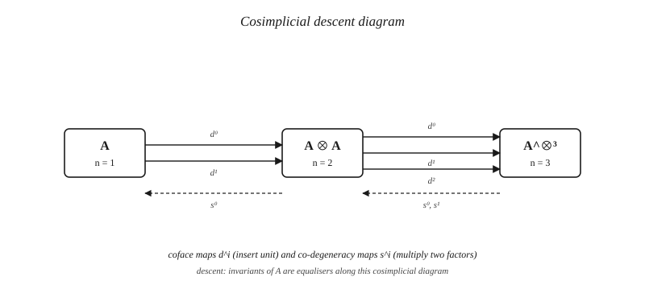

The recursive brane tower carries a higher-categorical structure that
organises the transitions between levels into a cosimplicial crossed
groupoid.  The key observation is that Yekutieli's framework for central
extensions of gerbes [yekutieli2010] furnishes exactly the triples
$(x, g, a)$ needed to define the face and degeneracy maps.

