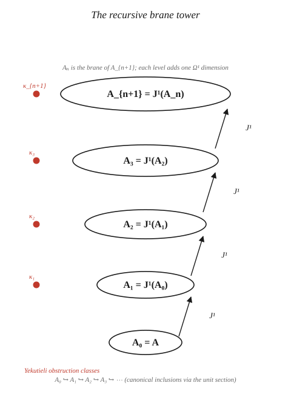

Let $(\mathbf{C}, A, \tau)$ be a quantum observable universe over a
ring $R$ ([quantum observable universe](#def:quantum-observable-universe)).  Set
$A_0 = A$.  *Inductively*, define
$A_{n+1} = J^1(A_n)$ as the
([jet prolongation](#prop:jet-prolongation)) of the Frobenius--Hopf
object $A_n$.

The *brane relation* is the following recursive structure:

1. Each jet object $A_n$ serves as the base object for the next level;
   $A_n$ is the *brane* of $A_{n+1}$.
2. At each level, the comultiplication $\Delta_n$ on $A_n$ encodes
   the $n$-th level connection, inherited from the Frobenius--Hopf
   structure by [jet prolongation](#prop:jet-prolongation).

The *recursive brane tower* is the sequence
$A_0 \hookrightarrow A_1 \hookrightarrow A_2 \hookrightarrow \cdots$
in $\mathbf{C}$, where each embedding is the canonical inclusion
$A_n \hookrightarrow J^1(A_n) = A_{n+1}$ via the unit section.

