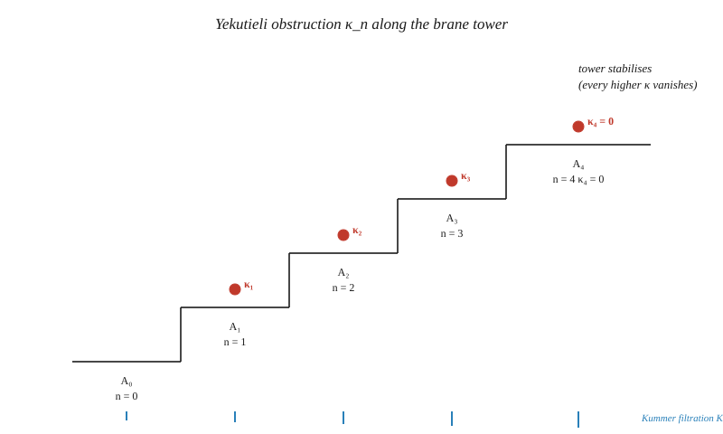

Let $(\mathbf{C}, A, \tau)$ be a
([quantum observable universe](#def:quantum-observable-universe)) and let
$\{A_n\}_{n \geq 0}$ be the
([recursive brane tower](#def:recursive-brane-tower)).  The central extensions of
gerbes

$$
  1  \longrightarrow  \mathcal{B}
   \longrightarrow  \mathfrak{G}_{n+1}
   \longrightarrow  \mathfrak{G}_n
   \longrightarrow  1
$$

arising from the
([jet prolongation](#prop:jet-prolongation)) satisfy the Yekutieli Lifting
Condition ([Yekutieli lifting condition](#def:yekutieli-lifting-condition)).  In the
archimedean realisation, $\mathcal{B} = \mathcal{O}_M^{\times}$.  In
particular, the lift of the Frobenius--Hopf object from level $n$ to
level $n{+}1$ exists if and only if the obstruction class
$\kappa_n \in H^2(M, \mathcal{B})$
([quantum characteristic classes](#def:quantum-characteristic-classes)) vanishes.

