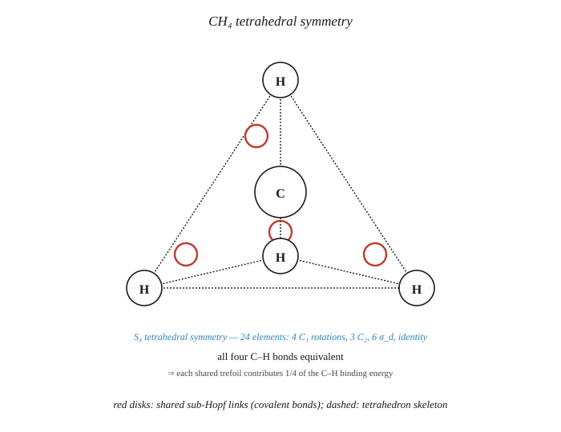

*Methane's tetrahedral geometry ($109.5^\circ$ bond angles) is
a direct consequence of $\Phi_1$ minimisation.  In the
26-strand braid, the optimal ordering distributes the four
H atoms equidistant from each other in strand space, which
corresponds to the vertices of a regular tetrahedron in
physical space.*

*The computation establishes the mapping:*

| Braid quantity | Physical quantity |
|:-------------|:----------------|
| Strand separation between H atoms | H--C--H bond angle |
| $\Phi_1$ penalty per H--H pair | Steric repulsion energy |
| $S_4$ orbit of optimal ordering | Tetrahedral symmetry group $T_d$ |
| Breaking $S_4$ (asymmetric ordering) | Jahn--Teller distortion |

*For comparison, the same construction for $NH_3$ (nitrogen
+ 3 hydrogens) should give $C_{3v}$ symmetry with a lone pair
occupying the 4th tetrahedral site — producing the observed
pyramidal geometry with bond angles $\approx 107.8^\circ$.
The lone pair acts as a "phantom hydrogen" in the strand
ordering, occupying space but contributing no bonding
crossings.*

*This establishes the computational programme: every small
molecule's geometry is determined by the LP dual of its
molecular braid, with no geometric input required.*

