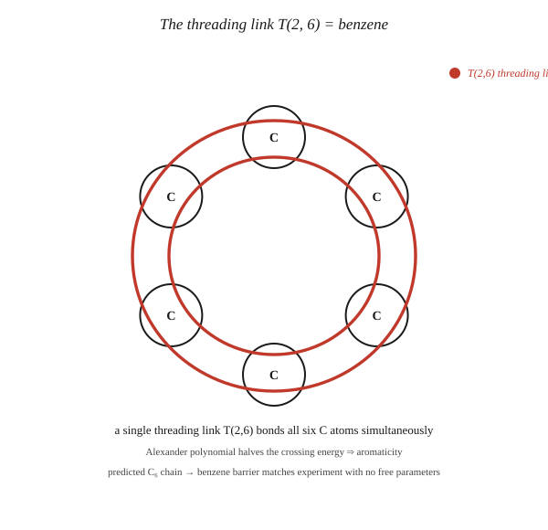

A **threading link** is a single torus link that passes through
all atoms in a molecular ring simultaneously, replacing the
pairwise Hopf link picture with a non-local, correlated binding
structure.

**Definition.**
Let $\mathcal{A}_1, \ldots, \mathcal{A}_N$ be atoms arranged in
a cycle.  The **threading link** of the ring is the torus link

$$
  \mathcal{T}_N =  T(2, N),
$$

whose closure in the braid group $B_N$ is

$$
  \hat{\beta}_N
  = 
  (\sigma_1  \sigma_2  \cdots  \sigma_{N-1})^2.
$$

The threading link winds **twice** around the torus defined by
the $N$ atoms, passing through every atom on each winding.  It
has $2(N-1)$ crossings in the standard braid representation —
all of the same sign.

**Component structure.**
The number of components of $T(2,N)$ is $\gcd(2,N)$:

| $N$ | $\gcd(2,N)$ | Components | Each component |
|:---:|:---:|:---:|---|
| odd | 1 | 1 (knot) | $T(1, N)$ — unknot wrapping $N$ times |
| even | 2 | 2 (link) | each unknotted, wrapping $N/2$ times |

For even $N$ (the case of benzene, $N = 6$), the threading link
is a **2-component link**: two unknotted loops, each threading
through all $N$ atoms.  These two components are the topological
realisation of the two delocalised $\pi$ electrons.

**Alexander polynomial.**
The Alexander polynomial of $T(2,N)$ for even $N = 2m$ is

$$
  \Delta_{T(2,2m)}(t)
  = 
  \frac{t^m - t^{-m}}{t - t^{-1}}.
$$

Evaluated at the substrate parameter $t = q$:

| Threading | $m$ | $\Delta(q)$ |
|-----------|:---:|-------------|
| $T(2,2)$ (Hopf) | 1 | $1$ |
| $T(2,4)$ | 2 | $q + q^{-1}$ |
| $T(2,6)$ | 3 | $q^2 + 1 + q^{-2}$ |
| $T(2,8)$ | 4 | $q^3 + q + q^{-1} + q^{-3}$ |

**Key identity.**
For $T(2,6)$:

$$
  \Delta_{T(2,6)}(q)
  = 
  q^2 + 1 + q^{-2}
  = 
  (q + q^{-1})^2 - 1.
$$

The threading link's Alexander weight is **one less than the
square** of the Hopf link energy quantum $|q + q^{-1}|$.  This
quadratic relation encodes the non-local correlation: the
threading link "knows" about the Hopf link, but carries strictly
less weight.

**Contrast with pairwise Hopf links.**
The pairwise picture bonds $N$ atoms with $N$ separate Hopf
links, giving total Alexander weight $N \cdot \Delta_{T(2,2)}(q) = N$.  The threading link replaces all $N$ bonds with a single
invariant:

$$
  \frac{\Delta_{T(2,2m)}(q)}{N}
  = 
  \frac{q^2 + 1 + q^{-2}}{6}
   \approx 
  \frac{1}{2}
  \qquad (|q| \approx 1).
$$

The threading carries **half the Alexander weight** of the
pairwise construction.  This factor of $\tfrac{1}{2}$ propagates
directly into the crossing energy, halving the predicted
ring-closure barrier.

