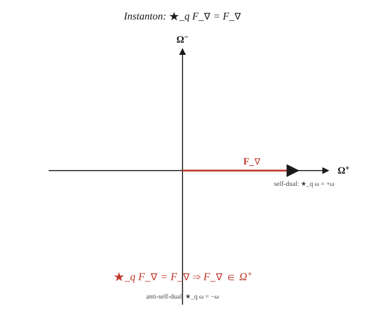

Let $(\mathbf{C}, A, \tau)$ be a
([quantum observable universe](#def:quantum-observable-universe)) with connection
$\nabla$ ([categorical connection](#def:categorical-connection)) and
$q$-Hodge star $\star_q$ ([$q$-Hodge star](#def:q-hodge-star)).
The connection $\nabla$ is an *instanton* if its curvature
$F_\nabla \in \Omega^2(A)$ is $\star_q$-self-dual:

$$
  \star_q F_\nabla =  F_\nabla.
$$

Equivalently, the curvature factors through the self-dual projection:

```tex
\begin{equation}\label{eq:instanton-cd}
\begin{tikzcd}[row sep=2.5em, column sep=3em]
  A \otimes A \ar[r, "\nabla \circ \nabla"]
    \ar[dr, "0"']
  & \Omega^2(A) \ar[d, "\pi^-"] \\
  & \Omega^-(A)
\end{tikzcd}
\end{equation}
```

where $\pi^- = \tfrac{1}{2}(\mathrm{id} - \star_q)$ is the
anti-self-dual projector and $\Omega^-(A) = \ker(\mathrm{id} + \star_q)$.


