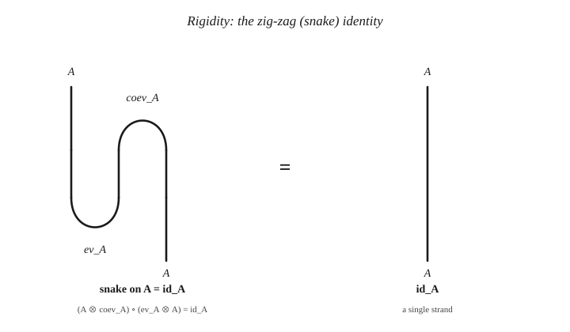

Let $(\mathbf{C}, A, \tau)$ be a
[quantum universe](#def:quantum-universe) with multiplication
$\mu \colon A \otimes A \to A$ and Frobenius form
$\int_A \colon A \to \mathbf{1}$. The *Frobenius pairing* is the
composite

```tex
\begin{equation}\label{eq:frobenius-pairing}
\begin{tikzcd}[column sep=2.5em]
  A \otimes A \ar[r, "\mu"]
  & A \ar[r, "\int_A"]
  & \mathbf{1}
\end{tikzcd}
\end{equation}
```

We say the Frobenius pairing is *non-degenerate* when this composite
induces an isomorphism $A \xrightarrow{ \sim } A^{\vee}$ to the
dual object. Equivalently, the snake identities hold: there exists a
coevaluation $\tilde{\eta} \colon \mathbf{1} \to A \otimes A$ such
that the two composites

$$
A \xrightarrow{\rho^{-1}} A \otimes \mathbf{1}
  \xrightarrow{\mathrm{id} \otimes \tilde{\eta}} A \otimes A \otimes A
  \xrightarrow{\alpha^{-1}} (A \otimes A) \otimes A
  \xrightarrow{(\int_A \circ \mu) \otimes \mathrm{id}} \mathbf{1} \otimes A
  \xrightarrow{\lambda_A} A
$$

and its mirror are both equal to $\mathrm{id}_A$.


