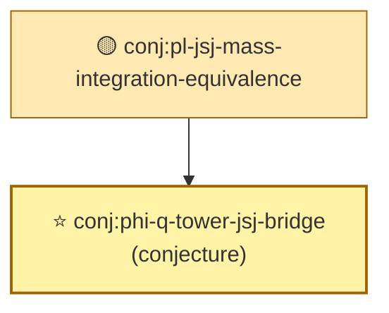
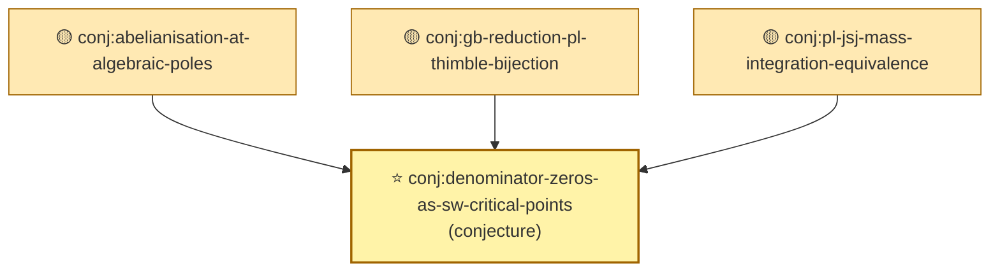

```mermaid
graph TD
    conj_jet_filtered_knot_factor["🟡 conj:jet-filtered-knot-factor"]:::conj
    conj_archimedean_remainder_exponential_decay["🟡 conj:archimedean-remainder-exponential-decay"]:::conj
    conj_phi_q_tower_jsj_bridge["🟡 conj:phi-q-tower-jsj-bridge"]:::conj
    conj_brane_tower_z_habiro["🟡 conj:brane-tower-z-habiro"]:::conj
    conj_mass_element_nf["🟡 conj:mass-element-nf"]:::conj
    conj_knot_factor_frobenius_pairing["🟡 conj:knot-factor-frobenius-pairing"]:::conj
    conj_complex_chirality_rotation["🟡 conj:complex-chirality-rotation"]:::conj
    conj_denominator_zeros_as_sw_critical_points["🟡 conj:denominator-zeros-as-sw-critical-points"]:::conj
    conj_aeon_boundary_generates_chart["🟡 conj:aeon-boundary-generates-chart"]:::conj
    conj_n_v_bring_action["🟡 conj:n-v-bring-action"]:::conj
    conj_n_v_tower_depth_ninety["🟡 conj:n-v-tower-depth-ninety"]:::conj
    conj_gb_reduction_pl_thimble_bijection["🟡 conj:gb-reduction-pl-thimble-bijection"]:::conj
    rem_calibration_inputs["📝 rem:calibration-inputs"]:::rem
    conj_ns_counterexample["🟡 conj:ns-counterexample"]:::conj
    conj_cp_violation_spectral_form["🟡 conj:cp-violation-spectral-form"]:::conj
    conj_borromean_quark["🟡 conj:borromean-quark"]:::conj
    conj_abelianisation_at_algebraic_poles["🟡 conj:abelianisation-at-algebraic-poles"]:::conj
    conj_kashaev_volume_conjecture["🟡 conj:kashaev-volume-conjecture"]:::conj
    conj_algebraic_geometric_dilog_equivalence["🟡 conj:algebraic-geometric-dilog-equivalence"]:::conj
    conj_palindromicity_orbital_type["🟡 conj:palindromicity-orbital-type"]:::conj
    conj_dilogarithm_archimedean_limit["🟡 conj:dilogarithm-archimedean-limit"]:::conj
    conj_periodic_table_demand["🟡 conj:periodic-table-demand"]:::conj
    conj_p_vs_np_boundary["🟡 conj:p-vs-np-boundary"]:::conj
    conj_mass_endomorphism["⭐ conj:mass-endomorphism<br/>(conjecture)"]:::seed
    conj_levi_degeneracy["🟡 conj:levi-degeneracy"]:::conj
    conj_abelianisation_at_algebraic_poles --> conj_denominator_zeros_as_sw_critical_points
    conj_algebraic_geometric_dilog_equivalence --> conj_dilogarithm_archimedean_limit
    conj_algebraic_geometric_dilog_equivalence --> conj_kashaev_volume_conjecture
    conj_archimedean_remainder_exponential_decay --> conj_dilogarithm_archimedean_limit
    conj_archimedean_remainder_exponential_decay --> conj_kashaev_volume_conjecture
    conj_dilogarithm_archimedean_limit --> conj_kashaev_volume_conjecture
    conj_gb_reduction_pl_thimble_bijection --> conj_denominator_zeros_as_sw_critical_points
    conj_mass_element_nf --> conj_mass_endomorphism
    conj_mass_endomorphism --> conj_brane_tower_z_habiro
    conj_n_v_bring_action --> conj_mass_endomorphism
    conj_n_v_tower_depth_ninety --> conj_mass_endomorphism
    conj_phi_q_tower_jsj_bridge --> conj_kashaev_volume_conjecture
    rem_calibration_inputs --> conj_mass_endomorphism
    classDef seed fill:#fff3a8,stroke:#a06400,stroke-width:2px;
    classDef conj fill:#ffe9b3,stroke:#a06400;
    classDef prov fill:#cfe2f3,stroke:#1a4e8a;
    classDef rem fill:#eaeaea,stroke:#666;
    classDef def fill:#d9ead3,stroke:#274e13;
```

```mermaid
graph TD
    conj_jet_filtered_knot_factor["🟡 conj:jet-filtered-knot-factor"]:::conj
    def_algebraic_quantum_volume["📐 def:algebraic-quantum-volume"]:::def
    conj_archimedean_remainder_exponential_decay["🟡 conj:archimedean-remainder-exponential-decay"]:::conj
    conj_brane_tower_z_habiro["🟡 conj:brane-tower-z-habiro"]:::conj
    conj_mass_element_nf["🟡 conj:mass-element-nf"]:::conj
    conj_knot_factor_frobenius_pairing["🟡 conj:knot-factor-frobenius-pairing"]:::conj
    conj_complex_chirality_rotation["🟡 conj:complex-chirality-rotation"]:::conj
    conj_denominator_zeros_as_sw_critical_points["🟡 conj:denominator-zeros-as-sw-critical-points"]:::conj
    conj_aeon_boundary_generates_chart["🟡 conj:aeon-boundary-generates-chart"]:::conj
    conj_n_v_bring_action["🟡 conj:n-v-bring-action"]:::conj
    conj_n_v_tower_depth_ninety["🟡 conj:n-v-tower-depth-ninety"]:::conj
    conj_gb_reduction_pl_thimble_bijection["🟡 conj:gb-reduction-pl-thimble-bijection"]:::conj
    conj_ns_counterexample["🟡 conj:ns-counterexample"]:::conj
    conj_cp_violation_spectral_form["🟡 conj:cp-violation-spectral-form"]:::conj
    prop_algebraic_volume_specialization["🔷 prop:algebraic-volume-specialization"]:::prov
    conj_borromean_quark["🟡 conj:borromean-quark"]:::conj
    conj_abelianisation_at_algebraic_poles["🟡 conj:abelianisation-at-algebraic-poles"]:::conj
    conj_kashaev_volume_conjecture["🟡 conj:kashaev-volume-conjecture"]:::conj
    conj_algebraic_geometric_dilog_equivalence["🟡 conj:algebraic-geometric-dilog-equivalence"]:::conj
    conj_shared_denominator_cusp_holonomy["⭐ conj:shared-denominator-cusp-holonomy<br/>(conjecture)"]:::seed
    conj_palindromicity_orbital_type["🟡 conj:palindromicity-orbital-type"]:::conj
    conj_dilogarithm_archimedean_limit["🟡 conj:dilogarithm-archimedean-limit"]:::conj
    conj_periodic_table_demand["🟡 conj:periodic-table-demand"]:::conj
    conj_p_vs_np_boundary["🟡 conj:p-vs-np-boundary"]:::conj
    conj_mass_endomorphism["🟡 conj:mass-endomorphism"]:::conj
    conj_levi_degeneracy["🟡 conj:levi-degeneracy"]:::conj
    conj_abelianisation_at_algebraic_poles --> conj_denominator_zeros_as_sw_critical_points
    conj_algebraic_geometric_dilog_equivalence --> conj_dilogarithm_archimedean_limit
    conj_algebraic_geometric_dilog_equivalence --> conj_kashaev_volume_conjecture
    conj_archimedean_remainder_exponential_decay --> conj_dilogarithm_archimedean_limit
    conj_archimedean_remainder_exponential_decay --> conj_kashaev_volume_conjecture
    conj_archimedean_remainder_exponential_decay --> conj_shared_denominator_cusp_holonomy
    conj_archimedean_remainder_exponential_decay --> def_algebraic_quantum_volume
    conj_brane_tower_z_habiro --> def_algebraic_quantum_volume
    conj_denominator_zeros_as_sw_critical_points --> conj_shared_denominator_cusp_holonomy
    conj_dilogarithm_archimedean_limit --> conj_kashaev_volume_conjecture
    conj_gb_reduction_pl_thimble_bijection --> conj_denominator_zeros_as_sw_critical_points
    conj_kashaev_volume_conjecture --> def_algebraic_quantum_volume
    conj_mass_element_nf --> conj_mass_endomorphism
    conj_mass_endomorphism --> conj_brane_tower_z_habiro
    conj_n_v_bring_action --> conj_mass_endomorphism
    conj_n_v_tower_depth_ninety --> conj_mass_endomorphism
    conj_shared_denominator_cusp_holonomy --> conj_algebraic_geometric_dilog_equivalence
    conj_shared_denominator_cusp_holonomy --> conj_dilogarithm_archimedean_limit
    conj_shared_denominator_cusp_holonomy --> conj_kashaev_volume_conjecture
    def_algebraic_quantum_volume --> conj_shared_denominator_cusp_holonomy
    prop_algebraic_volume_specialization --> conj_algebraic_geometric_dilog_equivalence
    prop_algebraic_volume_specialization --> conj_shared_denominator_cusp_holonomy
    prop_algebraic_volume_specialization --> def_algebraic_quantum_volume
    classDef seed fill:#fff3a8,stroke:#a06400,stroke-width:2px;
    classDef conj fill:#ffe9b3,stroke:#a06400;
    classDef prov fill:#cfe2f3,stroke:#1a4e8a;
    classDef rem fill:#eaeaea,stroke:#666;
    classDef def fill:#d9ead3,stroke:#274e13;
```

# Conjecture cones — §5 of the 2026-05-01 deep audit
**Compiled** 2026-05-01 on `claude/tier-4-math-audit-EkI7a` (workplan task **P4.2**).
**Pair:** [`2026-05-01-math-framework-deep-audit.md`](2026-05-01-math-framework-deep-audit.md), [`2026-05-01-math-framework-workplan.md`](2026-05-01-math-framework-workplan.md).

## Purpose

Each open conjecture from §5 of the deep audit gets a **downstream
cone**: the set of blocks that, by following `uses[]` (and
`interprets:` for `remark` blocks), transitively depend on the
conjecture.  The cone tells us *exactly* what becomes conjectural-by-
propagation if the named conjecture is left open — and conversely,
*how much of the paper is unblocked* once it is closed.

The cone respects the conjectural-propagation rule of CLAUDE.md §3b:
any provable block (`theorem` / `proposition` / `lemma` /
`corollary`) appearing in the cone of an open `conj:` block is a
**propagation violation** and must be either demoted to `conjecture`
or refactored to remove the dependency.

## How to read the diagrams

- ⭐ **seed** — the conjecture under audit
- 🟡 **conjecture** — another conjecture downstream of the seed
- 🔷 **provable** (theorem / proposition / lemma / corollary) — a
  propagation violation, **must be demoted or refactored**
- 📐 **definition** — a definition that names something contingent on
  the seed (per §3b clarification, not itself a violation, but its
  downstream provable cone is)
- 📝 **remark** — a remark interpreting the seed (allowed)
- 💡 **example** — a concrete instance of the seed

Nodes are kept tractable: the diagram shows direct dependents plus a
representative sample of the cone (≤ 25 nodes per cone).  The full
cone counts are in the per-conjecture tables below the diagrams.

---

## Summary table
| Conjecture | Cone size | Propagation violations | Failure consequence |
|------------|----------:|-----------------------:|---------------------|
| [`conj:mass-endomorphism`](../../content/quantum-observable-universe/braids-and-knots/mass-endomorphism-conjecture.md) | 504 | 210 | The tower formula remains correct as an *infinite series*; the closed form is just a convenience. |
| [`conj:phi-q-tower-jsj-bridge`](../../content/quantum-observable-universe/braids-and-knots/phi-q-tower-jsj-bridge.md) | 1 | 0 | Algebraic-side mass tower remains correct but loses the JSJ-bounded thimble interpretation. |
| [`conj:shared-denominator-cusp-holonomy`](../../content/quantum-observable-universe/braids-and-knots/shared-denominator-cusp-holonomy.md) | 504 | 210 | Thimble integration domain identification weakens; algebraic side unaffected. |
| [`conj:denominator-zeros-as-sw-critical-points`](../../content/quantum-observable-universe/descartes-universe/denominator-zeros-as-sw-critical-points.md) | 3 | 0 | τ-image identification for SW critical points loses precision; algebraic side unaffected. |
| [`lem:motivic-perpetual-obstruction`](../../content/quantum-observable-universe/lifting-and-descent/motivic-perpetual-obstruction.md) (as `conj:motivic-perpetual-obstruction`) | 0 | 0 | Compute remains, formal-substrate identification weakens. |
| `conj:hahn-substrate` | _(not authored)_ | — | Lower-order tower predictions unchanged. |
| `conj:vacuum-epsilon` | _(not authored)_ | — | Cosmological-endpoint blocks lose interpretation. |
| `conj:bigbang-heatdeath` | _(not authored)_ | — | Cosmological endpoints reframed as remarks. |
| `conj:jones-birthday` | _(not authored)_ | — | Pure refinement; baseline Jones unchanged. |
| `conj:kashaev-surreal` | _(not authored)_ | — | Bridge to ℂ-side weakens. |

---

## conj:mass-endomorphism
**Source:** [`conj:mass-endomorphism`](../../content/quantum-observable-universe/braids-and-knots/mass-endomorphism-conjecture.md)  **Chapter:** `braids-and-knots`  **Short form:** mass tower as single $H_n(q)$ element  **Failure consequence:** The tower formula remains correct as an *infinite series*; the closed form is just a convenience.

**Cone size:** 504 downstream blocks (**proposition** ×185, **remark** ×158, **definition** ×54, **conjecture** ×33, **proof** ×20, **prose** ×13, **theorem** ×13, **example** ×12, **corollary** ×7, **lemma** ×5, **simulator** ×4).

**🔴 Propagation violations (210)** — these provable blocks must be demoted to `conjecture` or refactored to drop the dependency:

- 🔷 [`cor:commutative-chirality-vanishes`](../../content/quantum-observable-universe/braids-and-knots/commutative-chirality-vanishes.md) _(`corollary` in `braids-and-knots`)_
- 🔷 [`cor:gauge-coupling-uniqueness`](../../content/quantum-observable-universe/descartes-universe/gauge-coupling-uniqueness.md) _(`corollary` in `descartes-universe`)_
- 🔷 [`cor:habiro-expansion-atomic`](../../content/quantum-observable-universe/braids-and-knots/habiro-expansion-atomic.md) _(`corollary` in `braids-and-knots`)_
- 🔷 [`cor:knot-factor-amphicheiral`](../../content/quantum-observable-universe/braids-and-knots/knot-factor-amphicheiral.md) _(`corollary` in `braids-and-knots`)_
- 🔷 [`cor:knot-factor-borromean-composite`](../../content/quantum-observable-universe/braids-and-knots/knot-factor-borromean-composite.md) _(`corollary` in `braids-and-knots`)_
- 🔷 [`cor:knot-factor-shell-closed`](../../content/quantum-observable-universe/braids-and-knots/knot-factor-shell-closed.md) _(`corollary` in `braids-and-knots`)_
- 🔷 [`cor:spectral-decomposition-qvalue`](../../content/quantum-observable-universe/descartes-universe/spectral-decomposition-qvalue.md) _(`corollary` in `descartes-universe`)_
- 🔷 [`lem:degree-one-braid-trivial-volume`](../../content/quantum-observable-universe/braids-and-knots/degree-one-braid-trivial-volume.md) _(`lemma` in `braids-and-knots`)_
- 🔷 [`lem:genus-from-hecke-completeness`](../../content/quantum-observable-universe/descartes-universe/genus-from-hecke-completeness.md) _(`lemma` in `descartes-universe`)_
- 🔷 [`lem:genus-ideal-characterisation`](../../content/quantum-observable-universe/descartes-universe/genus-ideal-characterisation.md) _(`lemma` in `descartes-universe`)_
- 🔷 [`lem:surreal-squeeze`](../../content/quantum-observable-universe/algebraic-substrate/surreal-squeeze.md) _(`lemma` in `algebraic-substrate`)_
- 🔷 [`lem:yekutieli-leading-coefficient`](../../content/quantum-observable-universe/descartes-universe/yekutieli-leading-coefficient.md) _(`lemma` in `descartes-universe`)_
- 🔷 [`prop:algebraic-volume-specialization`](../../content/quantum-observable-universe/braids-and-knots/algebraic-quantum-volume-specialization.md) _(`proposition` in `braids-and-knots`)_
- 🔷 [`prop:alpha-em-gluon-octet-form`](../../content/quantum-observable-universe/descartes-universe/alpha-em-gluon-octet-form.md) _(`proposition` in `descartes-universe`)_
- 🔷 [`prop:alpha-k-derivation-procedure`](../../content/quantum-observable-universe/braids-and-knots/alpha-k-derivation-procedure.md) _(`proposition` in `braids-and-knots`)_
- 🔷 [`prop:antiparticle-crossing-reversal`](../../content/quantum-observable-universe/descartes-universe/antiparticle-crossing-reversal.md) _(`proposition` in `descartes-universe`)_
- 🔷 [`prop:atom-knot-mass-derivation`](../../content/quantum-observable-universe/braids-and-knots/atom-knot-mass-derivation.md) _(`proposition` in `braids-and-knots`)_
- 🔷 [`prop:atomic-lp-stability`](../../content/quantum-observable-universe/particle-interactions/atomic-lp-stability.md) _(`proposition` in `particle-interactions`)_
- 🔷 [`prop:atomic-nf-witness`](../../content/quantum-observable-universe/particle-interactions/atomic-nf-witness.md) _(`proposition` in `particle-interactions`)_
- 🔷 [`prop:baryon-product-from-alt`](../../content/quantum-observable-universe/descartes-universe/baryon-product-from-alt.md) _(`proposition` in `descartes-universe`)_
- 🔷 [`prop:benzene-threading-emergence`](../../content/quantum-observable-universe/molecular-construction/benzene-threading-emergence.md) _(`proposition` in `molecular-construction`)_
- 🔷 [`prop:beta-decay-transfer-matrix`](../../content/quantum-observable-universe/particle-interactions/beta-decay-transfer-matrix.md) _(`proposition` in `particle-interactions`)_
- 🔷 [`prop:blowup-yekutieli`](../../content/quantum-observable-universe/fluid-dynamics/p3-blowup-yekutieli.md) _(`proposition` in `fluid-dynamics`)_
- 🔷 [`prop:boltzmann-constant`](../../content/quantum-observable-universe/information-theory/boltzmann-constant.md) _(`proposition` in `information-theory`)_
- 🔷 [`prop:box-braid-irreducibility`](../../content/quantum-observable-universe/particle-interactions/box-braid-irreducibility.md) _(`proposition` in `particle-interactions`)_
- 🔷 [`prop:bw-categorical-descent`](../../content/quantum-observable-universe/particle-interactions/bw-categorical-descent.md) _(`proposition` in `particle-interactions`)_
- 🔷 [`prop:bw-coefficient-shadow-price`](../../content/quantum-observable-universe/braids-and-knots/bw-coefficient-shadow-price.md) _(`proposition` in `braids-and-knots`)_
- 🔷 [`prop:categorical-coordinate-ring`](../../content/quantum-observable-universe/quantum-observable-universes/categorical-coordinate-ring.md) _(`proposition` in `quantum-observable-universes`)_
- 🔷 [`prop:categorical-fourier-exists`](../../content/quantum-observable-universe/quantum-observable-universes/categorical-fourier-transform-exists.md) _(`proposition` in `quantum-observable-universes`)_
- 🔷 [`prop:categorical-fourier-unique`](../../content/quantum-observable-universe/quantum-observable-universes/categorical-fourier-transform-unique.md) _(`proposition` in `quantum-observable-universes`)_
- … and 180 more

### Downstream cone diagram



_(showing 25 of 504 downstream blocks; see table for full list)_

### By chapter

**`algebraic-substrate`** — 12 blocks: [`conj:q-birch-swinnerton-dyer`](../../content/quantum-observable-universe/algebraic-substrate/q-birch-swinnerton-dyer.md), [`conj:q-collatz`](../../content/quantum-observable-universe/algebraic-substrate/q-collatz-conjecture.md), [`lem:surreal-squeeze`](../../content/quantum-observable-universe/algebraic-substrate/surreal-squeeze.md), [`prop:collatz-contact-boundary`](../../content/quantum-observable-universe/algebraic-substrate/collatz-contact-boundary.md), [`prop:collatz-no-cycles`](../../content/quantum-observable-universe/algebraic-substrate/collatz-no-cycles.md), [`prop:surreal-rate-calculus`](../../content/quantum-observable-universe/algebraic-substrate/surreal-rate-calculus.md), [`rem:bsd-surreal-bound`](../../content/quantum-observable-universe/algebraic-substrate/bsd-surreal-bound.md), [`rem:collatz-hausdorff-comparison`](../../content/quantum-observable-universe/algebraic-substrate/collatz-hausdorff-comparison.md), … (+4)

**`appendix-atomic-mass-calculations`** — 4 blocks: [`prose:amc-calculations`](../../content/quantum-observable-universe/appendix-atomic-mass-calculations/amc-calculations.md), [`prose:amc-method`](../../content/quantum-observable-universe/appendix-atomic-mass-calculations/amc-method.md), [`prose:amc-summary`](../../content/quantum-observable-universe/appendix-atomic-mass-calculations/amc-summary.md), [`rem:q-integer-mass-table`](../../content/quantum-observable-universe/appendix-atomic-mass-calculations/amc-q-integer-table.md)

**`appendix-knot-operations`** — 5 blocks: [`rem:gluon-model-comparison`](../../content/quantum-observable-universe/appendix-knot-operations/gluon-model-comparison.md), [`rem:hadron-level-knot-table`](../../content/quantum-observable-universe/appendix-knot-operations/hadron-level-knot-table.md), [`rem:hecke-operations`](../../content/quantum-observable-universe/appendix-knot-operations/hecke-operations.md), [`rem:knot-operator-basis-table`](../../content/quantum-observable-universe/appendix-knot-operations/knot-operator-basis-table.md), [`rem:particle-nf-table`](../../content/quantum-observable-universe/appendix-knot-operations/particle-nf-table.md)

**`appendix-knot-periodic-table`** — 5 blocks: [`prose:knot-periodic-table`](../../content/quantum-observable-universe/appendix-knot-periodic-table/knot-periodic-table.md), [`rem:knot-atom-diagrams`](../../content/quantum-observable-universe/appendix-knot-periodic-table/knot-atom-diagrams.md), [`rem:knot-centric-table`](../../content/quantum-observable-universe/appendix-knot-periodic-table/knot-centric-table.md), [`sim:knot-atom-diagrams`](../../content/quantum-observable-universe/appendix-knot-periodic-table/knot-atom-diagrams-sim.md), [`sim:knot-periodic-table`](../../content/quantum-observable-universe/appendix-knot-periodic-table/knot-periodic-table-sim.md)

**`appendix-transfer-matrices`** — 7 blocks: [`tm-general-form`](../../content/quantum-observable-universe/appendix-transfer-matrices/tm-general-form.md), [`tm-heavy-atom-examples`](../../content/quantum-observable-universe/appendix-transfer-matrices/tm-heavy-atom-examples.md), [`tm-inductive-construction`](../../content/quantum-observable-universe/appendix-transfer-matrices/tm-inductive-construction.md), [`tm-interaction-completeness`](../../content/quantum-observable-universe/appendix-transfer-matrices/tm-interaction-completeness.md), [`tm-interactions`](../../content/quantum-observable-universe/appendix-transfer-matrices/tm-interactions.md), [`tm-knot-pairs`](../../content/quantum-observable-universe/appendix-transfer-matrices/tm-knot-pairs.md), [`tm-worked-examples`](../../content/quantum-observable-universe/appendix-transfer-matrices/tm-worked-examples.md)

**`braids-and-knots`** — 158 blocks: [`conj:algebraic-geometric-dilog-equivalence`](../../content/quantum-observable-universe/braids-and-knots/algebraic-geometric-dilog-equivalence.md), [`conj:archimedean-remainder-exponential-decay`](../../content/quantum-observable-universe/braids-and-knots/archimedean-remainder-exponential-decay.md), [`conj:brane-tower-z-habiro`](../../content/quantum-observable-universe/braids-and-knots/brane-tower-z-habiro.md), [`conj:dilogarithm-archimedean-limit`](../../content/quantum-observable-universe/braids-and-knots/dilogarithm-archimedean-limit.md), [`conj:jet-filtered-knot-factor`](../../content/quantum-observable-universe/braids-and-knots/jet-filtered-knot-factor.md), [`conj:kashaev-volume-conjecture`](../../content/quantum-observable-universe/braids-and-knots/kashaev-volume-conjecture.md), [`conj:knot-factor-frobenius-pairing`](../../content/quantum-observable-universe/braids-and-knots/knot-factor-frobenius-pairing.md), [`conj:mass-element-nf`](../../content/quantum-observable-universe/braids-and-knots/mass-element-nf.md), … (+150)

**`descartes-universe`** — 88 blocks: [`conj:abelianisation-at-algebraic-poles`](../../content/quantum-observable-universe/descartes-universe/abelianisation-at-algebraic-poles.md), [`conj:denominator-zeros-as-sw-critical-points`](../../content/quantum-observable-universe/descartes-universe/denominator-zeros-as-sw-critical-points.md), [`conj:gb-reduction-pl-thimble-bijection`](../../content/quantum-observable-universe/descartes-universe/gb-reduction-pl-thimble-bijection.md), [`conj:pl-jsj-mass-integration-equivalence`](../../content/quantum-observable-universe/descartes-universe/pl-jsj-mass-integration-equivalence.md), [`cor:gauge-coupling-uniqueness`](../../content/quantum-observable-universe/descartes-universe/gauge-coupling-uniqueness.md), [`cor:spectral-decomposition-qvalue`](../../content/quantum-observable-universe/descartes-universe/spectral-decomposition-qvalue.md), [`def:antineutrino-knot`](../../content/quantum-observable-universe/descartes-universe/antineutrino-knot.md), [`def:beta-decay-skein`](../../content/quantum-observable-universe/descartes-universe/beta-decay-skein.md), … (+80)

**`fluid-dynamics`** — 22 blocks: [`conj:levi-degeneracy`](../../content/quantum-observable-universe/fluid-dynamics/levi-degeneracy-conjecture.md), [`conj:ns-counterexample`](../../content/quantum-observable-universe/fluid-dynamics/p5-counterexample.md), [`ex:torus-ns-regular`](../../content/quantum-observable-universe/fluid-dynamics/torus-ns-regular.md), [`prop:blowup-yekutieli`](../../content/quantum-observable-universe/fluid-dynamics/p3-blowup-yekutieli.md), [`prop:core-levi-form`](../../content/quantum-observable-universe/fluid-dynamics/core-levi-form.md), [`prop:leray-profile`](../../content/quantum-observable-universe/fluid-dynamics/leray-profile.md), [`prop:ns-kummer-specialisation`](../../content/quantum-observable-universe/fluid-dynamics/ns-kummer-specialisation.md), [`prop:ns-obstruction-computation`](../../content/quantum-observable-universe/fluid-dynamics/ns-obstruction-computation.md), … (+14)

**`glossary`** — 1 block: [`rem:glossary-q-bit-skein`](../../content/quantum-observable-universe/glossary/glossary-q-bit-skein.md)

**`information-theory`** — 45 blocks: [`conj:aeon-boundary-generates-chart`](../../content/quantum-observable-universe/information-theory/aeon-boundary-generates-chart.md), [`conj:p-vs-np-boundary`](../../content/quantum-observable-universe/information-theory/p-vs-np-boundary.md), [`conj:qou-p-neq-np`](../../content/quantum-observable-universe/information-theory/qou-p-neq-np.md), [`conj:quantum-computational-universality`](../../content/quantum-observable-universe/information-theory/quantum-computational-universality.md), [`def:big-bang-state`](../../content/quantum-observable-universe/information-theory/big-bang-state.md), [`def:cmb-functor`](../../content/quantum-observable-universe/information-theory/cmb-functor.md), [`def:computational-horizon`](../../content/quantum-observable-universe/information-theory/computational-horizon.md), [`def:horizon-functor`](../../content/quantum-observable-universe/information-theory/horizon-functor.md), … (+37)

**`models-of-qous`** — 1 block: [`conj:yang-mills-mass-gap`](../../content/quantum-observable-universe/models-of-qous/yang-mills-mass-gap.md)

**`molecular-construction`** — 24 blocks: [`conj:palindromicity-orbital-type`](../../content/quantum-observable-universe/molecular-construction/palindromicity-orbital-type.md), [`conj:shell-closure-nf-term-count`](../../content/quantum-observable-universe/molecular-construction/shell-closure-nf-term-count.md), [`def:benzene-molecular-braid`](../../content/quantum-observable-universe/molecular-construction/benzene-molecular-braid.md), [`def:ch4-molecular-braid`](../../content/quantum-observable-universe/molecular-construction/ch4-molecular-braid.md), [`def:co-molecular-braid`](../../content/quantum-observable-universe/molecular-construction/co-molecular-braid.md), [`def:co2-molecular-braid`](../../content/quantum-observable-universe/molecular-construction/co2-molecular-braid.md), [`def:covalent-bond-shared-trefoil`](../../content/quantum-observable-universe/molecular-construction/covalent-bond-shared-trefoil.md), [`def:electron-shell-braid-capacity`](../../content/quantum-observable-universe/molecular-construction/electron-shell-braid-capacity.md), … (+16)

**`observations`** — 43 blocks: [`conj:borromean-quark`](../../content/quantum-observable-universe/observations/borromean-quark.md), [`conj:complex-chirality-rotation`](../../content/quantum-observable-universe/observations/complex-chirality-rotation.md), [`conj:cp-violation-spectral-form`](../../content/quantum-observable-universe/observations/cp-violation-spectral-form.md), [`conj:n-v-bring-action`](../../content/quantum-observable-universe/observations/n-v-bring-action.md), [`conj:n-v-tower-depth-ninety`](../../content/quantum-observable-universe/observations/n-v-tower-depth-ninety.md), [`ex:hydrogen-knot-structure`](../../content/quantum-observable-universe/observations/hydrogen-knot-structure.md), [`ex:nitrogen-14-threading`](../../content/quantum-observable-universe/observations/nitrogen-14-threading.md), [`ex:tritium-decay-knot-equation`](../../content/quantum-observable-universe/observations/tritium-decay-knot-equation.md), … (+35)

**`particle-interactions`** — 53 blocks: [`conj:periodic-table-demand`](../../content/quantum-observable-universe/particle-interactions/periodic-table-demand-conjecture.md), [`def:atomic-braid`](../../content/quantum-observable-universe/particle-interactions/atomic-braid.md), [`def:derived-atom`](../../content/quantum-observable-universe/particle-interactions/derived-atom.md), [`def:transfer-matrix-operator`](../../content/quantum-observable-universe/particle-interactions/transfer-matrix-operator.md), [`def:universal-ilp-algorithm`](../../content/quantum-observable-universe/particle-interactions/universal-ilp-algorithm.md), [`ex:deuterium-derived-nf`](../../content/quantum-observable-universe/particle-interactions/deuterium-derived-nf.md), [`ex:helium4-derived-nf`](../../content/quantum-observable-universe/particle-interactions/helium4-derived-nf.md), [`ex:hydrogen-derived-nf`](../../content/quantum-observable-universe/particle-interactions/hydrogen-derived-nf.md), … (+45)

**`quantum-observable-universes`** — 36 blocks: [`def:q-dilogarithm`](../../content/quantum-observable-universe/quantum-observable-universes/q-dilogarithm.md), [`def:q-exponential`](../../content/quantum-observable-universe/quantum-observable-universes/q-exponential.md), [`def:q-logarithm`](../../content/quantum-observable-universe/quantum-observable-universes/q-logarithm.md), [`def:q-resolvent`](../../content/quantum-observable-universe/quantum-observable-universes/q-resolvent.md), [`ex:photon-wavefront`](../../content/quantum-observable-universe/quantum-observable-universes/photon-wavefront-example.md), [`prf:categorical-fourier-exists`](../../content/quantum-observable-universe/quantum-observable-universes/categorical-fourier-transform-exists-proof.md), [`prf:categorical-fourier-unique`](../../content/quantum-observable-universe/quantum-observable-universes/categorical-fourier-transform-unique-proof.md), [`prf:categorical-laplace-exists`](../../content/quantum-observable-universe/quantum-observable-universes/categorical-laplace-transform-exists-proof.md), … (+28)

---

## conj:phi-q-tower-jsj-bridge
**Source:** [`conj:phi-q-tower-jsj-bridge`](../../content/quantum-observable-universe/braids-and-knots/phi-q-tower-jsj-bridge.md)  **Chapter:** `braids-and-knots`  **Short form:** Hecke residue ↔ JSJ bridge  **Failure consequence:** Algebraic-side mass tower remains correct but loses the JSJ-bounded thimble interpretation.

**Cone size:** 1 downstream blocks (**conjecture** ×1).

**🟢 No propagation violations** — every downstream block is already `conjecture` or `remark`/`example`/`definition`. Cone is propagation-clean.

### Downstream cone diagram



### By chapter

**`descartes-universe`** — 1 block: [`conj:pl-jsj-mass-integration-equivalence`](../../content/quantum-observable-universe/descartes-universe/pl-jsj-mass-integration-equivalence.md)

---

## conj:shared-denominator-cusp-holonomy
**Source:** [`conj:shared-denominator-cusp-holonomy`](../../content/quantum-observable-universe/braids-and-knots/shared-denominator-cusp-holonomy.md)  **Chapter:** `braids-and-knots`  **Short form:** shared cusp denominator (algebraic ↔ holonomy)  **Failure consequence:** Thimble integration domain identification weakens; algebraic side unaffected.

**Cone size:** 504 downstream blocks (**proposition** ×185, **remark** ×158, **definition** ×54, **conjecture** ×33, **proof** ×20, **prose** ×13, **theorem** ×13, **example** ×12, **corollary** ×7, **lemma** ×5, **simulator** ×4).

**🔴 Propagation violations (210)** — these provable blocks must be demoted to `conjecture` or refactored to drop the dependency:

- 🔷 [`cor:commutative-chirality-vanishes`](../../content/quantum-observable-universe/braids-and-knots/commutative-chirality-vanishes.md) _(`corollary` in `braids-and-knots`)_
- 🔷 [`cor:gauge-coupling-uniqueness`](../../content/quantum-observable-universe/descartes-universe/gauge-coupling-uniqueness.md) _(`corollary` in `descartes-universe`)_
- 🔷 [`cor:habiro-expansion-atomic`](../../content/quantum-observable-universe/braids-and-knots/habiro-expansion-atomic.md) _(`corollary` in `braids-and-knots`)_
- 🔷 [`cor:knot-factor-amphicheiral`](../../content/quantum-observable-universe/braids-and-knots/knot-factor-amphicheiral.md) _(`corollary` in `braids-and-knots`)_
- 🔷 [`cor:knot-factor-borromean-composite`](../../content/quantum-observable-universe/braids-and-knots/knot-factor-borromean-composite.md) _(`corollary` in `braids-and-knots`)_
- 🔷 [`cor:knot-factor-shell-closed`](../../content/quantum-observable-universe/braids-and-knots/knot-factor-shell-closed.md) _(`corollary` in `braids-and-knots`)_
- 🔷 [`cor:spectral-decomposition-qvalue`](../../content/quantum-observable-universe/descartes-universe/spectral-decomposition-qvalue.md) _(`corollary` in `descartes-universe`)_
- 🔷 [`lem:degree-one-braid-trivial-volume`](../../content/quantum-observable-universe/braids-and-knots/degree-one-braid-trivial-volume.md) _(`lemma` in `braids-and-knots`)_
- 🔷 [`lem:genus-from-hecke-completeness`](../../content/quantum-observable-universe/descartes-universe/genus-from-hecke-completeness.md) _(`lemma` in `descartes-universe`)_
- 🔷 [`lem:genus-ideal-characterisation`](../../content/quantum-observable-universe/descartes-universe/genus-ideal-characterisation.md) _(`lemma` in `descartes-universe`)_
- 🔷 [`lem:surreal-squeeze`](../../content/quantum-observable-universe/algebraic-substrate/surreal-squeeze.md) _(`lemma` in `algebraic-substrate`)_
- 🔷 [`lem:yekutieli-leading-coefficient`](../../content/quantum-observable-universe/descartes-universe/yekutieli-leading-coefficient.md) _(`lemma` in `descartes-universe`)_
- 🔷 [`prop:algebraic-volume-specialization`](../../content/quantum-observable-universe/braids-and-knots/algebraic-quantum-volume-specialization.md) _(`proposition` in `braids-and-knots`)_
- 🔷 [`prop:alpha-em-gluon-octet-form`](../../content/quantum-observable-universe/descartes-universe/alpha-em-gluon-octet-form.md) _(`proposition` in `descartes-universe`)_
- 🔷 [`prop:alpha-k-derivation-procedure`](../../content/quantum-observable-universe/braids-and-knots/alpha-k-derivation-procedure.md) _(`proposition` in `braids-and-knots`)_
- 🔷 [`prop:antiparticle-crossing-reversal`](../../content/quantum-observable-universe/descartes-universe/antiparticle-crossing-reversal.md) _(`proposition` in `descartes-universe`)_
- 🔷 [`prop:atom-knot-mass-derivation`](../../content/quantum-observable-universe/braids-and-knots/atom-knot-mass-derivation.md) _(`proposition` in `braids-and-knots`)_
- 🔷 [`prop:atomic-lp-stability`](../../content/quantum-observable-universe/particle-interactions/atomic-lp-stability.md) _(`proposition` in `particle-interactions`)_
- 🔷 [`prop:atomic-nf-witness`](../../content/quantum-observable-universe/particle-interactions/atomic-nf-witness.md) _(`proposition` in `particle-interactions`)_
- 🔷 [`prop:baryon-product-from-alt`](../../content/quantum-observable-universe/descartes-universe/baryon-product-from-alt.md) _(`proposition` in `descartes-universe`)_
- 🔷 [`prop:benzene-threading-emergence`](../../content/quantum-observable-universe/molecular-construction/benzene-threading-emergence.md) _(`proposition` in `molecular-construction`)_
- 🔷 [`prop:beta-decay-transfer-matrix`](../../content/quantum-observable-universe/particle-interactions/beta-decay-transfer-matrix.md) _(`proposition` in `particle-interactions`)_
- 🔷 [`prop:blowup-yekutieli`](../../content/quantum-observable-universe/fluid-dynamics/p3-blowup-yekutieli.md) _(`proposition` in `fluid-dynamics`)_
- 🔷 [`prop:boltzmann-constant`](../../content/quantum-observable-universe/information-theory/boltzmann-constant.md) _(`proposition` in `information-theory`)_
- 🔷 [`prop:box-braid-irreducibility`](../../content/quantum-observable-universe/particle-interactions/box-braid-irreducibility.md) _(`proposition` in `particle-interactions`)_
- 🔷 [`prop:bw-categorical-descent`](../../content/quantum-observable-universe/particle-interactions/bw-categorical-descent.md) _(`proposition` in `particle-interactions`)_
- 🔷 [`prop:bw-coefficient-shadow-price`](../../content/quantum-observable-universe/braids-and-knots/bw-coefficient-shadow-price.md) _(`proposition` in `braids-and-knots`)_
- 🔷 [`prop:categorical-coordinate-ring`](../../content/quantum-observable-universe/quantum-observable-universes/categorical-coordinate-ring.md) _(`proposition` in `quantum-observable-universes`)_
- 🔷 [`prop:categorical-fourier-exists`](../../content/quantum-observable-universe/quantum-observable-universes/categorical-fourier-transform-exists.md) _(`proposition` in `quantum-observable-universes`)_
- 🔷 [`prop:categorical-fourier-unique`](../../content/quantum-observable-universe/quantum-observable-universes/categorical-fourier-transform-unique.md) _(`proposition` in `quantum-observable-universes`)_
- … and 180 more

### Downstream cone diagram



_(showing 25 of 504 downstream blocks; see table for full list)_

### By chapter

**`algebraic-substrate`** — 12 blocks: [`conj:q-birch-swinnerton-dyer`](../../content/quantum-observable-universe/algebraic-substrate/q-birch-swinnerton-dyer.md), [`conj:q-collatz`](../../content/quantum-observable-universe/algebraic-substrate/q-collatz-conjecture.md), [`lem:surreal-squeeze`](../../content/quantum-observable-universe/algebraic-substrate/surreal-squeeze.md), [`prop:collatz-contact-boundary`](../../content/quantum-observable-universe/algebraic-substrate/collatz-contact-boundary.md), [`prop:collatz-no-cycles`](../../content/quantum-observable-universe/algebraic-substrate/collatz-no-cycles.md), [`prop:surreal-rate-calculus`](../../content/quantum-observable-universe/algebraic-substrate/surreal-rate-calculus.md), [`rem:bsd-surreal-bound`](../../content/quantum-observable-universe/algebraic-substrate/bsd-surreal-bound.md), [`rem:collatz-hausdorff-comparison`](../../content/quantum-observable-universe/algebraic-substrate/collatz-hausdorff-comparison.md), … (+4)

**`appendix-atomic-mass-calculations`** — 4 blocks: [`prose:amc-calculations`](../../content/quantum-observable-universe/appendix-atomic-mass-calculations/amc-calculations.md), [`prose:amc-method`](../../content/quantum-observable-universe/appendix-atomic-mass-calculations/amc-method.md), [`prose:amc-summary`](../../content/quantum-observable-universe/appendix-atomic-mass-calculations/amc-summary.md), [`rem:q-integer-mass-table`](../../content/quantum-observable-universe/appendix-atomic-mass-calculations/amc-q-integer-table.md)

**`appendix-knot-operations`** — 5 blocks: [`rem:gluon-model-comparison`](../../content/quantum-observable-universe/appendix-knot-operations/gluon-model-comparison.md), [`rem:hadron-level-knot-table`](../../content/quantum-observable-universe/appendix-knot-operations/hadron-level-knot-table.md), [`rem:hecke-operations`](../../content/quantum-observable-universe/appendix-knot-operations/hecke-operations.md), [`rem:knot-operator-basis-table`](../../content/quantum-observable-universe/appendix-knot-operations/knot-operator-basis-table.md), [`rem:particle-nf-table`](../../content/quantum-observable-universe/appendix-knot-operations/particle-nf-table.md)

**`appendix-knot-periodic-table`** — 5 blocks: [`prose:knot-periodic-table`](../../content/quantum-observable-universe/appendix-knot-periodic-table/knot-periodic-table.md), [`rem:knot-atom-diagrams`](../../content/quantum-observable-universe/appendix-knot-periodic-table/knot-atom-diagrams.md), [`rem:knot-centric-table`](../../content/quantum-observable-universe/appendix-knot-periodic-table/knot-centric-table.md), [`sim:knot-atom-diagrams`](../../content/quantum-observable-universe/appendix-knot-periodic-table/knot-atom-diagrams-sim.md), [`sim:knot-periodic-table`](../../content/quantum-observable-universe/appendix-knot-periodic-table/knot-periodic-table-sim.md)

**`appendix-transfer-matrices`** — 7 blocks: [`tm-general-form`](../../content/quantum-observable-universe/appendix-transfer-matrices/tm-general-form.md), [`tm-heavy-atom-examples`](../../content/quantum-observable-universe/appendix-transfer-matrices/tm-heavy-atom-examples.md), [`tm-inductive-construction`](../../content/quantum-observable-universe/appendix-transfer-matrices/tm-inductive-construction.md), [`tm-interaction-completeness`](../../content/quantum-observable-universe/appendix-transfer-matrices/tm-interaction-completeness.md), [`tm-interactions`](../../content/quantum-observable-universe/appendix-transfer-matrices/tm-interactions.md), [`tm-knot-pairs`](../../content/quantum-observable-universe/appendix-transfer-matrices/tm-knot-pairs.md), [`tm-worked-examples`](../../content/quantum-observable-universe/appendix-transfer-matrices/tm-worked-examples.md)

**`braids-and-knots`** — 158 blocks: [`conj:algebraic-geometric-dilog-equivalence`](../../content/quantum-observable-universe/braids-and-knots/algebraic-geometric-dilog-equivalence.md), [`conj:archimedean-remainder-exponential-decay`](../../content/quantum-observable-universe/braids-and-knots/archimedean-remainder-exponential-decay.md), [`conj:brane-tower-z-habiro`](../../content/quantum-observable-universe/braids-and-knots/brane-tower-z-habiro.md), [`conj:dilogarithm-archimedean-limit`](../../content/quantum-observable-universe/braids-and-knots/dilogarithm-archimedean-limit.md), [`conj:jet-filtered-knot-factor`](../../content/quantum-observable-universe/braids-and-knots/jet-filtered-knot-factor.md), [`conj:kashaev-volume-conjecture`](../../content/quantum-observable-universe/braids-and-knots/kashaev-volume-conjecture.md), [`conj:knot-factor-frobenius-pairing`](../../content/quantum-observable-universe/braids-and-knots/knot-factor-frobenius-pairing.md), [`conj:mass-element-nf`](../../content/quantum-observable-universe/braids-and-knots/mass-element-nf.md), … (+150)

**`descartes-universe`** — 88 blocks: [`conj:abelianisation-at-algebraic-poles`](../../content/quantum-observable-universe/descartes-universe/abelianisation-at-algebraic-poles.md), [`conj:denominator-zeros-as-sw-critical-points`](../../content/quantum-observable-universe/descartes-universe/denominator-zeros-as-sw-critical-points.md), [`conj:gb-reduction-pl-thimble-bijection`](../../content/quantum-observable-universe/descartes-universe/gb-reduction-pl-thimble-bijection.md), [`conj:pl-jsj-mass-integration-equivalence`](../../content/quantum-observable-universe/descartes-universe/pl-jsj-mass-integration-equivalence.md), [`cor:gauge-coupling-uniqueness`](../../content/quantum-observable-universe/descartes-universe/gauge-coupling-uniqueness.md), [`cor:spectral-decomposition-qvalue`](../../content/quantum-observable-universe/descartes-universe/spectral-decomposition-qvalue.md), [`def:antineutrino-knot`](../../content/quantum-observable-universe/descartes-universe/antineutrino-knot.md), [`def:beta-decay-skein`](../../content/quantum-observable-universe/descartes-universe/beta-decay-skein.md), … (+80)

**`fluid-dynamics`** — 22 blocks: [`conj:levi-degeneracy`](../../content/quantum-observable-universe/fluid-dynamics/levi-degeneracy-conjecture.md), [`conj:ns-counterexample`](../../content/quantum-observable-universe/fluid-dynamics/p5-counterexample.md), [`ex:torus-ns-regular`](../../content/quantum-observable-universe/fluid-dynamics/torus-ns-regular.md), [`prop:blowup-yekutieli`](../../content/quantum-observable-universe/fluid-dynamics/p3-blowup-yekutieli.md), [`prop:core-levi-form`](../../content/quantum-observable-universe/fluid-dynamics/core-levi-form.md), [`prop:leray-profile`](../../content/quantum-observable-universe/fluid-dynamics/leray-profile.md), [`prop:ns-kummer-specialisation`](../../content/quantum-observable-universe/fluid-dynamics/ns-kummer-specialisation.md), [`prop:ns-obstruction-computation`](../../content/quantum-observable-universe/fluid-dynamics/ns-obstruction-computation.md), … (+14)

**`glossary`** — 1 block: [`rem:glossary-q-bit-skein`](../../content/quantum-observable-universe/glossary/glossary-q-bit-skein.md)

**`information-theory`** — 45 blocks: [`conj:aeon-boundary-generates-chart`](../../content/quantum-observable-universe/information-theory/aeon-boundary-generates-chart.md), [`conj:p-vs-np-boundary`](../../content/quantum-observable-universe/information-theory/p-vs-np-boundary.md), [`conj:qou-p-neq-np`](../../content/quantum-observable-universe/information-theory/qou-p-neq-np.md), [`conj:quantum-computational-universality`](../../content/quantum-observable-universe/information-theory/quantum-computational-universality.md), [`def:big-bang-state`](../../content/quantum-observable-universe/information-theory/big-bang-state.md), [`def:cmb-functor`](../../content/quantum-observable-universe/information-theory/cmb-functor.md), [`def:computational-horizon`](../../content/quantum-observable-universe/information-theory/computational-horizon.md), [`def:horizon-functor`](../../content/quantum-observable-universe/information-theory/horizon-functor.md), … (+37)

**`models-of-qous`** — 1 block: [`conj:yang-mills-mass-gap`](../../content/quantum-observable-universe/models-of-qous/yang-mills-mass-gap.md)

**`molecular-construction`** — 24 blocks: [`conj:palindromicity-orbital-type`](../../content/quantum-observable-universe/molecular-construction/palindromicity-orbital-type.md), [`conj:shell-closure-nf-term-count`](../../content/quantum-observable-universe/molecular-construction/shell-closure-nf-term-count.md), [`def:benzene-molecular-braid`](../../content/quantum-observable-universe/molecular-construction/benzene-molecular-braid.md), [`def:ch4-molecular-braid`](../../content/quantum-observable-universe/molecular-construction/ch4-molecular-braid.md), [`def:co-molecular-braid`](../../content/quantum-observable-universe/molecular-construction/co-molecular-braid.md), [`def:co2-molecular-braid`](../../content/quantum-observable-universe/molecular-construction/co2-molecular-braid.md), [`def:covalent-bond-shared-trefoil`](../../content/quantum-observable-universe/molecular-construction/covalent-bond-shared-trefoil.md), [`def:electron-shell-braid-capacity`](../../content/quantum-observable-universe/molecular-construction/electron-shell-braid-capacity.md), … (+16)

**`observations`** — 43 blocks: [`conj:borromean-quark`](../../content/quantum-observable-universe/observations/borromean-quark.md), [`conj:complex-chirality-rotation`](../../content/quantum-observable-universe/observations/complex-chirality-rotation.md), [`conj:cp-violation-spectral-form`](../../content/quantum-observable-universe/observations/cp-violation-spectral-form.md), [`conj:n-v-bring-action`](../../content/quantum-observable-universe/observations/n-v-bring-action.md), [`conj:n-v-tower-depth-ninety`](../../content/quantum-observable-universe/observations/n-v-tower-depth-ninety.md), [`ex:hydrogen-knot-structure`](../../content/quantum-observable-universe/observations/hydrogen-knot-structure.md), [`ex:nitrogen-14-threading`](../../content/quantum-observable-universe/observations/nitrogen-14-threading.md), [`ex:tritium-decay-knot-equation`](../../content/quantum-observable-universe/observations/tritium-decay-knot-equation.md), … (+35)

**`particle-interactions`** — 53 blocks: [`conj:periodic-table-demand`](../../content/quantum-observable-universe/particle-interactions/periodic-table-demand-conjecture.md), [`def:atomic-braid`](../../content/quantum-observable-universe/particle-interactions/atomic-braid.md), [`def:derived-atom`](../../content/quantum-observable-universe/particle-interactions/derived-atom.md), [`def:transfer-matrix-operator`](../../content/quantum-observable-universe/particle-interactions/transfer-matrix-operator.md), [`def:universal-ilp-algorithm`](../../content/quantum-observable-universe/particle-interactions/universal-ilp-algorithm.md), [`ex:deuterium-derived-nf`](../../content/quantum-observable-universe/particle-interactions/deuterium-derived-nf.md), [`ex:helium4-derived-nf`](../../content/quantum-observable-universe/particle-interactions/helium4-derived-nf.md), [`ex:hydrogen-derived-nf`](../../content/quantum-observable-universe/particle-interactions/hydrogen-derived-nf.md), … (+45)

**`quantum-observable-universes`** — 36 blocks: [`def:q-dilogarithm`](../../content/quantum-observable-universe/quantum-observable-universes/q-dilogarithm.md), [`def:q-exponential`](../../content/quantum-observable-universe/quantum-observable-universes/q-exponential.md), [`def:q-logarithm`](../../content/quantum-observable-universe/quantum-observable-universes/q-logarithm.md), [`def:q-resolvent`](../../content/quantum-observable-universe/quantum-observable-universes/q-resolvent.md), [`ex:photon-wavefront`](../../content/quantum-observable-universe/quantum-observable-universes/photon-wavefront-example.md), [`prf:categorical-fourier-exists`](../../content/quantum-observable-universe/quantum-observable-universes/categorical-fourier-transform-exists-proof.md), [`prf:categorical-fourier-unique`](../../content/quantum-observable-universe/quantum-observable-universes/categorical-fourier-transform-unique-proof.md), [`prf:categorical-laplace-exists`](../../content/quantum-observable-universe/quantum-observable-universes/categorical-laplace-transform-exists-proof.md), … (+28)

---

## conj:denominator-zeros-as-sw-critical-points
**Source:** [`conj:denominator-zeros-as-sw-critical-points`](../../content/quantum-observable-universe/descartes-universe/denominator-zeros-as-sw-critical-points.md)  **Chapter:** `descartes-universe`  **Short form:** denominator zeros ↔ SW critical points  **Failure consequence:** τ-image identification for SW critical points loses precision; algebraic side unaffected.

**Cone size:** 3 downstream blocks (**conjecture** ×3).

**🟢 No propagation violations** — every downstream block is already `conjecture` or `remark`/`example`/`definition`. Cone is propagation-clean.

### Downstream cone diagram



### By chapter

**`descartes-universe`** — 3 blocks: [`conj:abelianisation-at-algebraic-poles`](../../content/quantum-observable-universe/descartes-universe/abelianisation-at-algebraic-poles.md), [`conj:gb-reduction-pl-thimble-bijection`](../../content/quantum-observable-universe/descartes-universe/gb-reduction-pl-thimble-bijection.md), [`conj:pl-jsj-mass-integration-equivalence`](../../content/quantum-observable-universe/descartes-universe/pl-jsj-mass-integration-equivalence.md)

---

## conj:motivic-perpetual-obstruction

**Block-kind drift:** the audit lists this as `conj:` but content currently exposes it as `lem:motivic-perpetual-obstruction`. The lemma's `sorry` is the conjectural content — the cone below uses the lemma label.

**Source:** [`lem:motivic-perpetual-obstruction`](../../content/quantum-observable-universe/lifting-and-descent/motivic-perpetual-obstruction.md) (resolved from audit label `conj:motivic-perpetual-obstruction`)  **Chapter:** `lifting-and-descent`  **Short form:** no concrete `instance` at $q_0$  **Failure consequence:** Compute remains, formal-substrate identification weakens.

**Cone size:** 0 downstream blocks (_(empty cone)_).

**🟢 No propagation violations** — every downstream block is already `conjecture` or `remark`/`example`/`definition`. Cone is propagation-clean.

---

## conj:hahn-substrate

**Forward-looking:** label not yet authored. Audit anticipates a Hahn-series substrate axiomatisation; the appendix currently treats Hahn / surreal substrate as informal motivation (`rem:` / prose).

**Status:** label not present in content. **Cone size: 0.**

**Short form:** algebraic-substrate appendix surreals  
**Failure consequence:** Lower-order tower predictions unchanged.

_If/when this conjecture is authored, re-run the cone build script to populate this section._

---

## conj:vacuum-epsilon

**Forward-looking:** label not yet authored.

**Status:** label not present in content. **Cone size: 0.**

**Short form:** vacuum-energy normalisation  
**Failure consequence:** Cosmological-endpoint blocks lose interpretation.

_If/when this conjecture is authored, re-run the cone build script to populate this section._

---

## conj:bigbang-heatdeath

**Forward-looking:** label not yet authored.

**Status:** label not present in content. **Cone size: 0.**

**Short form:** cosmological endpoints  
**Failure consequence:** Cosmological endpoints reframed as remarks.

_If/when this conjecture is authored, re-run the cone build script to populate this section._

---

## conj:jones-birthday

**Forward-looking:** label not yet authored.

**Status:** label not present in content. **Cone size: 0.**

**Short form:** birthday-refinement of Jones  
**Failure consequence:** Pure refinement; baseline Jones unchanged.

_If/when this conjecture is authored, re-run the cone build script to populate this section._

---

## conj:kashaev-surreal

**Forward-looking:** label not yet authored. Closest existing conjecture is `conj:kashaev-volume-conjecture` (proper Archimedean form, not surreal-coefficient).

**Status:** label not present in content. **Cone size: 0.**

**Short form:** volume conjecture in surreal coefficients  
**Failure consequence:** Bridge to ℂ-side weakens.

_If/when this conjecture is authored, re-run the cone build script to populate this section._

---

## Aggregate summary

- **Total blocks under at least one open audit conjecture:** 504
- **Total propagation violations across all 10 cones:** 210
- **Conjectures with zero violations** (already propagation-clean): 8 / 10
- **Conjectures with > 0 violations** (need P3.1 sweep action): 2 / 10

See workplan task **P3.1** (Conjectural-propagation sweep) for the action.

## Methodology — does propagation pass through remarks?

CLAUDE.md §3b clarifies that the conjectural-propagation rule
(downstream of a `conj:` ⇒ kind must be `conjecture`) applies to
**provable kinds only** (`theorem`, `proposition`, `lemma`,
`corollary`).  Remarks make no logical claim and so are exempt.

However, this script computes the **transitive closure** of the
`uses[]` graph — including paths that pass through `remark` blocks.
This means that if

```
prop:A  →uses→  rem:B  →uses→  conj:C
```

then `prop:A` appears in the cone of `conj:C` even though the
intermediary `rem:B` is exempt.  The structural finding is real
(propagation flows), but whether the violation must be acted on
depends on the editor's reading of the chain:

1. If the prose of `rem:B` *itself* asserts a claim that depends on
   `conj:C`, then `prop:A`'s reliance on `rem:B` is a real
   propagation violation: `prop:A` must be demoted, or `rem:B`
   refactored to drop the conjecture from `uses[]` (switching to
   `interprets:` instead).
2. If `rem:B` is purely interpretive (a "see also" pointer) and the
   proof of `prop:A` does not depend on `conj:C`, then the violation
   is spurious; the cleanup is to **change `rem:B`'s
   `conj:C`-citation from `uses[]` to `interprets:`**.  Once that
   edge moves, `prop:A` no longer transitively `uses[]` `conj:C`.

The P3.1 sweep should resolve every cone-via-remark by case (1) or
case (2).  In particular, audit `rem:calibration-inputs` (cited by
≥ 2 propositions and itself listing `conj:mass-endomorphism` in
`uses[]`) — most likely a case (2) cleanup.

## Reproducibility

This report is generated mechanically from the `uses[]` /
`interprets:` graph.  To rebuild after content changes:

```bash
cd content && python3 pipeline/content-graph-analysis.py --json > /tmp/qou-graph.json
python3 docs/audits/scripts/build-conjecture-cones.py > docs/audits/conjecture-cones.md
```

The seed list is the §5 table of
[`2026-05-01-math-framework-deep-audit.md`](2026-05-01-math-framework-deep-audit.md).
If new audit conjectures are added (or existing ones closed), update
`AUDIT_CONJECTURES` in the build script.

