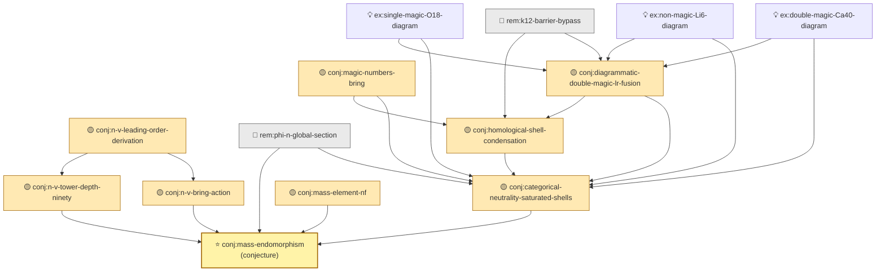
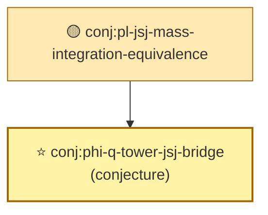
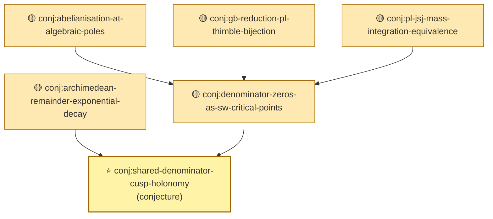
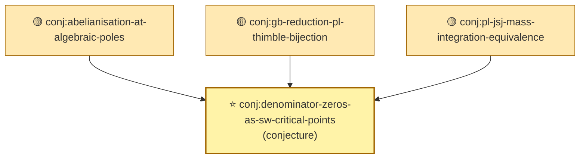

# Conjecture cones — §5 of the 2026-05-01 deep audit
**Compiled** 2026-05-01 on `claude/tier-4-math-audit-EkI7a` (workplan task **P4.2**).
**Pair:** [`2026-05-01-math-framework-deep-audit.md`](2026-05-01-math-framework-deep-audit.md), [`2026-05-01-math-framework-workplan.md`](2026-05-01-math-framework-workplan.md).

## Purpose

Each open conjecture from §5 of the deep audit gets a **downstream
cone**: the set of blocks that, by following `uses[]` (and
`interprets:` for `remark` blocks), transitively depend on the
conjecture.  The cone tells us *exactly* what becomes conjectural-by-
propagation if the named conjecture is left open — and conversely,
*how much of the paper is unblocked* once it is closed.

The cone respects the conjectural-propagation rule of AGENTS.md §3b:
any provable block (`theorem` / `proposition` / `lemma` /
`corollary`) appearing in the cone of an open `conj:` block is a
**propagation violation** and must be either demoted to `conjecture`
or refactored to remove the dependency.

## How to read the diagrams

- ⭐ **seed** — the conjecture under audit
- 🟡 **conjecture** — another conjecture downstream of the seed
- 🔷 **provable** (theorem / proposition / lemma / corollary) — a
  propagation violation, **must be demoted or refactored**
- 📐 **definition** — a definition that names something contingent on
  the seed (per §3b clarification, not itself a violation, but its
  downstream provable cone is)
- 📝 **remark** — a remark interpreting the seed (allowed)
- 💡 **example** — a concrete instance of the seed

Nodes are kept tractable: the diagram shows direct dependents plus a
representative sample of the cone (≤ 25 nodes per cone).  The full
cone counts are in the per-conjecture tables below the diagrams.

---

## Summary table
| Conjecture | Cone size | Propagation violations | Failure consequence |
|------------|----------:|-----------------------:|---------------------|
| [`conj:mass-endomorphism`](../../content/quantum-observable-universe/braids-and-knots/mass-endomorphism-conjecture.md) | 13 | 0 | The tower formula remains correct as an *infinite series*; the closed form is just a convenience. |
| [`conj:phi-q-tower-jsj-bridge`](../../content/quantum-observable-universe/braids-and-knots/phi-q-tower-jsj-bridge.md) | 1 | 0 | Algebraic-side mass tower remains correct but loses the JSJ-bounded thimble interpretation. |
| [`conj:shared-denominator-cusp-holonomy`](../../content/quantum-observable-universe/braids-and-knots/shared-denominator-cusp-holonomy.md) | 5 | 0 | Thimble integration domain identification weakens; algebraic side unaffected. |
| [`conj:denominator-zeros-as-sw-critical-points`](../../content/quantum-observable-universe/descartes-universe/denominator-zeros-as-sw-critical-points.md) | 3 | 0 | τ-image identification for SW critical points loses precision; algebraic side unaffected. |
| [`conj:motivic-perpetual-obstruction`](../../content/quantum-observable-universe/lifting-and-descent/motivic-perpetual-obstruction.md) | 0 | 0 | Compute remains, formal-substrate identification weakens. |

---

## conj:mass-endomorphism
**Source:** [`conj:mass-endomorphism`](../../content/quantum-observable-universe/braids-and-knots/mass-endomorphism-conjecture.md)  **Chapter:** `braids-and-knots`  **Short form:** mass tower as single $H_n(q)$ element  **Failure consequence:** The tower formula remains correct as an *infinite series*; the closed form is just a convenience.

**Cone size:** 13 downstream blocks (**conjecture** ×8, **example** ×3, **remark** ×2).

**🟢 No propagation violations** — every downstream block is already `conjecture` or `remark`/`example`/`definition`. Cone is propagation-clean.

### Downstream cone diagram



### By chapter

**`algebraic-substrate`** — 1 block: [`conj:magic-numbers-bring`](../../content/quantum-observable-universe/algebraic-substrate/magic-numbers-bring.md)

**`braids-and-knots`** — 3 blocks: [`conj:categorical-neutrality-saturated-shells`](../../content/quantum-observable-universe/braids-and-knots/categorical-neutrality-saturated-shells.md), [`conj:mass-element-nf`](../../content/quantum-observable-universe/braids-and-knots/mass-element-nf.md), [`rem:phi-n-global-section`](../../content/quantum-observable-universe/braids-and-knots/phi-n-global-section.md)

**`lifting-and-descent`** — 1 block: [`conj:homological-shell-condensation`](../../content/quantum-observable-universe/lifting-and-descent/homological-shell-condensation.md)

**`observations`** — 8 blocks: [`conj:diagrammatic-double-magic-lr-fusion`](../../content/quantum-observable-universe/observations/diagrammatic-double-magic-lr-fusion.md), [`conj:n-v-bring-action`](../../content/quantum-observable-universe/observations/n-v-bring-action.md), [`conj:n-v-leading-order-derivation`](../../content/quantum-observable-universe/observations/n-v-leading-order-derivation.md), [`conj:n-v-tower-depth-ninety`](../../content/quantum-observable-universe/observations/n-v-tower-depth-ninety.md), [`ex:double-magic-Ca40-diagram`](../../content/quantum-observable-universe/observations/double-magic-Ca40-diagram.md), [`ex:non-magic-Li6-diagram`](../../content/quantum-observable-universe/observations/non-magic-Li6-diagram.md), [`ex:single-magic-O18-diagram`](../../content/quantum-observable-universe/observations/single-magic-O18-diagram.md), [`rem:k12-barrier-bypass`](../../content/quantum-observable-universe/observations/k12-barrier-bypass.md)

---

## conj:phi-q-tower-jsj-bridge
**Source:** [`conj:phi-q-tower-jsj-bridge`](../../content/quantum-observable-universe/braids-and-knots/phi-q-tower-jsj-bridge.md)  **Chapter:** `braids-and-knots`  **Short form:** Hecke residue ↔ JSJ bridge  **Failure consequence:** Algebraic-side mass tower remains correct but loses the JSJ-bounded thimble interpretation.

**Cone size:** 1 downstream blocks (**conjecture** ×1).

**🟢 No propagation violations** — every downstream block is already `conjecture` or `remark`/`example`/`definition`. Cone is propagation-clean.

### Downstream cone diagram



### By chapter

**`descartes-universe`** — 1 block: [`conj:pl-jsj-mass-integration-equivalence`](../../content/quantum-observable-universe/descartes-universe/pl-jsj-mass-integration-equivalence.md)

---

## conj:shared-denominator-cusp-holonomy
**Source:** [`conj:shared-denominator-cusp-holonomy`](../../content/quantum-observable-universe/braids-and-knots/shared-denominator-cusp-holonomy.md)  **Chapter:** `braids-and-knots`  **Short form:** shared cusp denominator (algebraic ↔ holonomy)  **Failure consequence:** Thimble integration domain identification weakens; algebraic side unaffected.

**Cone size:** 5 downstream blocks (**conjecture** ×5).

**🟢 No propagation violations** — every downstream block is already `conjecture` or `remark`/`example`/`definition`. Cone is propagation-clean.

### Downstream cone diagram



### By chapter

**`braids-and-knots`** — 1 block: [`conj:archimedean-remainder-exponential-decay`](../../content/quantum-observable-universe/braids-and-knots/archimedean-remainder-exponential-decay.md)

**`descartes-universe`** — 4 blocks: [`conj:abelianisation-at-algebraic-poles`](../../content/quantum-observable-universe/descartes-universe/abelianisation-at-algebraic-poles.md), [`conj:denominator-zeros-as-sw-critical-points`](../../content/quantum-observable-universe/descartes-universe/denominator-zeros-as-sw-critical-points.md), [`conj:gb-reduction-pl-thimble-bijection`](../../content/quantum-observable-universe/descartes-universe/gb-reduction-pl-thimble-bijection.md), [`conj:pl-jsj-mass-integration-equivalence`](../../content/quantum-observable-universe/descartes-universe/pl-jsj-mass-integration-equivalence.md)

---

## conj:denominator-zeros-as-sw-critical-points
**Source:** [`conj:denominator-zeros-as-sw-critical-points`](../../content/quantum-observable-universe/descartes-universe/denominator-zeros-as-sw-critical-points.md)  **Chapter:** `descartes-universe`  **Short form:** denominator zeros ↔ SW critical points  **Failure consequence:** τ-image identification for SW critical points loses precision; algebraic side unaffected.

**Cone size:** 3 downstream blocks (**conjecture** ×3).

**🟢 No propagation violations** — every downstream block is already `conjecture` or `remark`/`example`/`definition`. Cone is propagation-clean.

### Downstream cone diagram



### By chapter

**`descartes-universe`** — 3 blocks: [`conj:abelianisation-at-algebraic-poles`](../../content/quantum-observable-universe/descartes-universe/abelianisation-at-algebraic-poles.md), [`conj:gb-reduction-pl-thimble-bijection`](../../content/quantum-observable-universe/descartes-universe/gb-reduction-pl-thimble-bijection.md), [`conj:pl-jsj-mass-integration-equivalence`](../../content/quantum-observable-universe/descartes-universe/pl-jsj-mass-integration-equivalence.md)

---

## conj:motivic-perpetual-obstruction

Block-kind: post-rename 2026-05-02, this is now `conj:motivic-perpetual-obstruction` (was `lem:` — the Lean file's `sorry` was always the conjectural content).

**Source:** [`conj:motivic-perpetual-obstruction`](../../content/quantum-observable-universe/lifting-and-descent/motivic-perpetual-obstruction.md)  **Chapter:** `lifting-and-descent`  **Short form:** no concrete `instance` at $q_0$  **Failure consequence:** Compute remains, formal-substrate identification weakens.

**Cone size:** 0 downstream blocks (_(empty cone)_).

**🟢 No propagation violations** — every downstream block is already `conjecture` or `remark`/`example`/`definition`. Cone is propagation-clean.

---

## Aggregate summary

- **Total blocks under at least one open audit conjecture:** 18
- **Total propagation violations across all 5 cones:** 0
- **Conjectures with zero violations** (already propagation-clean): 5 / 5
- **Conjectures with > 0 violations** (need P3.1 sweep action): 0 / 5

See workplan task **P3.1** (Conjectural-propagation sweep) for the action.

## Methodology — does propagation pass through remarks?

AGENTS.md §3b clarifies that the conjectural-propagation rule
(downstream of a `conj:` ⇒ kind must be `conjecture`) applies to
**provable kinds only** (`theorem`, `proposition`, `lemma`,
`corollary`).  Remarks make no logical claim and so are exempt.

However, this script computes the **transitive closure** of the
`uses[]` graph — including paths that pass through `remark` blocks.
This means that if

```
prop:A  →uses→  rem:B  →uses→  conj:C
```

then `prop:A` appears in the cone of `conj:C` even though the
intermediary `rem:B` is exempt.  The structural finding is real
(propagation flows), but whether the violation must be acted on
depends on the editor's reading of the chain:

1. If the prose of `rem:B` *itself* asserts a claim that depends on
   `conj:C`, then `prop:A`'s reliance on `rem:B` is a real
   propagation violation: `prop:A` must be demoted, or `rem:B`
   refactored to drop the conjecture from `uses[]` (switching to
   `interprets:` instead).
2. If `rem:B` is purely interpretive (a "see also" pointer) and the
   proof of `prop:A` does not depend on `conj:C`, then the violation
   is spurious; the cleanup is to **change `rem:B`'s
   `conj:C`-citation from `uses[]` to `interprets:`**.  Once that
   edge moves, `prop:A` no longer transitively `uses[]` `conj:C`.

The P3.1 sweep should resolve every cone-via-remark by case (1) or
case (2).  In particular, audit `rem:calibration-inputs` (cited by
≥ 2 propositions and itself listing `conj:mass-endomorphism` in
`uses[]`) — most likely a case (2) cleanup.

## Reproducibility

This report is generated mechanically from the `uses[]` /
`interprets:` graph.  To rebuild after content changes:

```bash
cd content && python3 pipeline/content-graph-analysis.py --json > /tmp/qou-graph.json
python3 docs/audits/scripts/build-conjecture-cones.py > docs/audits/conjecture-cones.md
```

The seed list is the §5 table of
[`2026-05-01-math-framework-deep-audit.md`](2026-05-01-math-framework-deep-audit.md).
If new audit conjectures are added (or existing ones closed), update
`AUDIT_CONJECTURES` in the build script.

