# Figures index — *On the Mechanics of Quantum Observable Universes*

Auto-generated by [`content/pipeline/build-figures-index.ts`](../content/pipeline/build-figures-index.ts).
Do not edit by hand — re-run the script after adding or modifying a figure under
`content/quantum-observable-universe/<chapter>/rendered/`.

**Authoring source-of-truth:**

- Specification + placement: [`docs/illustration-recommendations.md`](illustration-recommendations.md)
- Skill (prompt → SVG): [`.claude/skills/local/illustration-author.md`](../.claude/skills/local/illustration-author.md)
- Coordination ledger: [`docs/coordination/illustrations.md`](coordination/illustrations.md)

**Reading the table:**

- *Stub* — repository-wide unique slug (filename without `.svg`).
- *Title* — short generated name from the first `# …` heading of the prompt sidecar; also rendered under the figure in the printed PDF via `\figtitle{…}`.
- *Light* — primary SVG. Click for full size.
- *Dark* — hand-tuned dark-mode override if present; otherwise the same light SVG (viewer applies CSS `invert(1) hue-rotate(180deg)` filter automatically).
- *Prompt* — the textual prompt that produced the SVG (also surfaced in the printed PDF margin via `\figprompt{…}`).
- *Variants* — sibling design alternatives in the same recommended slot.
- *Wired in* — the chapter `.md` block that currently embeds this SVG; `(not wired)` means the figure is on disk but not yet referenced from any block (the author can choose where to place it).

**Status:** 42 authored figure(s) across 13 chapter(s) · 2 wired into a block · 0 hand-tuned dark-mode override(s).

## Algebraic Substrate

| Stub | Title | Light | Dark | Prompt | Variants | Wired in |
|------|-------|-------|------|--------|----------|----------|
| `frobenius-hopf-cake-0` | The Frobenius–Hopf substrate — three layers |  |  filter | F7.1 (P0). A three-layer cake stacked vertically. Bottom layer: the Hopf algebra structure $(m, \Delta, \eta, \varepsilon, S)$ on $A$, with the five string-diagram glyphs on the right (multiplication as a Y-shape, comultiplication as inverted Y, unit and counit as dots, antipode… | — | *(not wired)* |
| `spectral-trace-loop-0` | Spectral trace = closure of f into a loop | <a href="../content/quantum-observable-universe/algebraic-substrate/rendered/spectral-trace-loop-0.svg" title="Spectral trace = closure of f into a loop">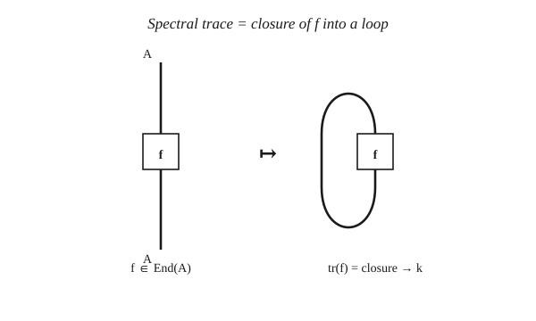</a> |  filter | F7.2 (P2 / P1). Two side-by-side string diagrams. Left: an open endomorphism $f \in \mathrm{End}(A)$ — vertical strand labelled $A$ above and below a small white box labelled $f$. Right: the same box $f$ inserted into a closed loop — strand goes up out of the box, curves around,… | — | *(not wired)* |

## Braids And Knots

| Stub | Title | Light | Dark | Prompt | Variants | Wired in |
|------|-------|-------|------|--------|----------|----------|
| `borromean-quarks-0` | Borromean quarks on the exceptional divisor | <a href="../content/quantum-observable-universe/braids-and-knots/rendered/borromean-quarks-0.svg" title="Borromean quarks on the exceptional divisor">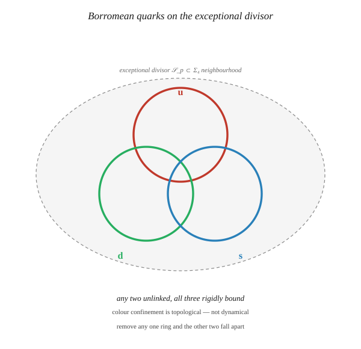</a> |  filter | F4.5 (P0). Three unknotted circles in the classic Borromean configuration (pairwise unlinked, but rigidly bound as a triple) drawn centred over a faint dashed ellipse representing a small patch of the exceptional divisor $\mathcal{S}_p \subset \Sigma_4$. The three circles are co… | — | *(not wired)* |
| `crossing-energy-staircase-0` | Crossing-energy stratification |  |  filter | F4.9 (P2 / P1). A step function plot. Horizontal axis: writhe $w(K)$, the net number of positive minus negative crossings, ticked at integer values $-3, -2, -1, 0, +1, +2, +3$. Vertical axis: binding energy $E_{\mathrm{bind}}$. The staircase rises symmetrically away from $w = 0$… | — | *(not wired)* |
| `knot-complement-rho-0` | π₁(ℙ¹(ℂ) \ K) → PSL(2, ℂ) via ρ |  |  filter | F4.8 (P1). Left: a stylised trefoil drawn lightly with a small dashed red circle highlighting one meridian disk; labels mark the meridian and identify the trefoil as $K \subset \mathbb{P}^1(\mathbb{C})$ with $\pi_1$ of the complement generated by meridians. Centre: a large $\rho… | — | *(not wired)* |
| `lp-active-set-0` | Operator-selection LP / SDP — active set + dual |  |  filter | F11.2 (P0). A 2D feasibility polytope drawn on $(x_1, x_2)$ axes. The polygon is filled light grey (the feasible region — the intersection of the half-planes $G \succeq 0$ and the net constraint). The polygon's two upper edges, terminating at the optimum vertex $x^*$, are drawn… | — | *(not wired)* |
| `markov-closure-0` | Markov closure: braid → link |  |  filter | F4.3 (P0). Three panels. Left: an open 3-strand braid $\beta = \sigma_1 \sigma_2^{-1} \sigma_1$ drawn vertically inside a faint dashed box, with three crossings (the gaps in the under-strands marking over/under). Centre: the *closure* $\hat\beta$ obtained by joining strand-$i$ a… | — | *(not wired)* |
| `mass-decomposition-0` | Brane-tower mass decomposition | <a href="../content/quantum-observable-universe/braids-and-knots/rendered/mass-decomposition-0.svg" title="Brane-tower mass decomposition">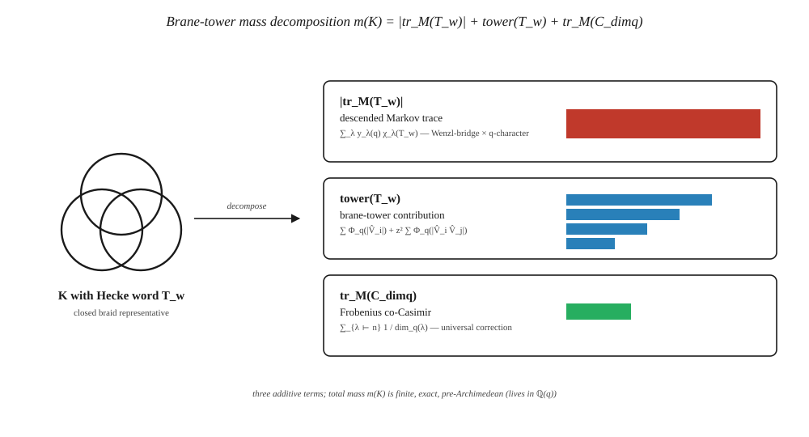</a> |  filter | F4.7 (P1). An exploded view: on the left, a stylised trefoil $K$ with its Hecke-word label $T_w$ underneath. An arrow labelled "decompose" points right to a stack of three rounded boxes, each carrying one term of the unified mass formula $m(K) = \|\mathrm{tr}_M(T_w)\| + \mathrm{to… | — | *(not wired)* |
| `mobius-pairing-0` | Möbius energy as a Frobenius pairing on K × K |  |  filter | F4.4 (P1). A stylised trefoil drawn in the left half of the figure, with two points $x$ and $y$ marked on the curve in red, and a dashed red segment of length $\|x - y\|$ joining them. Right side: the Möbius integrand $E(K) = \iint_{K \times K \setminus \Delta} ds\, dt / \|x - y\|^2… | — | *(not wired)* |
| `particle-knot-dictionary-0` | The particle ↔ knot dictionary |  |  filter | F4.1 (P0). A 2-row grid mapping knot types to particle identities. Top row (5 cards): the four charged-lepton + one closure cell, with each card showing a stylised torus knot $T(2,2k+1)$ above its particle label. Cards left-to-right: unknot $0_1 \to \nu_e$ (a circle, trivial bra… | — | *(not wired)* |
| `r-matrix-skein-0` | The Hecke skein triple |  |  filter | F4.2 (P0). Three side-by-side panels of local strand diagrams: a positive crossing $\sigma_i$ (over-strand running from lower-left to upper-right), its inverse $\sigma_i^{-1}$ (mirror), and the identity $1$ (two parallel strands). Each panel is framed with a light dashed border.… | — | [`braids-and-knots/braid-action-tensor.md`](../content/quantum-observable-universe/braids-and-knots/braid-action-tensor.md) |
| `schur-weyl-bose-fermi-0` | Schur–Weyl boson / fermion split on V^⊗3 | <a href="../content/quantum-observable-universe/braids-and-knots/rendered/schur-weyl-bose-fermi-0.svg" title="Schur–Weyl boson / fermion split on V^⊗3">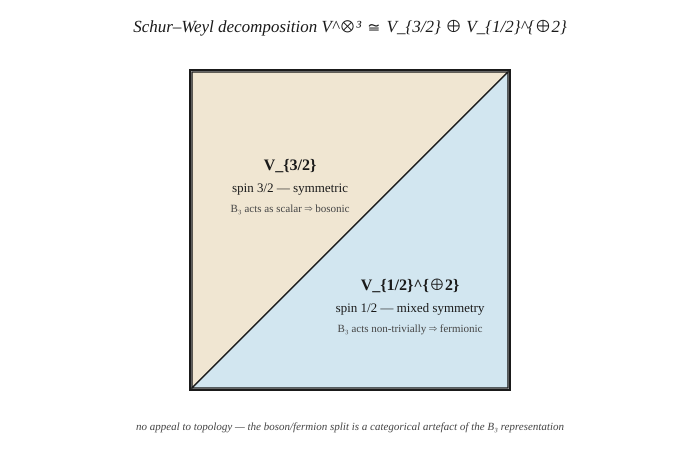</a> |  filter | F4.6 (P1). A square representing $V^{\otimes 3}$ split by a diagonal into two regions. The upper-left triangle is shaded warm and labelled "$V_{3/2}$ — spin 3/2 — symmetric — B₃ acts as scalar ⇒ bosonic". The lower-right triangle is shaded cool and labelled "$V_{1/2}^{\oplus 2}$… | — | *(not wired)* |

## Descartes Universe

| Stub | Title | Light | Dark | Prompt | Variants | Wired in |
|------|-------|-------|------|--------|----------|----------|
| `bring-coral-3-tubes-0` | Bring's surface as a coral with three colour tubes |  |  filter | F5.1 (P0). A schematic genus-4 surface drawn as a "coral": a horizontal body (large translucent ellipse) with four arched handles rising above. Three of the handles are coloured red, green, blue — the colour tubes carrying the spectral coordinates $c_r$, $c_g$, $c_b$ from Chapte… | — | *(not wired)* |
| `color-tube-coords-0` | Colour-tube coordinates c_r, c_g, c_b on Σ₄ | <a href="../content/quantum-observable-universe/descartes-universe/rendered/color-tube-coords-0.svg" title="Colour-tube coordinates c_r, c_g, c_b on Σ₄">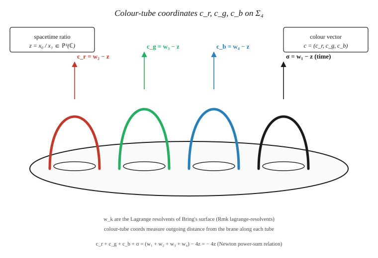</a> |  filter | F6.1 (P0). The Bring coral from F5.1 with coordinate arrows added. Each of the four coloured handles has an arrow rising from its apex labelled with the corresponding shifted Lagrange resolvent: $c_r = w_2 - z$ (red), $c_g = w_3 - z$ (green), $c_b = w_4 - z$ (blue), and the time… | — | *(not wired)* |
| `descartes-polytope-0` | Bring's surface as a moduli-polytope corner |  |  filter | F5.2 (P1). A 2D plot with horizontal axis genus $g$ (ticked $1, 2, 3, 4, 5, 6$) and vertical axis $\|\mathrm{Aut}\|$. The Hurwitz bound $84(g-1)$ is drawn as a blue dashed diagonal ceiling line; the QOU constraint $\chi = -6 \Rightarrow g = 4$ is drawn as a red dashed vertical lin… | — | *(not wired)* |
| `exceptional-divisor-borromeans-0` | Quark Borromeans on the exceptional divisor |  |  filter | F6.3 (P0). Two side-by-side Borromean configurations of three rings each, drawn over small dashed circles representing patches of the exceptional divisor $\mathcal{S}_p \subset \Sigma_4$. Left panel: solid R/G/B Borromean labelled $u$, $d$, $s$ — the light quark triple, generati… | — | *(not wired)* |
| `s5-permutohedron-0` | The S₅ permutohedron — 120 vertices |  |  filter | F6.4 (P1). A 2D Schlegel-style projection of the order-5 permutohedron $\Pi_5$ — a 4-dimensional polytope whose 120 vertices are the permutations of $(1,2,3,4,5)$. The figure renders nested hexagonal facets (with quadrilateral connectors) reproducing the visible structure when v… | — | *(not wired)* |
| `ym-mass-gap-0` | Yang–Mills mass gap — categorical spectral picture | <a href="../content/quantum-observable-universe/descartes-universe/rendered/ym-mass-gap-0.svg" title="Yang–Mills mass gap — categorical spectral picture">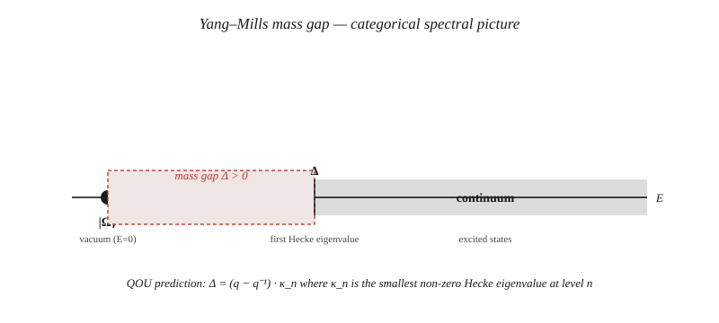</a> |  filter | F5.3 (P1). A horizontal energy axis. A single solid black dot at $E = 0$ labelled $\|\Omega\rangle$ (vacuum). A shaded gap region (light pink with red dashed border) from $E = 0$ to $E = \Delta$ labelled "mass gap $\Delta > 0$". To the right of $\Delta$ a translucent grey band la… | — | *(not wired)* |

## Fluid Dynamics

| Stub | Title | Light | Dark | Prompt | Variants | Wired in |
|------|-------|-------|------|--------|----------|----------|
| `madelung-decomposition-0` | Madelung decomposition ψ = √ρ · e^{iS/ℏ} | <a href="../content/quantum-observable-universe/fluid-dynamics/rendered/madelung-decomposition-0.svg" title="Madelung decomposition ψ = √ρ · e^{iS/ℏ}">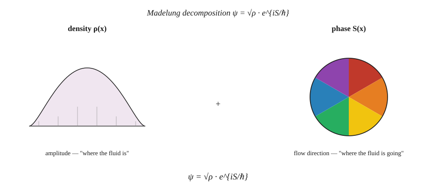</a> |  filter | F10.2 (P1). Two side-by-side panels with a "+" sign between them. Left: a bell-curve height map representing the density $\rho(x)$ on the brane (purple-tinted), with grid lines beneath. Caption: "amplitude — where the fluid is". Right: a six-segment coloured wheel representing t… | — | *(not wired)* |
| `ns-obstruction-blowup-0` | NS obstruction: q-NS regularity (q > 1) vs classical blowup (q = 1) | <a href="../content/quantum-observable-universe/fluid-dynamics/rendered/ns-obstruction-blowup-0.svg" title="NS obstruction: q-NS regularity (q > 1) vs classical blowup (q = 1)">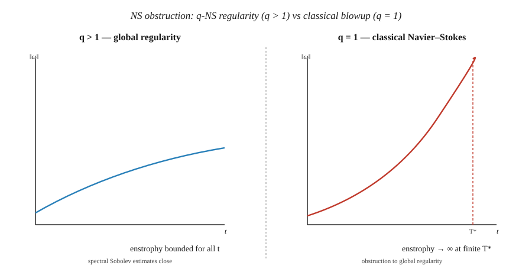 1) vs classical blowup (q = 1)"></a> | <a href="../content/quantum-observable-universe/fluid-dynamics/rendered/ns-obstruction-blowup-0.svg" title="NS obstruction: q-NS regularity (q > 1) vs classical blowup (q = 1) (filter-inverted)"> 1) vs classical blowup (q = 1) (filter-inverted)"></a> filter | F10.3 (P1). Two side-by-side phase portraits separated by a vertical dashed line. Left ($q > 1$): time on the horizontal axis, enstrophy $\\|\omega\\|$ on the vertical; a blue curve rises and asymptotes — bounded for all $t$. Caption: "global regularity; spectral Sobolev estimates… | — | *(not wired)* |
| `q-vortex-spectrum-0` | q-vortex spectrum on the brane |  |  filter | F10.1 (P0). Two-panel composite. Left: Bring's coral (smaller copy of F5.1) with dashed-grey closed flow lines drawn looping around each of the four handles; each flow line is annotated with its $q$-quantised circulation $\Gamma_n = 2\pi [n]_q$ for $n = 1, 2, 3, 4$. A footnote d… | — | *(not wired)* |

## Information Theory

| Stub | Title | Light | Dark | Prompt | Variants | Wired in |
|------|-------|-------|------|--------|----------|----------|
| `emergent-gravity-0` | Emergent gravity from information geometry | <a href="../content/quantum-observable-universe/information-theory/rendered/emergent-gravity-0.svg" title="Emergent gravity from information geometry">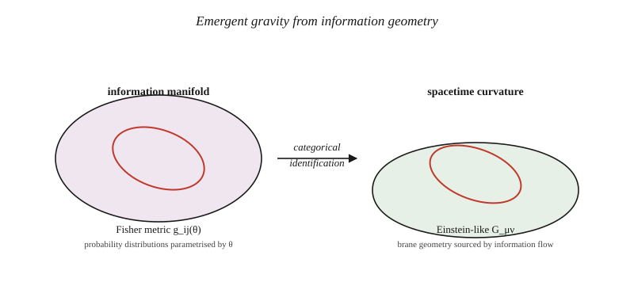</a> |  filter | F8.2 (P1). Two-panel composite. Left: an "information manifold" — an ellipse-shaped surface labelled "information manifold; Fisher metric $g_{ij}(\theta)$; probability distributions parametrised by $\theta$" with a red metric ellipsoid drawn on it. Right: the same metric ellipso… | — | *(not wired)* |
| `regime-scale-0` | Regime table — physical length scales |  |  filter | F8.1 (P1). Horizontal log-scale axis from $10^{-35}$ m (Planck) to $10^{25}$ m (Hubble). Four coloured bands tile the axis: blue "categorical substrate" (below $\ell_P$ ⇒ on the fibre), warm "Hecke regime" (braids · particles · nuclei), green "thermodynamic" (atoms · molecules ·… | — | *(not wired)* |

## Introduction

| Stub | Title | Light | Dark | Prompt | Variants | Wired in |
|------|-------|-------|------|--------|----------|----------|
| `roadmap-flow-A` | The roadmap as argument flow (horizontal three-band) |  |  filter | F0.1 (P0), variant A. A horizontal three-band argument-flow diagram. Top band lists the three inputs the paper takes from outside (everyday observations; the categorical language of rigid braided monoidal categories with a Frobenius–Hopf object; and the three calibration scalars… | [B](../content/quantum-observable-universe/introduction/rendered/roadmap-flow-B.svg) | [`introduction/roadmap-diagram.md`](../content/quantum-observable-universe/introduction/roadmap-diagram.md) |
| `roadmap-flow-B` | The roadmap as argument flow (radial wheel) | <a href="../content/quantum-observable-universe/introduction/rendered/roadmap-flow-B.svg" title="The roadmap as argument flow (radial wheel)">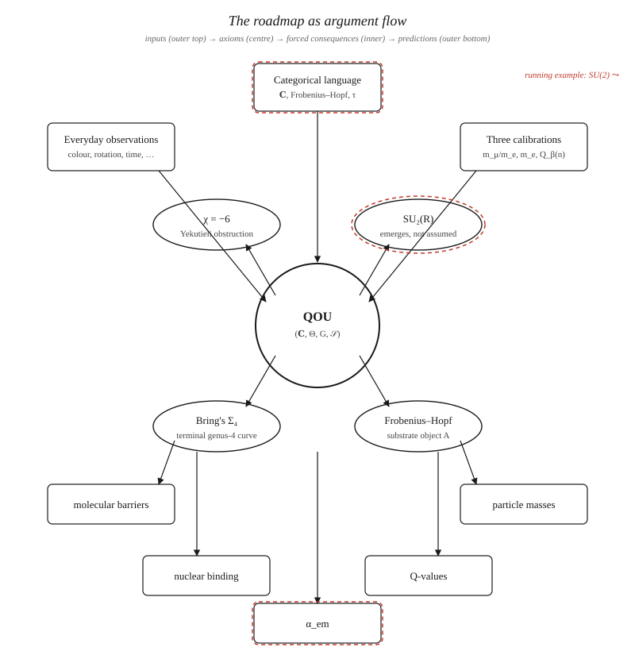</a> |  filter | F0.1 (P0), variant B. A radial argument-flow diagram. The QOU axioms occupy the centre as a single labelled disk. Around it on an inner ring sit the four forced consequences (SU₂(R), χ=−6, Bring's Σ₄, Frobenius–Hopf substrate). On the upper outer arc sit the three inputs (everyd… | [A](../content/quantum-observable-universe/introduction/rendered/roadmap-flow-A.svg) | *(not wired)* |
| `three-fold-triangle-0` | Three observations, one constraint | <a href="../content/quantum-observable-universe/introduction/rendered/three-fold-triangle-0.svg" title="Three observations, one constraint">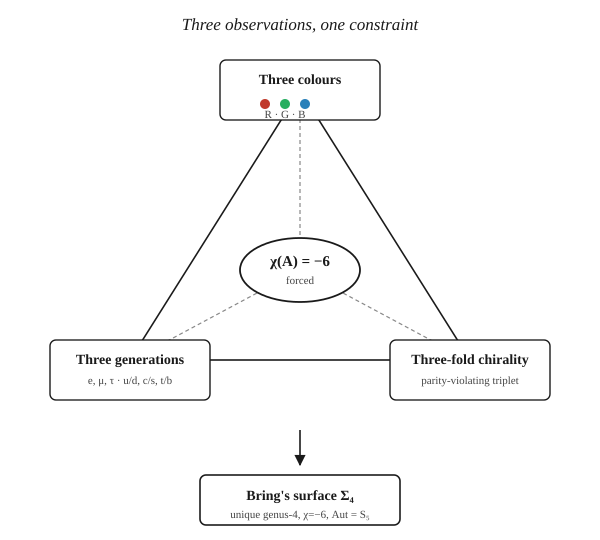</a> |  filter | F0.2 (P0). Equilateral triangle with three vertex boxes carrying the threefold structures observed in nature: three colours (R/G/B), three generations of matter (e/μ/τ leptons; u/d, c/s, t/b quarks), and three-fold chirality. Three dashed spokes connect the vertices to a central… | — | *(not wired)* |

## Lifting And Descent

| Stub | Title | Light | Dark | Prompt | Variants | Wired in |
|------|-------|-------|------|--------|----------|----------|
| `brane-tower-stack-0` | The recursive brane tower |  |  filter | F3.1 (P0). Vertical stack of disks of increasing radius, labelled bottom-to-top $A_0, A_1, A_2, A_3, \ldots, A_{n+1}$; each connected to the next by a $J^1$ jet-prolongation arrow on the right side. The disk at the base is the original Frobenius–Hopf object $A_0 = A$; each subse… | — | *(not wired)* |
| `yekutieli-staircase-0` | Yekutieli obstruction along the brane tower |  |  filter | F3.2 (P1). A staircase rising left-to-right with five steps for $n = 0, 1, 2, 3, 4$. Each step represents the brane-tower level $A_n$. At each step (above the platform) a small red dot is the Yekutieli obstruction class $\kappa_n$. The final step is marked in green with $\kappa_… | — | *(not wired)* |

## Molecular Construction

| Stub | Title | Light | Dark | Prompt | Variants | Wired in |
|------|-------|-------|------|--------|----------|----------|
| `h2-shared-trefoil-0` | H₂ as a shared trefoil bond |  |  filter | F13.1 (P0). Two stylised hydrogen atoms drawn as trefoils ($3_1$) on left and right; between them a red shared circle representing a single sub-Hopf link bridging the two trefoils — the categorical realisation of a covalent bond. Each H atom carries the label "trefoil $3_1$"; th… | — | *(not wired)* |
| `molecular-progression-0` | Molecular braid progression: H₂ → CO → CO₂ → CH₄ → C₂H₆ → C₆H₆ | <a href="../content/quantum-observable-universe/molecular-construction/rendered/molecular-progression-0.svg" title="Molecular braid progression: H₂ → CO → CO₂ → CH₄ → C₂H₆ → C₆H₆">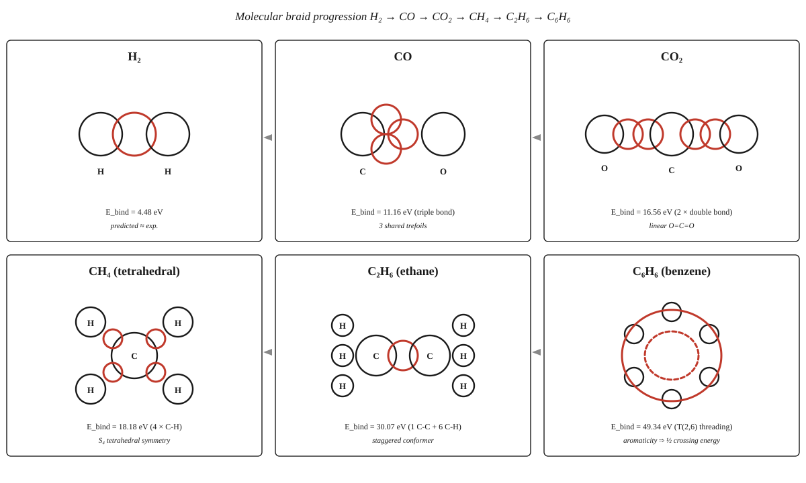</a> |  filter | F13.2 (P0). A 2 × 3 grid of molecular cells. Each cell shows the closed braid representation of one molecule, with the constituent atoms drawn as black-stroked circles labelled C, H, or O, and the *shared sub-Hopf links* (covalent bonds) drawn as red circles bridging the atomic… | — | *(not wired)* |

## Observations

| Stub | Title | Light | Dark | Prompt | Variants | Wired in |
|------|-------|-------|------|--------|----------|----------|
| `substrate-consistency-window-0` | The substrate consistency window |  |  filter | F12.1 (P0). A horizontal axis showing the substrate parameter $q$ across the range $[1.100, 1.120]$, ticked every $0.005$. Three translucent vertical bands span the axis, each bounded by the $q$-range allowed by one independent calibration: red = $m_\mu/m_e$ consistency, green =… | — | *(not wired)* |

## Organic Chemistry

| Stub | Title | Light | Dark | Prompt | Variants | Wired in |
|------|-------|-------|------|--------|----------|----------|
| `carbon-half-filled-0` | Carbon's half-filled valence shell | <a href="../content/quantum-observable-universe/organic-chemistry/rendered/carbon-half-filled-0.svg" title="Carbon's half-filled valence shell">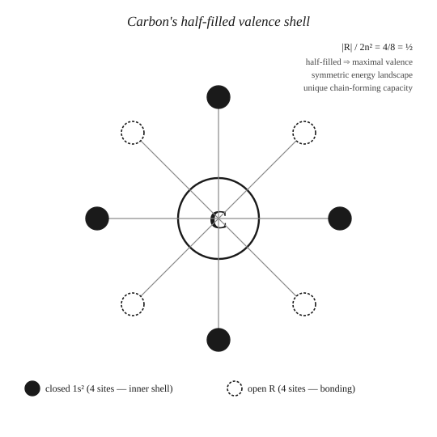</a> |  filter | F14.1 (P0). Central carbon node "C" with eight equally-spaced linking sites around it on a circle, corresponding to the second-shell capacity $2n^2 = 8$. Four sites — north, east, south, west — are filled black (the closed inner shell $1s^2$). Four sites — northeast, southeast,… | — | *(not wired)* |
| `threading-link-benzene-0` | The threading link T(2, 6) — benzene |  |  filter | F14.2 (P0). A regular hexagon of six small carbon-atom rings (drawn as small white circles labelled C) and a single large red ellipse threading through all six — the threading link $T(2, 6)$. A second concentric dashed red ellipse hints at the link's two-component nature. A smal… | — | *(not wired)* |

## Particle Interactions

| Stub | Title | Light | Dark | Prompt | Variants | Wired in |
|------|-------|-------|------|--------|----------|----------|
| `beta-decay-tower-0` | β-decay = Markov-stabilisation chain | <a href="../content/quantum-observable-universe/particle-interactions/rendered/beta-decay-tower-0.svg" title="β-decay = Markov-stabilisation chain">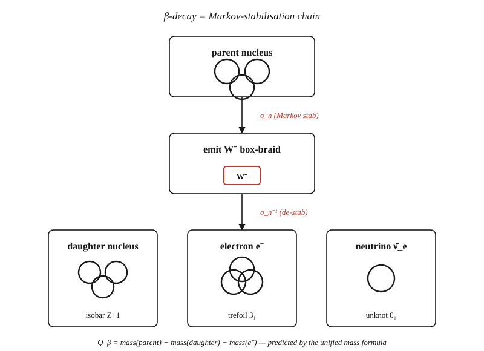</a> |  filter | F11.4 (P1). A vertical chain. Top: a labelled box "parent nucleus" with a small braided knot inside. Arrow downward labelled "$\sigma_n$ (Markov stab)". Middle: a labelled box "emit $W^-$ box-braid" with a small red rectangle marked $W^-$. Arrow downward labelled "$\sigma_n^{-1}… | — | *(not wired)* |
| `gs-reduction-tree-0` | The Gröbner–Shirshov reduction tree |  |  filter | F11.1 (P0). A rooted tree showing one full Gröbner–Shirshov reduction. Root at top: the unreduced Hecke word $T_w = \sigma_1 \sigma_2 \sigma_1 \sigma_2^{-1} \sigma_1 \sigma_2 \in H_3(q)$. Three downward branches, each annotated with a rewrite-rule label: *by braid* (σ₁σ₂σ₁ = σ₂σ… | — | *(not wired)* |
| `shell-closure-spectrum-0` | Nuclear shell closure as Hecke eigenvalue gap |  |  filter | F11.3 (P1). Bar chart with horizontal axis $Z$ (proton number, $0$ to $130$) and vertical axis "Hecke-spectrum gap" $\Delta$. Most $Z$ values get small grey bars; bars at $Z = 2, 8, 20, 28, 50, 82, 126$ are tall and coloured red, with their numerical labels above. These are the… | — | *(not wired)* |

## Quantum Observable Universes

| Stub | Title | Light | Dark | Prompt | Variants | Wired in |
|------|-------|-------|------|--------|----------|----------|
| `dirac-square-blocks-0` | The categorical Dirac square — D_∇² |  |  filter | F2.2 (P1). A $2 \times 2$ block-matrix glyph for $D_\nabla^2$. The diagonal blocks are shaded light grey and labelled: top-left "Ric — spatial curvature", bottom-right "$F_\nabla$ — Yang–Mills internal curvature". The off-diagonal blocks are drawn lighter and contain a single "0… | — | *(not wired)* |
| `instanton-self-dual-0` | Instanton self-duality projector | <a href="../content/quantum-observable-universe/quantum-observable-universes/rendered/instanton-self-dual-0.svg" title="Instanton self-duality projector">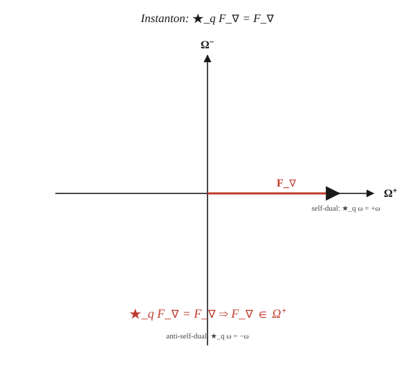</a> |  filter | F2.3 (P1). A coordinate plane with two perpendicular axes: horizontal $\Omega^+$ (self-dual 2-forms, $\star_q \omega = +\omega$), vertical $\Omega^-$ (anti-self-dual). A red vector labelled $F_\nabla$ lies along the $\Omega^+$ axis, illustrating that the curvature of an instanto… | — | *(not wired)* |
| `qu-to-qou-funnel-0` | From QU to QOU: three constraints |  |  filter | F2.1 (P0). A funnel diagram. Top: a wide dashed-outline cloud labelled "QUs — all rigid braided monoidal categories with Frobenius–Hopf object A and fibre functor τ". The cloud narrows through three sequential constrictions, each labelled with one of the QOU axioms: non-degenera… | — | *(not wired)* |

## Quantum Universes

| Stub | Title | Light | Dark | Prompt | Variants | Wired in |
|------|-------|-------|------|--------|----------|----------|
| `frobenius-snake-0` | Rigidity: the zig-zag snake identity | <a href="../content/quantum-observable-universe/quantum-universes/rendered/frobenius-snake-0.svg" title="Rigidity: the zig-zag snake identity">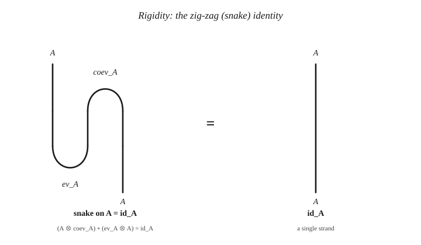</a> |  filter | F1.1 (P0). Left: a Penrose / string-diagram zig-zag composite. Top entry strand labelled $A$ enters; a cap labelled $\mathrm{coev}_A$ creates an $A \otimes A^\vee$ pair; three middle strands run vertically; a cup labelled $\mathrm{ev}_A$ closes the first two strands together; th… | — | *(not wired)* |
| `jet-prolongation-ladder-0` | Jet prolongation: Kähler differentials and J¹(A) |  |  filter | F1.3 (P2 / P1). The short exact sequence $0 \to \Omega^1(A) \to A \otimes A \xrightarrow{m} A \to 0$ drawn as a horizontal ladder of three labelled rounded-rectangle nodes connected by arrows. Each node carries a small subtitle: "Kähler bimodule", "tensor square", "multiplicatio… | — | *(not wired)* |
| `tannaka-krein-triangle-0` | Tannaka–Krein reconstruction | <a href="../content/quantum-observable-universe/quantum-universes/rendered/tannaka-krein-triangle-0.svg" title="Tannaka–Krein reconstruction">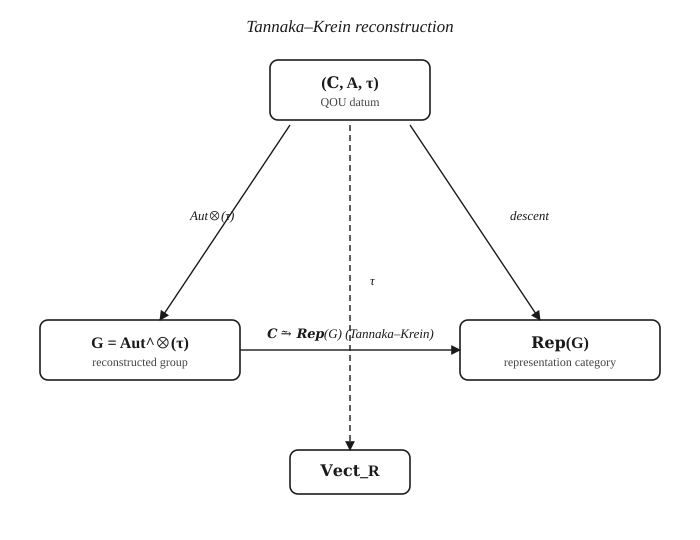</a> |  filter | F1.2 (P1). Triangle relating the QOU datum to the reconstructed group and its representation category. Top vertex: a labelled box "(𝐂, A, τ) — QOU datum". Bottom-left vertex: "$G = \mathrm{Aut}^\otimes(\tau)$ — reconstructed group". Bottom-right vertex: "$\mathbf{Rep}(G)$ — rep… | — | *(not wired)* |

Generated 2026-05-10 from 42 authored SVG file(s).
