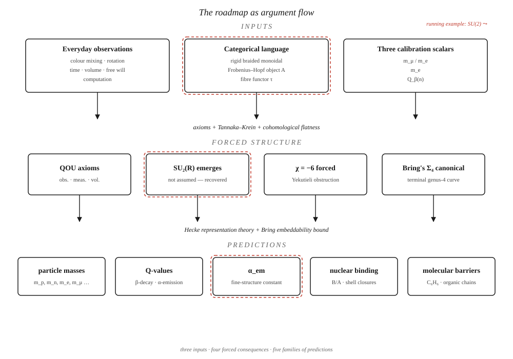
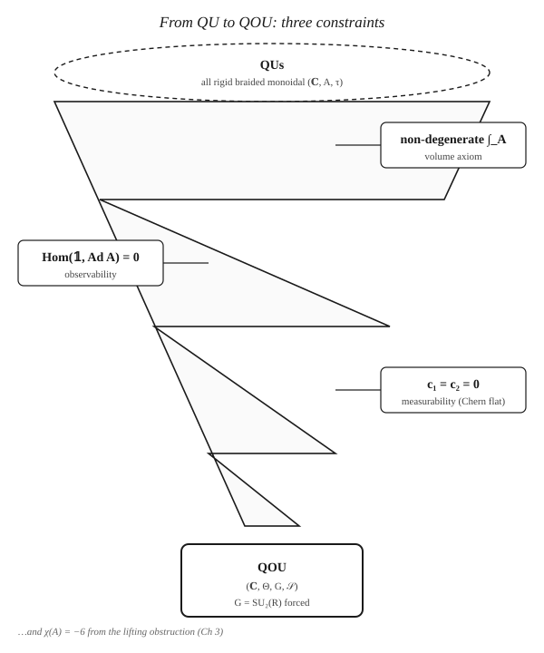

# Figures index — *On the Mechanics of Quantum Observable Universes*

Auto-generated by [`content/pipeline/build-figures-index.ts`](../content/pipeline/build-figures-index.ts).
Do not edit by hand — re-run the script after adding or modifying a figure under
`content/quantum-observable-universe/<chapter>/rendered/`.

**Authoring source-of-truth:**

- Specification + placement: [`docs/illustration-recommendations.md`](illustration-recommendations.md)
- Skill (prompt → SVG): [`.claude/skills/local/illustration-author.md`](../.claude/skills/local/illustration-author.md)
- Coordination ledger: [`docs/coordination/illustrations.md`](coordination/illustrations.md)

**Reading the table:**

- *Stub* — repository-wide unique slug (filename without `.svg`).
- *Title* — short generated name from the first `# …` heading of the prompt sidecar; also rendered under the figure in the printed PDF via `\figtitle{…}`.
- *Light* — primary SVG. Click for full size.
- *Dark* — hand-tuned dark-mode override if present; otherwise the same light SVG (viewer applies CSS `invert(1) hue-rotate(180deg)` filter automatically).
- *Prompt* — the textual prompt that produced the SVG (also surfaced in the printed PDF margin via `\figprompt{…}`).
- *Variants* — sibling design alternatives in the same recommended slot.
- *Wired in* — the chapter `.md` block that currently embeds this SVG; `(not wired)` means the figure is on disk but not yet referenced from any block (the author can choose where to place it).

**Status:** 8 authored figure(s) across 6 chapter(s) · 2 wired into a block · 0 hand-tuned dark-mode override(s).

## Braids And Knots

| Stub | Title | Light | Dark | Prompt | Variants | Wired in |
|------|-------|-------|------|--------|----------|----------|
| `r-matrix-skein-0` | The Hecke skein triple |  |  filter | F4.2 (P0). Three side-by-side panels of local strand diagrams: a positive crossing $\sigma_i$ (over-strand running from lower-left to upper-right), its inverse $\sigma_i^{-1}$ (mirror), and the identity $1$ (two parallel strands). Each panel is framed with a light dashed border.… | — | [`braids-and-knots/braid-action-tensor.md`](../content/quantum-observable-universe/braids-and-knots/braid-action-tensor.md) |

## Introduction

| Stub | Title | Light | Dark | Prompt | Variants | Wired in |
|------|-------|-------|------|--------|----------|----------|
| `roadmap-flow-A` | The roadmap as argument flow (horizontal three-band) |  |  filter | F0.1 (P0), variant A. A horizontal three-band argument-flow diagram. Top band lists the three inputs the paper takes from outside (everyday observations; the categorical language of rigid braided monoidal categories with a Frobenius–Hopf object; and the three calibration scalars… | [B](../content/quantum-observable-universe/introduction/rendered/roadmap-flow-B.svg) | [`introduction/roadmap-diagram.md`](../content/quantum-observable-universe/introduction/roadmap-diagram.md) |
| `roadmap-flow-B` | The roadmap as argument flow (radial wheel) |  |  filter | F0.1 (P0), variant B. A radial argument-flow diagram. The QOU axioms occupy the centre as a single labelled disk. Around it on an inner ring sit the four forced consequences (SU₂(R), χ=−6, Bring's Σ₄, Frobenius–Hopf substrate). On the upper outer arc sit the three inputs (everyd… | [A](../content/quantum-observable-universe/introduction/rendered/roadmap-flow-A.svg) | *(not wired)* |
| `three-fold-triangle-0` | Three observations, one constraint |  |  filter | F0.2 (P0). Equilateral triangle with three vertex boxes carrying the threefold structures observed in nature: three colours (R/G/B), three generations of matter (e/μ/τ leptons; u/d, c/s, t/b quarks), and three-fold chirality. Three dashed spokes connect the vertices to a central… | — | *(not wired)* |

## Lifting And Descent

| Stub | Title | Light | Dark | Prompt | Variants | Wired in |
|------|-------|-------|------|--------|----------|----------|
| `brane-tower-stack-0` | The recursive brane tower |  |  filter | F3.1 (P0). Vertical stack of disks of increasing radius, labelled bottom-to-top $A_0, A_1, A_2, A_3, \ldots, A_{n+1}$; each connected to the next by a $J^1$ jet-prolongation arrow on the right side. The disk at the base is the original Frobenius–Hopf object $A_0 = A$; each subse… | — | *(not wired)* |

## Observations

| Stub | Title | Light | Dark | Prompt | Variants | Wired in |
|------|-------|-------|------|--------|----------|----------|
| `substrate-consistency-window-0` | The substrate consistency window |  |  filter | F12.1 (P0). A horizontal axis showing the substrate parameter $q$ across the range $[1.100, 1.120]$, ticked every $0.005$. Three translucent vertical bands span the axis, each bounded by the $q$-range allowed by one independent calibration: red = $m_\mu/m_e$ consistency, green =… | — | *(not wired)* |

## Organic Chemistry

| Stub | Title | Light | Dark | Prompt | Variants | Wired in |
|------|-------|-------|------|--------|----------|----------|
| `carbon-half-filled-0` | Carbon's half-filled valence shell |  |  filter | F14.1 (P0). Central carbon node "C" with eight equally-spaced linking sites around it on a circle, corresponding to the second-shell capacity $2n^2 = 8$. Four sites — north, east, south, west — are filled black (the closed inner shell $1s^2$). Four sites — northeast, southeast,… | — | *(not wired)* |

## Quantum Observable Universes

| Stub | Title | Light | Dark | Prompt | Variants | Wired in |
|------|-------|-------|------|--------|----------|----------|
| `qu-to-qou-funnel-0` | From QU to QOU: three constraints |  |  filter | F2.1 (P0). A funnel diagram. Top: a wide dashed-outline cloud labelled "QUs — all rigid braided monoidal categories with Frobenius–Hopf object A and fibre functor τ". The cloud narrows through three sequential constrictions, each labelled with one of the QOU axioms: non-degenera… | — | *(not wired)* |

Generated 2026-05-10 from 8 authored SVG file(s).
