# Figures index — *On the Mechanics of Quantum Observable Universes*

Auto-generated by [`content/pipeline/build-figures-index.ts`](../content/pipeline/build-figures-index.ts).
Do not edit by hand — re-run the script after adding or modifying a figure under
`content/quantum-observable-universe/<chapter>/rendered/`.

**Authoring source-of-truth:**

- Specification + placement: [`docs/illustration-recommendations.md`](illustration-recommendations.md)
- Skill (prompt → SVG): [`.claude/skills/local/illustration-author.md`](../.claude/skills/local/illustration-author.md)
- Coordination ledger: [`docs/coordination/illustrations.md`](coordination/illustrations.md)

**Reading each entry:**

- **Stub** — repository-wide unique slug (filename without `.svg`).
- **Title** — short generated name from the first `# …` heading of the prompt sidecar; also rendered under the figure in the printed PDF via `\figtitle{…}`.
- **Light + Dark previews** — large side-by-side thumbnails (click for full size). When a hand-tuned `<stem>.dark.svg` sibling exists, the right side shows it; otherwise the right side reuses the light SVG (the viewer applies CSS `invert(1) hue-rotate(180deg)` to the light SVG at render time).
- **Prompt** — the textual prompt that produced the SVG (also surfaced in the printed PDF margin via `\figprompt{…}`).
- **Variants** — sibling design alternatives in the same recommended slot.
- **Wired in** — the chapter `.md` block that currently embeds this SVG; `(not wired)` means the figure is on disk but not yet referenced from any block.

**Status:** 64 authored figure(s) across 17 chapter(s) · 2 wired into a block · 0 hand-tuned dark-mode override(s).

## Algebraic Substrate

### `frobenius-hopf-cake-0` — The Frobenius–Hopf substrate — three layers

<a href="../content/quantum-observable-universe/algebraic-substrate/rendered/frobenius-hopf-cake-0.svg">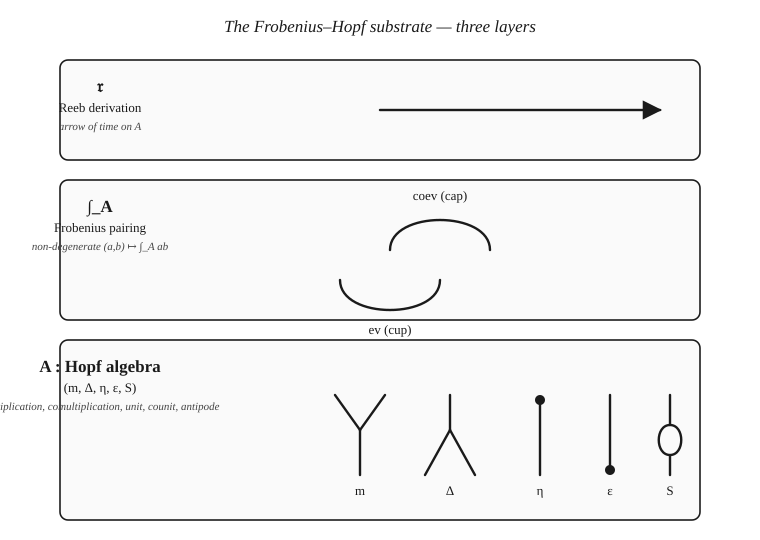</a>  

**Light** *(primary)*  ·  **Dark** *(viewer applies invert + hue-rotate filter at render time)*

> F7.1 (P0). A three-layer cake stacked vertically. Bottom layer: the Hopf algebra structure $(m, \Delta, \eta, \varepsilon, S)$ on $A$, with the five string-diagram glyphs on the right (multiplication as a Y-shape, comultiplication as inverted Y, unit and counit as dots, antipode…

**Variants:** — · **Wired in:** *(not wired)* · **Prompt file:** [`frobenius-hopf-cake-0.prompt.md`](../content/quantum-observable-universe/algebraic-substrate/rendered/frobenius-hopf-cake-0.prompt.md)

---

### `spectral-trace-loop-0` — Spectral trace = closure of f into a loop

  

**Light** *(primary)*  ·  **Dark** *(viewer applies invert + hue-rotate filter at render time)*

> F7.2 (P2 / P1). Two side-by-side string diagrams. Left: an open endomorphism $f \in \mathrm{End}(A)$ — vertical strand labelled $A$ above and below a small white box labelled $f$. Right: the same box $f$ inserted into a closed loop — strand goes up out of the box, curves around,…

**Variants:** — · **Wired in:** *(not wired)* · **Prompt file:** [`spectral-trace-loop-0.prompt.md`](../content/quantum-observable-universe/algebraic-substrate/rendered/spectral-trace-loop-0.prompt.md)

---

## Appendix Knot Operations

### `knot-operations-grid-0` — Knot operations — elementary moves

  

**Light** *(primary)*  ·  **Dark** *(viewer applies invert + hue-rotate filter at render time)*

> FA.2 (P2). A 2 × 3 grid of before-after panels, each illustrating one elementary knot operation. Top row: Reidemeister I (kink ↔ straight strand), Reidemeister II (poke ↔ two parallel strands), Reidemeister III (triangle move — three strands intersecting in two ways). Bottom row…

**Variants:** — · **Wired in:** *(not wired)* · **Prompt file:** [`knot-operations-grid-0.prompt.md`](../content/quantum-observable-universe/appendix-knot-operations/rendered/knot-operations-grid-0.prompt.md)

---

## Appendix Knot Periodic Table

### `knot-periodic-table-0` — Knot periodic table — by braid index n and crossing number c

<a href="../content/quantum-observable-universe/appendix-knot-periodic-table/rendered/knot-periodic-table-0.svg">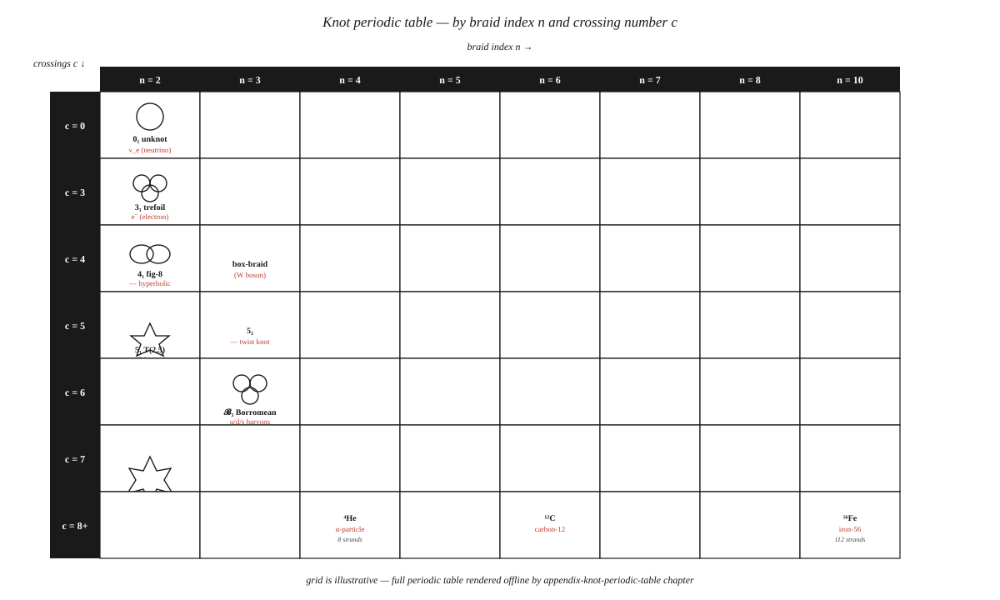</a>  

**Light** *(primary)*  ·  **Dark** *(viewer applies invert + hue-rotate filter at render time)*

> FA.1 (P1). A periodic-table-style grid with column headers $n = 2, 3, 4, 5, 6, 7, 8, 10$ (braid index) and row headers $c = 0, 3, 4, 5, 6, 7, 8+$ (crossing number). Each cell carries a small knot icon, the knot's standard name (e.g. $0_1$, $3_1$, $5_1$, $7_1$), and the associate…

**Variants:** — · **Wired in:** *(not wired)* · **Prompt file:** [`knot-periodic-table-0.prompt.md`](../content/quantum-observable-universe/appendix-knot-periodic-table/rendered/knot-periodic-table-0.prompt.md)

---

## Appendix Transfer Matrices

### `transfer-block-diagonal-0` — Transfer matrix M_n = Wedderburn block-diagonal decomposition

  

**Light** *(primary)*  ·  **Dark** *(viewer applies invert + hue-rotate filter at render time)*

> FA.3 (P2). A large square representing the transfer matrix $M_n$ of the Hecke algebra $H_n(q)$. Inside, four labelled diagonal blocks of varying sizes — top-left $M_{(n)}$ ($\dim_q = 1$, symmetric); upper-middle $M_{(n-1, 1)}$ ($\dim_q = [n-1]_q$, std); lower-middle $M_{(n-2, 2)…

**Variants:** — · **Wired in:** *(not wired)* · **Prompt file:** [`transfer-block-diagonal-0.prompt.md`](../content/quantum-observable-universe/appendix-transfer-matrices/rendered/transfer-block-diagonal-0.prompt.md)

---

## Braids And Knots

### `borromean-quarks-0` — Borromean quarks on the exceptional divisor

  

**Light** *(primary)*  ·  **Dark** *(viewer applies invert + hue-rotate filter at render time)*

> F4.5 (P0). Three unknotted circles in the classic Borromean configuration (pairwise unlinked, but rigidly bound as a triple) drawn centred over a faint dashed ellipse representing a small patch of the exceptional divisor $\mathcal{S}_p \subset \Sigma_4$. The three circles are co…

**Variants:** — · **Wired in:** *(not wired)* · **Prompt file:** [`borromean-quarks-0.prompt.md`](../content/quantum-observable-universe/braids-and-knots/rendered/borromean-quarks-0.prompt.md)

---

### `crossing-energy-staircase-0` — Crossing-energy stratification

<a href="../content/quantum-observable-universe/braids-and-knots/rendered/crossing-energy-staircase-0.svg">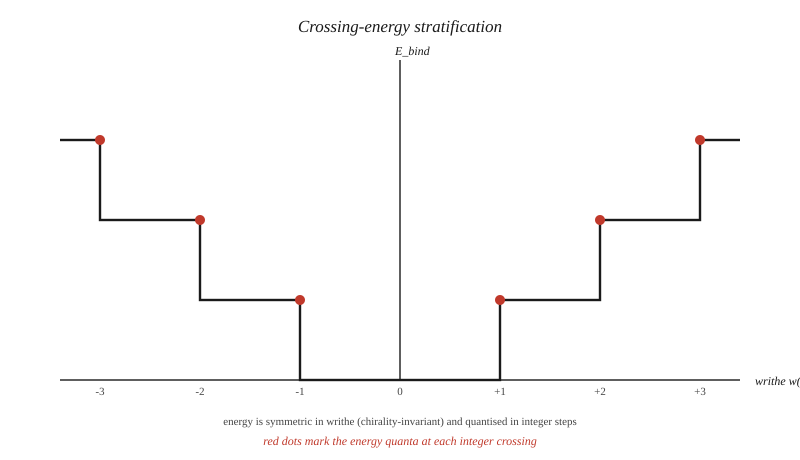</a>  

**Light** *(primary)*  ·  **Dark** *(viewer applies invert + hue-rotate filter at render time)*

> F4.9 (P2 / P1). A step function plot. Horizontal axis: writhe $w(K)$, the net number of positive minus negative crossings, ticked at integer values $-3, -2, -1, 0, +1, +2, +3$. Vertical axis: binding energy $E_{\mathrm{bind}}$. The staircase rises symmetrically away from $w = 0$…

**Variants:** — · **Wired in:** *(not wired)* · **Prompt file:** [`crossing-energy-staircase-0.prompt.md`](../content/quantum-observable-universe/braids-and-knots/rendered/crossing-energy-staircase-0.prompt.md)

---

### `knot-complement-rho-0` — π₁(ℙ¹(ℂ) \ K) → PSL(2, ℂ) via ρ

<a href="../content/quantum-observable-universe/braids-and-knots/rendered/knot-complement-rho-0.svg">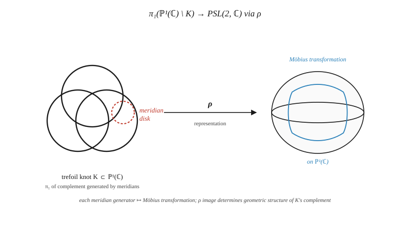</a>  

**Light** *(primary)*  ·  **Dark** *(viewer applies invert + hue-rotate filter at render time)*

> F4.8 (P1). Left: a stylised trefoil drawn lightly with a small dashed red circle highlighting one meridian disk; labels mark the meridian and identify the trefoil as $K \subset \mathbb{P}^1(\mathbb{C})$ with $\pi_1$ of the complement generated by meridians. Centre: a large $\rho…

**Variants:** — · **Wired in:** *(not wired)* · **Prompt file:** [`knot-complement-rho-0.prompt.md`](../content/quantum-observable-universe/braids-and-knots/rendered/knot-complement-rho-0.prompt.md)

---

### `lp-active-set-0` — Operator-selection LP / SDP — active set + dual

<a href="../content/quantum-observable-universe/braids-and-knots/rendered/lp-active-set-0.svg">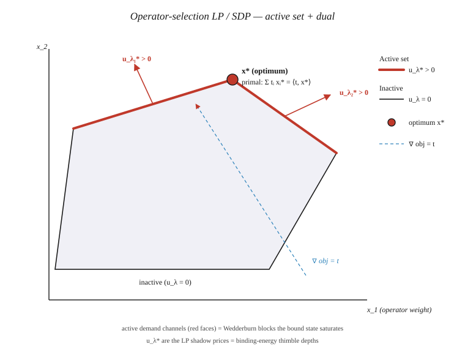</a>  

**Light** *(primary)*  ·  **Dark** *(viewer applies invert + hue-rotate filter at render time)*

> F11.2 (P0). A 2D feasibility polytope drawn on $(x_1, x_2)$ axes. The polygon is filled light grey (the feasible region — the intersection of the half-planes $G \succeq 0$ and the net constraint). The polygon's two upper edges, terminating at the optimum vertex $x^*$, are drawn…

**Variants:** — · **Wired in:** *(not wired)* · **Prompt file:** [`lp-active-set-0.prompt.md`](../content/quantum-observable-universe/braids-and-knots/rendered/lp-active-set-0.prompt.md)

---

### `markov-closure-0` — Markov closure: braid → link

  

**Light** *(primary)*  ·  **Dark** *(viewer applies invert + hue-rotate filter at render time)*

> F4.3 (P0). Three panels. Left: an open 3-strand braid $\beta = \sigma_1 \sigma_2^{-1} \sigma_1$ drawn vertically inside a faint dashed box, with three crossings (the gaps in the under-strands marking over/under). Centre: the *closure* $\hat\beta$ obtained by joining strand-$i$ a…

**Variants:** — · **Wired in:** *(not wired)* · **Prompt file:** [`markov-closure-0.prompt.md`](../content/quantum-observable-universe/braids-and-knots/rendered/markov-closure-0.prompt.md)

---

### `mass-decomposition-0` — Brane-tower mass decomposition

  

**Light** *(primary)*  ·  **Dark** *(viewer applies invert + hue-rotate filter at render time)*

> F4.7 (P1). An exploded view: on the left, a stylised trefoil $K$ with its Hecke-word label $T_w$ underneath. An arrow labelled "decompose" points right to a stack of three rounded boxes, each carrying one term of the unified mass formula $m(K) = |\mathrm{tr}_M(T_w)| + \mathrm{to…

**Variants:** — · **Wired in:** *(not wired)* · **Prompt file:** [`mass-decomposition-0.prompt.md`](../content/quantum-observable-universe/braids-and-knots/rendered/mass-decomposition-0.prompt.md)

---

### `mobius-pairing-0` — Möbius energy as a Frobenius pairing on K × K

  

**Light** *(primary)*  ·  **Dark** *(viewer applies invert + hue-rotate filter at render time)*

> F4.4 (P1). A stylised trefoil drawn in the left half of the figure, with two points $x$ and $y$ marked on the curve in red, and a dashed red segment of length $|x - y|$ joining them. Right side: the Möbius integrand $E(K) = \iint_{K \times K \setminus \Delta} ds\, dt / |x - y|^2…

**Variants:** — · **Wired in:** *(not wired)* · **Prompt file:** [`mobius-pairing-0.prompt.md`](../content/quantum-observable-universe/braids-and-knots/rendered/mobius-pairing-0.prompt.md)

---

### `particle-knot-dictionary-0` — The particle ↔ knot dictionary

  

**Light** *(primary)*  ·  **Dark** *(viewer applies invert + hue-rotate filter at render time)*

> F4.1 (P0). A 2-row grid mapping knot types to particle identities. Top row (5 cards): the four charged-lepton + one closure cell, with each card showing a stylised torus knot $T(2,2k+1)$ above its particle label. Cards left-to-right: unknot $0_1 \to \nu_e$ (a circle, trivial bra…

**Variants:** — · **Wired in:** *(not wired)* · **Prompt file:** [`particle-knot-dictionary-0.prompt.md`](../content/quantum-observable-universe/braids-and-knots/rendered/particle-knot-dictionary-0.prompt.md)

---

### `r-matrix-skein-0` — The Hecke skein triple

  

**Light** *(primary)*  ·  **Dark** *(viewer applies invert + hue-rotate filter at render time)*

> F4.2 (P0). Three side-by-side panels of local strand diagrams: a positive crossing $\sigma_i$ (over-strand running from lower-left to upper-right), its inverse $\sigma_i^{-1}$ (mirror), and the identity $1$ (two parallel strands). Each panel is framed with a light dashed border.…

**Variants:** — · **Wired in:** [`braids-and-knots/braid-action-tensor.md`](../content/quantum-observable-universe/braids-and-knots/braid-action-tensor.md) · **Prompt file:** [`r-matrix-skein-0.prompt.md`](../content/quantum-observable-universe/braids-and-knots/rendered/r-matrix-skein-0.prompt.md)

---

### `schur-weyl-bose-fermi-0` — Schur–Weyl boson / fermion split on V^⊗3

  

**Light** *(primary)*  ·  **Dark** *(viewer applies invert + hue-rotate filter at render time)*

> F4.6 (P1). A square representing $V^{\otimes 3}$ split by a diagonal into two regions. The upper-left triangle is shaded warm and labelled "$V_{3/2}$ — spin 3/2 — symmetric — B₃ acts as scalar ⇒ bosonic". The lower-right triangle is shaded cool and labelled "$V_{1/2}^{\oplus 2}$…

**Variants:** — · **Wired in:** *(not wired)* · **Prompt file:** [`schur-weyl-bose-fermi-0.prompt.md`](../content/quantum-observable-universe/braids-and-knots/rendered/schur-weyl-bose-fermi-0.prompt.md)

---

## Descartes Universe

### `bring-coral-3-tubes-0` — Bring's surface as a coral with three colour tubes

  

**Light** *(primary)*  ·  **Dark** *(viewer applies invert + hue-rotate filter at render time)*

> F5.1 (P0). A schematic genus-4 surface drawn as a "coral": a horizontal body (large translucent ellipse) with four arched handles rising above. Three of the handles are coloured red, green, blue — the colour tubes carrying the spectral coordinates $c_r$, $c_g$, $c_b$ from Chapte…

**Variants:** — · **Wired in:** *(not wired)* · **Prompt file:** [`bring-coral-3-tubes-0.prompt.md`](../content/quantum-observable-universe/descartes-universe/rendered/bring-coral-3-tubes-0.prompt.md)

---

### `bring-power-sums-0` — Bring's surface Σ₄ ⊂ ℙ⁴ — three nested constraints

<a href="../content/quantum-observable-universe/descartes-universe/rendered/bring-power-sums-0.svg">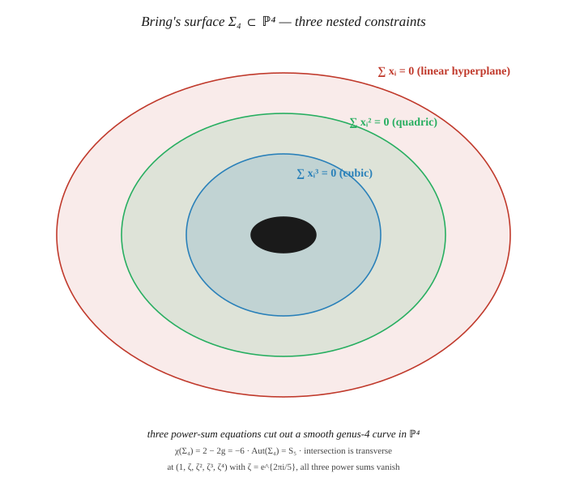</a>  

**Light** *(primary)*  ·  **Dark** *(viewer applies invert + hue-rotate filter at render time)*

> F9.1 (P0 / P1). Three concentric ellipses on a centred plot, each translucent and outlined in a distinct accent colour: outer red "$\sum x_i = 0$ (linear hyperplane)", middle green "$\sum x_i^2 = 0$ (quadric)", inner blue "$\sum x_i^3 = 0$ (cubic)". At the very centre: a small f…

**Variants:** — · **Wired in:** *(not wired)* · **Prompt file:** [`bring-power-sums-0.prompt.md`](../content/quantum-observable-universe/descartes-universe/rendered/bring-power-sums-0.prompt.md)

---

### `color-tube-coords-0` — Colour-tube coordinates c_r, c_g, c_b on Σ₄

  

**Light** *(primary)*  ·  **Dark** *(viewer applies invert + hue-rotate filter at render time)*

> F6.1 (P0). The Bring coral from F5.1 with coordinate arrows added. Each of the four coloured handles has an arrow rising from its apex labelled with the corresponding shifted Lagrange resolvent: $c_r = w_2 - z$ (red), $c_g = w_3 - z$ (green), $c_b = w_4 - z$ (blue), and the time…

**Variants:** — · **Wired in:** *(not wired)* · **Prompt file:** [`color-tube-coords-0.prompt.md`](../content/quantum-observable-universe/descartes-universe/rendered/color-tube-coords-0.prompt.md)

---

### `descartes-polytope-0` — Bring's surface as a moduli-polytope corner

<a href="../content/quantum-observable-universe/descartes-universe/rendered/descartes-polytope-0.svg">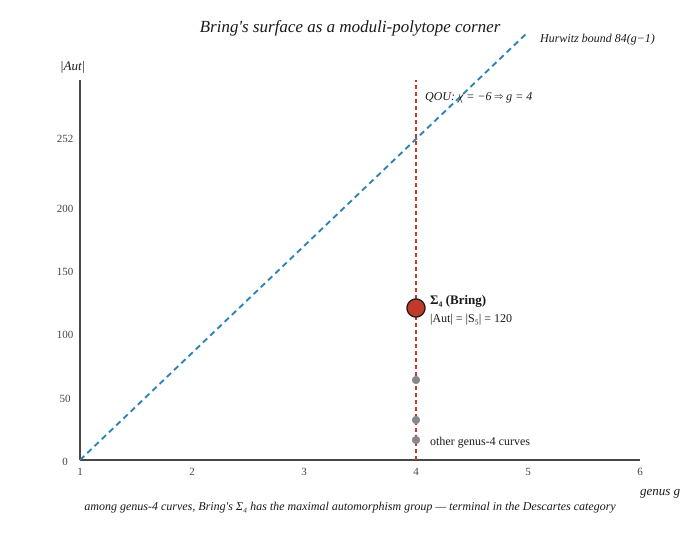</a>  

**Light** *(primary)*  ·  **Dark** *(viewer applies invert + hue-rotate filter at render time)*

> F5.2 (P1). A 2D plot with horizontal axis genus $g$ (ticked $1, 2, 3, 4, 5, 6$) and vertical axis $|\mathrm{Aut}|$. The Hurwitz bound $84(g-1)$ is drawn as a blue dashed diagonal ceiling line; the QOU constraint $\chi = -6 \Rightarrow g = 4$ is drawn as a red dashed vertical lin…

**Variants:** — · **Wired in:** *(not wired)* · **Prompt file:** [`descartes-polytope-0.prompt.md`](../content/quantum-observable-universe/descartes-universe/rendered/descartes-polytope-0.prompt.md)

---

### `exceptional-divisor-borromeans-0` — Quark Borromeans on the exceptional divisor

<a href="../content/quantum-observable-universe/descartes-universe/rendered/exceptional-divisor-borromeans-0.svg">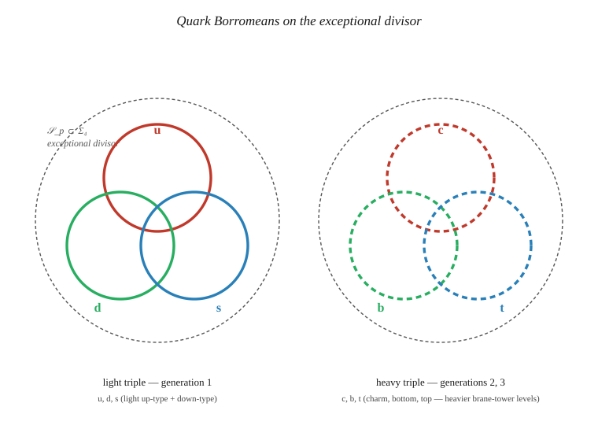</a>  

**Light** *(primary)*  ·  **Dark** *(viewer applies invert + hue-rotate filter at render time)*

> F6.3 (P0). Two side-by-side Borromean configurations of three rings each, drawn over small dashed circles representing patches of the exceptional divisor $\mathcal{S}_p \subset \Sigma_4$. Left panel: solid R/G/B Borromean labelled $u$, $d$, $s$ — the light quark triple, generati…

**Variants:** — · **Wired in:** *(not wired)* · **Prompt file:** [`exceptional-divisor-borromeans-0.prompt.md`](../content/quantum-observable-universe/descartes-universe/rendered/exceptional-divisor-borromeans-0.prompt.md)

---

### `s5-permutohedron-0` — The S₅ permutohedron — 120 vertices

<a href="../content/quantum-observable-universe/descartes-universe/rendered/s5-permutohedron-0.svg">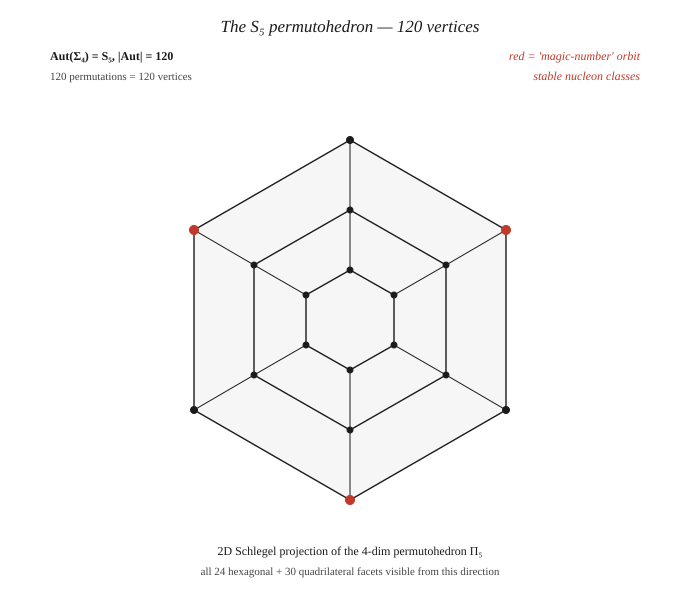</a>  

**Light** *(primary)*  ·  **Dark** *(viewer applies invert + hue-rotate filter at render time)*

> F6.4 (P1). A 2D Schlegel-style projection of the order-5 permutohedron $\Pi_5$ — a 4-dimensional polytope whose 120 vertices are the permutations of $(1,2,3,4,5)$. The figure renders nested hexagonal facets (with quadrilateral connectors) reproducing the visible structure when v…

**Variants:** — · **Wired in:** *(not wired)* · **Prompt file:** [`s5-permutohedron-0.prompt.md`](../content/quantum-observable-universe/descartes-universe/rendered/s5-permutohedron-0.prompt.md)

---

### `ym-mass-gap-0` — Yang–Mills mass gap — categorical spectral picture

  

**Light** *(primary)*  ·  **Dark** *(viewer applies invert + hue-rotate filter at render time)*

> F5.3 (P1). A horizontal energy axis. A single solid black dot at $E = 0$ labelled $|\Omega\rangle$ (vacuum). A shaded gap region (light pink with red dashed border) from $E = 0$ to $E = \Delta$ labelled "mass gap $\Delta > 0$". To the right of $\Delta$ a translucent grey band la…

**Variants:** — · **Wired in:** *(not wired)* · **Prompt file:** [`ym-mass-gap-0.prompt.md`](../content/quantum-observable-universe/descartes-universe/rendered/ym-mass-gap-0.prompt.md)

---

## Encounter

### `algebraic-geometric-rigidity-0` — Algebraic ↔ geometric rigidity pairing

<a href="../content/quantum-observable-universe/encounter/rendered/algebraic-geometric-rigidity-0.svg">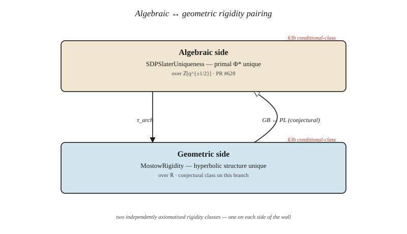</a>  

**Light** *(primary)*  ·  **Dark** *(viewer applies invert + hue-rotate filter at render time)*

> F13E.6 (P1, sibling #633). Two parallel rectangles, vertically stacked. Top (warm): "Algebraic side — SDPSlaterUniqueness — primal $\Phi^*$ unique — over $\mathbb{Z}[q^{\pm 1/2}]$ — PR #628". Bottom (cool): "Geometric side — MostowRigidity — hyperbolic structure unique — over $\…

**Variants:** — · **Wired in:** *(not wired)* · **Prompt file:** [`algebraic-geometric-rigidity-0.prompt.md`](../content/quantum-observable-universe/encounter/rendered/algebraic-geometric-rigidity-0.prompt.md)

---

### `archimedean-wall-0` — The Archimedean wall

<a href="../content/quantum-observable-universe/encounter/rendered/archimedean-wall-0.svg">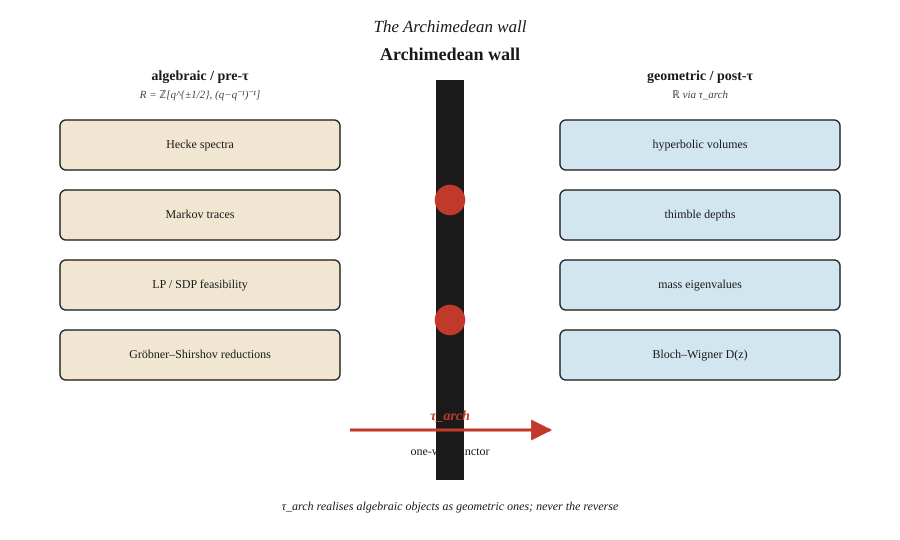</a>  

**Light** *(primary)*  ·  **Dark** *(viewer applies invert + hue-rotate filter at render time)*

> F13E.7 (P1, sibling #633). A vertical solid black wall down the centre, labelled "Archimedean wall" at the top in red. Left side (warm-tinted): four stacked tag boxes — Hecke spectra, Markov traces, LP/SDP feasibility, Gröbner–Shirshov reductions; header "algebraic / pre-$\tau$"…

**Variants:** — · **Wired in:** *(not wired)* · **Prompt file:** [`archimedean-wall-0.prompt.md`](../content/quantum-observable-universe/encounter/rendered/archimedean-wall-0.prompt.md)

---

### `archimedean-wall-dictionary-0` — SDP/LP dictionary across the Archimedean wall

<a href="../content/quantum-observable-universe/encounter/rendered/archimedean-wall-dictionary-0.svg">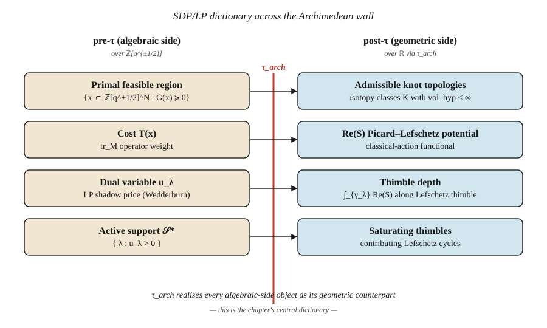</a>  

**Light** *(primary)*  ·  **Dark** *(viewer applies invert + hue-rotate filter at render time)*

> F13E.4 (P0, sibling #633). Two parallel columns of stacked rounded rectangles separated by a bold red vertical line labelled $\tau_{\mathrm{arch}}$. Left column (warm-tinted, "pre-$\tau$, over $\mathbb{Z}[q^{\pm 1/2}]$"): four rows — Primal feasible region; Cost $T(x)$ (operator…

**Variants:** — · **Wired in:** *(not wired)* · **Prompt file:** [`archimedean-wall-dictionary-0.prompt.md`](../content/quantum-observable-universe/encounter/rendered/archimedean-wall-dictionary-0.prompt.md)

---

### `base-vs-fibre-0` — Base M vs fibre 𝒮_p — different categorical registers

<a href="../content/quantum-observable-universe/encounter/rendered/base-vs-fibre-0.svg">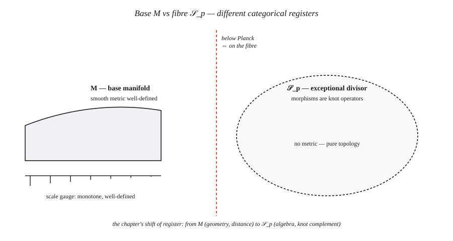</a>  

**Light** *(primary)*  ·  **Dark** *(viewer applies invert + hue-rotate filter at render time)*

> F13E.2 (P0, sibling #633). A cross-section composite. Left half: a smooth surface labelled "$M$ — base manifold; smooth metric well-defined" with a monotone scale gauge below it (a row of decreasing tick marks). Right half: a dashed-outline ellipse representing the fibre $\mathc…

**Variants:** — · **Wired in:** *(not wired)* · **Prompt file:** [`base-vs-fibre-0.prompt.md`](../content/quantum-observable-universe/encounter/rendered/base-vs-fibre-0.prompt.md)

---

### `encounter-three-panel-0` — Encounter: approach → crossing → merge

<a href="../content/quantum-observable-universe/encounter/rendered/encounter-three-panel-0.svg">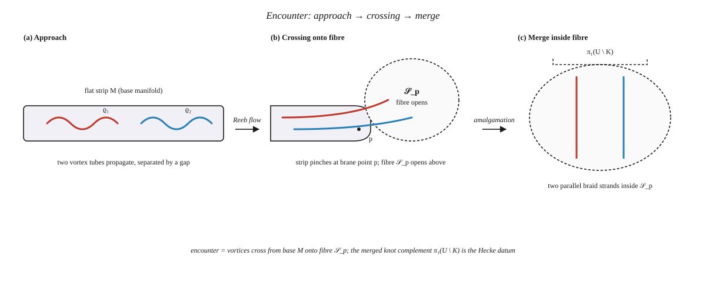</a>  

**Light** *(primary)*  ·  **Dark** *(viewer applies invert + hue-rotate filter at render time)*

> F13E.1 (P0, sibling #633). Three panels left-to-right. (a) Approach: a flat strip $M$ with two vortex tubes $\varrho_1$ (red) and $\varrho_2$ (blue) propagating along it, separated by a gap. (b) Crossing onto the fibre: the strip pinches at a brane point $p$, and a circle repres…

**Variants:** — · **Wired in:** *(not wired)* · **Prompt file:** [`encounter-three-panel-0.prompt.md`](../content/quantum-observable-universe/encounter/rendered/encounter-three-panel-0.prompt.md)

---

### `literature-precedent-map-0` — Literature precedents

<a href="../content/quantum-observable-universe/encounter/rendered/literature-precedent-map-0.svg">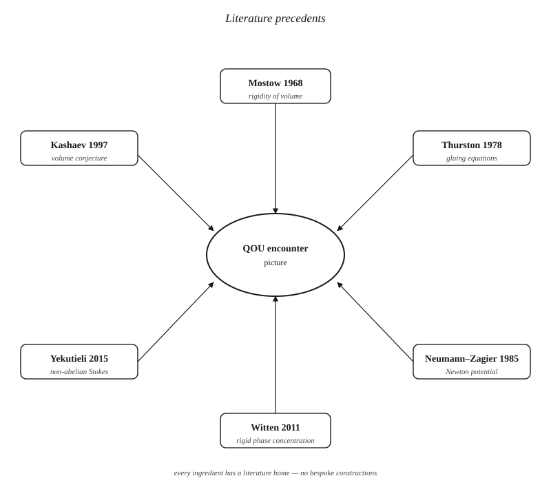</a>  

**Light** *(primary)*  ·  **Dark** *(viewer applies invert + hue-rotate filter at render time)*

> F13E.8 (P2, sibling #633). A radial diagram. Centre: an ellipse labelled "QOU encounter picture". Six outer satellites arranged at 60° intervals, each a labelled rectangle: Mostow 1968 (rigidity of volume), Thurston 1978 (gluing equations), Neumann–Zagier 1985 (Newton potential)…

**Variants:** — · **Wired in:** *(not wired)* · **Prompt file:** [`literature-precedent-map-0.prompt.md`](../content/quantum-observable-universe/encounter/rendered/literature-precedent-map-0.prompt.md)

---

### `mostow-volume-staircase-0` — Mostow rigidity: the volume spectrum is discrete

<a href="../content/quantum-observable-universe/encounter/rendered/mostow-volume-staircase-0.svg">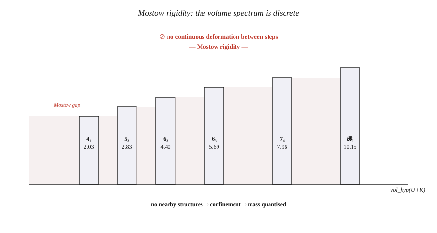</a>  

**Light** *(primary)*  ·  **Dark** *(viewer applies invert + hue-rotate filter at render time)*

> F13E.5 (P0, sibling #633). A staircase plot. Horizontal axis: $\mathrm{vol}_{\mathrm{hyp}}(U \setminus K)$. Each step is a rectangle marked with a knot type at the corresponding hyperbolic volume — $4_1$ (2.03), $5_2$ (2.83), $6_2$ (4.40), $6_3$ (5.69), $7_4$ (7.96), $\mathcal{B…

**Variants:** — · **Wired in:** *(not wired)* · **Prompt file:** [`mostow-volume-staircase-0.prompt.md`](../content/quantum-observable-universe/encounter/rendered/mostow-volume-staircase-0.prompt.md)

---

### `thurston-relaxation-0` — Thurston relaxation = Newton flow seeded by q-Pochhammer poles

<a href="../content/quantum-observable-universe/encounter/rendered/thurston-relaxation-0.svg">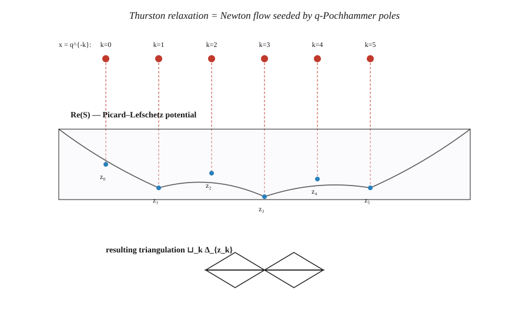</a>  

**Light** *(primary)*  ·  **Dark** *(viewer applies invert + hue-rotate filter at render time)*

> F13E.3 (P0, sibling #633). Top edge: a horizontal row of red dots labelled $x = q^{-k}$ for $k = 0, \ldots, 5$ — the $q$-Pochhammer poles. Below them, dashed red verticals drop into a curved $\mathrm{Re}(S)$ landscape (a Picard–Lefschetz potential surface) with labelled blue sad…

**Variants:** — · **Wired in:** *(not wired)* · **Prompt file:** [`thurston-relaxation-0.prompt.md`](../content/quantum-observable-universe/encounter/rendered/thurston-relaxation-0.prompt.md)

---

## Fluid Dynamics

### `madelung-decomposition-0` — Madelung decomposition ψ = √ρ · e^{iS/ℏ}

  

**Light** *(primary)*  ·  **Dark** *(viewer applies invert + hue-rotate filter at render time)*

> F10.2 (P1). Two side-by-side panels with a "+" sign between them. Left: a bell-curve height map representing the density $\rho(x)$ on the brane (purple-tinted), with grid lines beneath. Caption: "amplitude — where the fluid is". Right: a six-segment coloured wheel representing t…

**Variants:** — · **Wired in:** *(not wired)* · **Prompt file:** [`madelung-decomposition-0.prompt.md`](../content/quantum-observable-universe/fluid-dynamics/rendered/madelung-decomposition-0.prompt.md)

---

### `ns-obstruction-blowup-0` — NS obstruction: q-NS regularity (q > 1) vs classical blowup (q = 1)

<a href="../content/quantum-observable-universe/fluid-dynamics/rendered/ns-obstruction-blowup-0.svg"> 1) vs classical blowup (q = 1)"></a>  <a href="../content/quantum-observable-universe/fluid-dynamics/rendered/ns-obstruction-blowup-0.svg"> 1) vs classical blowup (q = 1) (dark — filter inverted)"></a>

**Light** *(primary)*  ·  **Dark** *(viewer applies invert + hue-rotate filter at render time)*

> F10.3 (P1). Two side-by-side phase portraits separated by a vertical dashed line. Left ($q > 1$): time on the horizontal axis, enstrophy $\|\omega\|$ on the vertical; a blue curve rises and asymptotes — bounded for all $t$. Caption: "global regularity; spectral Sobolev estimates…

**Variants:** — · **Wired in:** *(not wired)* · **Prompt file:** [`ns-obstruction-blowup-0.prompt.md`](../content/quantum-observable-universe/fluid-dynamics/rendered/ns-obstruction-blowup-0.prompt.md)

---

### `q-kolmogorov-0` — q-deformed Kolmogorov scaling E(k) ∝ k^{−5/3}

<a href="../content/quantum-observable-universe/fluid-dynamics/rendered/q-kolmogorov-0.svg">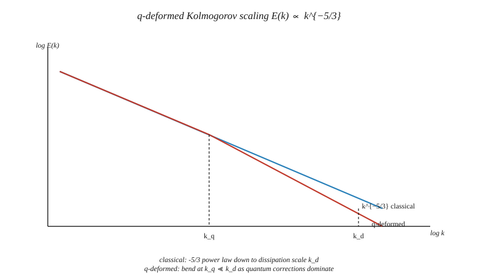</a>  

**Light** *(primary)*  ·  **Dark** *(viewer applies invert + hue-rotate filter at render time)*

> F10.4 (P2). Log-log plot of energy spectrum $E(k)$ on the brane. Two curves: a blue straight line representing the classical $k^{-5/3}$ Kolmogorov scaling, and a red broken-line that follows the classical slope until $k = k_q$ then bends to a steeper slope as $q$-deformation cor…

**Variants:** — · **Wired in:** *(not wired)* · **Prompt file:** [`q-kolmogorov-0.prompt.md`](../content/quantum-observable-universe/fluid-dynamics/rendered/q-kolmogorov-0.prompt.md)

---

### `q-vortex-spectrum-0` — q-vortex spectrum on the brane

  

**Light** *(primary)*  ·  **Dark** *(viewer applies invert + hue-rotate filter at render time)*

> F10.1 (P0). Two-panel composite. Left: Bring's coral (smaller copy of F5.1) with dashed-grey closed flow lines drawn looping around each of the four handles; each flow line is annotated with its $q$-quantised circulation $\Gamma_n = 2\pi [n]_q$ for $n = 1, 2, 3, 4$. A footnote d…

**Variants:** — · **Wired in:** *(not wired)* · **Prompt file:** [`q-vortex-spectrum-0.prompt.md`](../content/quantum-observable-universe/fluid-dynamics/rendered/q-vortex-spectrum-0.prompt.md)

---

## Information Theory

### `emergent-gravity-0` — Emergent gravity from information geometry

  

**Light** *(primary)*  ·  **Dark** *(viewer applies invert + hue-rotate filter at render time)*

> F8.2 (P1). Two-panel composite. Left: an "information manifold" — an ellipse-shaped surface labelled "information manifold; Fisher metric $g_{ij}(\theta)$; probability distributions parametrised by $\theta$" with a red metric ellipsoid drawn on it. Right: the same metric ellipso…

**Variants:** — · **Wired in:** *(not wired)* · **Prompt file:** [`emergent-gravity-0.prompt.md`](../content/quantum-observable-universe/information-theory/rendered/emergent-gravity-0.prompt.md)

---

### `planck-time-cell-0` — Planck-time computation cell

<a href="../content/quantum-observable-universe/information-theory/rendered/planck-time-cell-0.svg">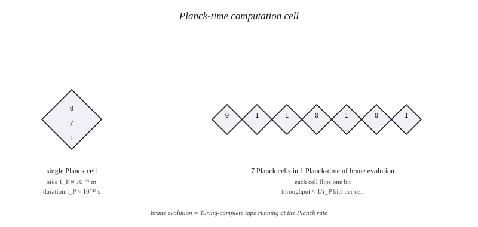</a>  

**Light** *(primary)*  ·  **Dark** *(viewer applies invert + hue-rotate filter at render time)*

> F8.3 (P2). Left: a single highlighted spacetime "diamond" cell of side $\ell_P$ with a "0/1" bit inscribed at its centre. Right: a horizontal strip of seven such diamonds tiling space, each with a bit value (0 or 1), representing one Planck-time of brane evolution. Captions: "si…

**Variants:** — · **Wired in:** *(not wired)* · **Prompt file:** [`planck-time-cell-0.prompt.md`](../content/quantum-observable-universe/information-theory/rendered/planck-time-cell-0.prompt.md)

---

### `regime-scale-0` — Regime table — physical length scales

<a href="../content/quantum-observable-universe/information-theory/rendered/regime-scale-0.svg">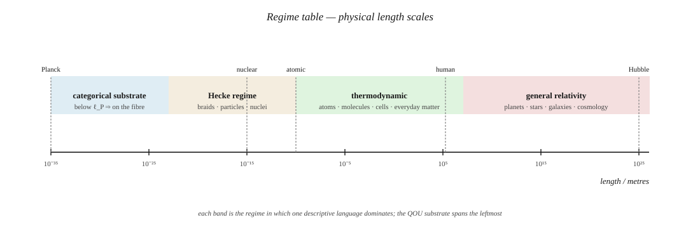</a>  

**Light** *(primary)*  ·  **Dark** *(viewer applies invert + hue-rotate filter at render time)*

> F8.1 (P1). Horizontal log-scale axis from $10^{-35}$ m (Planck) to $10^{25}$ m (Hubble). Four coloured bands tile the axis: blue "categorical substrate" (below $\ell_P$ ⇒ on the fibre), warm "Hecke regime" (braids · particles · nuclei), green "thermodynamic" (atoms · molecules ·…

**Variants:** — · **Wired in:** *(not wired)* · **Prompt file:** [`regime-scale-0.prompt.md`](../content/quantum-observable-universe/information-theory/rendered/regime-scale-0.prompt.md)

---

## Introduction

### `roadmap-flow-A` — The roadmap as argument flow (horizontal three-band)

  

**Light** *(primary)*  ·  **Dark** *(viewer applies invert + hue-rotate filter at render time)*

> F0.1 (P0), variant A. A horizontal three-band argument-flow diagram. Top band lists the three inputs the paper takes from outside (everyday observations; the categorical language of rigid braided monoidal categories with a Frobenius–Hopf object; and the three calibration scalars…

**Variants:** [B](../content/quantum-observable-universe/introduction/rendered/roadmap-flow-B.svg) · **Wired in:** [`introduction/roadmap-diagram.md`](../content/quantum-observable-universe/introduction/roadmap-diagram.md) · **Prompt file:** [`roadmap-flow-A.prompt.md`](../content/quantum-observable-universe/introduction/rendered/roadmap-flow-A.prompt.md)

---

### `roadmap-flow-B` — The roadmap as argument flow (radial wheel)

  

**Light** *(primary)*  ·  **Dark** *(viewer applies invert + hue-rotate filter at render time)*

> F0.1 (P0), variant B. A radial argument-flow diagram. The QOU axioms occupy the centre as a single labelled disk. Around it on an inner ring sit the four forced consequences (SU₂(R), χ=−6, Bring's Σ₄, Frobenius–Hopf substrate). On the upper outer arc sit the three inputs (everyd…

**Variants:** [A](../content/quantum-observable-universe/introduction/rendered/roadmap-flow-A.svg) · **Wired in:** *(not wired)* · **Prompt file:** [`roadmap-flow-B.prompt.md`](../content/quantum-observable-universe/introduction/rendered/roadmap-flow-B.prompt.md)

---

### `three-fold-triangle-0` — Three observations, one constraint

  

**Light** *(primary)*  ·  **Dark** *(viewer applies invert + hue-rotate filter at render time)*

> F0.2 (P0). Equilateral triangle with three vertex boxes carrying the threefold structures observed in nature: three colours (R/G/B), three generations of matter (e/μ/τ leptons; u/d, c/s, t/b quarks), and three-fold chirality. Three dashed spokes connect the vertices to a central…

**Variants:** — · **Wired in:** *(not wired)* · **Prompt file:** [`three-fold-triangle-0.prompt.md`](../content/quantum-observable-universe/introduction/rendered/three-fold-triangle-0.prompt.md)

---

## Lifting And Descent

### `brane-tower-stack-0` — The recursive brane tower

  

**Light** *(primary)*  ·  **Dark** *(viewer applies invert + hue-rotate filter at render time)*

> F3.1 (P0). Vertical stack of disks of increasing radius, labelled bottom-to-top $A_0, A_1, A_2, A_3, \ldots, A_{n+1}$; each connected to the next by a $J^1$ jet-prolongation arrow on the right side. The disk at the base is the original Frobenius–Hopf object $A_0 = A$; each subse…

**Variants:** — · **Wired in:** *(not wired)* · **Prompt file:** [`brane-tower-stack-0.prompt.md`](../content/quantum-observable-universe/lifting-and-descent/rendered/brane-tower-stack-0.prompt.md)

---

### `cosimplicial-descent-0` — Cosimplicial descent diagram

  

**Light** *(primary)*  ·  **Dark** *(viewer applies invert + hue-rotate filter at render time)*

> F3.3 (P2 / P1). Three labelled nodes in a horizontal row representing $A$, $A \otimes A$, $A^{\otimes 3}$ for $n = 1, 2, 3$. Between adjacent nodes, multiple parallel arrows show the coface maps $d^i$ — two between $n=1$ and $n=2$ ($d^0, d^1$), three between $n=2$ and $n=3$ ($d^…

**Variants:** — · **Wired in:** *(not wired)* · **Prompt file:** [`cosimplicial-descent-0.prompt.md`](../content/quantum-observable-universe/lifting-and-descent/rendered/cosimplicial-descent-0.prompt.md)

---

### `yekutieli-staircase-0` — Yekutieli obstruction along the brane tower

  

**Light** *(primary)*  ·  **Dark** *(viewer applies invert + hue-rotate filter at render time)*

> F3.2 (P1). A staircase rising left-to-right with five steps for $n = 0, 1, 2, 3, 4$. Each step represents the brane-tower level $A_n$. At each step (above the platform) a small red dot is the Yekutieli obstruction class $\kappa_n$. The final step is marked in green with $\kappa_…

**Variants:** — · **Wired in:** *(not wired)* · **Prompt file:** [`yekutieli-staircase-0.prompt.md`](../content/quantum-observable-universe/lifting-and-descent/rendered/yekutieli-staircase-0.prompt.md)

---

## Molecular Construction

### `ch4-tetrahedron-symmetry-0` — CH₄ tetrahedral symmetry

  

**Light** *(primary)*  ·  **Dark** *(viewer applies invert + hue-rotate filter at render time)*

> F13.3 (P2). A regular tetrahedron in 2D projection with hydrogen atoms (white circles labelled H) at the four vertices and a carbon atom (white circle labelled C) at the centroid. The four C–H "edges" are drawn as faint dashed grey lines; on each, a small red filled circle marks…

**Variants:** — · **Wired in:** *(not wired)* · **Prompt file:** [`ch4-tetrahedron-symmetry-0.prompt.md`](../content/quantum-observable-universe/molecular-construction/rendered/ch4-tetrahedron-symmetry-0.prompt.md)

---

### `h2-shared-trefoil-0` — H₂ as a shared trefoil bond

  

**Light** *(primary)*  ·  **Dark** *(viewer applies invert + hue-rotate filter at render time)*

> F13.1 (P0). Two stylised hydrogen atoms drawn as trefoils ($3_1$) on left and right; between them a red shared circle representing a single sub-Hopf link bridging the two trefoils — the categorical realisation of a covalent bond. Each H atom carries the label "trefoil $3_1$"; th…

**Variants:** — · **Wired in:** *(not wired)* · **Prompt file:** [`h2-shared-trefoil-0.prompt.md`](../content/quantum-observable-universe/molecular-construction/rendered/h2-shared-trefoil-0.prompt.md)

---

### `molecular-progression-0` — Molecular braid progression: H₂ → CO → CO₂ → CH₄ → C₂H₆ → C₆H₆

  

**Light** *(primary)*  ·  **Dark** *(viewer applies invert + hue-rotate filter at render time)*

> F13.2 (P0). A 2 × 3 grid of molecular cells. Each cell shows the closed braid representation of one molecule, with the constituent atoms drawn as black-stroked circles labelled C, H, or O, and the *shared sub-Hopf links* (covalent bonds) drawn as red circles bridging the atomic…

**Variants:** — · **Wired in:** *(not wired)* · **Prompt file:** [`molecular-progression-0.prompt.md`](../content/quantum-observable-universe/molecular-construction/rendered/molecular-progression-0.prompt.md)

---

## Observations

### `calibration-triangle-0` — Three calibrations, dozens of predictions

<a href="../content/quantum-observable-universe/observations/rendered/calibration-triangle-0.svg">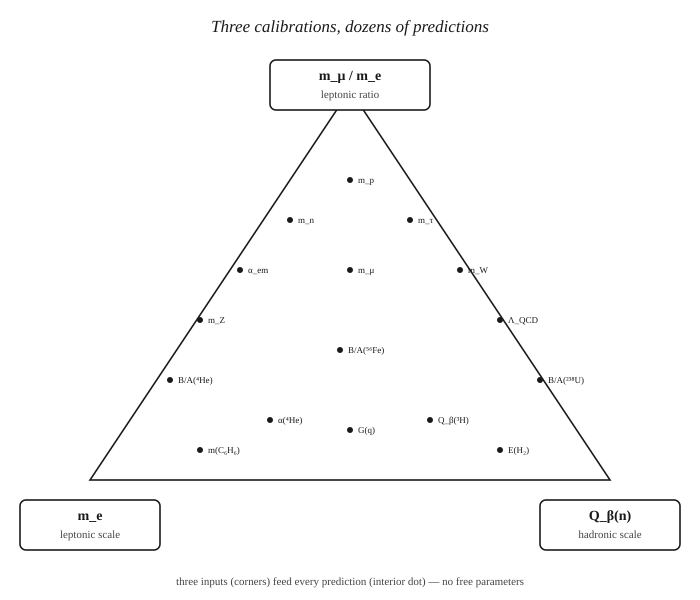</a>  

**Light** *(primary)*  ·  **Dark** *(viewer applies invert + hue-rotate filter at render time)*

> F12.2 (P1). A triangle whose three vertex boxes carry the three calibration inputs: top "$m_\mu / m_e$ — leptonic ratio", bottom-left "$m_e$ — leptonic scale", bottom-right "$Q_\beta(n)$ — hadronic scale". Inside the triangle: roughly 16 small black prediction dots labelled with…

**Variants:** — · **Wired in:** *(not wired)* · **Prompt file:** [`calibration-triangle-0.prompt.md`](../content/quantum-observable-universe/observations/rendered/calibration-triangle-0.prompt.md)

---

### `predicted-vs-codata-0` — Predicted vs CODATA mass — 50 particles, atoms, isotopes

<a href="../content/quantum-observable-universe/observations/rendered/predicted-vs-codata-0.svg">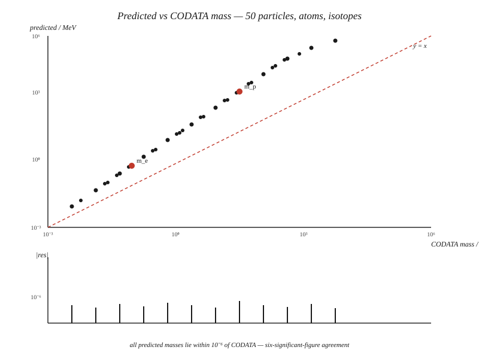</a>  

**Light** *(primary)*  ·  **Dark** *(viewer applies invert + hue-rotate filter at render time)*

> F12.3 (P1). A log-log scatter plot of QOU-predicted mass (vertical axis, MeV) against CODATA mass (horizontal axis, MeV), spanning $10^{-3}$ to $10^6$ MeV. A red dashed identity line $y = x$ runs corner-to-corner; ~30 black dots cluster tightly along it, each representing one pa…

**Variants:** — · **Wired in:** *(not wired)* · **Prompt file:** [`predicted-vs-codata-0.prompt.md`](../content/quantum-observable-universe/observations/rendered/predicted-vs-codata-0.prompt.md)

---

### `substrate-consistency-window-0` — The substrate consistency window

<a href="../content/quantum-observable-universe/observations/rendered/substrate-consistency-window-0.svg">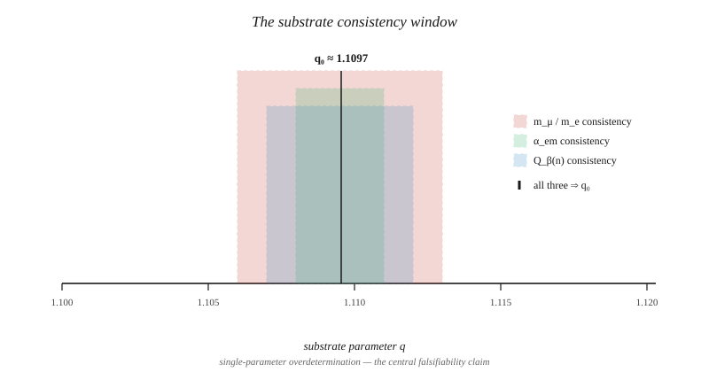</a>  

**Light** *(primary)*  ·  **Dark** *(viewer applies invert + hue-rotate filter at render time)*

> F12.1 (P0). A horizontal axis showing the substrate parameter $q$ across the range $[1.100, 1.120]$, ticked every $0.005$. Three translucent vertical bands span the axis, each bounded by the $q$-range allowed by one independent calibration: red = $m_\mu/m_e$ consistency, green =…

**Variants:** — · **Wired in:** *(not wired)* · **Prompt file:** [`substrate-consistency-window-0.prompt.md`](../content/quantum-observable-universe/observations/rendered/substrate-consistency-window-0.prompt.md)

---

## Organic Chemistry

### `benzene-aromaticity-0` — Benzene aromaticity: Kekulé ↔ delocalised

<a href="../content/quantum-observable-universe/organic-chemistry/rendered/benzene-aromaticity-0.svg">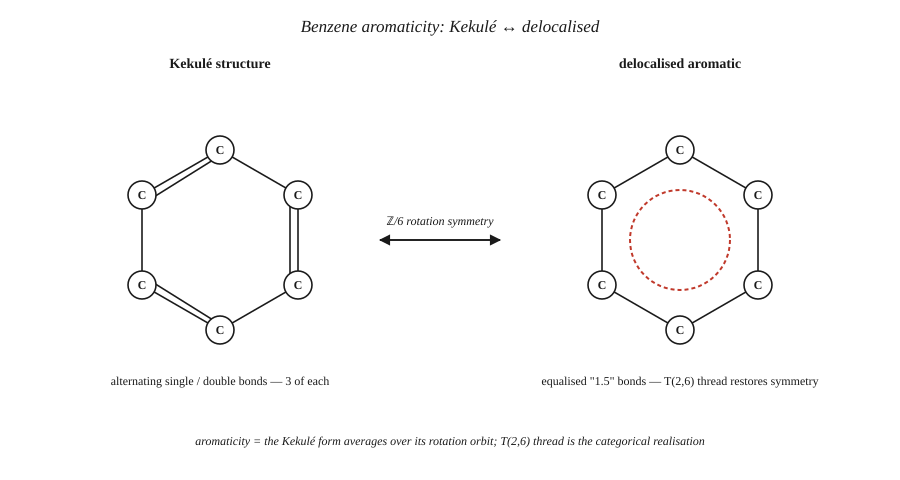</a>  

**Light** *(primary)*  ·  **Dark** *(viewer applies invert + hue-rotate filter at render time)*

> F14.4 (P2). Two side-by-side hexagons of carbon atoms (the C₆ ring of benzene). Left: the Kekulé structure with alternating single and double bonds explicitly drawn (3 of each). Right: the delocalised aromatic structure with all six bonds equal and an inner red dashed circle rep…

**Variants:** — · **Wired in:** *(not wired)* · **Prompt file:** [`benzene-aromaticity-0.prompt.md`](../content/quantum-observable-universe/organic-chemistry/rendered/benzene-aromaticity-0.prompt.md)

---

### `carbon-half-filled-0` — Carbon's half-filled valence shell

  

**Light** *(primary)*  ·  **Dark** *(viewer applies invert + hue-rotate filter at render time)*

> F14.1 (P0). Central carbon node "C" with eight equally-spaced linking sites around it on a circle, corresponding to the second-shell capacity $2n^2 = 8$. Four sites — north, east, south, west — are filled black (the closed inner shell $1s^2$). Four sites — northeast, southeast,…

**Variants:** — · **Wired in:** *(not wired)* · **Prompt file:** [`carbon-half-filled-0.prompt.md`](../content/quantum-observable-universe/organic-chemistry/rendered/carbon-half-filled-0.prompt.md)

---

### `chain-vs-ring-0` — Chain vs ring — C₆ topology comparison

  

**Light** *(primary)*  ·  **Dark** *(viewer applies invert + hue-rotate filter at render time)*

> F14.3 (P1). Two panels side-by-side. Left: a linear C₆ chain — six C atoms in a horizontal row connected by five red shared-trefoil bond markers; caption "5 shared trefoils — open ends; no aromatic stabilisation"; energy label $E_{\mathrm{chain}}$. Right: a closed C₆ ring (benze…

**Variants:** — · **Wired in:** *(not wired)* · **Prompt file:** [`chain-vs-ring-0.prompt.md`](../content/quantum-observable-universe/organic-chemistry/rendered/chain-vs-ring-0.prompt.md)

---

### `threading-link-benzene-0` — The threading link T(2, 6) — benzene

  

**Light** *(primary)*  ·  **Dark** *(viewer applies invert + hue-rotate filter at render time)*

> F14.2 (P0). A regular hexagon of six small carbon-atom rings (drawn as small white circles labelled C) and a single large red ellipse threading through all six — the threading link $T(2, 6)$. A second concentric dashed red ellipse hints at the link's two-component nature. A smal…

**Variants:** — · **Wired in:** *(not wired)* · **Prompt file:** [`threading-link-benzene-0.prompt.md`](../content/quantum-observable-universe/organic-chemistry/rendered/threading-link-benzene-0.prompt.md)

---

## Particle Interactions

### `active-dual-binding-multiplicity-0` — Active dual support 𝒮* = binding multiplicity

<a href="../content/quantum-observable-universe/particle-interactions/rendered/active-dual-binding-multiplicity-0.svg">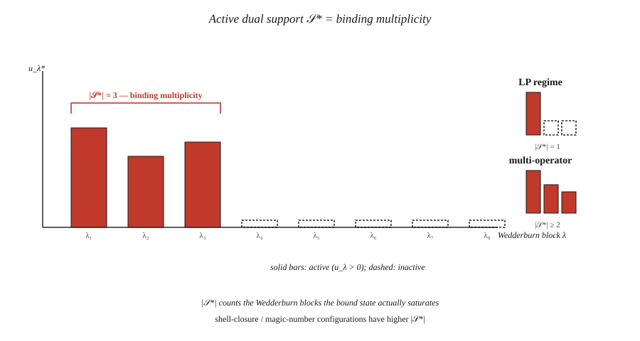</a>  

**Light** *(primary)*  ·  **Dark** *(viewer applies invert + hue-rotate filter at render time)*

> F12.5 (P1, sibling #633). Bar chart with horizontal axis "Wedderburn block $\lambda$" (eight blocks $\lambda_1, \ldots, \lambda_8$) and vertical axis $u_\lambda^*$. Bars at the first three blocks are tall and filled red (active, $u_\lambda^* > 0$); bars at the remaining five are…

**Variants:** — · **Wired in:** *(not wired)* · **Prompt file:** [`active-dual-binding-multiplicity-0.prompt.md`](../content/quantum-observable-universe/particle-interactions/rendered/active-dual-binding-multiplicity-0.prompt.md)

---

### `beta-decay-tower-0` — β-decay = Markov-stabilisation chain

  

**Light** *(primary)*  ·  **Dark** *(viewer applies invert + hue-rotate filter at render time)*

> F11.4 (P1). A vertical chain. Top: a labelled box "parent nucleus" with a small braided knot inside. Arrow downward labelled "$\sigma_n$ (Markov stab)". Middle: a labelled box "emit $W^-$ box-braid" with a small red rectangle marked $W^-$. Arrow downward labelled "$\sigma_n^{-1}…

**Variants:** — · **Wired in:** *(not wired)* · **Prompt file:** [`beta-decay-tower-0.prompt.md`](../content/quantum-observable-universe/particle-interactions/rendered/beta-decay-tower-0.prompt.md)

---

### `gs-reduction-tree-0` — The Gröbner–Shirshov reduction tree

  

**Light** *(primary)*  ·  **Dark** *(viewer applies invert + hue-rotate filter at render time)*

> F11.1 (P0). A rooted tree showing one full Gröbner–Shirshov reduction. Root at top: the unreduced Hecke word $T_w = \sigma_1 \sigma_2 \sigma_1 \sigma_2^{-1} \sigma_1 \sigma_2 \in H_3(q)$. Three downward branches, each annotated with a rewrite-rule label: *by braid* (σ₁σ₂σ₁ = σ₂σ…

**Variants:** — · **Wired in:** *(not wired)* · **Prompt file:** [`gs-reduction-tree-0.prompt.md`](../content/quantum-observable-universe/particle-interactions/rendered/gs-reduction-tree-0.prompt.md)

---

### `hecke-spectral-gap-deconfinement-0` — Hecke spectral gap collapse: q → ±i ⇒ deconfinement

<a href="../content/quantum-observable-universe/particle-interactions/rendered/hecke-spectral-gap-deconfinement-0.svg">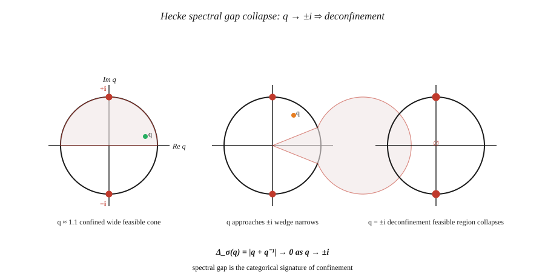</a>  

**Light** *(primary)*  ·  **Dark** *(viewer applies invert + hue-rotate filter at render time)*

> F12.4 (P1, sibling #633). Three miniatures of the complex-$q$ plane arranged left-to-right. Each miniature shows the unit circle, two red dots at $q = \pm i$ (Kauffman degeneracy points), and a shaded "feasible cone" wedge avoiding those points. Miniature 1 ($q \approx 1.1$): wi…

**Variants:** — · **Wired in:** *(not wired)* · **Prompt file:** [`hecke-spectral-gap-deconfinement-0.prompt.md`](../content/quantum-observable-universe/particle-interactions/rendered/hecke-spectral-gap-deconfinement-0.prompt.md)

---

### `shell-closure-spectrum-0` — Nuclear shell closure as Hecke eigenvalue gap

<a href="../content/quantum-observable-universe/particle-interactions/rendered/shell-closure-spectrum-0.svg">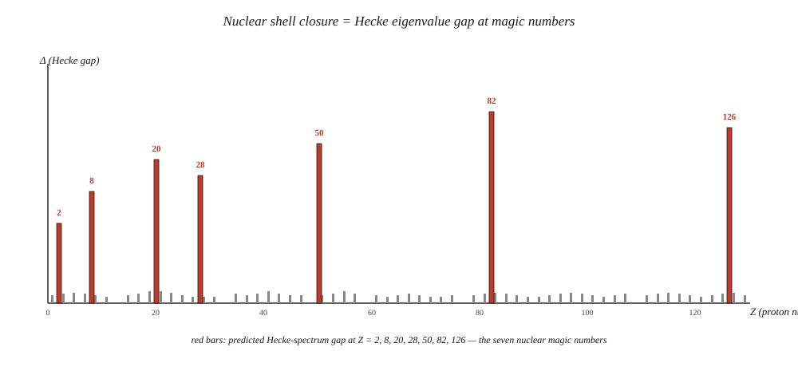</a>  

**Light** *(primary)*  ·  **Dark** *(viewer applies invert + hue-rotate filter at render time)*

> F11.3 (P1). Bar chart with horizontal axis $Z$ (proton number, $0$ to $130$) and vertical axis "Hecke-spectrum gap" $\Delta$. Most $Z$ values get small grey bars; bars at $Z = 2, 8, 20, 28, 50, 82, 126$ are tall and coloured red, with their numerical labels above. These are the…

**Variants:** — · **Wired in:** *(not wired)* · **Prompt file:** [`shell-closure-spectrum-0.prompt.md`](../content/quantum-observable-universe/particle-interactions/rendered/shell-closure-spectrum-0.prompt.md)

---

## Quantum Observable Universes

### `dirac-square-blocks-0` — The categorical Dirac square — D_∇²

<a href="../content/quantum-observable-universe/quantum-observable-universes/rendered/dirac-square-blocks-0.svg">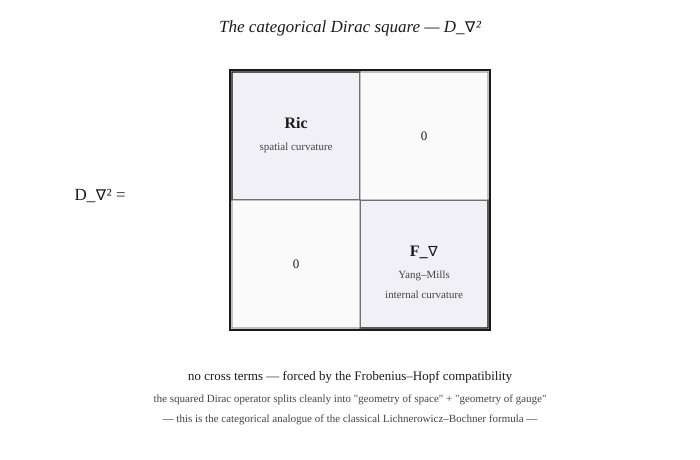</a>  

**Light** *(primary)*  ·  **Dark** *(viewer applies invert + hue-rotate filter at render time)*

> F2.2 (P1). A $2 \times 2$ block-matrix glyph for $D_\nabla^2$. The diagonal blocks are shaded light grey and labelled: top-left "Ric — spatial curvature", bottom-right "$F_\nabla$ — Yang–Mills internal curvature". The off-diagonal blocks are drawn lighter and contain a single "0…

**Variants:** — · **Wired in:** *(not wired)* · **Prompt file:** [`dirac-square-blocks-0.prompt.md`](../content/quantum-observable-universe/quantum-observable-universes/rendered/dirac-square-blocks-0.prompt.md)

---

### `instanton-self-dual-0` — Instanton self-duality projector

  

**Light** *(primary)*  ·  **Dark** *(viewer applies invert + hue-rotate filter at render time)*

> F2.3 (P1). A coordinate plane with two perpendicular axes: horizontal $\Omega^+$ (self-dual 2-forms, $\star_q \omega = +\omega$), vertical $\Omega^-$ (anti-self-dual). A red vector labelled $F_\nabla$ lies along the $\Omega^+$ axis, illustrating that the curvature of an instanto…

**Variants:** — · **Wired in:** *(not wired)* · **Prompt file:** [`instanton-self-dual-0.prompt.md`](../content/quantum-observable-universe/quantum-observable-universes/rendered/instanton-self-dual-0.prompt.md)

---

### `qu-to-qou-funnel-0` — From QU to QOU: three constraints

  

**Light** *(primary)*  ·  **Dark** *(viewer applies invert + hue-rotate filter at render time)*

> F2.1 (P0). A funnel diagram. Top: a wide dashed-outline cloud labelled "QUs — all rigid braided monoidal categories with Frobenius–Hopf object A and fibre functor τ". The cloud narrows through three sequential constrictions, each labelled with one of the QOU axioms: non-degenera…

**Variants:** — · **Wired in:** *(not wired)* · **Prompt file:** [`qu-to-qou-funnel-0.prompt.md`](../content/quantum-observable-universe/quantum-observable-universes/rendered/qu-to-qou-funnel-0.prompt.md)

---

## Quantum Universes

### `frobenius-snake-0` — Rigidity: the zig-zag snake identity

  

**Light** *(primary)*  ·  **Dark** *(viewer applies invert + hue-rotate filter at render time)*

> F1.1 (P0). Left: a Penrose / string-diagram zig-zag composite. Top entry strand labelled $A$ enters; a cap labelled $\mathrm{coev}_A$ creates an $A \otimes A^\vee$ pair; three middle strands run vertically; a cup labelled $\mathrm{ev}_A$ closes the first two strands together; th…

**Variants:** — · **Wired in:** *(not wired)* · **Prompt file:** [`frobenius-snake-0.prompt.md`](../content/quantum-observable-universe/quantum-universes/rendered/frobenius-snake-0.prompt.md)

---

### `jet-prolongation-ladder-0` — Jet prolongation: Kähler differentials and J¹(A)

<a href="../content/quantum-observable-universe/quantum-universes/rendered/jet-prolongation-ladder-0.svg">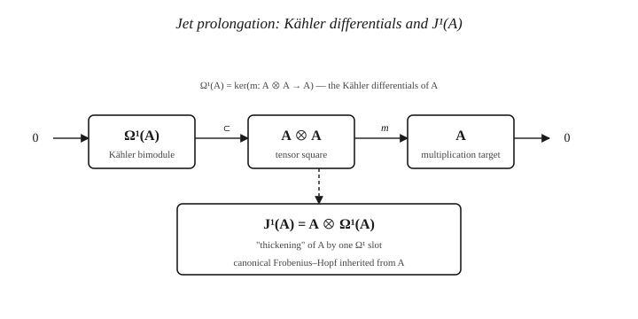</a>  

**Light** *(primary)*  ·  **Dark** *(viewer applies invert + hue-rotate filter at render time)*

> F1.3 (P2 / P1). The short exact sequence $0 \to \Omega^1(A) \to A \otimes A \xrightarrow{m} A \to 0$ drawn as a horizontal ladder of three labelled rounded-rectangle nodes connected by arrows. Each node carries a small subtitle: "Kähler bimodule", "tensor square", "multiplicatio…

**Variants:** — · **Wired in:** *(not wired)* · **Prompt file:** [`jet-prolongation-ladder-0.prompt.md`](../content/quantum-observable-universe/quantum-universes/rendered/jet-prolongation-ladder-0.prompt.md)

---

### `tannaka-krein-triangle-0` — Tannaka–Krein reconstruction

  

**Light** *(primary)*  ·  **Dark** *(viewer applies invert + hue-rotate filter at render time)*

> F1.2 (P1). Triangle relating the QOU datum to the reconstructed group and its representation category. Top vertex: a labelled box "(𝐂, A, τ) — QOU datum". Bottom-left vertex: "$G = \mathrm{Aut}^\otimes(\tau)$ — reconstructed group". Bottom-right vertex: "$\mathbf{Rep}(G)$ — rep…

**Variants:** — · **Wired in:** *(not wired)* · **Prompt file:** [`tannaka-krein-triangle-0.prompt.md`](../content/quantum-observable-universe/quantum-universes/rendered/tannaka-krein-triangle-0.prompt.md)

---

Generated 2026-05-10 from 64 authored SVG file(s).
