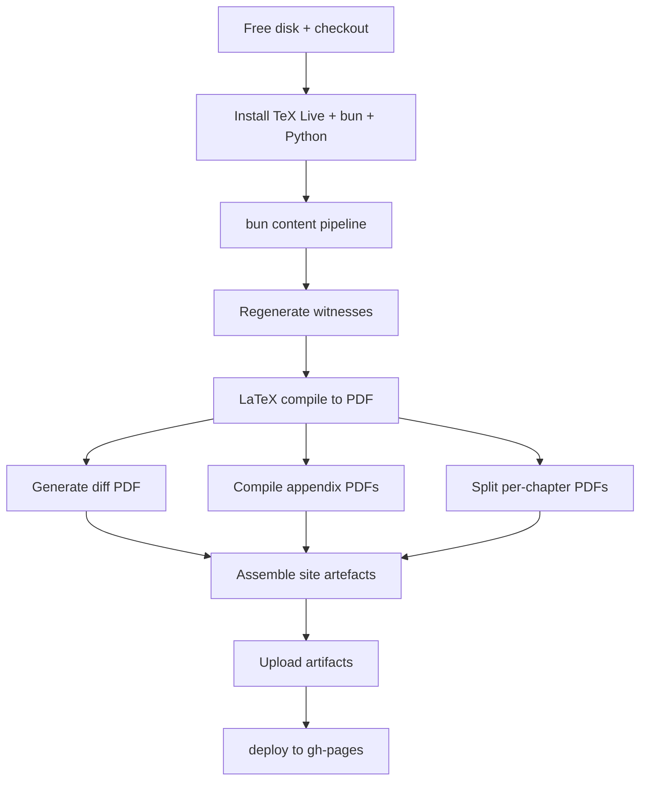
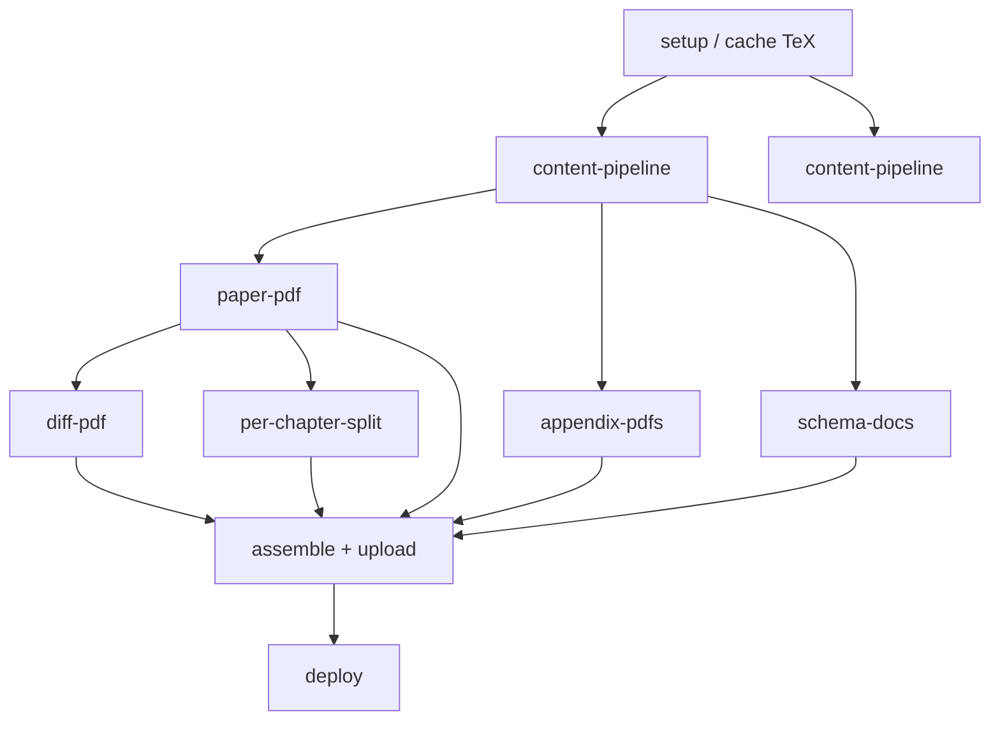

# publish.yml parallelization — 5-job DAG design (Phase A doc only)

**Date.** 2026-05-24
**Status.** Design doc — owner sign-off needed before any implementation touches `.github/workflows/publish.yml`.
**Motivation.** [Workplan v2 §3 / §6](2026-05-24-library-reuse-production-readiness.md) calls out the monolithic `publish.yml` (1,061 LOC, single job with 35+ sequential steps) as the highest-ROI CI parallelization target. Estimated 2-3× wall-clock speedup with a 5-job DAG.

## Current shape (monolithic)

[`publish.yml`](../../.github/workflows/publish.yml) has ONE compute job (`build-and-publish`, lines 80-1009) followed by a tiny `deploy` job (1010-1061). The compute job runs ~35 sequential steps for ~20-30 minutes per run:

**Bottleneck**: the TeX Live install alone is ~5-10 minutes. The rest is mostly sequential by historical accident, not by data dependency.

## Proposed 5-job DAG

### Jobs

| # | Job | Wall time | What | Depends on |
|---|---|---:|---|---|
| 1 | **setup** | ~3-5 min (one-time per run, then cached) | Install TeX Live + bun + Python via prebuilt Docker image; build cache for the image | — |
| 2 | **content-pipeline** | ~5-8 min | `bun run validate` + `bun run build` for all papers; regenerate witnesses; build schema-docs | setup |
| 3a | **paper-pdf** | ~3-5 min | `latexmk` compile main paper PDF + per-paper PDFs | content-pipeline |
| 3b | **appendix-pdfs** | ~2-3 min | Compile standalone appendix PDFs in parallel | content-pipeline |
| 3c | **diff-pdf** | ~3-4 min | `latexdiff` vs `main` branch | paper-pdf |
| 3d | **per-chapter-split** | ~1-2 min | Split main PDF into per-chapter PDFs via pypdf | paper-pdf |
| 4 | **assemble + upload** | ~2-3 min | Combine artefacts, build site/, builds.json, upload | all of 3a-d |
| 5 | **deploy** | ~1 min | Push to gh-pages | assemble |

**Theoretical wall-clock**: max(3a, 3b) + max(3c, 3d) + 4 + 5 ≈ 5 + 4 + 3 + 1 = **13 min** (vs current ~25-30 min). **2-3× faster** matching the workplan estimate.

## Implementation path (NOT in this PR)

### Phase A (this PR, doc only)

- [x] Design doc (this file)
- [x] Job DAG with wall-time estimates
- [x] Cost analysis + bottleneck identification
- [ ] Owner sign-off on the 5-job split + Docker-image-vs-actions/cache approach

### Phase B (separate PR after sign-off): Docker image baseline

1. **Build a `paper-builder` Docker image** baking TeX Live + bun + Python + the standard system deps. Publish to GHCR (`ghcr.io/litlfred/qou-paper-builder:<sha>`).
2. **New workflow `.github/workflows/paper-builder-image.yml`** — rebuilds the image on changes to `.github/docker/Dockerfile.paper-builder`.
3. Image is ~2-3 GB compressed; pulls in ~2-3 min (vs 5-10 min apt-get install + npm install). Net win even before parallelization.

### Phase C (separate PR after Phase B): publish.yml split

1. Split `build-and-publish` job into the 5 (or 7 with the 4-way split of 3a-d) jobs above
2. Each job uses `container: ghcr.io/litlfred/qou-paper-builder:<sha>` — instant setup
3. Artefacts pass between jobs via `actions/upload-artifact` + `actions/download-artifact`
4. `deploy` job consumes the unified artefact bundle from `assemble`

### Phase D (separate PR): observe + optimize

- Add per-job timing metrics
- Watch for one job becoming the new long-pole; further split if needed
- Consider parallelizing per-paper builds in Phase 3a (each paper PDF is independent)

## Why this doc instead of a direct refactor

`publish.yml` is **critical infrastructure** — it deploys main + every PR preview. A bad refactor breaks every PR preview link, blocks main, and disrupts the entire team. The right approach is:

1. Owner reviews the 5-job DAG + the Docker-image approach (this doc)
2. Phase B lands the Docker image WITHOUT modifying publish.yml — verifies the image works end-to-end against the existing monolithic build
3. Phase C lands a NEW workflow `publish-fast.yml` in parallel with `publish.yml`. Both run on PR; the new one is observed for ~1-2 weeks; if green, the old one is retired and the new one renamed
4. Phase D iterates

This 4-PR sequence is safer than a one-shot rewrite, and each Phase delivers measurable wins (Phase B already brings ~3-5 min savings without any DAG change; Phase C gets the full 2-3×).

## Open questions for owner

1. **GHCR write token**: Phase B requires pushing the prebuilt image to GHCR. The repo already publishes the `paper-assistant` image to GHCR (`build-lean-mcp.yml`), so the credentials/policy are presumably in place. Confirm before Phase B starts.
2. **Image refresh cadence**: when do we rebuild the `paper-builder` image? On every TeX Live security patch? Monthly? On manifest changes? Suggest: monthly + on `Dockerfile` changes.
3. **Parallel-per-paper extension**: the folio currently has 3 papers (QOU, UGB, fred2005); Phase 3a could fan out per-paper (3 parallel `latexmk` jobs). Worth it? Probably yes once Phase C is stable; defer to Phase D.
4. **Job dependencies**: the proposed DAG has `paper-pdf → diff-pdf` and `paper-pdf → per-chapter-split`. Confirm this matches the actual data flow (e.g. is the diff-PDF generation independent of the per-chapter split?).

## Related workplan items

- [Library-reuse production-readiness](2026-05-24-library-reuse-production-readiness.md) v2 — calls out the parallelization specifically
- [Downstream-consumer libraries status](2026-05-24-downstream-consumer-libraries-status.md) — context on which workplan items have shipped
- [Lean cache strategy](2026-05-24-lean-cache-strategy.md) — sibling effort; the Docker image approach here mirrors the "single backend, multiple consumers" pattern there
