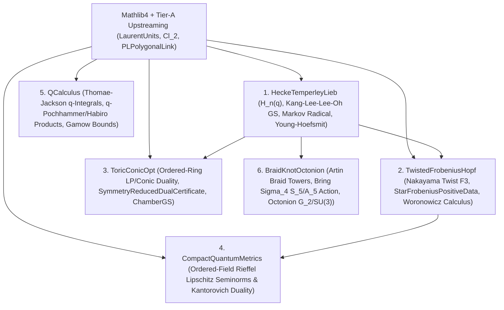

The Tier-B pure-mathematics layer decomposes into six standalone Lean 4 packages suitable for independent publication on the Lean Reservoir index. Every package is parameterized over generic commutative or ordered rings from Mathlib4 and is completely free of physical constants or empirical data.

| Reservoir package | Primary source namespaces | Core mathematical scope | Ground-ring generality |
|---|---|---|---|
| **HeckeTemperleyLieb** | *HeckeAlgebra*, *IwahoriHecke*, *BraidsAndKnots* | Type-$A_{n-1}$ Iwahori--Hecke algebras, Kang--Lee--Lee--Oh Gröbner--Shirshov completion, Markov trace radical, Temperley--Lieb quotient, Young--Hoefsmit seminormal matrices | Commutative ring $R$, $q \in R^\times$ (field for seminormal blocks) |
| **TwistedFrobeniusHopf** | *QuantumUniverse*, *AlgebraicAether*, *FrobeniusHopfData* | Ambidextrous Nakayama-twisted Frobenius algebras ($F_3$), Sweedler $H_4$ and Taft $T_n(\zeta)$ models, $\ast$-Frobenius positive cones, Woronowicz bicovariant calculus obstructions | Commutative / $\ast$-ordered ring $R$ |
| **ToricConicOpt** | *MathlibInfra*, *Optimization* | Exact Farkas and conic LP duality over ordered fields, group-averaged symmetry reduction, complementary-slackness uniqueness, Sturmfels--Thomas toric Gröbner / chamber bases | Linearly ordered field $\mathbb{F}$ |
| **CompactQuantumMetrics** | *Geometry*, *InformationTheory*, *MathlibInfra* | Finite-dimensional Rieffel compact quantum metric spaces, scalar-kernel Lipschitz seminorms, Kantorovich--Rubinstein state-space metric duality | Linearly ordered field $\mathbb{F}$ |
| **QCalculus** | *MathlibInfra*, *Nuclear*, *Habiro* | Thomae--Jackson $q$-integrals, $q$-fundamental theorem of calculus, $q$-Pochhammer and Habiro cyclotomic expansions, discrete Jackson--Gamow barrier bounds | Commutative / ordered ring $R$, $q \neq 1$ |
| **BraidKnotOctonion** | *BraidKnot*, *BringsSurface*, *EightfoldWay*, *Torsion* | Artin braid group towers, Markov conjugacy classes, Bring's genus-$4$ curve ($\chi_{\mathrm{eu}} = -6$, $S_5/A_5$ action), octonionic $G_2$ and $\mathrm{SU}(3)$ stabilizer algebra | Commutative ring $R$ |
