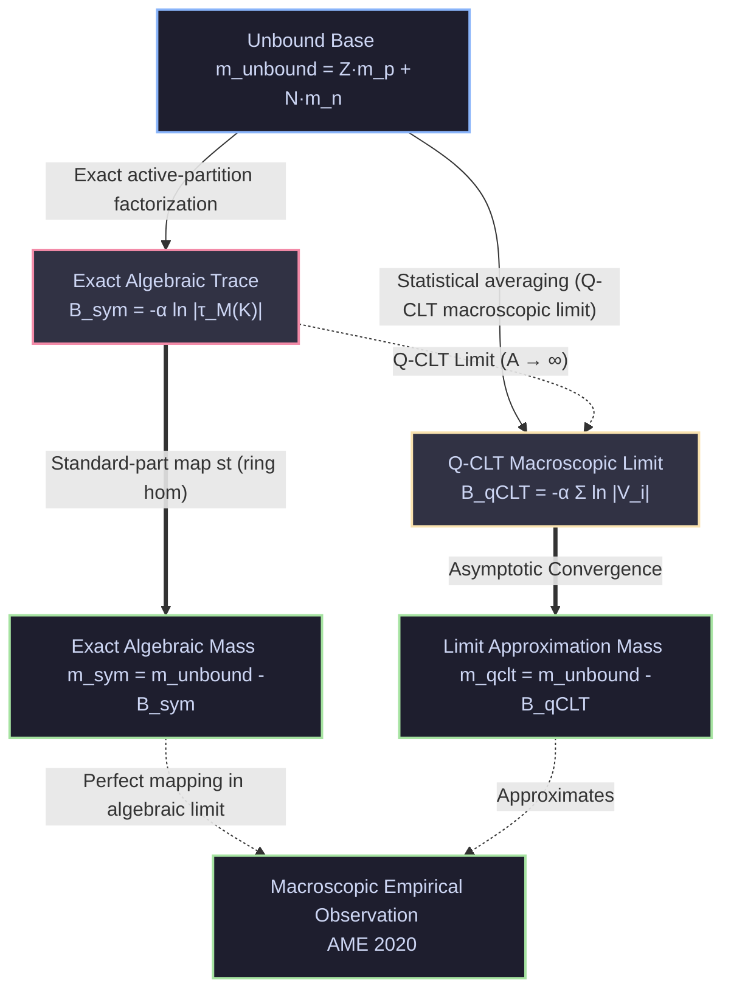

## Archimedean realisation & Trace Commutativity

Two independently defined binding traces — the exact active-partition factorization $B_{\mathrm{sym}}$ and the Q-CLT statistical limit $B_{\mathrm{qCLT}}$ — must land on the *same* macroscopic observable, and the standard-part map is what guarantees it. Here $\mathcal{F}_{Arch}$ denotes the **object-level standard-part map** $\mathrm{st} \colon \mathbf{No}_{\mathrm{fin}} \to \mathbb{R}$ — a surjective ring homomorphism — applied to the real-valued binding traces; it is the underlying evaluation of the categorical standard-part *functor* $\mathrm{St}$ ([def:standard-part-functor](#def:standard-part-functor)), not a functor in its own right. It transforms algebraic traces into physical macroscopic observables, so that the evaluation of nuclear binding traces rigorously commutes as the scale $A \to \infty$. The payoff is already concrete in the tritium / helium-3 splitting: both routes agree that the $n$–$n$ bond of tritium binds more tightly than the $p$–$p$ bond of helium-3.

### Numerical realization

The scale $\alpha$ in the diagram is the canonical energy scale $\alpha = E_0 =
\mathfrak{m}_e/\bigl(q_0(q_0-1)\bigr)$, the electron mass lifted by the substrate
factor — a derived quantity, not a free parameter (in particular it is neither
the neutron $\beta$-decay value $\mathfrak{Q}_\beta$ nor a deuteron-pinned fit). Writing the
bond suppression $s(K) = 1 - \mathrm{tr}_M(W_{\mathrm{atom}})/\mathrm{tr}_M(W_{\mathrm{free}})$
and the log-ratio $L(K) = \ln\bigl(\mathrm{tr}_M(W_{\mathrm{free}})/\mathrm{tr}_M(W_{\mathrm{atom}})\bigr)
= -\ln(1-s)$, the exact algebraic trace is $B_{\mathrm{sym}} = \alpha\,L$; its
linearization $B_{\mathrm{lin}} = \alpha\,s$ is the leading term of $L = s + s^2/2 +
\cdots$ and saturates at $\alpha$ (since $s < 1$); and the Q-CLT limit
$B_{\mathrm{qCLT}} = \alpha \sum_i \ln|V_i|$ replaces the exact correlated trace by a
sum of independent per-bond contributions, each $V_i$ the Markov-trace ratio of a
two-nucleon sub-braid. Taking every $V_i$ equal to the deuteron bond gives the
uniform limit; resolving the three bond types ($p$–$p$, $p$–$n$, $n$–$n$) by their
own sub-braid ratios — with $\ln|V_{n\text{-}n}| > \ln|V_{p\text{-}p}|$ — gives the
factorized limit.

Evaluated on the light nuclei whose binding trace is canonical, the exact
log-trace $B_{\mathrm{sym}}(E_0)$ reproduces the measured binding within
$\approx 1.2\times$ for the non-anomalous $A = 3$ isotopes with no fit. The
tritium / helium-3 splitting is resolved both by the exact trace and by the
factorized Q-CLT: tritium carries an $n$–$n$ bond where helium-3 carries a
$p$–$p$ bond, and the larger $n$–$n$ sub-braid suppression makes tritium the more
bound — a distinction the uniform-per-bond limit, blind to bond type, averages
away. The doubly-magic $^4\mathrm{He}$, which carries no single hyperbolic knot,
is instead reproduced by the shell-closure specialization $B = 2\,\mathfrak{m}_e\,
A\,\mathrm{Vol}(L6a4)$ with $\mathrm{Vol}(L6a4) = 8G$ the Borromean residue; the
per-knot trace forms undershoot the heavier $^6\mathrm{Li}$ and $^7\mathrm{Li}$ by
$\approx 1.6\times$, marking where the single-trace estimate gives way to shell
structure. The side-by-side evaluation through this one canonical trace — now
spanning $^2\mathrm{H}$ through $^7\mathrm{Li}$ — has been carried out
numerically.
