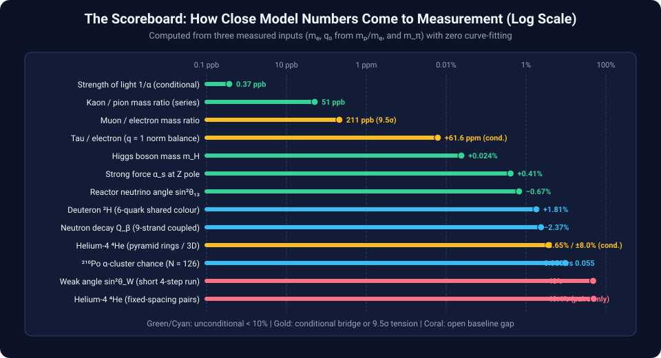

# Quantum Observable Universe: General-Audience Survey & Illustrated Storyboard Suite

> **Scope and License:** This folder accompanies the open mathematics monograph *Quantum Observable Universe* ([`github.com/litlfred/qou`](https://github.com/litlfred/qou)), released under **CC BY 4.0**. Inside the model, names such as *photon*, *electron*, *proton*, *mass*, and *binding energy* refer to defined mathematical shapes built from braided strands; physical science enters where pure unit-free ratios computed from those shapes are compared with laboratory measurements (**CODATA**, **Particle Data Group**, and the **Atomic Mass Evaluation**). Several ratios match experiment closely, several depend on unproved steps, and several miss measurement by wide margins.

---

## 1. Purpose and Audience

What happens if you set aside the assumption of an empty four-dimensional coordinate box, keep only the rules for how events follow one another and how neighboring strands cross over or under each other, and control that crossing difference with a single number $q_0 > 1$?

This suite presents a **nine-section general-audience survey article** paired one-to-one with **nine illustrated slide decks and visual storyboards** (~66 slides total) and **twenty vector diagrams (`assets/*.svg`)**. Written for curious readers who know everyday physics words—*atoms, protons, neutrons, electrons, light, waves, knots, symmetry, energy, and ratios*—without assuming specialist mathematics, every section builds from simple physical pictures first and explains every symbol in plain English.

---

## 2. Two Ground Rules

Every page of [`survey-article.md`](survey-article.md) and every slide deck in [`slides/`](slides/) follows two strict rules:

1. **Mathematical Model vs. Laboratory Comparison:** Calling a specific three-strand braid "the electron" or "the proton" defines a mathematical object inside the model. Empirical claims live strictly at the comparison boundary where unit-free ratios output by the model are placed beside experimental tables.
2. **Zero Curve-Fitting (Three Calibration Inputs Only):** Apart from **three measured inputs**—the electron mass $m_e$ (setting the mega-electronvolt energy unit), the proton-to-electron mass ratio $m_p / m_e$ (used as an **input pin** to solve for $q_0 = 1.10997858275\dots$, never claimed as a prediction), and the pion mass $m_\pi$ (setting the nuclear contact distance, which drops out altogether on pure proton–neutron electric differences)—no exponent, cutoff, or knot choice is tuned to fit data. Where a calculation misses measurement by $211$ parts per billion or by $48\%$, or brackets measurement only under an unproved bridge assumption, the exact scope is shown directly so missing steps stay visible.

---

## 3. Contents and Illustrated Deck Map

### General-Audience Survey Article

- **[`survey-article.md`](survey-article.md)** — Complete 9-section survey with 11 plain-English equations, 20 inline vector diagrams, a unified experimental comparison table, and 6 major unsolved mathematical questions.

### Per-Section Illustrated Slide Decks & Storyboards (`slides/`)

Each section of [`survey-article.md`](survey-article.md) has a companion deck containing **(a)** concise on-screen titles and equations, **(b)** rendered inline `.svg` visuals from [`assets/`](assets/), **(c)** full word-for-word host narration written for spoken clarity, and **(d)** 2D/3D animation directions:

| Sec. | Survey Section | Illustrated Slide Deck | Slides | Key Visuals |
|:----:|:---------------|:-----------------------|:------:|:------------|
| **1** | [Space, Time, and Indiscernibles](survey-article.md#1-space-time-and-indiscernibles-replacing-the-background-stage) | [`slides/section-01-relational-space-and-hecke-algebra.md`](slides/section-01-relational-space-and-hecke-algebra.md) | 7 | [`sec01-grid-to-braids.svg`](assets/sec01-grid-to-braids.svg), [`sec01-skein-relation.svg`](assets/sec01-skein-relation.svg), [`sec01-loop-quotient.svg`](assets/sec01-loop-quotient.svg) |
| **2** | [The Rules of the Game and the Three Calibrations](survey-article.md#2-the-rules-of-the-game-model-versus-measurement-and-the-three-calibrations) | [`slides/section-02-rules-of-the-game-and-three-calibrations.md`](slides/section-02-rules-of-the-game-and-three-calibrations.md) | 7 | [`sec02-model-vs-measurement.svg`](assets/sec02-model-vs-measurement.svg), [`sec02-figure-eight-tetrahedra.svg`](assets/sec02-figure-eight-tetrahedra.svg) |
| **3** | [Knots, Photons, and a Four-Holed Symmetric Surface](survey-article.md#3-knots-photons-and-a-four-holed-symmetric-surface) | [`slides/section-03-knots-photons-and-brings-surface.md`](slides/section-03-knots-photons-and-brings-surface.md) | 8 | [`sec03-photon-and-borromean.svg`](assets/sec03-photon-and-borromean.svg), [`sec03-brings-surface-pentagons.svg`](assets/sec03-brings-surface-pentagons.svg) |
| **4** | [The Fine-Structure Constant and the Electroweak Forces](survey-article.md#4-the-fine-structure-constant-and-the-electroweak-forces) | [`slides/section-04-fine-structure-and-electroweak.md`](slides/section-04-fine-structure-and-electroweak.md) | 8 | [`sec04-torus-knots-alpha.svg`](assets/sec04-torus-knots-alpha.svg), [`sec04-electroweak-higgs-rg.svg`](assets/sec04-electroweak-higgs-rg.svg) |
| **5** | [Ghost Particles on a Simple Loop: Neutrinos and Matter Families](survey-article.md#5-ghost-particles-on-a-simple-loop-neutrinos-and-matter-families) | [`slides/section-05-neutrinos-sweedler-and-generations.md`](slides/section-05-neutrinos-sweedler-and-generations.md) | 7 | [`sec05-unknot-neutrino-framing.svg`](assets/sec05-unknot-neutrino-framing.svg), [`sec05-generations-and-pmns.svg`](assets/sec05-generations-and-pmns.svg) |
| **6** | [Inside the Nucleon and Beta Decay](survey-article.md#6-inside-the-nucleon-and-beta-decay-how-honest-failures-drive-discovery) | [`slides/section-06-nucleons-and-beta-decay.md`](slides/section-06-nucleons-and-beta-decay.md) | 7 | [`sec06-beta-decay-nine-strand.svg`](assets/sec06-beta-decay-nine-strand.svg), [`sec06-proton-neutron-em.svg`](assets/sec06-proton-neutron-em.svg) |
| **7** | [Building Atomic Nuclei: Shared Colour, 73 Regions, and Alpha Decay](survey-article.md#7-building-atomic-nuclei-shared-colour-the-73-stability-regions-stellar-carbon-and-alpha-decay) | [`slides/section-07-nuclear-chambers-hoyle-and-alpha-decay.md`](slides/section-07-nuclear-chambers-hoyle-and-alpha-decay.md) | 8 | [`sec07-hidden-colour-deuteron.svg`](assets/sec07-hidden-colour-deuteron.svg), [`sec07-nuclear-chambers-hoyle.svg`](assets/sec07-nuclear-chambers-hoyle.svg), [`sec07-po210-alpha-tunneling.svg`](assets/sec07-po210-alpha-tunneling.svg) |
| **8** | [Five Layers of Matter: Chemistry and Horizons](survey-article.md#8-five-layers-of-matter-why-chemistry-exists-and-what-happens-at-horizons) | [`slides/section-08-five-layer-confinement-tower-and-chemistry.md`](slides/section-08-five-layer-confinement-tower-and-chemistry.md) | 8 | [`sec08-five-layer-tower.svg`](assets/sec08-five-layer-tower.svg), [`sec08-horizon-punctures.svg`](assets/sec08-horizon-punctures.svg) |
| **9** | [The Scoreboard: Where the Model Hits, Fails, and Can Be Tested](survey-article.md#9-the-scoreboard-where-the-model-hits-where-it-fails-and-how-to-test-it) | [`slides/section-09-the-honest-scoreboard-and-open-frontiers.md`](slides/section-09-the-honest-scoreboard-and-open-frontiers.md) | 7 | [`sec09-unified-comparison-chart.svg`](assets/sec09-unified-comparison-chart.svg), [`sec09-unsolved-questions-map.svg`](assets/sec09-unsolved-questions-map.svg) |

---

## 4. Reproducing the Visuals and Adapting the Decks

- **Vector Visual Generator:** Run `python3 papers/pbs-spacetime-survey/scripts/render_storyboard_visuals.py` (`mpmath` at 60 decimal places, zero floating-point rounding) to regenerate all 20 `.svg` frames in [`assets/`](assets/).
- **Presentation Formats:** Each Markdown file in [`slides/`](slides/) is structured with `[On-Screen]`, `[Visual Frame]`, `[Host Narration]`, and `[Animation Notes]` blocks so it can be viewed directly on GitHub, exported to slide decks (`.pptx` / Reveal.js), or animated in Manim and Blender.
