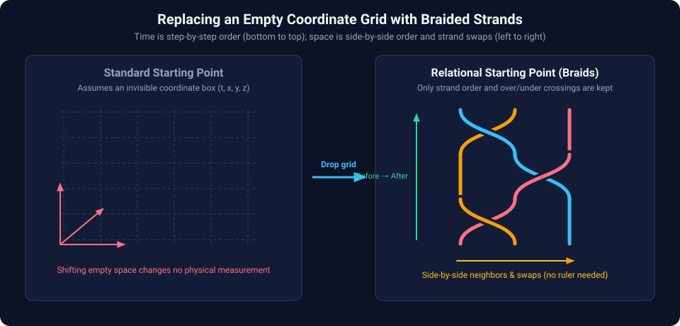
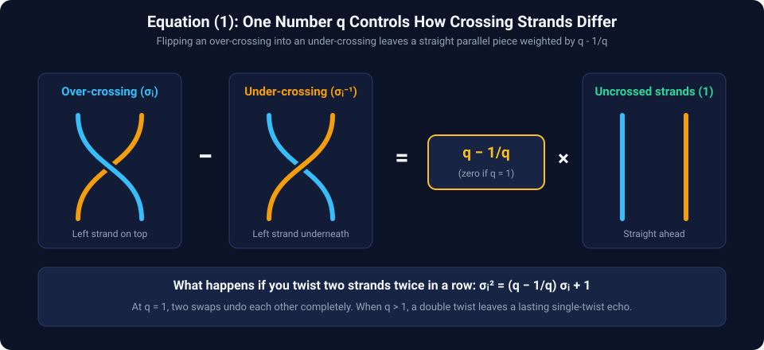
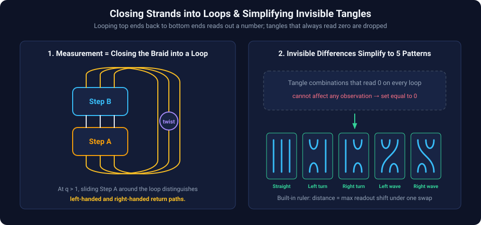

# Section 1 Illustrated Storyboard: Space, Time, and Indiscernibles

**Companion to:** [Survey Article §1](../survey-article.md#1-space-time-and-indiscernibles-replacing-the-background-stage) | [Suite Index](../README.md)  
**Target Runtime:** ~6 minutes (7 slides)  
**Audience Level:** Curious general viewer (everyday physics words only; zero specialist algebra jargon)

---

## Slide 1.1 — Starting Without an Empty Room

### On-Screen Text
- **Title:** Does Physics Need an Empty Coordinate Box?
- **Comparison:** Empty grid $(t, x, y, z) + 26\text{ constants} \quad \longrightarrow \quad \text{Step-by-step strand order}$

### Host Narration
"Almost every physics course starts by imagining an empty room: an invisible three-dimensional coordinate grid ticking forward in time. Only after we bolt that grid into place do we put fields inside it, treat their ripples as particles, and measure roughly two dozen constants in the laboratory to make the numbers come out right. What if we drop the empty box at the start and ask how much of space, time, and matter can be built purely from the order in which events connect?"

### Animation Notes
- Open on a 3D wireframe coordinate cube (`#1e293b`) with dials along the margin representing free constants.
- Gently fade out the coordinate lines to deep slate (`#0d1326`), leaving three colored ribbons (cyan, amber, coral) weaving smoothly from bottom to top without axes or rulers.

---

## Slide 1.2 — Leibniz's Simple Question

### On-Screen Text
- **Title:** Only Observable Relations Count
- **Three Everyday Ideas:**
  1. **Time:** Which step comes *after* which
  2. **Space:** Which strands sit *side by side* and swap places
  3. **No Hidden Twins:** Two states that look identical to every possible test are the *same* state

### Host Narration
"Three hundred years ago, Gottfried Wilhelm Leibniz posed a simple thought experiment to Isaac Newton's supporters. Suppose you slid the entire universe three meters to the left inside an empty coordinate box. Every distance and angle between real objects would stay unchanged, so no experiment could ever detect the shift. Leibniz concluded that the empty box isn't real. Time is simply the order of one event following another; space is the order of things sitting side by side; and two arrangements that give identical answers to every possible observation are literally the same state."

### Animation Notes
- Show three glowing nodes inside a faint coordinate grid; shift all three nodes rightward together while distance bars between them stay constant. Fade out the grid.
- Arrange three vertical ribbons side by side: highlight a vertical arrow (`Before -> After`) for time and a horizontal swap between neighbors (`Side-by-Side Crossing`) for space.

---

## Slide 1.3 — Why Passing Straight Through Builds Nothing

### On-Screen Text
- **Title:** Remembering Over vs. Under
- **Two Worlds:**
  - **Flat swaps ($q = 1$):** Crossing twice untangles completely ($\sigma_i^2 = \mathbf{1}$)
  - **Braided strands ($q > 1$):** Crossing *over* ($\sigma_i$) differs from crossing *under* ($\sigma_i^{-1}$)

### Host Narration
"Lay two ribbons side by side on a table and cross the left ribbon over the right: call that move sigma. Now cross them a second time in the exact same direction. If over-crossings and under-crossings made no difference—as if the ribbons could pass ghostlike straight through each other—then two swaps would always put both ribbons right back where they started. Nothing could ever tangle, lock together, or hold tension. For shapes to form, the rules have to tell an over-crossing apart from an under-crossing."

### Animation Notes
- Split screen: on the left ($q = 1$), two translucent ribbons cross twice, pass through one another, and snap back into two straight vertical lines.
- On the right ($q > 1$), two solid 3D tubes cross twice in the same direction; pulling the ends taut tightens them into a visible full twist that refuses to flatten.

---

## Slide 1.4 — Equation (1): The Strand-Swapping Rule

### On-Screen Text
- **Title:** One Number $q$ Controls Every Crossing

$$
\sigma_i - \sigma_i^{-1} = \left(q - \frac{1}{q}\right)\mathbf{1}, \qquad h := q - \frac{1}{q}
$$

- **Double Twist:** $\sigma_i^2 = h\,\sigma_i + \mathbf{1}$

### Host Narration
"Equation one writes down that difference using a single positive number q. On the left, take an over-crossing sigma minus the matching under-crossing sigma-inverse. On the right, boldface one simply means two straight uncrossed ribbons, multiplied by q minus one-over-q, which we call h for short. Check what happens if q equals one: one minus one is zero, so over equals under and all tangles vanish. Whenever q is larger than one, flipping an over-crossing into an under-crossing leaves behind a straight parallel piece of strength h—and twisting twice leaves a lasting single-twist echo."

### Animation Notes
- Highlight each visual ribbon tile in `sec01-skein-relation.svg` as it is named: cyan-over-amber (`σᵢ`), cyan-under-amber (`σᵢ⁻¹`), gold multiplier (`q − 1/q`), and straight parallel bars (`1`).
- Stack a second crossing on top to animate a double twist splitting into straight parallel ribbons plus a single-crossing echo weighted by $h$.

---

## Slide 1.5 — Closing a Braid Into a Measurement Loop

### On-Screen Text
- **Title:** How You Measure a Braid: Close the Loop
- **Loop Readout:** Connect top ends smoothly back to bottom ends $\longrightarrow$ one pure number
- **Handedness ($q > 1$):** Sliding a step around the return loop distinguishes left turns from right turns

### Host Narration
"A braid with loose ends on a table represents a process still underway. To read out an actual observable number, a detector has to close the circuit—looping the top ends of the strands smoothly around to meet their bottom ends, turning the braid into closed rings or a knot. That single closed-loop readout acts like measuring volume in geometry, before we ever introduce a meter stick. And when q is greater than one, sliding a step around that return loop also tells left-handed turns apart from right-handed turns."

### Animation Notes
- Focus on the left half of `sec01-loop-quotient.svg`: three golden arcs sweep from the top of `Step B` around the right side into the bottom of `Step A`.
- Animate `Step A` sliding around the curved return arc, picking up a visible twist collar as it passes from bottom to top.

---

## Slide 1.6 — Dropping Tangles That Always Read Zero

### On-Screen Text
- **Title:** Simplifying Invisible Differences
- **Rule:** If a combination of crossings reads $0$ on *every* closed loop, set it equal to $0$
- **Result on 3 Strands:** Leaves just $5$ simple non-crossing connection patterns

### Host Narration
"Now apply Leibniz's rule that indistinguishable states are identical. On three strands, you can combine several crossings in a way whose closed-loop readout cancels to zero no matter what other braid you attach before closing the loop. Because no possible loop test inside the model can ever spot that combination, it has zero physical effect—so we drop it. Once those invisible combinations are cleared away, any three-strand state simplifies down to five clean, non-crossing connection patterns."

### Animation Notes
- Focus on the right half of `sec01-loop-quotient.svg`: show a dashed box of canceling crossings feeding into a loop meter that reads `0.0000`, then fading out.
- Light up the five surviving three-strand patterns in green (`Straight`, `Left turn`, `Right turn`, `Left wave`, `Right wave`).

---

## Slide 1.7 — A Built-In Ruler Without Coordinates

### On-Screen Text
- **Title:** Distance Emerges from Strand Swaps
- **Built-In Ruler:** Distance between two states $=$ largest readout change produced by a single neighbor swap

### Host Narration
"Notice what emerges automatically on those five patterns, still without any coordinate grid. How far apart are two braided states? You can measure the distance between them by asking how much any observable readout shifts when you swap two neighboring strands once—and that built-in ruler obeys the ordinary triangle law of geometry by pure algebra. We now have twist, handedness, loop volume, and distance from one number q. Next, in Section two, we set the strict rules for testing this model against real laboratory data without cheating."

### Animation Notes
- Show three state dots arranged in a triangle above the five planar strand patterns, with straight distance segments connecting them (`d(A, C) ≤ d(A, B) + d(B, C)`).
- Transition right into the vertical `Compare Here` line of `sec02-model-vs-measurement.svg`.
