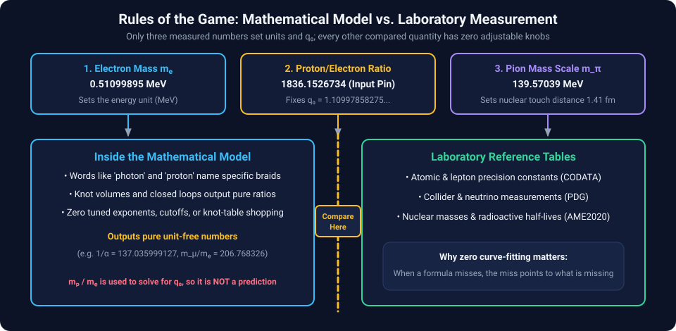
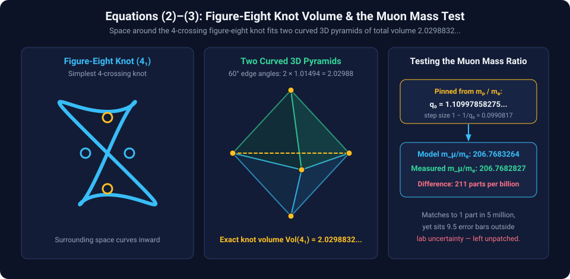

# Section 2 Illustrated Storyboard: The Rules of the Game and the Three Calibrations

**Companion to:** [Survey Article §2](../survey-article.md#2-the-rules-of-the-game-model-versus-measurement-and-the-three-calibrations) | [Suite Index](../README.md)  
**Target Runtime:** ~6 minutes 30 seconds (7 slides)  
**Audience Level:** Curious general viewer (everyday physics words only; zero specialist algebra jargon)

---

## Slide 2.1 — How Not to Fool Yourself With Numbers

### On-Screen Text
- **Title:** Zero Curve-Fitting Allowed
- **Banned Moves:**
  - Adjusting exponents or multipliers to hit a target number
  - Searching a knot catalog to pick whichever knot lands closest
  - Hiding a wrong answer behind a rounded patch

### Host Narration
"Whenever someone claims to connect pure geometry to physical numbers like the mass of a particle or the strength of light, your first question should be: did they adjust the formula to make it fit? With enough powers of pi, square roots, and knot tables, a computer can manufacture a close match to almost any number on earth. Worse still, adjusting a knob to erase an error destroys the model's ability to teach us anything—because that error was the exact clue pointing to a missing piece of physics. Here, curve-fitting is strictly banned."

### Animation Notes
- Show a flexible curve bending through five green dots as four sliders turn automatically; when a sixth dot appears, the curve flies off-screen. Fade out all sliders.
- Replace with a locked gear train driven by one central shaft ($q_0$): every output dial turns rigidly, keeping any miss clearly visible.

---

## Slide 2.2 — Model Names vs. Laboratory Measurements

### On-Screen Text
- **Title:** Where Mathematics Ends and Physics Begins
- **Left (`Mathematical Model`):** Specific braids named `photon`, `electron`, `proton` $\longrightarrow$ pure unit-free ratios
- **Right (`Laboratory Tables`):** Atomic, collider, and nuclear measurements

### Host Narration
"First, keep the boundary between math and physics clear. Inside the mathematics, calling a specific three-strand braid 'the electron' or 'the proton' is simply naming a shape—just as a geometer calls a three-crossing loop 'the trefoil knot.' Physics enters only at the vertical comparison line in the center of this diagram, where a pure unit-free ratio produced by the model is placed right beside laboratory measurements."

### Animation Notes
- Highlight the left blue box of `sec02-model-vs-measurement.svg` (`Inside the Mathematical Model`), then flash the central gold `Compare Here` line, then highlight the right green box (`Laboratory Reference Tables`).

---

## Slide 2.3 — Only Three Measured Inputs Set the Units and $q_0$

### On-Screen Text
- **Title:** The Three Calibration Inputs
- **Inputs:**
  1. **Electron mass ($m_e = 0.511\;\mathrm{MeV}$):** Sets the energy unit
  2. **Proton-to-electron ratio ($m_p / m_e = 1836.15267$):** Input pin that solves for $q_0$
  3. **Pion mass ($m_\pi = 139.57\;\mathrm{MeV}$):** Sets nuclear touch distance ($1.41\;\mathrm{fm}$)

### Host Narration
"Pure strand math outputs pure ratios without human units like mega-electronvolts or meters. To express answers in laboratory units and know which value of q describes our universe, the model uses three measured inputs. First, the electron's mass defines our mega-electronvolt energy ruler; because it sets the unit by definition, only ratios, mass differences, and binding energies count as tests. Second, the proton-to-electron mass ratio is fed in to solve for q-naught—meaning the proton-to-electron ratio is an input pin, never a prediction. Third, the pion mass sets the touch range of nuclear forces."

### Animation Notes
- Highlight the three top input cards of `sec02-model-vs-measurement.svg` from left to right (`1. Electron Mass`, `2. Proton/Electron Ratio`, `3. Pion Mass Scale`), with arrows feeding into the model box.

---

## Slide 2.4 — Equation (2): Volume Around the Figure-Eight Knot

### On-Screen Text
- **Title:** Curved Space Around a Four-Crossing Knot

$$
\frac{m_\mu}{m_e} = \frac{\mathrm{Vol}(4_1)}{\hbar_q^2}, \qquad \hbar_q := 1 - \frac{1}{q}, \qquad \mathrm{Vol}(4_1) \approx 2.0298832
$$

### Host Narration
"To see how knot shapes produce mass ratios, look at the simplest knot whose surrounding space curves inward: the four-crossing figure-eight knot on the left. Imagine drilling that loop out of three-dimensional space and filling the remaining room with building blocks. It fits two identical curved three-dimensional pyramids with sixty-degree edge angles, each with volume 1.01494, giving an exact total volume of 2.0298832. Dividing that volume by the square of the fractional step away from q equals one gives the model's mass ratio for the muon, the electron's heavier cousin."

### Animation Notes
- Rotate the 3D four-crossing figure-eight knot (`4₁`), then morph the space around it into the two teal-and-blue curved 3D pyramids shown in the center panel of `sec02-figure-eight-tetrahedra.svg`.

---

## Slide 2.5 — Equation (3): Solving for $q_0$ From the Proton Ratio

### On-Screen Text
- **Title:** Pinning $q_0$ (`m_p / m_e` Is an Input, Never an Output)

$$
\frac{m_p}{m_e} = 2\,\frac{\mathrm{Vol}(4_1)}{\hbar_{q_0}^2}\,|\mathrm{loop}(\beta_{\mathrm{Bor}})|\,\frac{[2]_{q_0}[3]_{q_0}}{q_0^3} - 12 \quad \Longrightarrow \quad q_0 = 1.10997858275\dots
$$

### Host Narration
"On three strands, the proton's core is a six-crossing braid that closes into three interlocked rings. Equation three connects the proton-to-electron mass ratio to twice the figure-eight volume scale times the closed-loop readout of that three-ring braid, minus twelve. Notice two key points of honesty. First, we plug in the measured proton-to-electron ratio—1836.1526734—to solve this equation for q-naught, fixing q-naught at 1.10997858275. Second, the one-over-q-cubed factor in this formula is currently stated as an assumption rather than proved from first principles."

### Animation Notes
- Animate the measured number `1836.152673426` entering the left side of Equation (3) with a gold `INPUT PIN` badge, locking a crosshair onto `q₀ = 1.10997858275138...` on a smooth curve.
- Highlight the `1 / q₀³` factor with a clear amber `Assumed Power (Unproved)` label.

---

## Slide 2.6 — First Real Test: The Muon Mass to 211 Parts per Billion

### On-Screen Text
- **Title:** Plugging $q_0$ Straight Into the Muon Formula
- **Zero-Parameter Comparison:**
  - **Model ($m_\mu / m_e$):** $206.7683264$
  - **Laboratory measurement:** $206.7682827 \pm 0.0000046$
  - **Offset:** **$211\;\mathrm{parts\ per\ billion}$** ($9.5$ error bars)

### Host Narration
"Now comes our first real test with zero adjustable knobs. Take that exact number q-naught—1.10997858275—and drop it straight into Equation two for the muon-to-electron mass ratio. Equation two outputs 206.7683264. In the laboratory, the muon-to-electron ratio is 206.7682827. Without tuning a single constant, the figure-eight knot volume matches the muon's mass to roughly one part in five million—211 parts per billion. Yet because experiments measure the muon to 22 parts per billion, that tiny offset still sits nine-and-a-half error bars outside experimental uncertainty."

### Animation Notes
- Zoom onto a number line from `0` to `250`, where `206.7683264` and `206.7682827` sit right on top of each other to the naked eye.
- Magnify the point `206.7683` ten million times until the green laboratory error bar (`±0.0000046`) separates visibly from the blue model dot by `9.5` error-bar widths.

---

## Slide 2.7 — Why Leaving a 211-ppb Gap Unpatched Matters

### On-Screen Text
- **Title:** Keeping Small Discrepancies Visible
- **Diagnostic Clue:** Proton $q_0$ and muon $q$ differ by $11.5\;\mathrm{parts\ per\ billion}$ $\longrightarrow$ points to uncomputed radiative loop effects

### Host Narration
"Why not multiply by a tiny correction factor to make those last 211 parts per billion disappear? Because under zero-fit rules, a small unpatched discrepancy is information. That eleven-and-a-half part-per-billion difference between the proton's q-naught and the muon's q shows up again when we test the strength of light—telling us directly that subtle feedback loops between light, electrons, muons, and protons still need to be calculated cleanly. Next, in Section three, let's look inside those three-strand braids to see how light, electrons, and quarks fit together."

### Animation Notes
- Show the two nearby pins `q₀(proton) = 1.109978583` and `q(muon) = 1.109978596` separated by a clean `11.5 ppb` caliper, then pan forward to the three-strand photon and three-ring proton diagrams of Section 3.
