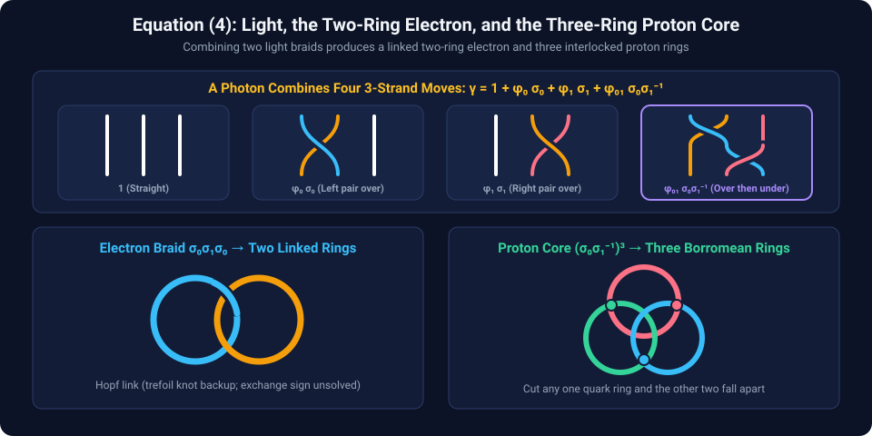
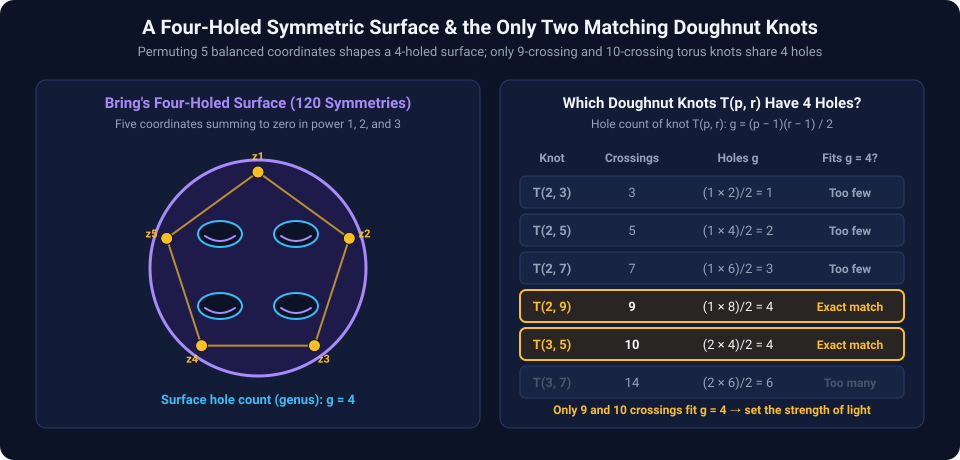

# Section 3 Illustrated Storyboard: Knots, Photons, and a Four-Holed Symmetric Surface

**Companion to:** [Survey Article §3](../survey-article.md#3-knots-photons-and-a-four-holed-symmetric-surface) | [Suite Index](../README.md)  
**Target Runtime:** ~7 minutes (8 slides)  
**Audience Level:** Curious general viewer (everyday physics words only; zero specialist algebra jargon)

---

## Slide 3.1 — Light Without Invisible "Virtual Particles"

### On-Screen Text
- **Title:** Equation (4): How Light Moves on Three Strands

$$
\gamma(\varphi) = \mathbf{1} + \varphi_0\sigma_0 + \varphi_1\sigma_1 + \varphi_{01}\sigma_0\sigma_1^{-1}
$$

- **Four Simple Moves:** Straight ahead ($\mathbf{1}$), left pair over ($\sigma_0$), right pair over ($\sigma_1$), and over-then-under ($\sigma_0\sigma_1^{-1}$)

### Host Narration
"In textbook physics diagrams, forces are often drawn as invisible 'virtual photons'—short-lived bookkeeping particles that pop out of empty space and vanish before any detector can see them. Inside this braided model, virtual photons do not exist. Instead, a photon of light is a direct combination of four simple moves on three side-by-side strands: running straight ahead, crossing the left pair over, crossing the right pair over, and a handed two-step move where the left strand passes *over* the middle strand and then *under* the right strand."

### Animation Notes
- Highlight the four top boxes of `sec03-photon-and-borromean.svg` from left to right: straight white bars (`1`), left over-crossing (`φ₀ σ₀`), right over-crossing (`φ₁ σ₁`), and the violet over-then-under vertex (`φ₀₁ σ₀σ₁⁻¹`).

---

## Slide 3.2 — Two Colliding Photons Form the Two-Ring Electron

### On-Screen Text
- **Title:** Colliding Two Photons Into an Electron Braid
- **Simplification:**

$$
\sigma_1 \cdot (\sigma_0\sigma_1^{-1}) \;=\; \underbrace{\sigma_0\sigma_1\sigma_0}_{\text{two linked rings (electron)}} - h\,\sigma_1\sigma_0
$$

- **Scope Note:** Three-crossing trefoil knot kept as a secondary candidate; electron swap-sign proof still unsolved.

### Host Narration
"Watch what happens when two photons meet end to end and simplify using our strand-swapping rule from Section one. When the right-pair crossing of the first photon meets the over-then-under move of the second, the crossing rule splits the product into a remainder plus a clean half-twist of all three strands: sigma-zero, sigma-one, sigma-zero. Close the top and bottom ends of that half-twist, and two strands join into one ring linked once through the third strand's ring. That two-ring link is the model's primary shape for the electron—with a three-crossing knot kept as a backup, and the proof of why swapping two electrons flips their quantum sign still unsolved."

### Animation Notes
- Animate the right-pair crossing `σ₁` meeting `σ₀σ₁⁻¹`, sliding smoothly into the three-strand half-twist `σ₀σ₁σ₀`.
- Loop the ends around to form the cyan-and-amber two-ring link in the lower-left panel of `sec03-photon-and-borromean.svg`.

---

## Slide 3.3 — Two Photons Also Build the Proton's Six-Crossing Core

### On-Screen Text
- **Title:** Equation (4b): Balanced Collisions Build the Proton Core

$$
V^3 = (\sigma_0\sigma_1^{-1})^3 = \gamma(0, 0, qh)\,\gamma(0, 0, -h/q)
$$

- **Why This Shape:** Lowest crossing cost among twist-balanced three-strand braids

### Host Narration
"What about protons, neutrons, and quarks? Suppose we collide two photons and keep only three-strand states that are completely balanced in twist—meaning no single ring twists around itself, and no pair of rings links directly on its own. Checking every balanced three-strand braid up to ten crossings singles out one lowest-energy winner: repeating that over-then-under move three times in a row, V-cubed. Even better, multiplying two opposite-signed pure-vertex photons produces V-cubed with zero leftover terms."

### Animation Notes
- Multiply two violet vertex blocks `+qh V` and `-h/q V` alongside their straight terms (`1`); watch the middle terms cancel step by step until three stacked copies of `V = σ₀σ₁⁻¹` lock into a six-crossing column.

---

## Slide 3.4 — Why You Can Never Pull One Quark Out Alone

### On-Screen Text
- **Title:** Three Interlocked Rings Explain Quark Confinement
- **Borromean Rings:**
  - Each individual quark (such as an up quark) is just $1$ plain unknotted circle
  - No two rings link each other, yet cutting *any* $1$ ring frees the other $2$

### Host Narration
"Now close the top and bottom ends of that six-crossing braid, and look at the three-dimensional shape in the lower-right panel: the Borromean rings. Notice that an individual up quark isn't a complicated knot at all—it is just one plain unknotted circle inside the trio. No two circles pass through each other; every pair has zero direct link. Yet all three rings are locked together tightly—and if you snip *any* one ring to pull a quark out on its own, the remaining two rings immediately fall completely apart. That gives an instant geometric picture of why isolated quarks are never seen in nature."

### Animation Notes
- Focus on the lower-right panel of `sec03-photon-and-borromean.svg`: tug outward on the red, green, and blue rings so they lock tightly at the center; then snip the red ring and animate the green and blue rings sliding apart effortlessly without touching.

---

## Slide 3.5 — Three Layers of Strong-Force "Colour"

### On-Screen Text
- **Title:** Red, Green, and Blue as Three Stacked Strand Layers
- **Proton & Neutron Rule:** One quark rides on each of the three layers, blending to neutral "white"

### Host Narration
"In nuclear physics, the strong force carries three charges whimsically called red, green, and blue, which must combine into neutral white inside every proton or neutron. In our strand picture, a baryon tube carries three stacked layers—so a quark's colour simply records which of the three layers it rides on. When three strands combine one on each layer into a balanced white group, their combined swapping rule reproduces the exact same three-strand braid behavior we started with."

### Animation Notes
- Slice across a three-strand bundle to show three stacked translucent ribbons (red, green, blue), one quark riding on each layer, merging into a single bright white proton core as the camera pulls back.

---

## Slide 3.6 — A Four-Holed Surface With Maximum Symmetry

### On-Screen Text
- **Title:** Bring's Four-Holed Surface ($120$ Symmetries)
- **Balanced Five-Coordinate Shape:**

$$
z_1 + z_2 + z_3 + z_4 + z_5 = 0, \qquad \sum_{i=1}^5 z_i^2 = 0, \qquad \sum_{i=1}^5 z_i^3 = 0
$$

### Host Narration
"When we trace how three-strand braids wrap over smooth two-dimensional surfaces, the branching rules point to a classic shape from nineteenth-century geometry called Bring's surface, shown on the left. Think of a smooth closed surface shaped like a four-holed doughnut, defined by five coordinates whose sum, sum of squares, and sum of cubes all equal zero. Because you can shuffle those five coordinates in all five-times-four-times-three-times-two-times-one—one hundred and twenty—possible ways without changing the equations, it is the most symmetric four-holed surface mathematics allows."

### Animation Notes
- Highlight the left panel of `sec03-brings-surface-pentagons.svg`: rotate the five golden pentagon vertices (`z₁..z₅`) by $72^\circ$ steps around the four interior holes, showing the surface mapping cleanly onto itself every time.

---

## Slide 3.7 — Which Doughnut Knots Match Four Holes?

### On-Screen Text
- **Title:** Counting Holes Selects Only Two Knots ($9$ and $10$ Crossings)

$$
\text{Hole count } g = \frac{(p - 1)(r - 1)}{2} = 4 \quad \Longrightarrow \quad T(2, 9)\text{ and }T(3, 5)
$$

### Host Narration
"Now ask a simple whole-number question on the right-hand chart. A doughnut knot, written T-of-p-comma-r, winds p times around a doughnut's tube and r times through its center hole, with no common factor shared between p and r. The simplest smooth surface spanning that knot has p-minus-one times r-minus-one divided by two holes. Which doughnut knots have *four* holes, matching our four-holed surface? We need p-minus-one times r-minus-one to equal eight. Only one-times-eight and two-times-four qualify—leaving just two knots in all of mathematics: T-two-nine, with nine crossings, and T-three-five, with ten crossings."

### Animation Notes
- Step down the six rows on the right side of `sec03-brings-surface-pentagons.svg`: dim the 1-, 2-, and 3-hole rows, light up the two golden rows `T(2, 9) -> 9 crossings` and `T(3, 5) -> 10 crossings`, and dim `T(3, 7) -> 6 holes`.

---

## Slide 3.8 — From $9 \times 10 = 90$ to $137.036$

### On-Screen Text
- **Title:** Next Up: Stretching $9$ and $10$ at $q_0 = 1.10997858$
- **Flat Arithmetic ($q = 1$):** $1 \times 9 \times 10 = 90$
- **Curved Braid Arithmetic ($q_0$):** What happens to $9$ and $10$?

### Host Narration
"Notice how clean that setup is. Nobody picked the numbers nine and ten by trial and error to aim at one hundred and thirty-seven. Matching four holes forced nine and ten by elementary multiplication—and in flat q-equals-one arithmetic, nine times ten is ninety, nowhere near one-thirty-seven. Yet our universe doesn't sit at q equals one; the proton-to-electron ratio pinned q-naught at 1.10997858. In Section four, let's plug q-naught into nine and ten and watch what happens to the strength of light."

### Animation Notes
- Show `1 × 9 × 10 = 90` on a horizontal scale far below `137.035999...`; begin moving the slider from `q = 1` toward `q₀ = 1.10997858`, pausing just as the indicator sweeps past `135` into Section 4.
