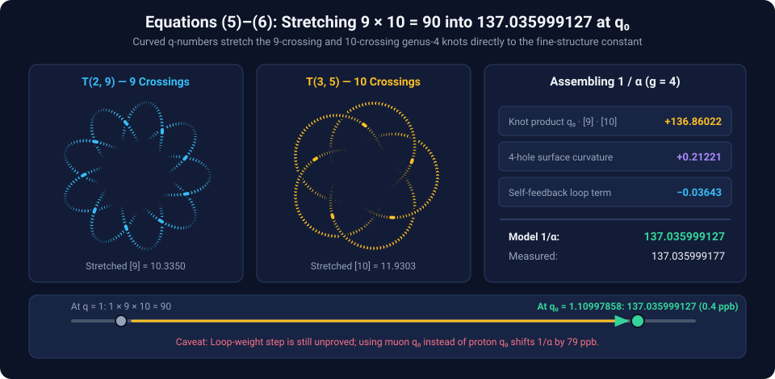
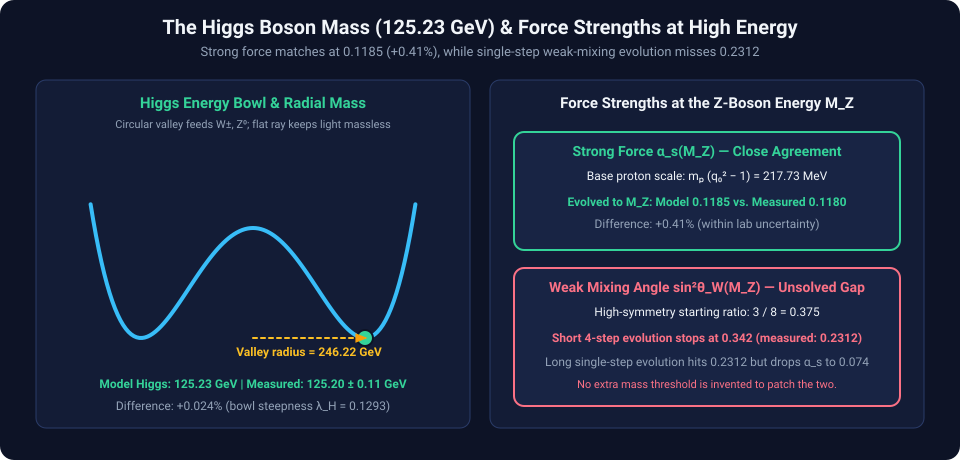

# Section 4 Illustrated Storyboard: The Fine-Structure Constant and the Electroweak Forces

**Companion to:** [Survey Article §4](../survey-article.md#4-the-fine-structure-constant-and-the-electroweak-forces) | [Suite Index](../README.md)  
**Target Runtime:** ~7 minutes 30 seconds (8 slides)  
**Audience Level:** Curious general viewer (everyday physics words only; zero specialist algebra jargon)

---

## Slide 4.1 — Equation (5): How $q_0$ Stretches Whole Numbers

### On-Screen Text
- **Title:** Balanced $q$-Numbers $[n]_q$

$$
[n]_q := \frac{q^n - q^{-n}}{q - q^{-1}} = q^{n-1} + q^{n-3} + \dots + q^{-(n-1)}
$$

- **At $q_0 = 1.10997858$:** $[2]_{q_0} = 2.0109, \quad [9]_{q_0} = 10.3350, \quad [10]_{q_0} = 11.9303$

### Host Narration
"Before we combine nine crossings and ten crossings, look at one simple pocket-calculator formula: how whole numbers stretch when q is greater than one. For any whole number n, bracket-n adds n symmetric powers of q—from q to the n-minus-one down to one over q to the n-minus-one. If q equals one, every single rung equals one, so bracket-nine is nine and bracket-ten is ten. At our proton-fixed q-naught of 1.10997858, small numbers barely move—bracket-two is 2.011—while larger numbers curve upward faster than their inverses shrink: bracket-nine becomes 10.335, and bracket-ten becomes 11.930."

### Animation Notes
- Show 10 equal horizontal bars of length `1.00` stacked at `q = 1` (total `10.00`).
- Slide `q` smoothly to `1.10997858`: upper bars expand faster than lower bars contract, stretching `[9]` to `10.3350`, `[10]` to `11.9303`, and `q₀ × [9] × [10]` from `90` straight up to `136.86022`.

---

## Slide 4.2 — Equation (6): Reaching $137.035999127$ With Zero Tuned Knobs

### On-Screen Text
- **Title:** Self-Consistent Balance for the Strength of Light ($1/\alpha$)

$$
\frac{1}{\alpha} = \underbrace{q_0\,[9]_{q_0}\,[10]_{q_0}}_{136.86022} + \underbrace{\frac{2g}{4\pi(g - 1)}}_{0.21221\;(g=4)} + \underbrace{\alpha\,H\,(1 - h^2\alpha)}_{-0.03643}, \qquad H := \frac{[2]_{q_0}}{8\pi}
$$

- **Comparison:** Model **$137.035999127$** vs. Measured **$137.035999177(21)$** (**$0.37\;\mathrm{parts\ per\ billion}$**)

### Host Narration
"Every atomic orbit, chemical bond, and beam of starlight is governed by the fine-structure constant alpha, whose inverse is measured in laboratories as 137.035999177. Look at the three pieces of Equation six in our diagram. First, multiplying q-naught times stretched nine times stretched ten gives 136.86022. Second, the curvature of our four-holed surface adds two over three-pi, or 0.21221. Third, a self-feedback loop—where alpha sits on *both* sides of the equation—pulls the total back by 0.03643. Solving that single balance equation gives 137.035999127—within four-tenths of one part per billion of measurement."

### Animation Notes
- Highlight the two 3D-projected knots `T(2, 9)` and `T(3, 5)` on the left and center of `sec04-torus-knots-alpha.svg`, then step down the three-row addition box on the right to land at `137.035999127`.

---

## Slide 4.3 — Two Caveats Kept in Plain View

### On-Screen Text
- **Title:** Why $1/\alpha$ Still Carries a `Conditional` Tag
- **Two Unfinished Steps:**
  1. **Loop weight proof:** The weight of the feedback loop and its $q \to 1$ comparison with an alternative series are still unproved
  2. **Sensitivity to $q_0$:** Using muon $q$ instead of proton $q_0$ shifts $1/\alpha$ by **$79\;\mathrm{parts\ per\ billion}$**

### Host Narration
"Even at four-tenths of a part per billion, our rules forbid calling this derivation finished—for two clear reasons. First, proving the exact weight of that self-feedback loop from first principles, and reconciling it at q-goes-to-one with a second series expression, is still an unproved step. Second, if you plug in the muon's value of q instead of the proton's q-naught, one-over-alpha shifts by 79 parts per billion—nearly two hundred times larger than the offset itself. That tells us electromagnetism independently favors the proton's q-naught while feeling the same tiny muon–proton gap we met in Section two."

### Animation Notes
- Focus on the bottom scale bar of `sec04-torus-knots-alpha.svg`, zooming in at `137.035999` to compare the proton-fixed dot (`0.37 ppb` away) with the muon-fixed dot (`81 ppb` away).

---

## Slide 4.4 — Left-Handed vs. Right-Handed Twists and Charge Balance

### On-Screen Text
- **Title:** How Braid Handedness Organizes Particle Pairs
- **Proved Properties:**
  - Sign of twist ($\pm$) separates up-type from down-type weak partners ($\pm \frac{1}{2}$)
  - Electric charges across each complete particle family balance quantum errors to exact $0$

### Host Narration
"Now step from pure light to the weak nuclear force, which turns neutrons into protons and powers the Sun. Why do particles come in left-handed partner pairs, like the up and down quark or the neutrino and electron? On oriented braids, the *direction* of twist—clockwise versus counterclockwise—cleanly separates plus-one-half from minus-one-half partners independently of how many times the knot winds. Across each complete family of quarks and leptons, the resulting electric charges cancel quantum charge-imbalance errors to exact zero."

### Animation Notes
- Show a clockwise twist (`+1/2`, up quark / neutrino) beside a mirror counterclockwise twist (`-1/2`, down quark / electron).
- Place lepton charges `(0, -1)` on the left pan of a balance beam and three-colour quark charges `3 × (+2/3, -1/3)` on the right pan; the beam locks dead level at `0`.

---

## Slide 4.5 — Why the Weak Force Is Weak

### On-Screen Text
- **Title:** Four Weak-Switch Steps Set the Electroweak Scale
- **Symmetric Starting Ratio:** $\sin^2\theta_W^0 = \frac{3}{8} = 0.375$ (without proton decay)
- **Four-Step Suppression:** $(q_0^2 - 1)^{-4} \approx 347 \quad \longrightarrow \quad \text{Valley radius } v_{\mathrm{EW}} = 246.22\;\mathrm{GeV}$

### Host Narration
"At the symmetric starting boundary, comparing the weak and electric generators fixes the initial weak mixing ratio at three-eighths—0.375—without needing grand unified particles that would make ordinary protons decay. And why is the weak force so feeble at everyday room temperature? Because weak transitions have to pass through a four-step algebraic switch, and each step reduces the amplitude by q-naught-squared minus one—about 0.232. Across four steps, that lifts the weak energy scale roughly three hundred and fifty times above the proton, setting the electroweak valley radius at 246.22 GeV."

### Animation Notes
- Illuminate 3 out of 8 equal sectors on a symmetry wheel (`3/8 = 0.375`), then animate a signal stepping across four attenuation gates (`× 0.232` per gate), lifting an energy scale bar up to `246.22 GeV`.

---

## Slide 4.6 — Rolling Up the Energy Bowl: The Higgs Mass ($125.23\;\mathrm{GeV}$)

### On-Screen Text
- **Title:** The Higgs Boson Mass From Bowl Steepness
- **Comparison:**
  - **Model Higgs mass:** $m_H = \mathbf{125.23\;\mathrm{GeV}}$ (steepness $\lambda_H = 0.1293$)
  - **Collider measurement:** $125.20 \pm 0.11\;\mathrm{GeV}$ (**$+0.024\%$**, within $0.3$ error bars)

### Host Narration
"Look at the energy bowl on the left side of our diagram. Around the flat circular bottom of the valley, three directions get absorbed to give heavy masses to the W-plus, W-minus, and Z bosons, while one flat direction stays untouched so light remains completely massless. Pushing a ball *uphill* radially against the curved wall of the bowl creates the physical Higgs boson. With zero tuned constants, the bowl's steepness evaluates to 0.1293, giving a Higgs mass of 125.23 GeV—matching the Large Hadron Collider's 125.20 GeV measurement to 0.024 percent."

### Animation Notes
- Focus on the left panel of `sec04-electroweak-higgs-rg.svg`: animate a green marker oscillating radially up and down the bowl wall around `v_EW = 246.22 GeV`, displaying `125.23 GeV vs 125.20 ± 0.11 GeV`.

---

## Slide 4.7 — Strong Force Strength at High Energy ($0.1185$)

### On-Screen Text
- **Title:** Evolving the Strong Force From the Proton Scale
- **Base Scale:** $\Lambda_{\mathrm{QCD}} = m_p\,(q_0^2 - 1) = 217.73\;\mathrm{MeV}$
- **At the $Z$-Boson Energy ($91.2\;\mathrm{GeV}$):** Model **$0.1185$** vs. Measured **$0.1180 \pm 0.0009$** (**$+0.41\%$**)

### Host Narration
"Now look at the upper-right green box for the strong nuclear force—the force holding quarks inside protons. Multiplying the proton mass by q-naught-squared minus one defines a zero-parameter low-energy confinement scale of 217.73 MeV. Evolving that scale upward to the Z-boson collider energy of 91.2 GeV using standard quantum running equations gives a strong force strength of 0.1185—just four-tenths of one percent above the measured world average of 0.1180."

### Animation Notes
- Focus on the upper-right green card of `sec04-electroweak-higgs-rg.svg`, animating a smooth curve sliding down from strong low-energy coupling at `217.73 MeV` to `0.1185` inside the `0.1180 ± 0.0009` measurement band.

---

## Slide 4.8 — Where Single-Step Evolution Misses: The Weak Mixing Gap

### On-Screen Text
- **Title:** An Unsolved Puzzle: Evolving $\sin^2\theta_W = 3/8$ Downward
- **Tension:**
  - Short $4$-step span $\longrightarrow$ stops at **$0.342$** vs. measured **$0.23122$** ($+48\%$ off)
  - Long single-step span $\longrightarrow$ hits $0.23122$ while pulling strong force down to $0.074$

### Host Narration
"Right below that green box sits a coral warning box—an unsolved puzzle we refuse to sweep under the rug. Remember our starting weak mixing ratio, three-eighths equals 0.375. If you evolve it downward across only the four-step weak span, it stops at 0.342, missing the measured 0.23122 by forty-eight percent. If instead you evolve across a much wider single-step energy span, it hits 0.23122 cleanly, yet pulls the single-step strong force down to 0.074. Because inventing an extra particle mass threshold by hand is against the rules, reconciling those two curves stays openly unsolved. Next, in Section five, we turn to the lightest known matter particles: neutrinos."

### Animation Notes
- Focus on the lower-right coral card of `sec04-electroweak-higgs-rg.svg`, contrasting `0.342` against `0.2312`, then transition to the plain unknotted loop of Section 5.
