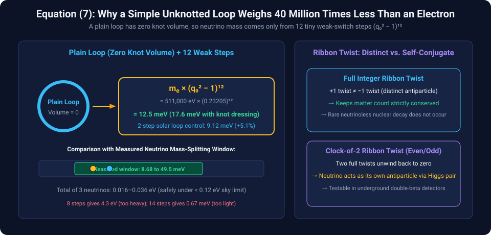
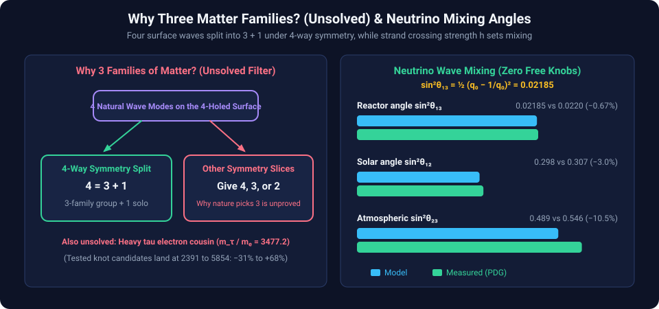

# Section 5 Illustrated Storyboard: Ghost Particles on a Simple Loop — Neutrinos and Matter Families

**Companion to:** [Survey Article §5](../survey-article.md#5-ghost-particles-on-a-simple-loop-neutrinos-and-matter-families) | [Suite Index](../README.md)  
**Target Runtime:** ~6 minutes 30 seconds (7 slides)  
**Audience Level:** Curious general viewer (everyday physics words only; zero specialist algebra jargon)

---

## Slide 5.1 — Why a Plain Unknotted Loop Weighs Almost Zero

### On-Screen Text
- **Title:** Neutrinos Start as a Plain Unknotted Circle
- **Baseline Shape:** Zero crossings · Zero holes · Zero electric charge · **Zero knot volume**

### Host Narration
"Every second, trillions of neutral particles from the Sun's core pass right through your hand without hitting a single atom: neutrinos. For decades, physicists assumed neutrinos weighed literally zero. Later, underground water detectors proved they do carry a tiny mass—more than ten million times lighter than an electron. In our knot picture, it's easy to see why a neutrino starts out massless: at baseline, it is just a plain unknotted circle, with zero crossings and zero curved knot volume. So how can a plain circle gain a featherweight mass at all?"

### Animation Notes
- Open on a smooth cyan ring (`Plain Loop, Volume = 0`) next to the four-crossing figure-eight knot from Section 2 (`Volume = 2.0299`), highlighting the contrast between zero crossings and four crossings.

---

## Slide 5.2 — Equation (7a): Twelve Weak Steps Shrink the Electron Scale

### On-Screen Text
- **Title:** Stepping Down Forty Million Times From the Electron

$$
m_\nu^{(12)}(q_0) = m_e\,(q_0^2 - 1)^{12} \approx 12.5\;\mathrm{meV} \qquad \bigl(\text{with knot loop: } 17.6\;\mathrm{meV}\bigr)
$$

- **Measured Oscillation Window:** **$8.68$ to $49.5\;\mathrm{meV}$** (solar loop control: **$9.12\;\mathrm{meV}$**, $+5.1\%$)

### Host Narration
"Even though a plain circle has zero knot volume of its own, a neutrino still talks weakly to its charged partner—the electron—through the same four-state algebraic switch that made the weak force feeble in Section four. Every step across that switch multiplies by q-naught-squared minus one, or 0.232. Across twelve steps, 0.232 to the twelfth power shrinks the electron's 511,000-electronvolt mass by forty million, landing at 12.5 milli-electronvolts—or 17.6 milli-electronvolts with its knot loop factor. Both sit right inside the measured neutrino mass-splitting window of 8.68 to 49.5 milli-electronvolts, while keeping the sum of all three neutrinos safely below the sky-survey limit."

### Animation Notes
- Focus on the left half of `sec05-unknot-neutrino-framing.svg`: animate `511,000 eV` stepping down 12 rungs (`× 0.232` each) to land inside the green `8.68 to 49.5 meV` window bar, while showing neighboring powers (`8 steps = 4.3 eV` too heavy, `14 steps = 0.67 meV` too light).

---

## Slide 5.3 — Twisting a Paper Ribbon: Distinct Antiparticles vs. Self-Partners

### On-Screen Text
- **Title:** Two Ways to Count Twists on a Flat Ribbon Loop
- **Option A (Full Integer Twist):** $+1 \neq -1$ twist $\longrightarrow$ neutrino and antineutrino stay strictly distinct
- **Option B (Even / Odd Twist):** Two twists unwind $\longrightarrow$ neutrino acts as its own antiparticle via two Higgs interactions

### Host Narration
"Now picture that plain circle not as a thin wire, but as a flat paper strip that you can give a full 360-degree twist before taping its ends together. As the right side of our diagram shows, nature has two topological choices. If nature counts every whole-number twist—plus-one, plus-two, minus-one—then neutrinos and antineutrinos remain distinct forever. If instead nature only tracks even versus odd twists—so two full twists unwind back to zero—single-particle mass is still blocked by symmetry, leaving a two-Higgs interaction where the neutrino is its own antiparticle. Underground nuclear experiments are actively testing which option our universe chose."

### Animation Notes
- Focus on the right half of `sec05-unknot-neutrino-framing.svg`: animate a paper ribbon loop holding a `+1` twist (top card) versus two full twists passing around a belt-trick loop to flatten out to `0` (bottom card).

---

## Slide 5.4 — Equation (7b): Neutrino Wave Mixing From One Crossing Number

### On-Screen Text
- **Title:** Reactor Neutrino Mixing From $h = q_0 - 1/q_0$

$$
\sin^2\theta_{13} = \frac{1}{2}\left(q_0 - \frac{1}{q_0}\right)^2 = \mathbf{0.02185} \qquad \bigl(\text{Measured: } 0.0220 \pm 0.0007,\;\; -0.67\%\bigr)
$$

### Host Narration
"As neutrinos travel through space, their three flavors—electron, muon, and tau—mix into one another like coupled pendulums. How strongly does the smallest of those three mixing angles tilt? Start from balanced three-way symmetry and rotate by a single strand-crossing amplitude, h equals q-naught minus one-over-q-naught. Half of h-squared equals 0.02185—within two-thirds of one percent of the nuclear-reactor neutrino measurement of 0.0220, while the solar angle lands within three percent and the atmospheric angle within ten-and-a-half percent."

### Animation Notes
- Focus on the right panel of `sec05-generations-and-pmns.svg`, animating the blue model bars beside the green measured bars for `Reactor sin²θ₁₃`, `Solar sin²θ₁₂`, and `Atmospheric sin²θ₂₃`.

---

## Slide 5.5 — Unsolved Question 1: Why Are There Three Matter Families?

### On-Screen Text
- **Title:** Splitting Four Surface Waves Into $3 + 1$
- **What Works:** Requiring $4$-way coordinate symmetry splits the $4$ surface waves into **$3 + 1$**
- **What Is Unproved:** Other natural symmetry slices give $4$, $3$, or $2$—why nature picks $3$ has no proof yet

### Host Narration
"Now look at the coral warning panel on the left: one of the biggest unsolved puzzles in all of physics. Why did nature photocopy the electron and up-down quarks into *three* matter families rather than two or four? Remember that our symmetric surface from Section three has four holes—and therefore supports four natural smooth wave patterns. If you require symmetry among four of its five coordinates, those four wave patterns split into three plus one: a three-family group plus one solo wave. Yet checking other symmetry slices on the exact same surface gives four, three, or two. Until a proof shows why left-handed matter waves must pick that three-wave slice, the number three is not derived unconditionally."

### Animation Notes
- Focus on the upper-left diagram of `sec05-generations-and-pmns.svg`, showing `4 Surface Wave Modes` branching left into green `4 = 3 + 1` and right into coral `Other Symmetry Slices Give 4, 3, or 2`.

---

## Slide 5.6 — Unsolved Question 2: The Heavy Tau Mass ($3477.2 \times m_e$)

### On-Screen Text
- **Title:** Where Knot Candidates Miss Badly: The Tau Lepton
- **Measured Ratio ($m_\tau / m_e$):** $3477.23 \pm 0.23$
- **Tested Parameter-Free Candidates:** $2391$ ($-31\%$), $2907$ ($-16\%$), $5854$ ($+68\%$) $\longrightarrow$ **Unsolved**

### Host Narration
"Right underneath sits a second wide-open gap: the mass of the tau, the heaviest cousin of the electron, weighing 3,477.2 times an electron. Every parameter-free knot candidate tested so far—wrapping cables around the figure-eight knot or testing five-crossing knots—misses by sixteen to sixty-eight percent, landing at 2,391, 2,907, or 5,854. Rather than inventing an adjustable weight to split the difference and land on 3,477, the model records every miss openly and leaves the tau mass—and the four quark-mixing angles—unsolved."

### Animation Notes
- Plot a horizontal target line at `3477.23` with three coral candidate markers landing wide to the left (`2391`, `2907`) and right (`5854`), labeled `Zero Tuning = Honest Miss`.

---

## Slide 5.7 — Stepping Inside Protons and Neutrons Next

### On-Screen Text
- **Title:** From Ghostly Loops to Dense Quarks
- **Next Up (§6):** Why a free neutron decays in $15\;\mathrm{minutes}$—and how a $58\%$ failure revealed a nine-strand interaction

### Host Narration
"Look at the contrast we just saw: parameter-free weak steps put simple-loop neutrinos right inside the milli-electronvolt window and hit the reactor mixing angle within one percent, while leaving the heavy tau mass wide open. Next, in Section six, we step inside protons and neutrons to watch a fifteen-minute radioactive clock—and see how refusing to patch a fifty-eight percent error revealed that beta decay takes nine strands working together."

### Animation Notes
- Transition from the single plain neutrino loop to three interlocked quark strands meeting an outgoing electron-antineutrino pair (`sec06-beta-decay-nine-strand.svg`).
