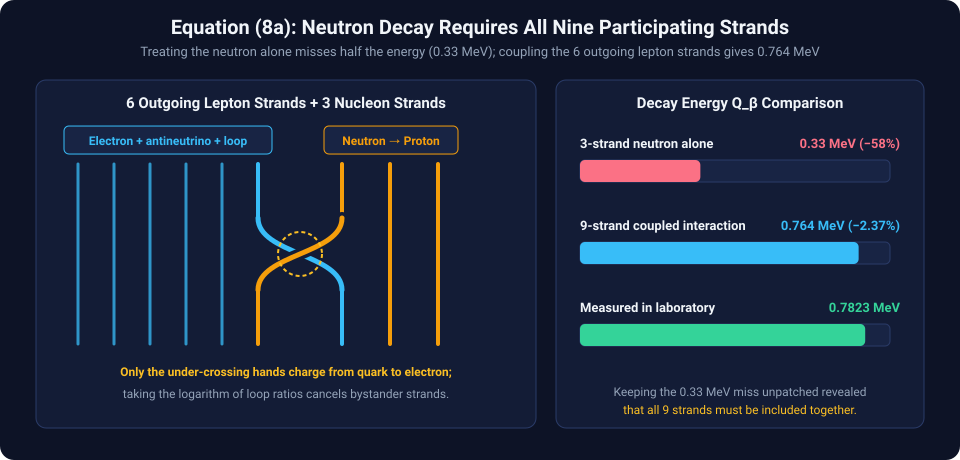
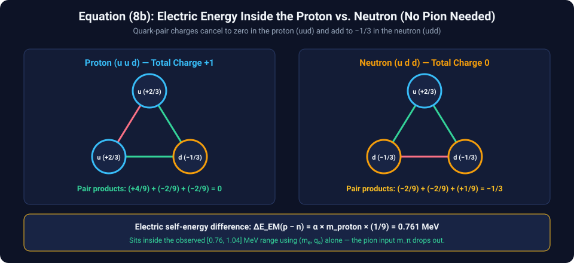

# Section 6 Illustrated Storyboard: Inside the Nucleon and Beta Decay

**Companion to:** [Survey Article §6](../survey-article.md#6-inside-the-nucleon-and-beta-decay-how-honest-failures-drive-discovery) | [Suite Index](../README.md)  
**Target Runtime:** ~6 minutes 30 seconds (7 slides)  
**Audience Level:** Curious general viewer (everyday physics words only; zero specialist algebra jargon)

---

## Slide 6.1 — The Fifteen-Minute Clock That Keeps Hydrogen Alive

### On-Screen Text
- **Title:** Neutron Beta Decay: $n \longrightarrow p + e^- + \bar{\nu}_e$
- **Two Delicate Numbers:**
  - **Neutron–proton mass difference ($m_n - m_p$):** $1.2933\;\mathrm{MeV}$ ($0.14\%$ of proton mass)
  - **Kinetic energy released ($Q_\beta$):** $0.7823\;\mathrm{MeV}$

### Host Narration
"Pull a single neutron out of an atomic nucleus and set a stopwatch: on average, in just under fifteen minutes, it decays into a proton, an electron, and an antineutrino, releasing 0.7823 mega-electronvolts of kinetic energy. The neutron outweighs the proton by just one-seventh of one percent—1.2933 MeV. Yet our entire chemical world hangs on that sliver: if the proton were slightly heavier instead, hydrogen atoms would collapse into neutrons and stars could never burn."

### Animation Notes
- Show a three-ring neutron (`u d d`) ticking toward `14 min 38 s`, then emitting a two-ring electron (`e⁻`) and a plain-loop antineutrino (`ν̄ₑ`) while turning into a proton (`u u d`), with `Q_β = 0.7823 MeV` displayed on an energy bar.

---

## Slide 6.2 — Why Looking at Three Strands Alone Misses by 58%

### On-Screen Text
- **Title:** An Isolated Three-Strand Formula Falls Short
- **Isolated Baryon Readout:**
  - $Q_\beta = \mathbf{0.33\;\mathrm{MeV}}$ vs. $0.78\;\mathrm{MeV}$ measured (**$58\%$ too low**)
  - $m_n - m_p = \mathbf{0.84\;\mathrm{MeV}}$ vs. $1.29\;\mathrm{MeV}$ measured (**$35\%$ too low**)

### Host Narration
"What happens if you try to calculate that decay energy by looking *only* at the three strands of an isolated neutron switching into a proton? Following the consistent three-strand loop rules gives just 0.33 MeV—fifty-eight percent below measurement—and 0.84 MeV for the neutron–proton mass difference, thirty-five percent low. Notice how valuable that failure is when curve-fitting is banned: instead of multiplying 0.33 by an invented fudge factor, you have to ask what physical participants were left out of the three-strand box."

### Animation Notes
- Show three quark strands inside an isolated dashed box outputting a short coral bar (`0.33 MeV`) next to the full green laboratory bar (`0.7823 MeV`), with a question mark pointing outside the box toward the missing outgoing electron and antineutrino.

---

## Slide 6.3 — Beta Decay Takes Nine Strands Together

### On-Screen Text
- **Title:** Coupling the Six Outgoing Lepton Strands to the Three Quark Strands
- **Nine-Strand Layout:** $6\text{ lepton strands (left)} \;+\; 3\text{ nucleon strands (right)} \;=\; 9\text{ strands}$
- **Boundary Handedness:** Over-crossing ($\sigma_5$) transfers $0$ charge; **under-crossing ($\sigma_5^{-1}$) transfers $-1$ charge**

### Host Narration
"Neutron decay isn't a solo costume change inside three isolated strands; it is a particle interaction that creates an electron and an antineutrino. Together with one closed neutral loop needed to keep total strand count balanced, that outgoing lepton pair occupies six strands on the left, meeting the three nucleon strands on the right—nine strands in total. And right at the boundary between strand five and strand six, crossing *over* transfers zero electric charge, whereas crossing *under* hands negative charge cleanly from a quark to the outgoing electron."

### Animation Notes
- Walk across the left panel of `sec06-beta-decay-nine-strand.svg`: highlight the 6 cyan lepton strands (`0..5`), the 3 amber nucleon strands (`6..8`), and the golden dashed circle around the boundary under-crossing `σ₅⁻¹`.

---

## Slide 6.4 — Equation (8a): Logarithmic Energy Cancels Bystander Strands

### On-Screen Text
- **Title:** Reaching $+0.764\;\mathrm{MeV}$ With Zero Tuned Constants

$$
Q_\beta^{\mathrm{coupled}} = -E_0\,\ln\left(\frac{\mathrm{loop}(W_n)}{\mathrm{loop}(W_p)}\right) + \Delta E_{\mathrm{spin}} = \mathbf{+0.764\;\mathrm{MeV}} \qquad \bigl(\text{Measured: } 0.7823\;\mathrm{MeV},\;\; -2.37\%\bigr)
$$

### Host Narration
"How do you convert closed-loop numbers into energy when bystander strands sit nearby? If two non-interacting systems sit in the same room, their closed-loop readouts *multiply*, whereas their energies must *add*. The unique mathematical function that turns multiplication into addition is the logarithm. Taking the logarithm of the neutron-to-proton loop ratio cancels disconnected bystander strands automatically and gives plus 0.738 MeV; adding the 0.026 MeV magnetic spin-spin push among the three quarks brings the nine-strand answer to 0.764 MeV—within 2.37 percent of measurement."

### Animation Notes
- Focus on the right panel of `sec06-beta-decay-nine-strand.svg`, animating the bar climbing from the coral isolated value (`0.33 MeV`) up to the cyan coupled 9-strand value (`0.764 MeV`, just `2.37%` shy of `0.7823 MeV`).

---

## Slide 6.5 — A Puzzle Inside the Proton: Why Isn't Charge $+1$ Heavier?

### On-Screen Text
- **Title:** Electric Repulsion Pushes the Proton's Mass *Up*, Not Down
- **Quark Charges:**
  - **Proton ($uud$, total $+1$):** Pairwise products $(+\frac{4}{9}) + (-\frac{2}{9}) + (-\frac{2}{9}) = \mathbf{0}$
  - **Neutron ($udd$, total $0$):** Pairwise products $(-\frac{2}{9}) + (-\frac{2}{9}) + (+\frac{1}{9}) = \mathbf{-\frac{1}{3}}$

### Host Narration
"Now look inside the proton and neutron at their electric charges alone. A proton has net electric charge plus-one, while a neutron has net charge zero—so electrostatic repulsion pushes the *proton's* mass up relative to the neutron. Check the quark pairs in our diagram. A proton has two plus-two-thirds up quarks and one minus-one-third down quark: multiply every pair of charges and add them up—plus four-ninths, minus two-ninths, minus two-ninths—exact zero. Do the same for the neutron's one up and two down quarks, and the pair products add to minus one-third."

### Animation Notes
- Highlight each triangle edge in `sec06-proton-neutron-em.svg` one by one: on the left (`Proton`), coral repulsion `+4/9` cancels the two green attractions `-2/9` and `-2/9` to `0`; on the right (`Neutron`), net attraction sums to `-1/3`.

---

## Slide 6.6 — Equation (8b): Electric Splitting Without Using the Pion Mass

### On-Screen Text
- **Title:** Pion-Free Electric Difference ($0.761\;\mathrm{MeV}$)

$$
\Delta E_{\mathrm{EM}}(p - n) = \frac{1}{9}\,\alpha\,m_{\mathrm{proton}} = \mathbf{0.761\;\mathrm{MeV}} \qquad \bigl(\text{Empirical range: } 0.76\text{ to }1.04\;\mathrm{MeV}\bigr)
$$

- **Bonus:** Uses $(m_e, q_0)$ alone—Input 3 (the pion mass $m_\pi$) drops out completely

### Host Narration
"Combine that exact one-third pair-charge difference with the one-third single-quark charge-squared difference, and you get a pure geometric fraction of one-ninth. Multiply one-ninth by the model's own fine-structure constant alpha and proton mass scale, and out comes 0.761 MeV of extra electric energy on the proton—sitting right inside the 0.76 to 1.04 MeV range inferred from electron-scattering data. Notice what vanished: our third calibration input, the pion mass, wasn't needed at all."

### Animation Notes
- Highlight the bottom gold-bordered box of `sec06-proton-neutron-em.svg`, showing `Input 3 (m_π)` greying out while `(mₑ, q₀)` alone produce `0.761 MeV` inside `[0.76, 1.04] MeV`.

---

## Slide 6.7 — Upward to Whole Atomic Nuclei Next

### On-Screen Text
- **Title:** From Single Protons and Neutrons to the Periodic Table
- **Next Up (§7):** Why ${}^2\mathrm{H}$ binds gently, why no mass-5 atom exists, how stars forge ${}^{12}\mathrm{C}$, and why ${}^4\mathrm{He}$ still misses half its binding

### Host Narration
"Now we're ready to glue protons and neutrons together into atomic nuclei. In Section seven, we'll see why neighboring protons and neutrons have to share quark colour strands to bind heavy hydrogen, how whole-number grouping selects our exact nuclear universe out of seventy-three mathematical possibilities—explaining both the missing mass-five atoms and how stars make carbon-twelve—and why helium-four's huge twenty-eight-MeV binding energy still stands half-unsolved."

### Animation Notes
- Zoom out from one proton and one neutron to show six quark strands beginning to cross-connect into a deuteron (`sec07-hidden-colour-deuteron.svg`).
