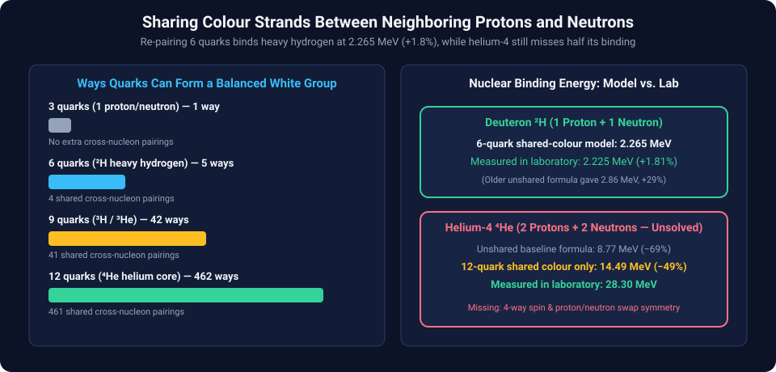
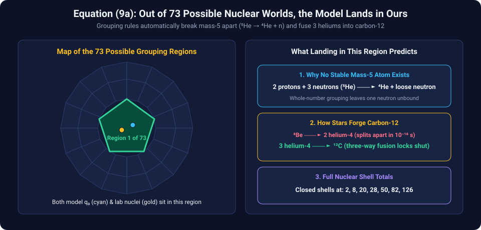
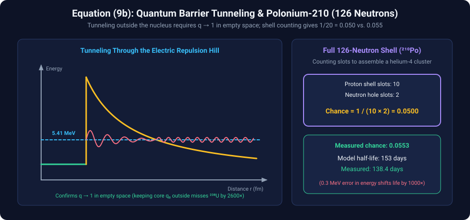

# Section 7 Illustrated Storyboard: Building Atomic Nuclei — Shared Colour, the 73 Regions, Stellar Carbon, and Alpha Decay

**Companion to:** [Survey Article §7](../survey-article.md#7-building-atomic-nuclei-shared-colour-the-73-stability-regions-stellar-carbon-and-alpha-decay) | [Suite Index](../README.md)  
**Target Runtime:** ~7 minutes 30 seconds (8 slides)  
**Audience Level:** Curious general viewer (everyday physics words only; zero specialist algebra jargon)

---

## Slide 7.1 — Two Very Different Questions About Atomic Nuclei

### On-Screen Text
- **Title:** Grouping Rules vs. Exact Binding Totals
- **Two Tests:**
  1. **Which nuclei hold together?** (Why no mass-5 atom exists; how stars fuse $3\text{ heliums} \to \text{carbon-12}$)
  2. **How tightly do they bind in MeV?** (Gentle $2.22\;\mathrm{MeV}$ deuteron vs. tight $28.30\;\mathrm{MeV}$ helium-4)

### Host Narration
"When protons and neutrons pack together into atomic nuclei, any fundamental model faces two distinct tests. First are grouping questions: why does heavy hydrogen hold together gently, why does no stable mass-five atom exist anywhere in nature, and how do dying stars jump past unstable beryllium-eight to fuse three helium cores into carbon-twelve? Second are strength questions: does the math reproduce the actual mega-electronvolt binding totals? As we'll see, this model hits the grouping rules, heavy hydrogen, and radioactive tunneling cleanly, while showing why fixed-spacing pairs give half of helium-four's binding and how four-cluster colour rings and three-dimensional wave compression reach the 28.3 MeV scale."

### Animation Notes
- Split screen: on the left, nuclear cluster icons (`²H`, `⁴He`, `⁵He -> ⁴He + n`, `3 ⁴He -> ¹²C`) light up green; on the right, a vertical energy thermometer shows `²H = 2.22 MeV` near the bottom and `⁴He = 28.30 MeV` near the top.

---

## Slide 7.2 — Why Isolated Nucleon Bags Fail to Bind Helium-4

### On-Screen Text
- **Title:** Neighboring Quarks Share Colour Across Nucleons
- **Ways to Form a Balanced White Group:**
  - $3$ quarks ($1$ nucleon): **$1$ way**
  - $6$ quarks (${}^2\mathrm{H}$): **$5$ ways** ($4$ shared across the pair)
  - $9$ quarks ($A = 3$): **$42$ ways** $\;\cdot\;$ $12$ quarks (${}^4\mathrm{He}$): **$462$ ways**

### Host Narration
"If you try to glue protons and neutrons together while forcing every three-quark proton or neutron to keep its red, green, and blue strands locked strictly inside its own private bag, two-photon exchange leaves helium-four slightly unbound. Inside a real nucleus, neighboring quarks can trade colour partners across nucleon boundaries while keeping the whole nucleus balanced white overall. Count the ways on the left chart: three quarks have just one white grouping, six quarks have five, nine quarks have forty-two, and twelve quarks have four hundred and sixty-two."

### Animation Notes
- Step down the four horizontal bars on the left of `sec07-hidden-colour-deuteron.svg` (`1`, `5`, `42`, `462`), showing red, green, and blue arcs reconnecting across two neighboring three-quark rings.

---

## Slide 7.3 — Heavy Hydrogen ($+1.81\%$), Pyramid Colour Rings, and 3D Compression

### On-Screen Text
- **Title:** Pairwise Ceiling vs. Four-Cluster Colour Rings & Wave Compression
- **Deuteron (${}^2\mathrm{H}$):** Model **$2.265\;\mathrm{MeV}$** vs. Measured **$2.225\;\mathrm{MeV}$** (**$+1.81\%$**, unchanged by $3$-/$4$-body rings)
- **Helium-4 (${}^4\mathrm{He}$, Measured $28.30\;\mathrm{MeV}$):**
  - Fixed-spacing pairs + $4$-way spin/charge symmetry: **$14.33\;\mathrm{MeV}$** ($-49.4\%$; $A = 3$: **$6.96\;\mathrm{MeV}$**)
  - Pyramid $3$-/$4$-cluster colour rings (`+` sign): **$29.33\;\mathrm{MeV}$** (**$+3.65\%$**; opposite `-` sign $17.54\;\mathrm{MeV}$)
  - $3\mathrm{D}$ relative-motion wave compression: **brackets $[26.02,\; 30.55]\;\mathrm{MeV}$** ($-8.0\%$ to $+8.0\%$; unified operator open)

### Host Narration
"Allowing quarks to share colour across neighboring protons and neutrons lowers the energy at every step. Look at the green upper-right box: for heavy hydrogen—one proton and one neutron—shared colour gives 2.265 MeV, within 1.81 percent of the measured 2.225 MeV. Now look at the lower-right box for four-particle helium-four, arranged as a three-dimensional pyramid with six pair bonds, four triangular faces, and three four-corner rings. Pairing colour sharing with four-way spin-and-proton-neutron symmetry at fixed spacing gives 6.96 MeV at mass three and 14.33 MeV at helium-four—roughly six times heavy hydrogen, or half of the measured 28.30 MeV. Two zero-parameter effects close that factor of two while leaving heavy hydrogen untouched: closed three- and four-cluster colour rings reach 29.33 MeV, within 3.65 percent, and three-dimensional wave compression across six pairs sharing three relative coordinates brackets 26.02 to 30.55 MeV. What is still open is deriving one unified spatial-braid rule that fixes the loop sign and combines both effects without double-counting."

### Animation Notes
- Highlight the upper-right green deuteron card (`2.265 vs 2.225 MeV`) and lower-right amber helium-4 card (`Fixed-spacing pairs 14.33 MeV | Pyramid colour rings 29.33 MeV | 3D compression 26.02–30.55 MeV vs 28.30 MeV`) of `sec07-hidden-colour-deuteron.svg`.

---

## Slide 7.4 — Equation (9a): Mapping All 73 Possible Nuclear Worlds

### On-Screen Text
- **Title:** Out of 73 Grouping Regions, the Model Lands in Ours

$$
0 < B_d < \min(B_h, B_t), \qquad \max(2B_t, 2B_h) < B_\alpha
$$

- **Result:** Both model $q_0$ and laboratory nuclear masses sit inside the same single region ($\mathcal{C}_{\mathrm{phys}}$)

### Host Narration
"Even before that unified three-dimensional helium-four operator is finished, what about the relative stability rules that decide *which* nuclei hold together? Track the six basic light clusters—proton, neutron, deuteron, three-particle triton and helion, and four-particle helium-four—while conserving total protons and neutrons. Whole-number rearrangement math divides all possible nuclear universes into seventy-three distinct stability regions, sketched on the left. With zero tuned parameters, the model's binding ratios at q-naught land strictly inside the exact same green central region occupied by real laboratory nuclei."

### Animation Notes
- Zoom into the 73-cell polygon fan on the left of `sec07-nuclear-chambers-hoyle.svg`, lighting up the central green pentagon `Region 1 of 73` containing both the cyan model dot and gold laboratory dot.

---

## Slide 7.5 — Why Mass-5 Breaks Apart and How Stars Make Carbon-12

### On-Screen Text
- **Title:** Automatic Grouping Rules Inside Our Region
- **Three Direct Consequences:**
  1. **Mass-5 gap:** ${}^5\mathrm{He}$ ($2p + 3n$) simplifies automatically to **${}^4\mathrm{He} + \text{free } n$**
  2. **Stellar carbon path:** ${}^8\mathrm{Be} \to 2\,{}^4\mathrm{He}$ splits apart, while **$3\,{}^4\mathrm{He} \to {}^{12}\mathrm{C}$** releases energy
  3. **Closed nuclear shells:** Recovers full shell totals **$2, 8, 20, 28, 50, 82, 126$**

### Host Narration
"Landing inside that one region out of seventy-three hands us three pillars of nuclear physics automatically, shown on the right. First, put two protons and three neutrons together as helium-five: the region's eleven energy-lowering replacement rules break it cleanly into one helium-four core plus one loose neutron—explaining why no stable mass-five atom exists. Second, beryllium-eight splits back into two heliums, whereas fusing *three* heliums into carbon-twelve releases energy—reproducing the stellar fusion path that made every carbon atom in our bodies. Third, adding shell capacities recovers all seven closed nuclear shell totals, from two up to one hundred and twenty-six."

### Animation Notes
- Walk down the three right-hand cards of `sec07-nuclear-chambers-hoyle.svg`: animate `2p + 3n` snapping into `⁴He + n`, `⁸Be` splitting while `3 α` fuse into `¹²C`, and shell rings filling at `2, 8, 20, 28, 50, 82, 126`.

---

## Slide 7.6 — Tunneling Across 24 Powers of Ten & Proving $q \to 1$ in Vacuum

### On-Screen Text
- **Title:** Heavy-Atom Alpha Decay Tests Empty Space Outside the Nucleus
- **Range:** Half-lives from $0.3\;\mathrm{microseconds}$ (${}^{212}\mathrm{Po}$) to $4.5\;\mathrm{billion\ years}$ (${}^{238}\mathrm{U}$)
- **Vacuum Test:** Exterior repulsion hill requires **$q \to 1$ in empty space** (keeping core $q_0$ outside misses ${}^{238}\mathrm{U}$ by $2{,}600\times$)

### Host Narration
"Now move all the way up to heavy radioactive elements like polonium, radon, radium, and uranium, which decay by quantum-tunneling a helium-four cluster through the electric repulsion hill on the left. Using the model's own fine-structure constant alpha and pion touch radius—with zero fitted nuclear radii—bare tunneling tracks open-shell half-lives across twenty-four powers of ten. Better yet, it tests empty space itself: if the core value q-naught persisted across the empty space outside the nucleus, uranium-238's half-life would be off by a factor of twenty-six hundred—confirming directly that q relaxes back to one in empty vacuum."

### Animation Notes
- Focus on the left barrier plot of `sec07-po210-alpha-tunneling.svg`: animate the coral wave attenuating exponentially through the gold `1/r` hill from $R_{\mathrm{touch}}$ out to $R_{\mathrm{turn}}$ where `q → 1`.

---

## Slide 7.7 — Equation (9b): Polonium-210 at the Closed 126-Neutron Shell

### On-Screen Text
- **Title:** Counting Shell Slots Predicts the ${}^{210}\mathrm{Po}$ Slowdown

$$
S_\alpha({}^{210}\mathrm{Po}) = \frac{1}{10 \times 2} = \mathbf{0.0500} \qquad \bigl(\text{Measured: } \mathbf{0.0553};\;\; 153\;\mathrm{days}\text{ vs. }138.4\;\mathrm{days}\bigr)
$$

### Host Narration
"Right at 126 neutrons—polonium-210, shown on the right—nuclear physicists observe a sharp twenty-fold slowdown in alpha decay because the closed neutron shell quenches collective pairing. To assemble an outgoing helium-four cluster at that closed shell, the nucleus has to draw a spin-zero proton pair from a ten-slot proton shell and a spin-zero neutron-hole pair from a two-slot neutron shell. One over ten times two equals 0.0500—matching the measured formation chance of 0.0553 and predicting a 153-day half-life against 138.4 days measured."

### Animation Notes
- Focus on the right panel of `sec07-po210-alpha-tunneling.svg`, highlighting `10` proton slots and `2` neutron-hole slots combining into `1 / (10 × 2) = 0.0500`.

---

## Slide 7.8 — Why Extreme Sensitivity Demands High Nuclear Precision

### On-Screen Text
- **Title:** Exponential Sensitivity & Stepping Up to Chemistry
- **Sensitivity Warning:** At ${}^{238}\mathrm{U}$, a $0.30\;\mathrm{MeV}$ error in decay energy shifts half-life by $1{,}000\times$
- **Next Up (§8):** How five stacked layers lock nuclei solid so everyday chemistry can exist

### Host Narration
"Notice the sensitivity note at the bottom right: because quantum tunneling depends exponentially on decay energy, even a 0.30 MeV error in internally predicted nuclear masses shifts uranium's half-life by a factor of a thousand—showing why closing our earlier nuclear binding gap matters so much. Now zoom out one more step: once nuclei are built, why don't chemical fires or living cells ever crack them open? That brings us to the five-layer tower in Section eight."

### Animation Notes
- Show a small `0.30 MeV` nudge on the horizontal `Q_α` dashed line multiplying the outgoing wave tail by `10³`, then pull the camera upward from an atomic nucleus through orbiting electron clouds (`sec08-five-layer-tower.svg`).
