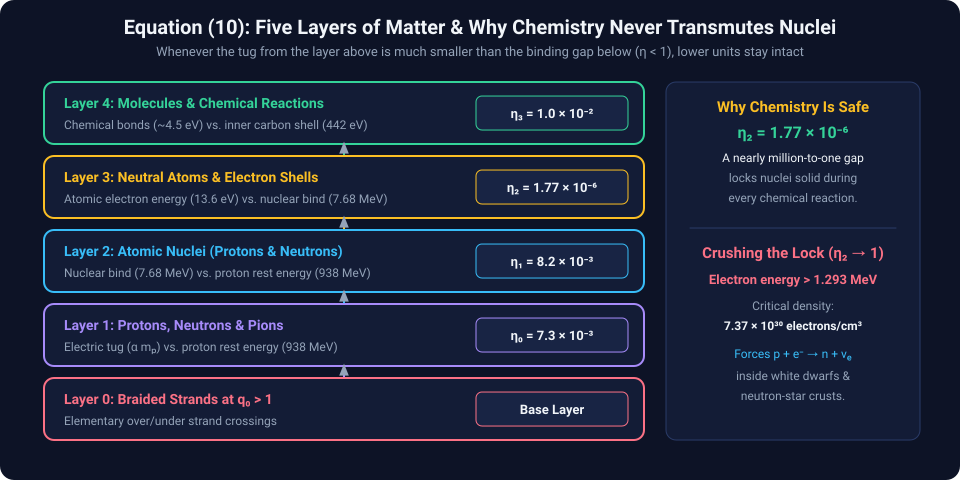
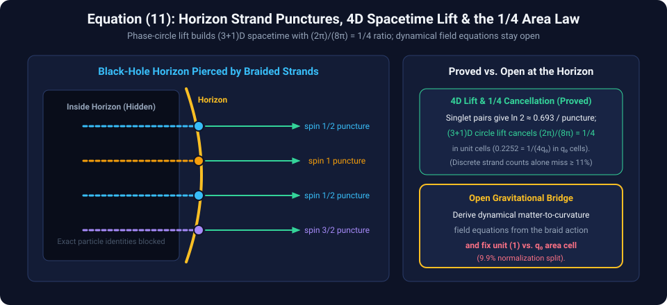

# Section 8 Illustrated Storyboard: Five Layers of Matter — Chemistry, Crushed Stars, and Horizons

**Companion to:** [Survey Article §8](../survey-article.md#8-five-layers-of-matter-why-chemistry-exists-and-what-happens-at-horizons) | [Suite Index](../README.md)  
**Target Runtime:** ~7 minutes 30 seconds (8 slides)  
**Audience Level:** Curious general viewer (everyday physics words only; zero specialist algebra jargon)

---

## Slide 8.1 — Why Can Chemistry Exist Without Changing Elements?

### On-Screen Text
- **Title:** Why Burning Wood Never Turns Carbon Into Boron
- **Contrast:**
  - Conventional scale-stepping: Refits new constants at every energy boundary
  - Five-layer braided tower: Zero refitted constants from strands up to molecules

### Host Narration
"Stop for a moment and ask one of the simplest, deepest questions in science: why does chemistry exist as its own world? When you strike a match, digest lunch, or charge a battery, outer electrons rearrange violently—yet carbon nuclei never turn into boron, and protons never shatter into loose quarks. Usually, moving from quarks to protons, from protons to nuclei, or from nuclei to atoms forces physicists to re-measure brand-new constants at each step. Here, all five levels stack into one tower with zero refitted constants."

### Animation Notes
- Show a flickering chemical flame rearranging `CH₄ + 2 O₂ -> CO₂ + 2 H₂O` while zooming 100,000 times inward to the central carbon nucleus, which sits completely undisturbed.

---

## Slide 8.2 — Equation (10): One Simple Stability Ratio ($\eta_k < 1$)

### On-Screen Text
- **Title:** When Do Building Blocks Stay Unbreakable?

$$
\eta_k := \frac{\text{next-layer tug } \|\delta_V\|}{\text{lower-layer break cost } \Delta_k} < 1 \quad \Longrightarrow \quad \text{lower-layer units stay intact}
$$

### Host Narration
"Equation ten states the rule governing every floor of that five-story tower. On any floor k, call Delta-k the energy needed to crack open one building block from the floor below, and call delta-V the strongest tug coming from interactions on the floor above. Divide the tug from above by the break-apart cost below: call that unit-free ratio eta-k. Whenever eta-k is smaller than one, breaking a lower-level block always costs net energy—so those blocks behave like solid Lego bricks on the floor above."

### Animation Notes
- Highlight a two-floor cutaway from `sec08-five-layer-tower.svg`: a wide vertical pillar labeled `Break Cost Δ_k` easily outweighs a small downward arrow labeled `Next-Layer Tug ||δ_V||`, lighting up `η_k < 1 -> Units Locked`.

---

## Slide 8.3 — Lower Floors: Strands $\to$ Protons $\to$ Nuclei

### On-Screen Text
- **Title:** How Quarks and Nucleons Feel Gentle Nudges Without Breaking
- **Floor 0 $\to$ Floor 1 (Strands $\to$ Protons/Neutrons):** $\eta_0 = 7.3 \times 10^{-3}$ ($0.7\%$ electric shift)
- **Floor 1 $\to$ Floor 2 (Protons/Neutrons $\to$ Nuclei):** $\eta_1 = 8.2 \times 10^{-3}$ ($\approx 1\%$ quark nudge inside nuclei)

### Host Narration
"Start at the bottom two steps of the diagram. Stepping from braided strands up to protons and neutrons gives a ratio of 0.0073: electric forces nudge proton and neutron masses by less than one percent without ever pulling a quark loose. Stepping from protons and neutrons up to atomic nuclei divides 7.68 MeV of nuclear binding by 938 MeV of proton rest energy—giving 0.0082. That one-percent ratio matches the slight shift experiments see when high-energy muons bounce off quarks inside heavy nuclei, while keeping protons and neutrons intact."

### Animation Notes
- Highlight the bottom three bars of `sec08-five-layer-tower.svg` (`Base Layer`, `Layer 1: η₀ = 7.3 × 10⁻³`, and `Layer 2: η₁ = 8.2 × 10⁻³`).

---

## Slide 8.4 — The Million-to-One Lock That Makes Chemistry Safe

### On-Screen Text
- **Title:** Floor 2 $\to$ Floor 3: Nuclei to Atoms ($\eta_2 = 1.77 \times 10^{-6}$)
- **Ratio:** $\frac{13.61\;\mathrm{eV}\text{ atomic electron energy}}{7.68\;\mathrm{MeV}\text{ nuclear binding}} = \mathbf{1.77 \times 10^{-6}}$ (less than $2\;\mathrm{parts\ per\ million}$)

### Host Narration
"Now step onto Floor three—ordinary atoms and ions—and look at that golden badge: eta-two equals 1.77 times ten to the minus six. An outer atomic electron tugs with roughly 13.6 electronvolts, whereas cracking a nucleon out of carbon costs 7.68 *million* electronvolts. Because two parts per million is half a million times smaller than one, atomic proton and neutron counts stay strictly frozen across every chemical reaction on earth."

### Animation Notes
- Highlight `Layer 3` and the top-right `Why Chemistry Is Safe` panel of `sec08-five-layer-tower.svg`, comparing a tiny `13.6 eV` spark next to a towering `7,680,000 eV` nuclear wall.

---

## Slide 8.5 — Floor 4: Whole-Number Rules of Molecules and Rings

### On-Screen Text
- **Title:** Floor 3 $\to$ Floor 4: Frozen Inner Shells & Chemical Formulas ($\eta_3 = 1.0 \times 10^{-2}$)
- **Chemistry Layer:** Valence bonds ($\approx 4.5\;\mathrm{eV}$) leave inner shells ($442\;\mathrm{eV}$) untouched while whole-number atom conservation balances every reaction

### Host Narration
"One step higher—from atoms to covalent molecules on Floor four—chemical bonds of about four-and-a-half electronvolts pull against inner carbon core electrons bound by four hundred and forty-two electronvolts, a ratio of one percent. Inner electron shells stay frozen, while outer electrons fill shells and balance chemical equations by the exact same kind of whole-number conservation rules that grouped protons and neutrons in Section seven—including the extra stiffness of linked ring molecules like benzene."

### Animation Notes
- Highlight the top green bar (`Layer 4: η₃ = 1.0 × 10⁻²`) of `sec08-five-layer-tower.svg`, animating six carbon cores with frozen `1s` inner spheres locking into a hexagonal ring of shared outer valence loops.

---

## Slide 8.6 — Crushing the Lock Inside Dead Stars ($\eta_2 \to 1$)

### On-Screen Text
- **Title:** What Happens When Gravity Pushes $\eta_2$ Past $1$?
- **Exact Threshold:** Electron sea energy $> m_n - m_p = \mathbf{1.2933\;\mathrm{MeV}}$
- **Critical Density:** **$7.37 \times 10^{30}\;\mathrm{electrons/cm^3}$** $\longrightarrow$ nuclei dissolve into neutron-star matter

### Host Narration
"Now flip Equation ten around: can nature ever *break* that chemical lock? Yes—inside a crushed star. Look at the lower-right panel of our tower diagram. Inside a white-dwarf core or the outer crust of a neutron star, gravity packs electrons so tightly that their sea energy climbs past 1.2933 MeV—about seven-point-four times ten to the thirty electrons per cubic centimeter. At that exact threshold, eta-two crosses one, the lock flips open, and electrons are forced straight into protons to turn atomic nuclei into neutron matter."

### Animation Notes
- Focus on the lower-right `Crushing the Lock` box of `sec08-five-layer-tower.svg`: animate a rising blue electron-pressure gauge crossing `1.293 MeV`, causing atomic lattices to dissolve into a sea of neutrons (`p + e⁻ -> n + νₑ`).

---

## Slide 8.7 — Equation (11): Strands Piercing a Black-Hole Horizon

### On-Screen Text
- **Title:** Information Boundaries and Horizon Strand Punctures

$$
Z_1(s_\star) := \sum_{j = \frac{1}{2}, 1, \frac{3}{2}, \dots} [2j + 1]_{q_0}\,e^{-s_\star\,C_{q_0}(j)} = 1
$$

- **Boundary Split:** Exact particle identities stay hidden inside; slope witnesses leak out as thermal radiation

### Host Narration
"Squeeze matter even harder than a neutron star, and a black-hole event horizon forms. In this model, a horizon acts as a strict information boundary: exact particle identities behind the horizon cannot be read by any finite loop outside, while first-order slope ripples cross outward as thermal Hawking radiation. Counting braided strands of spin one-half, one, three-halves, and so on piercing that horizon surface leads to Equation eleven—a clean balance equation with a single critical point s-star that fixes how much entropy each puncture carries."

### Animation Notes
- Focus on the left panel of `sec08-horizon-punctures.svg`: show dashed interior strands hitting the golden `Horizon` curve at glowing puncture dots (`spin 1/2`, `spin 1`, `spin 3/2`) and emitting green thermal arrows outward.

---

## Slide 8.8 — Honest Scope at the Horizon: The $1/4$ Area Law and Open Gravity Dynamics

### On-Screen Text
- **Title:** How $(2\pi)/(8\pi) = 1/4$ Emerges—and What Gravity Still Needs
- **Proved:**
  - Spin-$1/2$ puncture counting gives $\ln 2 \approx 0.693$ entropy per pair & exact modular entanglement balance
  - Lifting 3D twisted strand geometry over its phase circle builds a $(3+1)\mathrm{D}$ curved spacetime where thermal boost ($2\pi$) divided by light-sheet focusing ($8\pi$) gives **$1/4 = 0.2500$** in unit cells ($0.2252 = 1/(4q_0)$ in $q_0$ cells)
- **Unsolved:** Deriving dynamical matter-to-curvature field equations & choosing between the $1$ vs. $q_0$ area cell ($9.9\%$ split)

### Host Narration
"And right on the right-hand side of that horizon diagram sits the exact boundary between what is proved and what is still open for gravity. Purely discrete strand counting fixes the entropy per puncture—0.693 for singlet pairs, or 0.688 for single modular strands—yet testing twenty-one discrete ratios shows that strand counting by itself never produces one-quarter. Instead, lifting the three-dimensional twisted strand geometry over its phase circle builds a parameter-free four-dimensional spacetime with three space directions, one time direction, and inward light-ray focusing: dividing thermal horizon periodicity, two pi, by gravitational light-sheet focusing, eight pi, cancels cleanly to one-quarter in unit circuit-area cells, or one over four q-naught—about ten percent lower—in direct q-naught cells. What is still unsolved is deriving the full dynamical gravitational field equations from the braid action and settling that ten-percent cell-unit choice. Let's bring every result together on one final scoreboard in Section nine."

### Animation Notes
- Contrast the green `4D Spacetime Lift & (2π)/(8π) = 1/4 Cancellation (Proved)` card and amber `Open Gravity Bridge (Dynamical Field Law & 1 vs q₀ Cell)` card on the right of `sec08-horizon-punctures.svg`, then transition to the full comparison chart of Section 9.
