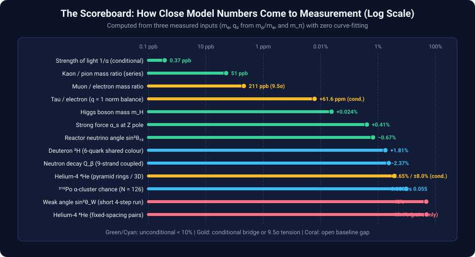
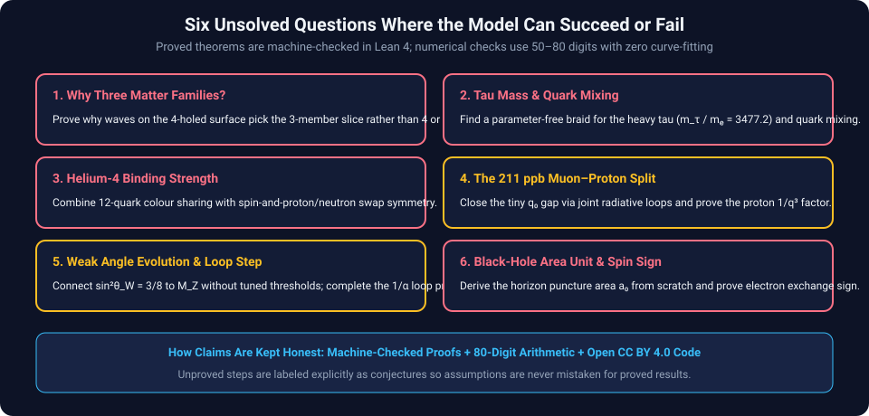

# Section 9 Illustrated Storyboard: The Scoreboard — Where the Model Hits, Fails, and Can Be Tested

**Companion to:** [Survey Article §9](../survey-article.md#9-the-scoreboard-where-the-model-hits-where-it-fails-and-how-to-test-it) | [Suite Index](../README.md)  
**Target Runtime:** ~6 minutes 30 seconds (7 slides)  
**Audience Level:** Curious general viewer (everyday physics words only; zero specialist algebra jargon)

---

## Slide 9.1 — Putting Every Number on One Unvarnished Chart

### On-Screen Text
- **Title:** One Unified Scoreboard Across Ten Powers of Ten
- **Same Three Inputs Everywhere:** Electron mass $m_e$ $\;\cdot\;$ Crossing number $q_0$ (from $m_p / m_e$) $\;\cdot\;$ Pion scale $m_\pi$

### Host Narration
"Now let's step back and put every comparison we've met onto one honest chart, spanning from tenths of a part per billion on the left out to seventy percent discrepancies on the right. Every single bar on this chart comes from the exact same three measured inputs—the electron's mass, the crossing parameter q-naught fixed by the proton-to-electron ratio, and where nuclear touch distance enters, the pion mass—with zero curve-fitting anywhere."

### Animation Notes
- Sweep across `sec09-unified-comparison-chart.svg` from left (`0.1 ppb`) to right (`100%`), lighting up the green sub-percent bars, the gold `211 ppb` muon tension bar, the cyan few-percent nuclear/decay bars, and the coral unsolved-gap bars.

---

## Slide 9.2 — Close Agreements: Light, Electroweak, and Neutrinos

### On-Screen Text
- **Title:** Sub-Percent Matches (With Scope Labels Intact)
- **Highlights:**
  - **Strength of light ($1/\alpha$):** $137.035999127$ vs. $137.035999177$ (**$0.37\;\mathrm{ppb}$**, conditional on loop weight)
  - **Higgs boson mass ($m_H$):** $125.23\;\mathrm{GeV}$ vs. $125.20 \pm 0.11\;\mathrm{GeV}$ (**$+0.024\%$**)
  - **Strong force ($\alpha_s(M_Z)$) & Reactor mixing ($\sin^2\theta_{13}$):** **$+0.41\%$** & **$-0.67\%$**
  - **Neutrino scale ($12$ weak steps):** **$12.5\text{–}17.6\;\mathrm{meV}$** inside the $8.68\text{–}49.5\;\mathrm{meV}$ window

### Host Narration
"Start with the upper green group. On our four-holed surface, stretching the nine-crossing and ten-crossing knots at q-naught lands within four-tenths of a part per billion of one-over-alpha, while keeping its conditional label until the loop-weight proof is finished. In the high-energy collider sector, the Higgs boson mass matches within 0.024 percent and the strong force at the Z pole within 0.41 percent. And on a plain zero-volume loop, twelve weak-suppression steps shrink the electron mass by forty million right into the measured milli-electronvolt neutrino window, with reactor mixing within two-thirds of a percent."

### Animation Notes
- Zoom into the top six bars of `sec09-unified-comparison-chart.svg`, displaying each model value beside its experimental uncertainty band.

---

## Slide 9.3 — Few-Percent Nuclear & Decay Matches + Exact Grouping

### On-Screen Text
- **Title:** Coupled Strands, Shared Colour, and the 73 Regions
- **Highlights:**
  - **Deuteron (${}^2\mathrm{H}$, $6$-quark colour sharing):** $2.265\;\mathrm{MeV}$ vs. $2.225\;\mathrm{MeV}$ (**$+1.81\%$**)
  - **Neutron decay ($Q_\beta$, $9$-strand coupled):** $+0.764\;\mathrm{MeV}$ vs. $0.7823\;\mathrm{MeV}$ (**$-2.37\%$**)
  - **Nuclear stability map:** Lands inside the **single physical region ($1$ of $73$)** (${}^5\mathrm{He}$ breakup, stellar ${}^{12}\mathrm{C}$, closed shells, ${}^{210}\mathrm{Po}$ $0.050$ vs. $0.055$)
  - **Chemical lock ($\eta_2$):** **$1.77 \times 10^{-6}$** preserves nuclei across chemistry; flips at $1.293\;\mathrm{MeV}$ in dense stars

### Host Narration
"In the middle cyan group, including all nine participating strands brings neutron decay energy to within 2.37 percent of measurement, while quark electric charges inside the proton and neutron give 0.761 MeV without needing the pion input at all. Allowing six quarks to share colour binds heavy hydrogen within 1.81 percent; whole-number grouping picks our exact nuclear stability region out of seventy-three possibilities; slot counting at 126 neutrons gives polonium-210's twenty-fold alpha slowdown; and a two-part-per-million energy ratio locks nuclei solid across all of chemistry."

### Animation Notes
- Highlight the middle cyan bars of `sec09-unified-comparison-chart.svg` alongside miniature callout icons of the 73-region pentagon and the five-layer tower.

---

## Slide 9.4 — Where the Model Currently Fails or Stays Incomplete

### On-Screen Text
- **Title:** Large Misses Are Diagnostic Clues, Not Embarrassments
- **Clear Gaps:**
  - **Helium-4 (${}^4\mathrm{He}$) binding:** $14.49\;\mathrm{MeV}$ ($12q$ colour) / $8.77\;\mathrm{MeV}$ (baseline) vs. **$28.30\;\mathrm{MeV}$** ($-49\%$ / $-69\%$)
  - **Tau lepton mass ($m_\tau / m_e$):** Candidates miss $3477.2$ by **$-31\%$ to $+68\%$**
  - **Short $4$-step weak-angle run:** Stops at **$0.342$** vs. **$0.23122$** ($+48\%$)

### Host Narration
"Now look squarely at the coral bars and the six unsolved cards on this map—the places where the model as it stands today falls short. Helium-four's binding energy is still roughly half of the measured 28.30 MeV because four-way spin-and-proton-neutron swap symmetry hasn't been combined with twelve-quark colour sharing yet. Every tested knot candidate for the heavy tau lepton misses by thirty to seventy percent. Short four-step evolution of the weak mixing angle stops at 0.342 instead of 0.2312. And why left-handed waves pick three matter families out of four surface modes—along with the elementary area unit of a black-hole puncture—still awaits a proof."

### Animation Notes
- Step through the six cards of `sec09-unsolved-questions-map.svg`, keeping coral and gold borders sharp and legible.

---

## Slide 9.5 — Why Computer Proof Checking Changes Theoretical Science

### On-Screen Text
- **Title:** Separating Proved Math From Unproved Assumptions
- **Two Mechanical Safeguards:**
  1. **Formal Proof Checker (Lean 4):** Checks every logical step from scratch; labels unproved bridges explicitly as `conjecture`
  2. **80-Digit Arithmetic (`mpmath`):** Zero floating-point rounding drift; candidate formulas written down *before* checking data

### Host Narration
"Normally, if you want to check a thousand-page theoretical physics manuscript, you have to trust months of human algebra and hope no hidden assumption slipped into Lemma fourteen. This project uses two mechanical safeguards to change that. First, every theorem claimed as proved is checked line by line by the Lean four proof assistant—and any physical bridge that isn't proved yet is isolated explicitly as a named conjecture, so an assumption can never masquerade as a theorem. Second, every numerical test runs at fifty to eighty decimal digits, with candidate formulas written down before looking at the experimental comparison."

### Animation Notes
- Focus on the bottom cyan verification banner of `sec09-unsolved-questions-map.svg`: animate a proof tree lighting up green nodes (`Theorem — Checked`) while keeping amber nodes (`Conjecture — Stated Explicitly`) clearly separated.

---

## Slide 9.6 — How Viewers, Mathematicians, and Physicists Can Break or Build It

### On-Screen Text
- **Title:** An Open Repository Built to Be Audited
- **Explore (`github.com/litlfred/qou`, CC BY 4.0):**
  - Fork the repository and ask any language model or proof checker to walk through a formula
  - Submit a counterexample, a failing numerical test, or a proof of an unsolved step

### Host Narration
"Everything you've seen in this series—every braid definition, every proof file, every eighty-digit script, and every failed candidate—lives openly on GitHub under a Creative Commons license. In fact, one of the easiest ways to explore or challenge it is to fork the repository, point your favorite language model or proof assistant at any claim on the scoreboard, and ask where the numbers come from—or try to break a conjecture with a counterexample. Contributors whose merged pull requests fix an error or solve an open step become co-authors of the monograph."

### Animation Notes
- Display a clean repository tree (`braids`, `surfaces`, `nuclei`, `chemistry`, `proofs`, `80-digit checks`) branching into two clear contributor paths: ` Counterexample / Bug Report` and `Derived Proof of Unsolved Card`.

---

## Slide 9.7 — Closing Perspective: Why Zero Fitting Wins Either Way

### On-Screen Text
- **Title:** One Parameter $q_0$, Zero Tuned Knobs, Clear Falsifiability
- **Core Question:** How much of physical law is forced by the rules of observation and braiding alone?

### Host Narration
"Step back one last time to where we started: three colored ribbons crossing over and under on a table, controlled by a single number q-naught. Whether this braided mathematical model eventually closes its unsolved gaps in helium-four, the tau mass, and black-hole horizons—or hits a clean mathematical wall that proves nature needs an extra ingredient—banning curve-fitting guarantees a genuine scientific answer. Either way, we learn something real about why mathematics describes our universe at all."

### Animation Notes
- Pull the camera smoothly back from the six unsolved cards through the five-layer tower, past the seventy-three nuclear regions and four-holed surface, all the way back to three quiet luminous ribbons crossing in dark space (`q₀ = 1.10997858...`), holding cleanly for end credits.
