# Braiding Matter and Light from Pure Relations: An Accessible Guide to the Quantum Observable Universe

*A General-Audience Survey of a Zero-Fit Mathematical Model of Particles, Forces, Nuclei, and Chemistry*

> **Scope and Reading Guide:** *Quantum Observable Universe* ([`github.com/litlfred/qou`](https://github.com/litlfred/qou), CC BY 4.0) is an open, work-in-progress mathematics monograph paired with formal computer-checked proofs and high-precision arithmetic. Inside this model, words such as *photon*, *electron*, *proton*, *mass*, and *binding energy* are names of specific mathematical shapes built from braided strands, much as a geometer calls a three-crossing loop "the trefoil knot." Physical science enters at the comparison boundary, where pure ratios computed from those shapes are set beside laboratory measurements (**CODATA**, **Particle Data Group**, and the **Atomic Mass Evaluation**). Several ratios match experiment closely, several depend on unproved mathematical steps, and several miss measurement by wide margins. Both the close agreements and the large discrepancies are presented on equal footing below.

---

## 1. Space, Time, and Indiscernibles: Replacing the Background Stage

Most descriptions of physics start by building an empty room. Before a single atom moves or a single beam of light crosses the scene, we imagine a smooth four-dimensional box of space and time coordinates $(t, x, y, z)$. Only after that invisible grid is fixed in place do we place fields inside it, treat their ripples as particles, and measure roughly two dozen unexplained numbers in the laboratory to set particle masses and force strengths.

Three centuries ago, Gottfried Wilhelm Leibniz asked Isaac Newton's defenders a simple question: if you shifted the entire contents of the universe three meters to the left inside an empty coordinate box, what measurement could possibly change? Nothing at all would change, because every distance and angle *between* objects would stay the same.

Leibniz proposed that the empty box is a human bookkeeping habit rather than a physical thing. In his view, **time** is simply the order in which events follow one another, **space** is the order in which things sit side by side, and two states that give identical results under every possible observation are the exact same state.

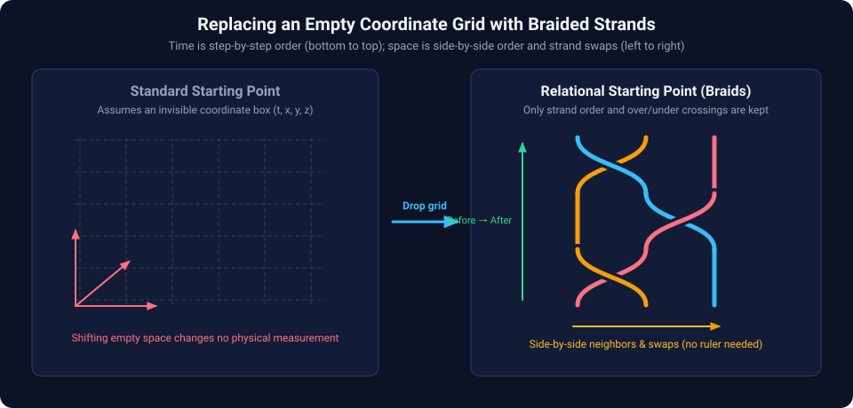

How can you turn that idea into concrete mathematics without sneaking coordinates back in? Imagine laying three colored ribbons side by side on a table and reading them from bottom to top.

- Stacking one step above another represents **before and after** (the skeleton of time).
- Placing ribbons next to each other represents **side by side** (the skeleton of space).
- Sliding a ribbon across its neighbor creates a **crossing**: either the left ribbon passes **over** the right ribbon, which we write as $\sigma_i$, or it passes **under** the right ribbon, which we write as $\sigma_i^{-1}$.

Suppose over-crossings and under-crossings made no difference at all, as if ghosts could walk straight through one another. Then swapping two neighbors twice in a row would always put every ribbon right back where it started ($\sigma_i^2 = \mathbf{1}$). Nothing could ever tangle, lock together, or store geometric tension.

To let strands remember *which way* they crossed, the Quantum Observable Universe (QOU) model introduces a single real number $q > 1$ that measures the difference between an over-crossing and an under-crossing (Equation 1):

$$
\sigma_i - \sigma_i^{-1} = \left(q - \frac{1}{q}\right)\mathbf{1}, \qquad h := q - \frac{1}{q}.
$$

Every symbol in Equation (1) describes a simple ribbon move:

- $\sigma_i$ means ribbon $i$ crosses **over** its right-hand neighbor;
- $\sigma_i^{-1}$ means ribbon $i$ crosses **under** that same neighbor;
- $\mathbf{1}$ means the two ribbons run **straight ahead** side by side without crossing;
- $q > 1$ is a single positive number setting how strongly an over-crossing differs from an under-crossing; if $q = 1$, then $q - 1/q = 0$, over equals under, and flat untangled swaps return;
- $h = q - 1/q$ is shorthand for that crossing-difference strength.

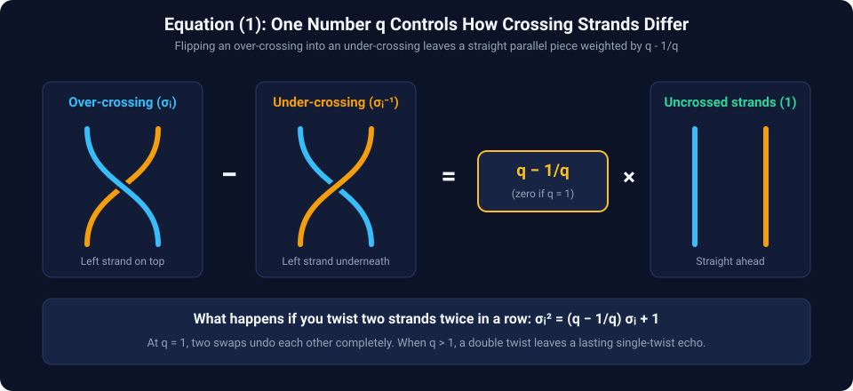

If you twist two neighboring ribbons *twice* in the same direction, Equation (1) gives $\sigma_i^2 = h\,\sigma_i + \mathbf{1}$. In plain words, a double twist partly relaxes back into straight parallel ribbons ($\mathbf{1}$) while leaving behind a single-twist echo of strength $h$. That refusal of two swaps to undo each other cleanly is the model's basic building block for curvature and mass.

An open braid on a table is a process mid-flight. To turn a braid into a measurable number, an instrument has to close the circuit—looping the top ends of the ribbons smoothly around to reconnect with their bottom ends, forming closed rings or knots. Reading out a single number from a closed loop plays the same role here that measuring volume or area plays in ordinary geometry. When $q > 1$, sliding a step all the way around that return loop also distinguishes left-handed turns from right-handed turns, giving the model a built-in sense of handedness.

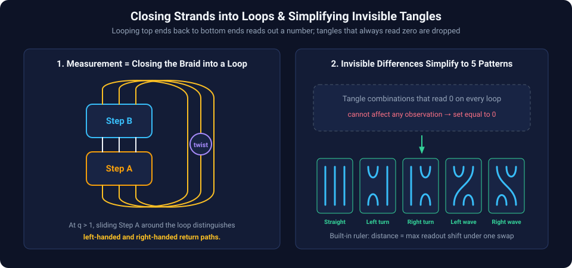

Now apply Leibniz's rule that states indistinguishable by every observation are the same. On three or more strands, certain combinations of crossings cancel out to **zero** no matter what other braid you attach to them before closing the loop. Because no loop measurement inside the model can ever detect those combinations, the model sets them equal to zero. On three strands, dropping those invisible combinations leaves just five basic non-crossing connection patterns—and defines a natural ruler between states by asking how much any readout can shift when you swap two neighboring strands once.

*(Technical note for mathematical readers: Equation (1) defines the Iwahori–Hecke algebra $H_n(q)$ equipped with a Nakayama-twisted Frobenius trace; quotienting by the two-sided trace radical yields the Temperley–Lieb algebra $TL_n(q)$, whose three-strand state space carries an exact finite Rieffel metric.)*

---

## 2. The Rules of the Game: Model versus Measurement and the Three Calibrations

Whenever a mathematical model tries to compute physical constants like the mass of the muon or the strength of electromagnetism, a careful reader should ask a blunt question: *did someone secretly tune the formulas to hit the right answers?*

With enough powers of $\pi$, roots, and knot tables, anyone with a laptop can cook up formulas that match almost any experimental number after the fact. Worse still, curve-fitting destroys a model's ability to teach us anything new. The moment you adjust a knob to hide a discrepancy, you erase the exact clue that would have shown where a physical step was missing.

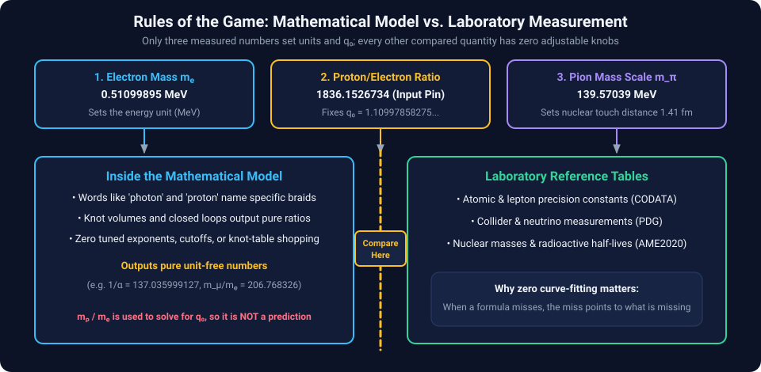

To prevent self-deception, QOU enforces two strict rules across all calculations:

1. **Mathematical names vs. physical tests:** Inside the mathematics, calling a specific three-strand braid "the electron" or "the proton" is a naming convention, not an assumption about nature. Physics enters solely at the comparison line, where a pure unit-free number produced by the model is compared directly against laboratory tables.
2. **Zero curve-fitting:** No exponent, coefficient, cutoff, or knot choice may be adjusted to match experimental data. When a parameter-free calculation lands $69\%$ away from the measured binding energy of helium-4, that $69\%$ failure stays on the front scoreboard until a genuine derivation explains what is missing.

If tuning knobs is forbidden, how many measured numbers *are* needed to connect unit-free mathematics to human laboratory units like mega-electronvolts ($\mathrm{MeV}$) and femtometers ($10^{-15}\;\mathrm{m}$)? The model uses **exactly three measured inputs**:

- **Input 1 — The electron mass ($m_e = 0.51099895\;\mathrm{MeV}$):** Sets our energy ruler. Because $m_e$ defines what one mega-electronvolt means in the model, multiplying a ratio by $m_e$ is just a unit conversion; only **dimensionless ratios, mass differences, decay energies, and binding energies** count as physical tests.
- **Input 2 — The proton-to-electron mass ratio ($m_p / m_e = 1836.1526734$):** Pins the exact numerical value of the crossing parameter $q_0$ for our universe. Because $m_p / m_e$ is fed *in* to solve for $q_0$, **the proton-to-electron mass ratio is an input pin, never an output prediction**.
- **Input 3 — The charged pion mass ($m_\pi = 139.57039\;\mathrm{MeV}$):** Sets the characteristic touch distance of nuclear forces ($r_\pi \approx 1.414\;\mathrm{fm}$). On purely electric differences inside protons and neutrons (Section 6), even this third input drops out completely.

Let us see how $q_0$ is pinned—and how that immediately sets up our first no-net test on the **muon**, the heavier cousin of the electron that weighs roughly $207$ times more than an electron.

In three-dimensional knot geometry, the simplest knot whose surrounding space curves inward with uniform negative curvature is the four-crossing **figure-eight knot** ($4_1$). Imagine drilling that four-crossing loop out of space and filling the remaining room with building blocks: it fits **exactly two** symmetric curved three-dimensional pyramids (tetrahedra) with $60^\circ$ edge angles, each having geometric volume $1.0149416\dots$, for a total knot volume $\mathrm{Vol}(4_1) = 2.0298832\dots$ Dividing that geometric volume by the square of the fractional step away from $q = 1$ gives the model's muon-to-electron mass ratio (Equation 2):

$$
\frac{m_\mu}{m_e} = \frac{\mathrm{Vol}(4_1)}{\hbar_q^2}, \qquad \hbar_q := 1 - \frac{1}{q}, \qquad \mathrm{Vol}(4_1) \approx 2.0298832128.
$$

In Equation (2):

- $m_\mu / m_e$ is how many times heavier the muon is than the electron;
- $\hbar_q = 1 - 1/q$ measures the fractional step of $q$ away from the flat value $q = 1$;
- $\mathrm{Vol}(4_1) \approx 2.0298832128$ is the exact three-dimensional curved volume surrounding the four-crossing figure-eight knot.

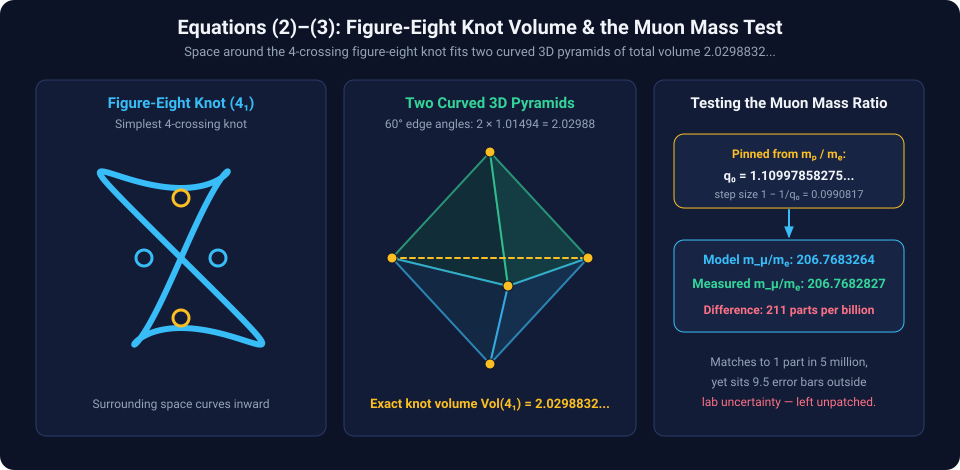

On three strands, the proton's core is a six-crossing braid $\beta_{\mathrm{Bor}}$ whose closed rings form the **Borromean rings** (three unknotted loops locked together). Using the measured proton-to-electron ratio $1836.152673426\dots$ as Input 2 in the proton's closed-loop formula fixes $q_0$ (Equation 3):

$$
\frac{m_p}{m_e} = 2\,\frac{\mathrm{Vol}(4_1)}{\hbar_{q_0}^2}\,|\mathrm{tr}(\beta_{\mathrm{Bor}})|\,\frac{[2]_{q_0}[3]_{q_0}}{q_0^3} - 12 \quad \Longrightarrow \quad q_0 = 1.1099785827513808\dots
$$

In Equation (3):

- $m_p / m_e$ is **supplied from measurement** to solve for $q_0$, giving $q_0 \approx 1.1099785828$ (so $\hbar_{q_0} \approx 0.09908$ and $h = q_0 - 1/q_0 \approx 0.20906$);
- $|\mathrm{tr}(\beta_{\mathrm{Bor}})| = (4 + h^2 - 3h^4 - h^6)/(h^2 + 4)$ is the exact loop readout of the six-crossing Borromean braid;
- $[2]_{q_0}[3]_{q_0}/q_0^3$ is a three-strand normalization factor whose $1/q_0^3$ power is explicitly flagged in the monograph as asserted rather than proved from first principles.

Now perform the test: take $q_0 = 1.10997858275\dots$ from Equation (3) and substitute it directly into Equation (2) for the muon, changing nothing. Equation (2) outputs **$206.7683264$**. The measured CODATA value is **$206.7682827 \pm 0.0000046$**.

Look at both sides of that result. With zero adjustable parameters, the figure-eight knot volume and the proton-fixed $q_0$ match the muon mass to **211 parts per billion**—roughly one part in five million. At the same time, because laboratory experiments measure the muon to 22 parts per billion, a 211-part-per-billion offset sits **9.5 standard error bars** outside experimental uncertainty. Rather than adding a rounded correction polynomial to paper over those 211 parts per billion, the model leaves that tiny **muon–proton tension** untouched in plain view.

---

## 3. Knots, Photons, and a Four-Holed Symmetric Surface

If we have no background grid and no off-shell "virtual particles" popping in and out of empty space, how do light and matter look and interact inside a three-strand braid model?

In QOU, **virtual photons do not exist**. Instead, a **photon** ($\gamma$) is an explicit combination of four elementary moves on three side-by-side strands (Equation 4):

$$
\gamma(\varphi) = \mathbf{1} + \varphi_0\sigma_0 + \varphi_1\sigma_1 + \varphi_{01}\sigma_0\sigma_1^{-1}, \qquad V^3 = (\sigma_0\sigma_1^{-1})^3 = \gamma(0, 0, qh)\,\gamma(0, 0, -h/q).
$$

Each piece of Equation (4) corresponds to a direct visual ribbon move:

- $\mathbf{1}$ is three parallel strands continuing straight ahead;
- $\varphi_0\sigma_0$ crosses the **left pair** of strands (horizontal polarization of light);
- $\varphi_1\sigma_1$ crosses the **right pair** of strands (vertical polarization of light);
- $\varphi_{01}\sigma_0\sigma_1^{-1}$ is a two-step **over-then-under move** $V = \sigma_0\sigma_1^{-1}$: strand 0 passes *over* strand 1, and then the middle strand passes *under* strand 2.

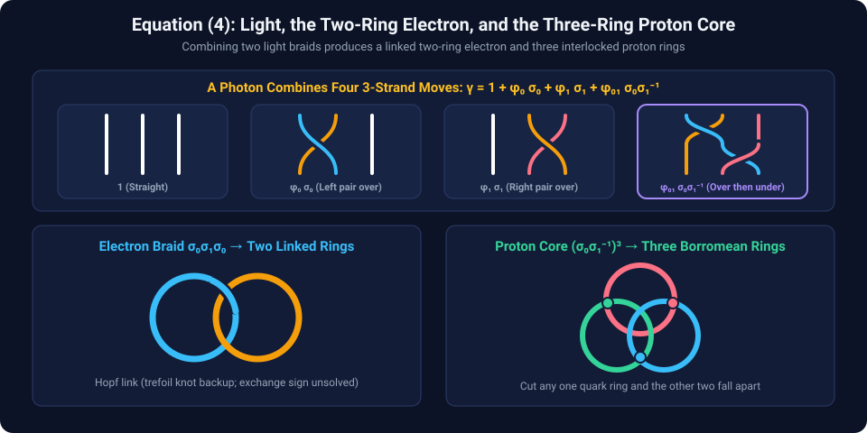

Watch what happens when two photons meet end to end and simplify using the crossing rule from Equation (1):

- **Forming the two-ring electron:** When the right-pair crossing ($\sigma_1$) of one photon meets the over-then-under vertex ($\sigma_0\sigma_1^{-1}$) of a second photon, Equation (1) simplifies the collision into the three-strand half-twist **$\sigma_0\sigma_1\sigma_0$**. Closing the top and bottom ends of $\sigma_0\sigma_1\sigma_0$ produces **two simple circles linked once through each other** (the Hopf link)—the model's primary braid for the **electron** (with the three-crossing trefoil knot kept as a secondary candidate, and with the proof of why two swapped Hopf-link electrons flip quantum sign left as an unsolved mathematical question).
- **Forming the three-ring proton core (why quarks never escape):** Suppose we collide two pure-vertex photons and keep only combinations that are completely balanced in twist—meaning no individual loop twists around itself and no pair of loops links directly. As the second half of Equation (4) shows, multiplying two opposite-signed pure-vertex photons produces $V^3 = (\sigma_0\sigma_1^{-1})^3$ identically. Closing $V^3$ yields the **Borromean rings**: three plain unknotted circles (representing three quarks, where an **up quark** is simply one plain circle inside the trio) locked together so that no two circles link on their own, yet all three are inseparably bound. If you cut *any* one ring to pull a quark out, the other two rings immediately fall apart—giving a direct geometric picture of quark confinement.
- **Three sheets of colour:** Along each baryon strand run three stacked layers representing the three "colours" (red, green, blue) of the strong force. Combining one strand on each layer into a balanced white trio reproduces our exact three-strand braid rules on protons and neutrons.

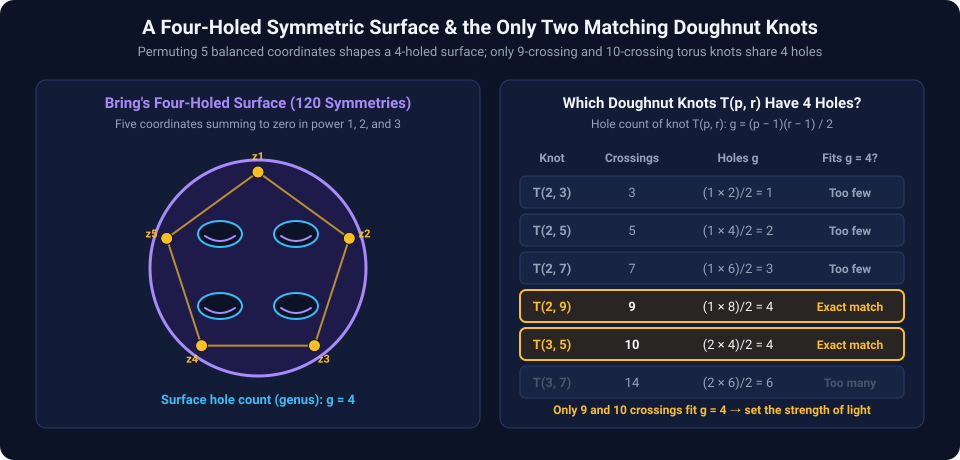

When we trace how three-strand braids branch over smooth two-dimensional surfaces, the symmetry constraints point to a specific shape from nineteenth-century geometry called **Bring's surface**: a smooth closed surface with **four holes** (genus $g = 4$) defined by five balanced coordinates ($z_1 + z_2 + z_3 + z_4 + z_5 = 0$, along with their squares and cubes summing to zero). Because all $5 \times 4 \times 3 \times 2 \times 1 = 120$ ways of permuting those five coordinates leave the equations unchanged, it is the most symmetric four-holed surface that mathematics permits.

Now ask a simple whole-number question about that four-holed surface. A **doughnut knot** (torus knot) $T(p, r)$ winds $p$ times around a doughnut's tube and $r$ times through its center hole, with $p$ and $r$ sharing no common factor. Its minimum spanning surface has hole count $g = (p - 1)(r - 1)/2$. *Which doughnut knots have exactly $4$ holes, matching Bring's surface?*

To get $(p - 1)(r - 1)/2 = 4$, we need $(p - 1)(r - 1) = 8$. With $2 \le p < r$ and no shared factor between $p$ and $r$, the whole number $8$ factors in only two eligible ways ($1 \times 8$ and $2 \times 4$), singling out **just two knots in all of mathematics**:

- **$T(2, 9)$**, which has **$9$ crossings**; and
- **$T(3, 5)$**, which has **$10$ crossings**.

Those two forced crossing counts—$9$ and $10$—now set the strength of light.

---

## 4. The Fine-Structure Constant and the Electroweak Forces

Every atomic orbit, chemical bond, and beam of starlight in our universe is governed by one unit-free number: the **fine-structure constant** $\alpha$, whose inverse $1/\alpha$ is measured in laboratories to be **$137.035999177 \pm 0.000000021$**. Why does nature sit at $137.035999\dots$ rather than $90$ or $200$?

In flat $q = 1$ arithmetic, multiplying our two four-hole crossing counts gives $1 \times 9 \times 10 = 90$—nowhere near $137$. When $q > 1$, however, whole numbers $n$ stretch into symmetric **$q$-numbers** $[n]_q$ defined by a balanced ladder of powers of $q$ (Equations 5 and 6):

$$
[n]_q := \frac{q^n - q^{-n}}{q - q^{-1}} = q^{n-1} + q^{n-3} + \dots + q^{-(n-1)},
$$

$$
\frac{1}{\alpha} = q_0\,[9]_{q_0}\,[10]_{q_0} + \frac{2g}{4\pi(g - 1)} + \alpha\,H\,(1 - h^2\alpha), \qquad g = 4, \qquad H := \frac{[2]_{q_0}}{8\pi}.
$$

Every piece of Equations (5) and (6) can be checked on a pocket calculator using our proton-fixed $q_0 = 1.10997858275\dots$:

- $[n]_q$ adds $n$ balanced powers of $q$. At $q = 1$, every power equals $1$, so $[9]_1 = 9$ and $[10]_1 = 10$. At $q_0 \approx 1.10997858$, larger numbers stretch upward faster than smaller ones shrink: $[2]_{q_0} \approx 2.0109$, $[9]_{q_0} \approx 10.3350$, and $[10]_{q_0} \approx 11.9303$;
- **$q_0\,[9]_{q_0}\,[10]_{q_0} = 136.86022$** is the main knot term from our two four-hole knots $T(2,9)$ and $T(3,5)$;
- **$\frac{2g}{4\pi(g - 1)} = \frac{2}{3\pi} = 0.21221$** is the geometric curvature contribution of a surface with $g = 4$ holes;
- **$\alpha\,H\,(1 - h^2\alpha) = -0.03643$** is a self-feedback loop correction where $\alpha$ appears on *both* sides of Equation (6), so $\alpha$ is solved as a single self-consistent balance point rather than an endless sum.

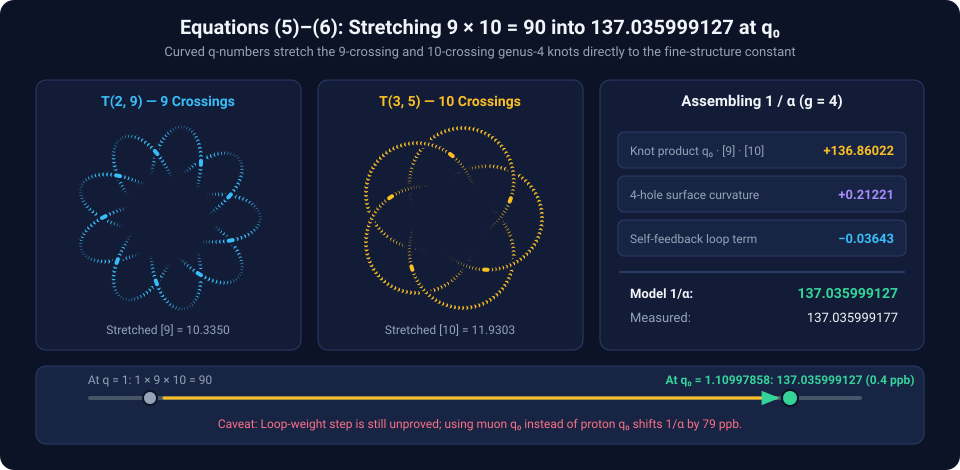

Solving Equation (6) gives **$1/\alpha = 137.035999127$**, which differs from the measured value $137.035999177$ by **0.37 parts per billion** (less than four parts in ten billion). In addition, when electric charge lines attach to whole protons and neutrons, positive-energy consistency locks their coupling parameter $t$ directly to $\alpha$ through the exact relation $2\ln t = -\alpha$.

Even at $0.37$ parts per billion, our honesty rules require flagging two caveats:

1. **Conditional mathematical step:** Proving the integration weight of the loop feedback term from first principles—and reconciling Equation (6) with an alternative topological series in the $q \to 1$ limit—is still unproved, so $1/\alpha$ carries a `conditional` label on the scoreboard.
2. **Sensitivity to $q_0$:** If we plugged in the *muon*-pinned $q$ instead of the proton-pinned $q_0$, $1/\alpha$ would move by $79$ parts per billion—showing independently that electromagnetism favors the proton's $q_0$ while feeling the same tiny muon–proton gap from Section 2.

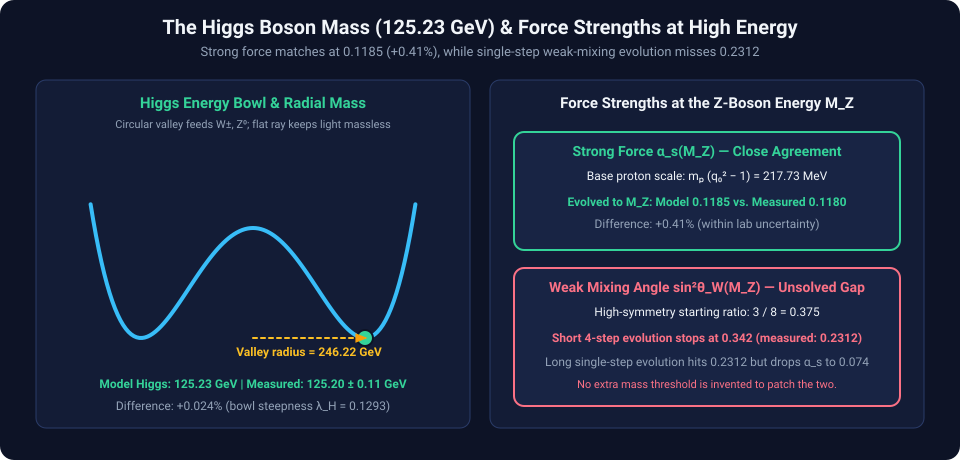

Stepping beyond light alone to the **weak and strong nuclear forces** produces three clean results alongside one sharp unsolved puzzle:

- **Handedness, electric charges, and the Higgs boson ($125.23\;\mathrm{GeV}$):** Left-handed versus right-handed braid crossings separate up-type from down-type weak partners ($\pm \frac{1}{2}$) and guarantee that quantum charge-imbalance errors ("anomalies") cancel to zero across each family of particles. Why is the weak force so feeble at everyday temperatures? Because weak transitions pass through a four-step algebraic switch that suppresses each hop by $(q_0^2 - 1) \approx 0.232$, setting the electroweak energy valley at $v_{\mathrm{EW}} = 246.22\;\mathrm{GeV}$. Around that circular valley, three flat directions feed masses to the $W^+$, $W^-$, and $Z^0$ bosons, one flat direction keeps the photon strictly massless, and rolling uphill radially gives a **Higgs boson mass of $125.23\;\mathrm{GeV}$**—within **$+0.024\%$** of the Large Hadron Collider measurement ($125.20 \pm 0.11\;\mathrm{GeV}$).
- **Strong force strength at high energy ($0.1185$):** Multiplying the proton mass by $(q_0^2 - 1)$ sets a zero-parameter strong-force confinement scale of $217.73\;\mathrm{MeV}$. Evolving that scale upward to the $Z$-boson energy ($91.19\;\mathrm{GeV}$) gives a strong coupling **$\alpha_s(M_Z) = 0.1185$**, within **$+0.41\%$** of the measured world average ($0.1180 \pm 0.0009$).
- **The unsolved weak-angle evolution gap:** At the symmetric algebraic starting point, the weak mixing ratio between electromagnetic and weak forces starts at $\sin^2\theta_W^0 = \frac{3}{8} = 0.375$. Evolving downward across just four weak-suppression steps stops at **$0.342$**, missing the measured value **$0.23122$** at $M_Z$ by $+48\%$; conversely, evolving across a much longer single-step span hits $0.23122$ while pulling $\alpha_s(M_Z)$ too low ($0.074$). Because inventing an ad-hoc intermediate particle mass to bend the curves is forbidden, reconciling those two evolutions stays flagged as unsolved.

---

## 5. Ghost Particles on a Simple Loop: Neutrinos and Matter Families

Why are **neutrinos**—the ghostlike neutral particles streaming through your body by the trillions every second from the Sun's core—more than *ten million times lighter* than an electron, yet not quite zero in mass?

In QOU's knot dictionary, the starting point is disarmingly simple. At baseline, a neutrino is an **unknotted plain circle** ($0_1$): zero crossings, zero holes, zero electric charge, and **zero curved knot volume** ($\mathrm{Vol}(0_1) = 0$). If particle mass came *exclusively* from curved knot volume as in Equation (2), neutrinos would weigh strictly zero forever.

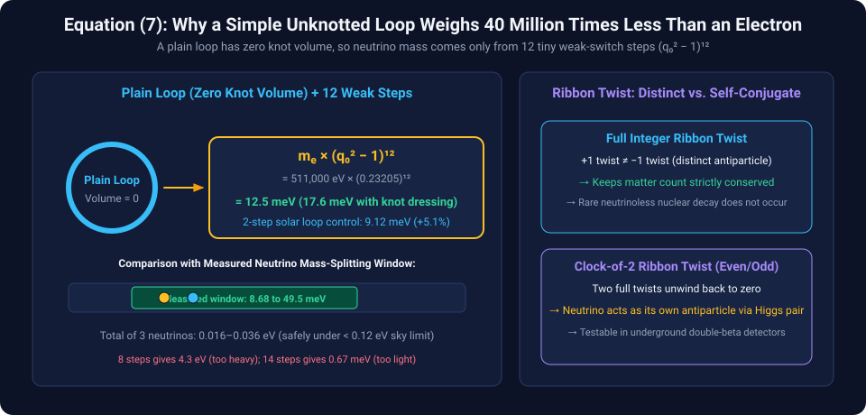

However, even a plain loop interacts weakly with its charged partner (the electron) through the same weak-step switch that suppressed the weak force in Section 4. Every pair of weak switch steps multiplies the electron mass scale by $(q_0^2 - 1)^2 \approx (0.23205)^2 \approx 0.0538$. Across twelve weak-suppression factors—and simultaneously in the wave-mixing overlap between neutrino flavors—the algebra yields Equation (7):

$$
m_\nu^{(12)}(q_0) = m_e\,(q_0^2 - 1)^{12} \approx 12.5\;\mathrm{meV}, \qquad \sin^2\theta_{13} = \frac{1}{2}\left(q_0 - \frac{1}{q_0}\right)^2 \approx 0.02185.
$$

Check what Equation (7) produces using $m_e$ and $q_0 = 1.10997858\dots$ alone, with zero adjustable knobs:

- Raising $(q_0^2 - 1) \approx 0.23205$ to the $12\text{th}$ power shrinks the electron's $511{,}000\;\mathrm{eV}$ mass by a factor of forty million, landing at **$12.5\;\mathrm{meV}$** ($0.0125\;\mathrm{eV}$), or **$17.6\;\mathrm{meV}$** when dressed by the $T(3,5)$ knot factor. Both numbers sit squarely inside the experimentally measured neutrino oscillation window of **$8.68$ to $49.5\;\mathrm{meV}$**, while keeping the sum of all three neutrino masses ($0.016\text{–}0.036\;\mathrm{eV}$) well under the cosmological sky-survey ceiling ($< 0.12\;\mathrm{eV}$). A companion two-vertex solar loop expression lands at **$9.12\;\mathrm{meV}$**, within **$+5.1\%$** of the measured solar splitting ($8.68\;\mathrm{meV}$)—while testing neighboring exponents shows openly that $8$ steps is far too heavy ($4.3\;\mathrm{eV}$) and $14$ steps is too light ($0.67\;\mathrm{meV}$).
- **Ribbon twist and whether neutrinos are their own antiparticles:** Think of the plain circle not as a thin wire, but as a flat paper ribbon that can carry full $360^\circ$ twists before its ends are taped together. If nature counts *every* integer twist ($+1 \neq -1$), neutrinos and antineutrinos stay strictly distinct forever. If nature counts twists only *even versus odd* (so two full twists unwind back to zero), single-particle mass is still blocked by symmetry, leaving only a paired Higgs interaction that makes the neutrino its own antiparticle—a distinction currently being tested in deep-underground nuclear decay detectors.
- **Neutrino mixing angles:** Rotating symmetric three-way wave mixing by a single crossing amplitude $h = q_0 - 1/q_0$ gives a reactor mixing parameter **$\sin^2\theta_{13} = \frac{1}{2}h^2 = 0.02185$** (**$-0.67\%$** from the measured $0.0220 \pm 0.0007$), alongside solar mixing **$0.298$** ($-3.0\%$ from $0.307$) and atmospheric mixing **$0.489$** ($-10.5\%$ from $0.546$).

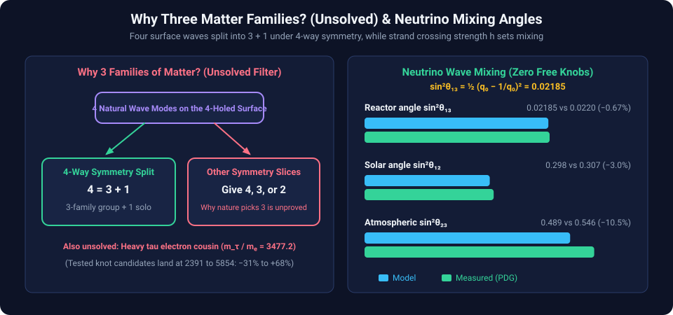

Right beside those neutrino results sit **two major unsolved questions** in the matter-family sector:

1. **Why are there three families of matter?** On our four-holed Bring surface from Section 3, there are $4$ natural smooth wave patterns. If you require symmetry among four of the five coordinates, those $4$ patterns split cleanly into **$3 + 1$**—a trio of three matter families plus one solo mode. However, checking other natural symmetry slices on the exact same surface yields $4$, $3$, or $2$ modes. Until a mathematical proof shows *why* left-handed matter waves must pick the $3$-mode slice rather than $4$ or $2$, the number of matter families ($N_{\mathrm{gen}} = 3$) is not yet derived unconditionally.
2. **The heavy tau lepton mass ($m_\tau / m_e = 3477.23$):** Electrons have two heavier cousins: the muon ($\approx 206.77\,m_e$) and the **tau** ($\approx 3477.23\,m_e$). Every parameter-free knot candidate tested so far for the tau misses by a wide margin, landing between $2391$ ($-31\%$) and $5854$ ($+68\%$). With curve-fitting banned, the tau mass (along with the four quark-mixing angles) stands wide open.

*(Technical note: Weak suppression steps arise from Sweedler's four-dimensional non-semisimple Hopf algebra $H_4$, whose order-four antipode projects charged-current loops onto the neutral doublet slot.)*

---

## 6. Inside the Nucleon and Beta Decay: How Honest Failures Drive Discovery

Left on its own outside an atomic nucleus, a free **neutron** survives about fifteen minutes before decaying into a **proton**, an **electron**, and an **antineutrino**, releasing **$0.7823\;\mathrm{MeV}$** of kinetic energy ($Q_\beta$). The total mass difference between a neutron and a proton is a tiny **$1.2933\;\mathrm{MeV}$**—just $0.14\%$ of their mass, yet life-or-death for our cosmos: if the proton were heavier instead, hydrogen atoms would collapse into neutrons and stars could never ignite.

Neutron decay offers a clear illustration of why refusing to curve-fit a failed calculation leads to physical insight.

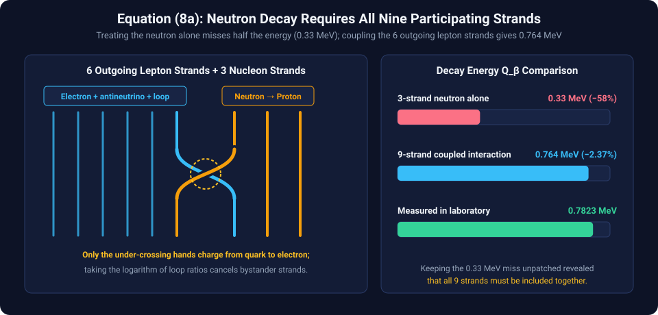

When you try to compute neutron decay by looking *only* at the three strands of an isolated baryon switching a down quark into an up quark, the consistent three-strand formula gives **$Q_\beta = 0.33\;\mathrm{MeV}$** (**$58\%$ too low**) and a neutron–proton mass difference of **$0.84\;\mathrm{MeV}$** (**$35\%$ too low**). An older shortcut had once given $0.784\;\mathrm{MeV}$—within $0.17\%$ of experiment—until a formal check proved that the shortcut violated the three-strand loop-cancellation rule from Section 1. Under QOU's discipline, a $0.17\%$ match built on an illegal rule was discarded immediately, leaving the $58\%$ shortfall exposed.

Why did the isolated three-strand calculation miss more than half the decay energy? Because **neutron beta decay is not a solo act on three strands**: the outgoing electron and antineutrino (plus a closed neutral loop required to balance strand count) occupy **six additional strands**, making beta decay a coupled **nine-strand interaction** (Equation 8):

$$
Q_\beta^{\mathrm{coupled}} = -E_0\,\ln\!\left(\frac{\mathrm{loop}(W_n)}{\mathrm{loop}(W_p)}\right) + \Delta E_{\mathrm{spin}} \approx +0.764\;\mathrm{MeV}, \qquad \Delta E_{\mathrm{EM}}(p - n) = \frac{1}{9}\,\alpha\,m_{\mathrm{proton}} \approx 0.761\;\mathrm{MeV}.
$$

Both halves of Equation (8) have simple physical meanings:

- **Coupled nine-strand decay energy ($+0.764\;\mathrm{MeV}$):** Place the six lepton strands on the left and the three quark strands on the right. At the boundary between them, crossing *over* transfers zero electric charge, whereas crossing *under* ($\sigma_5^{-1}$) hands negative charge cleanly from a quark to the outgoing electron. Measuring energy through the **logarithm** of closed-loop ratios (so independent bystander loops cancel out automatically, just as energies add when two non-interacting systems sit in the same room) yields $+0.738\;\mathrm{MeV}$; adding the $+0.026\;\mathrm{MeV}$ magnetic spin-spin repulsion difference between the three quarks brings the zero-parameter result to **$+0.764\;\mathrm{MeV}$**—within **$-2.37\%$** of the measured $0.7823\;\mathrm{MeV}$.
- **Pion-free electric energy inside the proton vs. neutron ($0.761\;\mathrm{MeV}$):** A proton is built from two $+2/3$ up quarks and one $-1/3$ down quark ($uud$, net charge $+1$), whereas a neutron has one $+2/3$ up quark and two $-1/3$ down quarks ($udd$, net charge $0$). Multiply pairs of quark charges inside each particle: in the proton, $(+4/9) + (-2/9) + (-2/9) = \mathbf{0}$; in the neutron, $(-2/9) + (-2/9) + (+1/9) = \mathbf{-1/3}$. Combining that exact $1/3$ pair-charge difference and self-charge difference ($f = 1/9$) with QOU's own $\alpha$ and proton mass scale gives **$0.761\;\mathrm{MeV}$** of extra electric energy on the proton—landing inside the experimentally inferred range ($0.76$ to $1.04\;\mathrm{MeV}$) **without using Input 3 (the pion mass $m_\pi$) at all**.

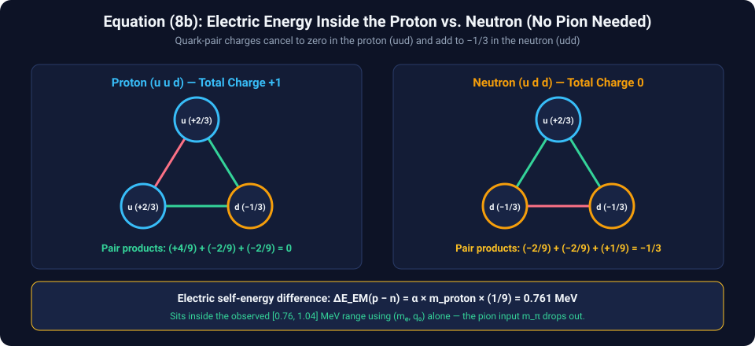

---

## 7. Building Atomic Nuclei: Shared Colour, the 73 Stability Regions, Stellar Carbon, and Alpha Decay

Move one step upward in size, from single protons and neutrons to **atomic nuclei**. Here any fundamental model faces two very different kinds of questions:

1. **Grouping questions (which nuclei hold together vs. fall apart?):** Why do one proton and one neutron bind gently into heavy hydrogen (**deuteron**, ${}^2\mathrm{H}$, $2.225\;\mathrm{MeV}$), while two protons and two neutrons snap shut into a **helium-4** core ($\alpha$-particle) with **$28.30\;\mathrm{MeV}$** of binding? Why does **no stable mass-5 atom exist anywhere in nature** (${}^5\mathrm{He}$ immediately sheds a neutron), and why does beryllium-8 (${}^8\mathrm{Be}$) split back into two helium-4 nuclei in $10^{-16}\;\mathrm{seconds}$—forcing dying stars to fuse *three* helium-4 nuclei into **carbon-12** (${}^{12}\mathrm{C}$) so carbon-based life can exist?
2. **Strength questions (exact binding energies in MeV):** Does the algebra get the actual mega-electronvolt binding totals right for larger nuclei?

QOU's nuclear calculations succeed cleanly on the grouping questions, on heavy-hydrogen colour sharing, and on radioactive alpha tunneling, while falling roughly a factor of two short on helium-4's total binding energy for a clear structural reason.

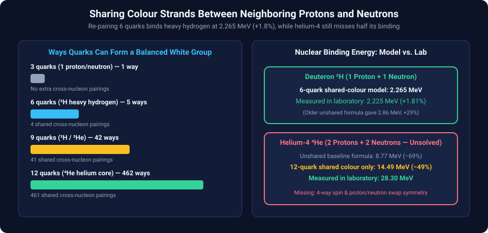

### 7.1 Shared Quark Colour Between Neighboring Nucleons

If you try to bind two protons and two neutrons into helium-4 while forcing each three-quark nucleon to keep its red, green, and blue strands strictly locked inside its own private bag, two-photon exchange leaves helium-4 *unbound* ($-0.86\;\mathrm{keV}$). Inside a real nucleus, closely packed quarks can swap colour partners across neighboring nucleons while keeping the whole nucleus colour-neutral overall:

- $3$ quarks ($1$ nucleon) have **$1$** colour-neutral grouping;
- $6$ quarks (${}^2\mathrm{H}$ deuteron) have **$5$** colour-neutral groupings ($4$ shared cross-nucleon channels);
- $9$ quarks (${}^3\mathrm{H}$, ${}^3\mathrm{He}$) have **$42$** groupings;
- $12$ quarks (${}^4\mathrm{He}$) have **$462$** groupings.

Allowing those shared colour channels strictly lowers the ground-state energy in every case. For the $6$-quark **deuteron (${}^2\mathrm{H}$)**, complete-pair colour sharing gives a binding energy of **$2.265\;\mathrm{MeV}$**, within **$+1.81\%$** of the measured $2.2246\;\mathrm{MeV}$. For $12$-quark **helium-4 (${}^4\mathrm{He}$)**, shared colour raises binding to **$14.49\;\mathrm{MeV}$** (compared with $8.77\;\mathrm{MeV}$ in the older single-channel formula), which is still roughly **half of the measured $28.30\;\mathrm{MeV}$** because the four-way symmetry that simultaneously swaps quark spins and proton/neutron labels has not yet been combined with colour sharing.

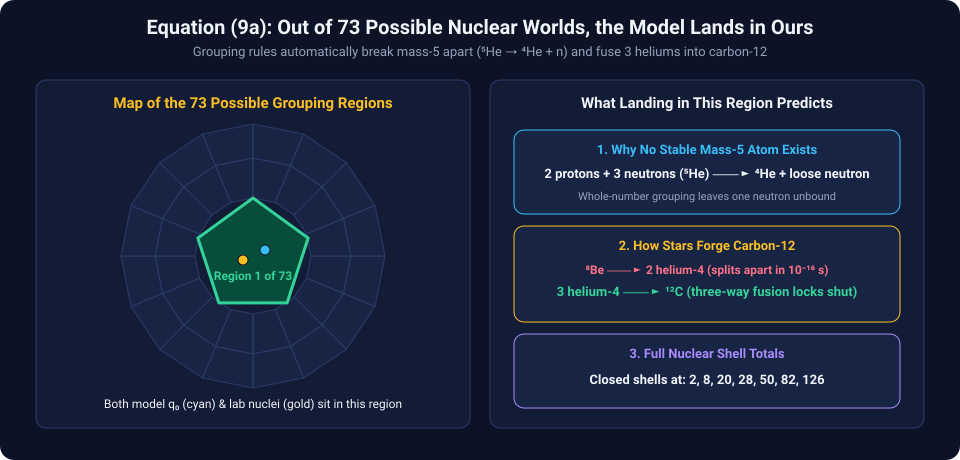

### 7.2 Out of 73 Possible Nuclear Grouping Worlds, the Model Lands in Ours

What about *which* nuclear clusters hold together or break apart? Track the six basic light building blocks—proton ($p$), neutron ($n$), deuteron ($d$), triton ($t = {}^3\mathrm{H}$), helion ($h = {}^3\mathrm{He}$), and helium-4 ($\alpha = {}^4\mathrm{He}$)—while conserving total protons $Z$ and neutrons $N$. Depending on the relative binding strengths $(B_d, B_t, B_h, B_\alpha)$, whole-number rearrangement math divides all possible nuclear worlds into **exactly $73$ distinct stability regions**.

With zero tuned parameters, the model's binding ratios at $q_0$ fall strictly inside **the single physical region ($\mathcal{C}_{\mathrm{phys}}$) occupied by laboratory nuclear data**—governed by five simple inequalities, alongside the shell-counting rule for heavy radioactive decay (Equation 9):

$$
0 < B_d < \min(B_h, B_t), \quad \max(2B_t, 2B_h) < B_\alpha; \qquad S_\alpha({}^{210}\mathrm{Po}) = \frac{1}{10 \times 2} = 0.0500.
$$

Landing inside that one region out of $73$ delivers three familiar landmarks of nuclear physics automatically:

- **Why mass-5 breaks apart:** Inside $\mathcal{C}_{\mathrm{phys}}$, $11$ energy-lowering whole-number replacement rules simplify $2$ protons plus $3$ neutrons (${}^5\mathrm{He}$) deterministically into **one helium-4 core plus one loose neutron** ($\alpha + n$), explaining the mass-5 gap while grouping nitrogen-14 cleanly into $d + 3\alpha$ with zero fractional leftovers.
- **How stars forge carbon-12:** The model's energy ordering makes beryllium-8 split apart (${}^8\mathrm{Be} \to 2\alpha$) while making three-way helium fusion release energy ($3\alpha \to {}^{12}\mathrm{C}$)—reproducing the stellar carbon bottleneck—and adding shell capacities $\{2, 6, 12, 8, 22, 32, 44\}$ recovers all seven closed nuclear shell totals **$(2, 8, 20, 28, 50, 82, 126)$**.
- **Heavy-atom alpha tunneling & polonium-210:** When a heavy nucleus like uranium-238 or polonium-210 emits a helium-4 cluster, that cluster tunnels quantum-mechanically through an electric repulsion hill whose touch radius ($r_0 \approx 1.172\;\mathrm{fm}$) is fixed by Input 3 ($m_\pi$) and whose height is fixed by $\alpha$. Across open-shell heavy nuclei spanning **24 powers of ten** in half-life ($0.3\;\mathrm{microseconds}$ up to $4.5\;\mathrm{billion\ years}$), bare tunneling matches measured half-lives within a factor of $1.4$ to $2.5$—and proves that **outside a nucleus in empty space, the deformation relaxes to $q \to 1$** (if $q_0 > 1$ persisted across empty space, uranium-238's half-life would miss by a factor of $2{,}600$). Right at the closed $126$-neutron shell in **polonium-210** (${}^{210}\mathrm{Po}$), pairing shuts off; picking a spin-balanced pair from $10$ proton slots and $2$ neutron-hole slots in Equation (9) gives an $\alpha$-formation probability of **$1/(10 \times 2) = 0.0500$** against the measured **$0.0553$** (predicting a $153$-day half-life vs. $138.4$ days measured).

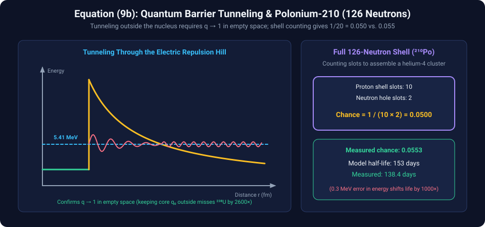

---

## 8. Five Layers of Matter: Why Chemistry Exists and What Happens at Horizons

Step back and ask a deceptively simple question: **why can chemistry happen without transmuting elements?** When you strike a match or digest food, outer electrons rearrange violently, yet carbon nuclei never accidentally turn into boron and protons never shatter into loose quarks.

In standard quantum field theory, moving from quarks to protons, from protons to nuclei, or from nuclei to atoms requires introducing brand-new empirical constants at each boundary to absorb high-energy unknowns. In QOU, all five scales stack into a **five-layer tower** ($\mathcal{L}_0 \to \mathcal{L}_1 \to \mathcal{L}_2 \to \mathcal{L}_3 \to \mathcal{L}_4$) governed at each step by one unit-free **stability ratio** $\eta_k$ computed from $(m_e, q_0)$ with zero refitted constants (Equation 10):

$$
\eta_k := \frac{\text{next-layer tug } \|\delta_V\|}{\text{lower-layer break cost } \Delta_k} < 1 \quad \Longrightarrow \quad \text{lower-layer units stay intact} \qquad \bigl(\eta_2 \approx 1.77 \times 10^{-6}\bigr).
$$

Equation (10) states a clean physical rule: whenever the strongest tug $\|\delta_V\|$ from the layer above is smaller than the energy $\Delta_k$ required to crack open a unit from the layer below ($\eta_k < 1$), breaking a lower-layer unit always costs net energy, so those units act as unbreakable building blocks on the floor above.

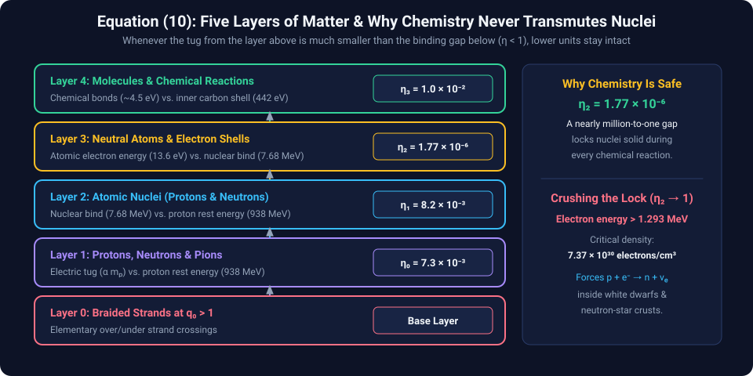

Look at the four ratios climbing the tower from braided strands to living chemistry:

1. **Strands $\to$ Protons & Neutrons ($\eta_0 = 7.3 \times 10^{-3}$):** Electric forces tug on quarks at $0.7\%$ of the proton's rest energy—shifting proton and neutron masses slightly without ever freeing a quark.
2. **Protons & Neutrons $\to$ Atomic Nuclei ($\eta_1 = 8.2 \times 10^{-3}$):** Nuclear binding ($\approx 7.68\;\mathrm{MeV}$ per nucleon vs. $938\;\mathrm{MeV}$ proton mass) nudges internal quark motion by $\sim 1\%$—matching the $1\%\text{–}5\%$ shift seen when high-energy muons scatter off quarks inside nuclei, while keeping protons and neutrons intact.
3. **Atomic Nuclei $\to$ Atoms & Ions ($\eta_2 = 1.77 \times 10^{-6}$):** Atomic electron binding ($13.61\;\mathrm{eV}$) divided by nuclear binding ($7.68\;\mathrm{MeV}$) is **less than two parts per million**. That nearly million-to-one lock guarantees mathematically that every chemical reaction preserves proton and neutron counts $(Z, N)$.
4. **Closed-Core Atoms $\to$ Molecules & Reactions ($\eta_3 = 1.0 \times 10^{-2}$):** Chemical bonds ($\approx 4.5\;\mathrm{eV}$ vs. $442\;\mathrm{eV}$ inner carbon electrons) leave inner electron shells untouched while outer valence electrons follow whole-number reaction-balancing rules that govern molecular formulas and ring stiffness.

Now flip Equation (10) around: **what happens when gravity crushes matter so hard that $\eta_k$ climbs up to $1$?** Inside a dying white-dwarf star or the outer crust of a neutron star, gravity squeezes electrons together until their sea energy exceeds $1.2933\;\mathrm{MeV}$ (at a density of $7.37 \times 10^{30}\;\mathrm{electrons/cm^3}$). At that exact point, $\eta_2$ crosses $1$, the chemical lock snaps open, and electrons are forced *into* protons to form neutron matter ($p + e^- \to n + \nu_e$).

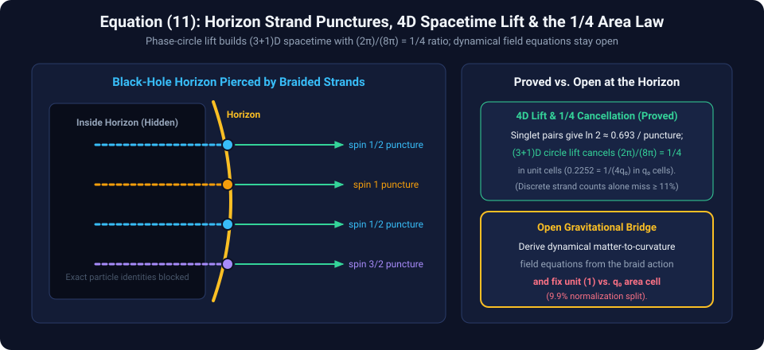

What if gravity crushes matter even further, forming a **black hole**? In QOU, an event horizon acts as an information boundary: exact particle identities inside the horizon (degree-$0$ data) cannot be read by any finite outside loop, while first-order slope data leaks outward as thermal Hawking radiation. Counting braided strands of spin $j = \frac{1}{2}, 1, \frac{3}{2}, \dots$ piercing the horizon gives a state-counting balance equation (Equation 11):

$$
Z_1(s_\star) := \sum_{j = \frac{1}{2}, 1, \frac{3}{2}, \dots} [2j + 1]_{q_0}\,e^{-s_\star\,C_{q_0}(j)} = 1.
$$

In Equation (11), $[2j + 1]_{q_0}$ counts the states of a spin-$j$ puncture, $C_{q_0}(j) > 0$ is its spin weight, and $s_\star$ is the unique balance point where total horizon state growth turns critical, fixing the entropy per puncture. Here again, QOU states plainly what is *not* yet solved: converting puncture count into Jacob Bekenstein and Stephen Hawking's horizon area law ($S = A / 4\ell_P^2$) still requires matching one constant by hand, because **the elementary area unit $a_0$ of a single puncture (and Einstein's gravitational field equations themselves) have not yet been derived from the braid rules**.

---

## 9. The Scoreboard: Where the Model Hits, Where It Fails, and How to Test It

Let us gather the model's main comparisons with experiment and its main unsolved gaps into one calm, unified view. Every row below starts from the same three measured inputs—the electron mass $m_e$, the crossing parameter $q_0 = 1.10997858275\dots$ fixed from $m_p / m_e$, and (where nuclear contact length enters) the pion mass $m_\pi$—with zero curve-fitting.

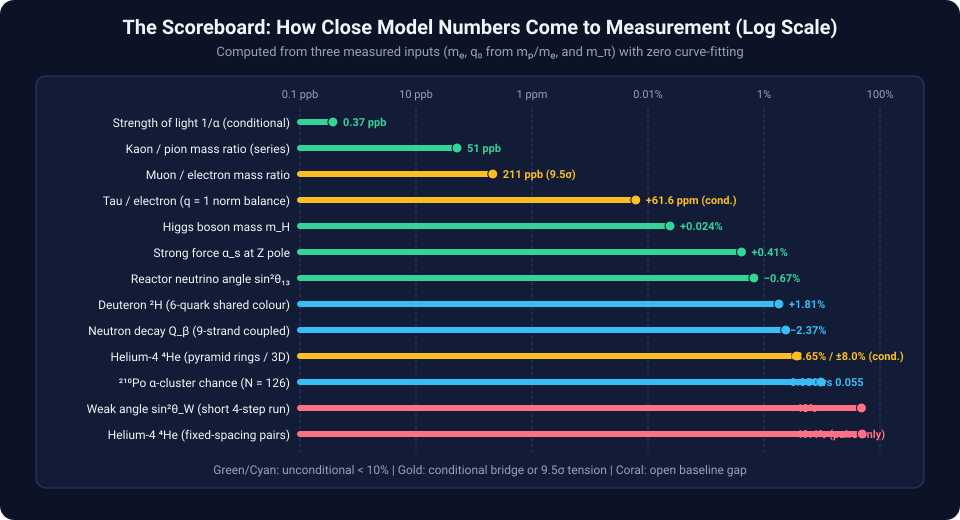

### 9.1 Unified Comparison With Laboratory Measurement

| Physical Quantity | Model Value | Measured Value | Difference & Scope Note |
|:------------------|:------------|:---------------|:------------------------|
| **Inverse fine-structure constant ($1/\alpha$)** | $137.035999127$ | $137.035999177(21)$ | **$0.37\;\mathrm{ppb}$**; conditional on an unproved loop-weight step |
| **Kaon-to-pion mass ratio ($m_K / m_\pi$)** | $3.537119$ | $3.537118$ | **$51\;\mathrm{ppb}$**; includes a truncated series correction |
| **Muon-to-electron mass ratio ($m_\mu / m_e$)** | $206.7683264$ | $206.7682827(46)$ | **$211\;\mathrm{ppb}$** ($9.5\sigma$ live tension between muon & proton $q_0$) |
| **Higgs boson mass ($m_H$)** | $125.23\;\mathrm{GeV}$ | $125.20 \pm 0.11\;\mathrm{GeV}$ | **$+0.024\%$** ($+0.27\sigma$) |
| **Strong force coupling at $Z$ pole ($\alpha_s(M_Z)$)** | $0.1185$ | $0.1180 \pm 0.0009$ | **$+0.41\%$** ($+0.54\sigma$, evolved from $m_p(q_0^2 - 1)$) |
| **Reactor neutrino mixing ($\sin^2\theta_{13}$)** | $0.02185$ | $0.0220 \pm 0.0007$ | **$-0.67\%$** ($-0.21\sigma$, from $\frac{1}{2}(q_0 - 1/q_0)^2$) |
| **Neutrino mass scale ($12$ weak steps)** | $12.5\text{–}17.6\;\mathrm{meV}$ | $8.68\text{–}49.5\;\mathrm{meV}$ window | **Inside oscillation window** (2-step solar loop: $9.12\;\mathrm{meV}$, $+5.1\%$) |
| **Deuteron (${}^2\mathrm{H}$) binding** | $2.265\;\mathrm{MeV}$ ($6q$ shared) / $2.86\;\mathrm{MeV}$ (unshared) | $2.2246\;\mathrm{MeV}$ | **$+1.81\%$** with 6-quark colour sharing ($+29\%$ unshared baseline) |
| **Neutron decay energy ($Q_\beta$)** | $0.764\;\mathrm{MeV}$ ($9$-strand) / $0.33\;\mathrm{MeV}$ ($3$-strand) | $0.7823\;\mathrm{MeV}$ | **$-2.37\%$** coupled 9-strand log readout ($-58\%$ isolated 3-strand) |
| **Proton–neutron electric split ($\Delta E_{\mathrm{EM}}$)** | $0.761\;\mathrm{MeV}$ (no $m_\pi$ used) | $0.76\text{–}1.04\;\mathrm{MeV}$ | **Inside empirical range** (isolated total $m_n - m_p$ baseline: $0.84$ vs. $1.29\;\mathrm{MeV}$, $-35\%$) |
| **Nuclear clustering stability region** | Region $\mathcal{C}_{\mathrm{phys}}$ ($1$ of $73$) | Region $\mathcal{C}_{\mathrm{phys}}$ (AME2020) | **Exact region match** (${}^5\mathrm{He} \to \alpha + n$ breakup, $3\alpha \to {}^{12}\mathrm{C}$, closed shells) |
| **Polonium-210 $\alpha$-formation ($N = 126$)** | $0.0500$ ($153\;\mathrm{days}$) | $0.0553$ ($138.4\;\mathrm{days}$) | **$-0.044\;\mathrm{dex}$** ($1/20$ closed-shell slot count; confirms $q \to 1$ in vacuum) |
| **Atomic-to-nuclear chemical lock ($\eta_2$)** | $1.77 \times 10^{-6}$ ($E_F^* = 1.293\;\mathrm{MeV}$) | Nuclei conserved in chemistry | **Proved** across 5-layer tower; flips to neutron matter in dense stars |
| **Weak mixing angle at $Z$ pole ($\sin^2\theta_W(M_Z)$)** | $0.342$ (bare 4-step evolution) | $0.23122$ | **$+48\%$ discrepancy** without intermediate threshold structure |
| **Triton (${}^3\mathrm{H}$) & Lithium-7 (${}^7\mathrm{Li}$) binding** | $6.20\;\mathrm{MeV}$ & $18.0\;\mathrm{MeV}$ | $8.48\;\mathrm{MeV}$ & $39.3\;\mathrm{MeV}$ | **$-27\%$ & $-54\%$** (asserted single-channel baseline formula) |
| **Helium-4 (${}^4\mathrm{He}$) binding** | $14.49\;\mathrm{MeV}$ ($12q$) / $8.77\;\mathrm{MeV}$ (baseline) | $28.30\;\mathrm{MeV}$ | **$-49\%$ / $-69\%$** (missing 4-way spin & proton/neutron swap symmetry) |

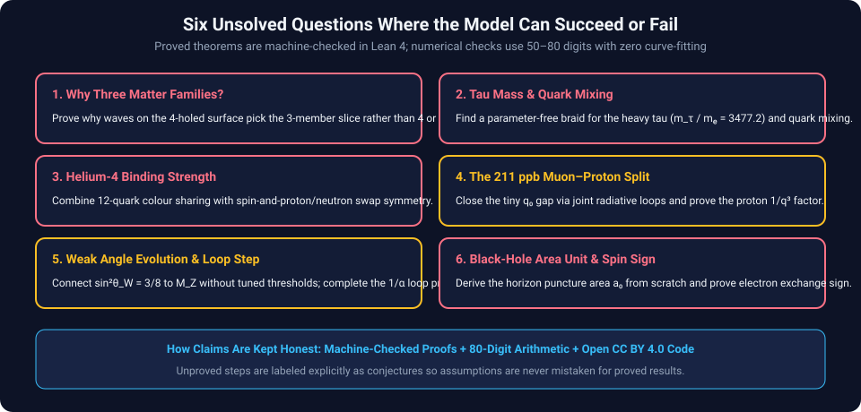

### 9.2 Six Major Unsolved Questions

1. **Why three families of matter?** Four wave modes on the four-holed surface split into $3 + 1$ under four-coordinate symmetry, whereas other symmetry slices give $4$, $3$, or $2$; no theorem yet forces left-handed matter to select the $3$-mode slice unconditionally.
2. **The heavy tau mass and quark mixing:** Tested parameter-free knot formulas for $m_\tau / m_e = 3477.23$ miss by $-31\%$ to $+68\%$, and the four quark-mixing parameters lack a derived flavor basis.
3. **Full nuclear binding strength (${}^4\mathrm{He}$ and beyond):** Shared 12-quark colour pairings lift helium-4 to $14.49\;\mathrm{MeV}$, still roughly half of the measured $28.30\;\mathrm{MeV}$ until joint spin-and-charge-partner swap symmetry and the overall energy-scale map are derived.
4. **The 211-part-per-billion muon–proton gap and the proton's $1/q_0^3$ factor:** Closing the $9.5\sigma$ offset between the muon and proton values of $q_0$ requires a joint radiative loop calculation, and the $1/q_0^3$ power in Equation (3) still needs a first-principles derivation.
5. **Weak mixing evolution and the $1/\alpha$ loop weight:** Connecting $\sin^2\theta_W^0 = 3/8$ to $0.23122$ at $M_Z$ simultaneously with $\alpha_s(M_Z) = 0.1185$ without tuned thresholds—and completing the formal proof of the loop weight in Equation (6)—are both unfinished.
6. **Black-hole puncture area $a_0$ and electron exchange sign:** Deriving the absolute area $a_0$ of one horizon strand puncture without matching Bekenstein–Hawking's $A / 4\ell_P^2$, deriving Einstein's gravitational equations, and proving why swapping two Hopf-link electrons flips quantum sign are all unsolved.

### 9.3 How Anyone Can Audit or Challenge the Model

Every theorem, explicit conjecture, and high-precision calculation behind this survey lives openly at [`github.com/litlfred/qou`](https://github.com/litlfred/qou) under Creative Commons Attribution 4.0:

- **Computer-checked mathematics:** Every theorem marked as proved is verified by the Lean 4 proof checker from foundational logic, while unproved physical bridges are labeled explicitly as conjectures so assumptions cannot hide inside proofs.
- **High-precision arithmetic without rounding drift:** Numerical comparisons run at $50$ to $80$ decimal digits with candidate formulas written down before comparing against experimental tables.
- **Open participation:** Any reader can fork the repository, inspect the proofs and scripts with a language model or proof assistant, and test an idea; contributors whose pull requests fix an error or derive an unsolved step earn co-authorship on the monograph. Because zero curve-fitting is allowed, the mathematics will either close its remaining gaps cleanly or show us exactly where it breaks.
